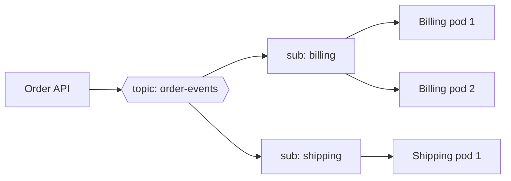
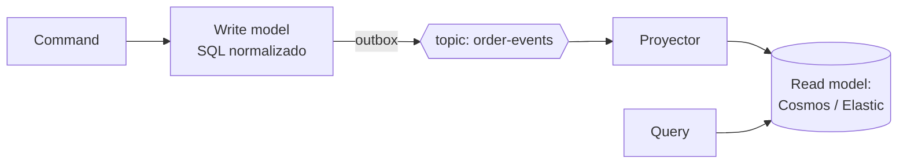

# 08 - Patrones de arquitectura

> Mensajería en sistemas distribuidos: qué patrón resuelve qué problema y qué coste añade.

## Contenido
- [[#Event-Driven Architecture]]
- [[#Commands vs Events]]
- [[#Publisher Subscriber]]
- [[#Competing Consumers]]
- [[#Outbox Pattern]]
- [[#Inbox Pattern]]
- [[#Saga Pattern]]
- [[#Eventual Consistency]]
- [[#CQRS]]
- [[#Circuit Breaker]]
- [[#Claim Check Pattern]]
- [[#Versionado de mensajes]]
- [[#Frameworks de mensajeria NET]]

> [!info] Cómo leer esta nota
> Cada patrón responde a un **problema concreto** creado por la mensajería asíncrona. Si no tienes ese problema, el patrón es coste sin beneficio. Esa es la parte que se suele omitir y la que más se valora en una entrevista de arquitecto.
>
> Esta nota se centra en **cómo se implementan con Service Bus**. La teoría general, independiente del broker, está en [[🏗️ Diseño de Microservicios]], [[Transactional Outbox]], [[Saga Pattern]], [[CQRS (Command Query Responsibility Segregation)|CQRS]], [[Event Sourcing]], [[Circuit Breaker]], [[Retry con Backoff Exponencial]] e [[Idempotencia]].

---

## Event-Driven Architecture
### ¿Qué es?
Estilo de arquitectura en el que los componentes se comunican **emitiendo hechos** ("ocurrió X") en lugar de llamarse entre sí ("haz X"). Quien emite no sabe quién reacciona.

### ¿Qué problema resuelve?
- **Acoplamiento temporal**: el emisor no necesita que el receptor esté disponible ([[01 - Fundamentos y arquitectura#Comunicacion sincrona vs asincrona|Comunicacion sincrona vs asincrona]]).
- **Acoplamiento de conocimiento**: añadir un consumidor nuevo (p. ej. Analytics) no exige tocar al productor.
- **Picos de carga**: el broker absorbe la diferencia entre ritmo de producción y de consumo.

### Lo que cuesta (la parte incómoda)
| Coste | Por qué | Mitigación |
|---|---|---|
| Consistencia eventual | El estado se propaga con retraso | [[#Eventual Consistency]] + UX que lo asuma |
| Flujo de negocio implícito | Nadie "ve" el proceso completo; está repartido entre consumidores | Trazas distribuidas, documentar flujos, orquestación cuando crece ([[#Saga Pattern]]) |
| Depuración difícil | Un fallo aparece lejos de su causa | [[09 - Produccion y operacion#Observabilidad con Application Insights|Observabilidad con Application Insights]], `CorrelationId` |
| Duplicados y desorden | At-least-once, consumidores concurrentes | [[03 - Confiabilidad y manejo de errores#Idempotent Consumer|Idempotent Consumer]], [[03 - Confiabilidad y manejo de errores#Sessions|Sessions]] |
| Contratos como API pública | Cambiar un evento rompe a consumidores que no conoces | [[#Versionado de mensajes]] |

### Tres sabores de evento (Martin Fowler los distingue; mezclarlos causa confusión)
| Tipo | Contenido | Ventaja | Riesgo |
|---|---|---|---|
| **Event notification** | Mínimo: `OrderPlaced { OrderId }` | Contrato estable, pequeño | El consumidor llama de vuelta al productor → reaparece el acoplamiento síncrono |
| **Event-carried state transfer** | Datos suficientes: `OrderPlaced { OrderId, Lines, Total, CustomerId }` | Consumidor autónomo | Contrato más grande y más difícil de evolucionar; datos duplicados |
| **Event sourcing** | Los eventos **son** la fuente de verdad | Auditoría y reconstrucción | Complejidad alta. Service Bus **no** es un event store (no hay replay: un mensaje completado desaparece) |

> [!warning] Service Bus no es un log
> Si necesitas releer el histórico de eventos (replay, nuevos consumidores que procesen desde el principio), Service Bus no sirve: usa Event Hubs/Kafka o un event store y, si hace falta, publica desde ahí a Service Bus. Ver [[01 - Fundamentos y arquitectura#Message Broker|Message Broker]].

### Cuándo NO usarla
- CRUD simple con un único consumidor y necesidad de respuesta inmediata.
- Equipos sin capacidad de operar mensajería (DLQ, métricas, reprocesado): el coste operativo es real.
- Cuando el usuario necesita el resultado en la misma petición y no hay forma razonable de diseñar la UX asíncrona.

### Relación
[[#Commands vs Events]] · [[#Publisher Subscriber]] · [[#Saga Pattern]] · [[#Eventual Consistency]]

---

## Commands vs Events
### Definiciones
| | Command | Event |
|---|---|---|
| Semántica | "Haz X" (petición, puede rechazarse) | "Ocurrió X" (hecho, no se puede rechazar) |
| Nombre | Imperativo: `ReserveStock`, `ChargePayment` | Pasado: `StockReserved`, `PaymentFailed` |
| Destinatarios | **Uno** (un servicio dueño) | **Cero o muchos** |
| Quién define el contrato | El receptor | El emisor |
| Entidad en Service Bus | **Queue** | **Topic** + subscriptions |
| Acoplamiento | El emisor conoce al receptor y su intención | El emisor no conoce a nadie |

### Regla práctica
- Si el emisor **necesita** que algo concreto ocurra y le importa quién lo hace → command a una queue.
- Si el emisor solo informa y no le importa quién reacciona → event a un topic.

### Errores comunes
- **Comandos disfrazados de eventos**: `SendWelcomeEmailRequested` publicado en un topic. Si solo hay un destinatario legítimo y el emisor espera que ocurra, es un comando. Llamarlo evento oculta la dependencia.
- **Eventos con nombre en imperativo** o eventos que contienen instrucciones para un consumidor concreto.
- **Un topic donde todo el mundo publica comandos** filtrados por `To`: reinventa queues con más coste de filtros.
- **Request/response sobre mensajería** para algo que debería ser HTTP. Si es necesario, usa `ReplyTo` + `CorrelationId` (o `ReplyToSessionId` con sesiones), pero asume la complejidad.

### Request/Reply con Service Bus (cuando de verdad hace falta)
```csharp
var request = new ServiceBusMessage(BinaryData.FromObjectAsJson(query))
{
    MessageId = Guid.NewGuid().ToString(),
    ReplyTo = "pricing-replies",
    ReplyToSessionId = instanceId          // cada instancia escucha su propia sesión
};
await requestSender.SendMessageAsync(request, ct);

await using var replyReceiver = await client.AcceptSessionAsync("pricing-replies", instanceId, cancellationToken: ct);
var reply = await replyReceiver.ReceiveMessageAsync(TimeSpan.FromSeconds(10), ct); // null = timeout
```
La queue de respuestas necesita `RequiresSession = true`. Si el receptor tarda más que el timeout, la respuesta llega a una sesión que nadie lee: ponle TTL corto.

### Pregunta de entrevista
*¿Por qué `OrderPlaced` va a un topic y `ChargePayment` a una queue?* → `OrderPlaced` es un hecho del dominio de Orders que interesa a varios servicios que Orders no debe conocer. `ChargePayment` es una petición con un único dueño (Payments), que puede rechazarla, y cuyo contrato define Payments.

### Relación
[[#Event-Driven Architecture]] · [[01 - Fundamentos y arquitectura#Namespace y entidades|Namespace y entidades]] · [[#Saga Pattern]]

---

## Publisher Subscriber
### ¿Qué es?
Un productor publica una vez y **cada suscriptor recibe su propia copia**. En Service Bus: un topic con una subscription por servicio interesado. Detalle de mecánica en [[02 - Queues y Topics#Topics y Subscriptions|Topics y Subscriptions]].

### Pub/Sub + Competing Consumers (la combinación real)

Entre subscriptions: **copia**. Dentro de una subscription: **competencia** entre réplicas del mismo servicio.

### Decisiones de diseño
| Decisión | Opción A | Opción B | Criterio |
|---|---|---|---|
| Granularidad del topic | Uno por bounded context (`order-events`) | Uno por tipo de evento (`order-placed`) | A: menos entidades, filtros por `Subject`. B: permisos y escalado más finos, más entidades |
| Quién crea la subscription | El consumidor (en su IaC) | Un equipo de plataforma | El consumidor es el dueño de su subscription; el productor no debe saber que existe |
| Filtro | Correlation filter por `Subject` | SQL filter | Correlation es más barato; SQL solo si necesitas expresiones ([[02 - Queues y Topics#Filters y Rules|Filters y Rules]]) |

### Riesgo operativo clásico
Una subscription **abandonada** (servicio dado de baja) sigue acumulando copias hasta llenar la cuota del topic, y entonces **el productor deja de poder publicar para todos**. Mitigación: `AutoDeleteOnIdle` en subscriptions temporales, alerta de `ActiveMessages` por subscription y limpieza en el proceso de baja de servicios.

### Relación
[[02 - Queues y Topics#Topics y Subscriptions|Topics y Subscriptions]] · [[#Competing Consumers]] · [[#Commands vs Events]]

---

## Competing Consumers
### ¿Qué es?
Varias instancias leen de **la misma** queue/subscription; cada mensaje lo procesa solo una. Es el modelo de escalado horizontal por defecto de Service Bus.

### Qué te da
- Escalado lineal del throughput **hasta el cuello de botella real** (normalmente la BD).
- Tolerancia a fallos: si una instancia muere, los locks expiran y otra recoge sus mensajes.
- Balanceo implícito: quien está libre pide más.

### Qué te quita
- **Orden de procesamiento**: el broker entrega en orden, pero el consumidor A puede tardar más que B. Si necesitas orden por clave → [[03 - Confiabilidad y manejo de errores#Sessions|Sessions]].
- Visibilidad simple: un mismo flujo se reparte entre instancias → trazas distribuidas.

### Escalado automático
| Plataforma | Mecanismo | Nota |
|---|---|---|
| AKS / Container Apps | **KEDA** scaler `azure-servicebus` | Escala por longitud de queue/subscription (`messageCount`). Con workload identity no necesitas connection string |
| Azure Functions | Trigger de Service Bus con escalado del plan | Settlement manual con `ServiceBusMessageActions` (`AutoCompleteMessages = false`) |
| App Service / VMs | Autoscale por métrica `ActiveMessages` | Más lento de reaccionar |

```yaml
# KEDA ScaledObject (resumen)
triggers:
- type: azure-servicebus
  metadata:
    namespace: sb-orders-prod
    topicName: order-events
    subscriptionName: billing
    messageCount: "50"        # objetivo de mensajes por réplica
  authenticationRef:
    name: keda-sb-workload-identity
```

### Límites que aparecen al escalar
- **5 000 receive requests concurrentes por entidad** (sumando todas las subscriptions de un topic): cientos de pods × `MaxConcurrentCalls` alto llegan a `ServiceBusy` ([[10 - Troubleshooting#Troubleshooting - Throttling y ServerBusy|Throttling y ServerBusy]]).
- **5 000 conexiones AMQP por namespace**: un `ServiceBusClient` por pod, no por request.
- La dependencia aguas abajo: 50 réplicas × 16 = 800 consultas concurrentes a SQL.

### Relación
[[05 - Seguridad y performance#Performance tuning|Performance tuning]] · [[04 - NET y entorno local#ServiceBusProcessor|ServiceBusProcessor]] · [[#Publisher Subscriber]]

---

## Outbox Pattern
### Problema: el dual write
```csharp
await db.SaveChangesAsync();            // 1. pedido guardado
await sender.SendMessageAsync(evt);     // 2. el proceso muere aquí → evento perdido
```
O al revés: publicas primero y la BD falla → evento de algo que no existe. No hay transacción que abarque SQL y Service Bus ([[03 - Confiabilidad y manejo de errores#Transactions|Transactions]]: Service Bus no participa en 2PC).

### Solución
Escribir el mensaje en una tabla **Outbox** dentro de la **misma transacción de BD** que el cambio de negocio. Un proceso aparte (relay) lee la tabla y publica.

```mermaid
sequenceDiagram
    participant API as Order API
    participant DB as SQL (Orders + Outbox)
    participant R as Outbox Relay
    participant SB as Service Bus
    API->>DB: BEGIN; INSERT Order; INSERT OutboxMessage; COMMIT
    loop cada N ms
        R->>DB: SELECT pendientes (UPDLOCK, READPAST)
        R->>SB: Send (MessageId = Outbox.Id)
        R->>DB: UPDATE ProcessedAt
    end
```

### Implementación con EF Core
```csharp
public class OutboxMessage
{
    public Guid Id { get; init; } = Guid.NewGuid();      // será el MessageId
    public string Type { get; init; } = default!;        // → Subject
    public string Payload { get; init; } = default!;     // JSON
    public string? CorrelationId { get; init; }
    public DateTime OccurredAt { get; init; } = DateTime.UtcNow;
    public DateTime? ProcessedAt { get; set; }
    public int Attempts { get; set; }
    public string? LastError { get; set; }
}

// En el caso de uso: una sola transacción (SaveChanges ya es transaccional)
order.Place();
db.Orders.Add(order);
db.Outbox.Add(new OutboxMessage
{
    Type = nameof(OrderPlaced),
    Payload = JsonSerializer.Serialize(new OrderPlaced(order.Id, order.Total)),
    CorrelationId = Activity.Current?.TraceId.ToString()
});
await db.SaveChangesAsync(ct);
```

### Relay
```csharp
public sealed class OutboxRelay(IServiceScopeFactory scopes, ServiceBusSender sender, ILogger<OutboxRelay> log)
    : BackgroundService
{
    protected override async Task ExecuteAsync(CancellationToken ct)
    {
        using var timer = new PeriodicTimer(TimeSpan.FromMilliseconds(500));
        while (await timer.WaitForNextTickAsync(ct))
        {
            await using var scope = scopes.CreateAsyncScope();
            var db = scope.ServiceProvider.GetRequiredService<OrdersDbContext>();
            await using var tx = await db.Database.BeginTransactionAsync(ct);

            // READPAST: varias réplicas del relay no se pisan
            var batch = await db.Outbox
                .FromSql($"SELECT TOP (100) * FROM Outbox WITH (UPDLOCK, READPAST, ROWLOCK) WHERE ProcessedAt IS NULL ORDER BY OccurredAt")
                .ToListAsync(ct);

            foreach (var m in batch)
            {
                try
                {
                    await sender.SendMessageAsync(new ServiceBusMessage(m.Payload)
                    {
                        MessageId = m.Id.ToString(),        // determinista → Duplicate Detection
                        Subject = m.Type,
                        CorrelationId = m.CorrelationId,
                        ContentType = "application/json"
                    }, ct);
                    m.ProcessedAt = DateTime.UtcNow;
                }
                catch (ServiceBusException ex) when (ex.IsTransient)
                {
                    m.Attempts++; m.LastError = ex.Message;
                    break;                                  // reintenta en el siguiente tick, conserva orden
                }
            }
            await db.SaveChangesAsync(ct);
            await tx.CommitAsync(ct);
        }
    }
}
```
> [!note] Por qué hay duplicados aun así
> Si el relay publica y muere antes del `COMMIT` que marca `ProcessedAt`, volverá a publicar. Por eso: `MessageId = Outbox.Id` (lo filtra [[03 - Confiabilidad y manejo de errores#Duplicate Detection|Duplicate Detection]] si cae dentro de la ventana) **y** consumidores idempotentes (lo filtran siempre). El outbox garantiza *at-least-once* en publicación, no *exactly-once*.

### Variantes del relay
| Variante | Latencia | Complejidad | Nota |
|---|---|---|---|
| Polling (arriba) | 100 ms–segundos | Baja | La más común; vigila la carga de la consulta |
| Polling + "nudge" en memoria tras `SaveChanges` | Baja | Media | El polling queda como red de seguridad |
| CDC (Change Data Capture / Debezium) | Baja | Alta | Infraestructura adicional |
| Framework (MassTransit, NServiceBus, Wolverine) | Baja | Baja en código, dependencia externa | Ver [[#Frameworks de mensajeria NET]] |

### Operación
- **Purga**: borra filas procesadas con más antigüedad que la ventana de reprocesado (p. ej. 7 días) en lotes.
- **Métrica**: antigüedad de la fila pendiente más vieja. Si crece, el relay está caído o Service Bus rechaza.
- **Orden**: con una réplica del relay y `ORDER BY OccurredAt`, el orden de publicación se aproxima al de commit, pero no está garantizado entre transacciones concurrentes. Si el orden importa, usa `SessionId` y que el consumidor tolere huecos.

### Cuándo no merece la pena
- Si perder un evento ocasional es aceptable (telemetría, notificaciones no críticas).
- Si el estado de verdad **es** el mensaje (no hay BD local que modificar): basta con enviar.

### Relación
Teoría general: [[Transactional Outbox]] · [[#Inbox Pattern]] · [[03 - Confiabilidad y manejo de errores#Transactions|Transactions]] · [[03 - Confiabilidad y manejo de errores#At-least-once delivery|At-least-once delivery]] · [[06 - Laboratorios#Lab 13 - Outbox con EF Core|Lab 13 - Outbox con EF Core]]

### Pregunta de entrevista
*¿El outbox elimina los duplicados?* → No. Elimina la **pérdida** (y los eventos fantasma). Introduce un duplicado posible en el relay, que se cubre con `MessageId` determinista + idempotencia del consumidor.

---

## Inbox Pattern
### ¿Qué es?
La contraparte del outbox en el lado consumidor: registrar en la **misma transacción de BD** que el efecto de negocio que el mensaje ya se procesó. Es la técnica 2 de [[03 - Confiabilidad y manejo de errores#Idempotent Consumer|Idempotent Consumer]] formalizada como patrón.

### Dos variantes
| Variante | Cómo | Cuándo |
|---|---|---|
| **Inbox de deduplicación** (la habitual) | Tabla `ProcessedMessages(Consumer, MessageId)` con PK; se inserta junto al efecto | Casi siempre |
| **Inbox de almacenamiento** | El consumidor guarda el mensaje en la tabla Inbox, completa en Service Bus de inmediato y un proceso local lo ejecuta después | Cuando el handler es largo (> lock) o quieres desacoplar recepción de procesamiento |

### Inbox + Outbox en el mismo servicio
```csharp
await using var tx = await db.Database.BeginTransactionAsync(ct);
db.ProcessedMessages.Add(new("inventory", msg.MessageId, DateTime.UtcNow)); // inbox
product.Reserve(cmd.Quantity, cmd.OrderId);                                   // efecto
db.Outbox.Add(OutboxMessage.From(new StockReserved(cmd.OrderId)));            // outbox
await db.SaveChangesAsync(ct);   // PK duplicada → DbUpdateException → ya procesado
await tx.CommitAsync(ct);
await args.CompleteMessageAsync(args.Message, ct);
```
Resultado: el efecto, la deduplicación y el evento siguiente son atómicos. Es la base de una cadena *effectively-once* entre servicios.

### Límites
- Solo cubre efectos en **tu** BD. Para APIs externas necesitas idempotency keys.
- La tabla crece: purga por antigüedad mayor que TTL máximo + ventana de reprocesado de DLQ. Si purgas antes y alguien reprocesa la DLQ, el mensaje se procesará otra vez.

### Relación
[[#Outbox Pattern]] · [[03 - Confiabilidad y manejo de errores#Idempotent Consumer|Idempotent Consumer]]

---

## Saga Pattern
### Problema
Un proceso de negocio abarca varios servicios con BD propias (Order, Payment, Inventory). No hay transacción distribuida. Si el paso 3 falla, los pasos 1 y 2 ya están confirmados.

### Solución
Secuencia de transacciones locales; cada una publica un mensaje que dispara la siguiente. Si una falla, se ejecutan **compensaciones** que deshacen semánticamente lo anterior (`RefundPayment`, `ReleaseStock`). No es un rollback: el cobro ocurrió y luego se devolvió, y eso queda visible.

### Coreografía vs orquestación
| | Coreografía | Orquestación |
|---|---|---|
| Control | Cada servicio reacciona a eventos | Un orquestador envía comandos y escucha respuestas |
| Estado del proceso | Repartido | Centralizado (tabla de saga o session state) |
| Acoplamiento | Bajo entre servicios, alto al flujo implícito | Servicios desacoplados entre sí; acoplados al orquestador |
| Visibilidad | Difícil ("¿en qué paso está el pedido 42?") | Una consulta |
| Escala bien hasta | 3-4 pasos | Procesos largos y con ramas |
| En Service Bus | Topics + subscriptions | Queue de comandos por servicio + topic/queue de respuestas, sesión por `OrderId` |

Regla práctica: empieza con coreografía si el flujo es corto y estable; pasa a orquestación cuando necesites timeouts, ramas o responder a "¿en qué estado está?".

### Orquestador con Service Bus Sessions
Sesión = `OrderId`. Garantiza que los mensajes de un mismo pedido se procesan **en serie** por un único orquestador, y el estado puede guardarse en el session state o en BD.
```csharp
processor.ProcessMessageAsync += async args =>
{
    var state = await LoadStateAsync(args) ?? new OrderSagaState(args.SessionId);
    var outgoing = new List<ServiceBusMessage>();

    switch (args.Message.Subject)
    {
        case nameof(OrderPlaced):
            state.Status = SagaStatus.AwaitingPaymentAndStock;
            outgoing.Add(Command(new ChargePayment(state.OrderId, state.Total)));
            outgoing.Add(Command(new ReserveStock(state.OrderId, state.Lines)));
            outgoing.Add(Timeout(state.OrderId, TimeSpan.FromMinutes(15)));      // scheduled message
            break;
        case nameof(PaymentSucceeded): state.PaymentOk = true; break;
        case nameof(StockReserved):    state.StockOk = true;   break;
        case nameof(PaymentFailed):
            state.Status = SagaStatus.Compensating;
            if (state.StockOk) outgoing.Add(Command(new ReleaseStock(state.OrderId)));
            break;
        case nameof(StockRejected):
            state.Status = SagaStatus.Compensating;
            if (state.PaymentOk) outgoing.Add(Command(new RefundPayment(state.OrderId)));
            break;
        case "SagaTimeout" when !state.IsFinished:
            state.Status = SagaStatus.Compensating; /* compensar lo que esté hecho */ break;
    }
    if (state.PaymentOk && state.StockOk) state.Status = SagaStatus.Confirmed;

    // Envío + session state + complete atómicos (mismo namespace)
    using (var ts = new TransactionScope(TransactionScopeAsyncFlowOption.Enabled))
    {
        await commandSender.SendMessagesAsync(outgoing, args.CancellationToken);
        await args.SetSessionStateAsync(BinaryData.FromObjectAsJson(state), args.CancellationToken);
        await args.CompleteMessageAsync(args.Message, args.CancellationToken);
        ts.Complete();
    }
};
```
Requiere `EnableCrossEntityTransactions` y que la primera operación del cliente sea sobre la entidad de recepción ([[03 - Confiabilidad y manejo de errores#Transactions|Transactions]]). El timeout usa [[02 - Queues y Topics#Scheduled Messages|Scheduled Messages]].

### Reglas de diseño
1. **Las compensaciones también son mensajes at-least-once**: deben ser idempotentes (`RefundPayment` dos veces no devuelve dos veces).
2. **Pivot transaction**: identifica el paso a partir del cual ya no se compensa sino que se reintenta hasta el final (p. ej. tras enviar el paquete).
3. **Orden de pasos**: lo más probable que falle o lo más fácil de compensar primero (reservar stock antes que cobrar).
4. **Timeouts explícitos**: un servicio caído no debe dejar la saga colgada para siempre.
5. **Estados intermedios visibles**: el pedido está `Pending`, no `Confirmed`, hasta el final. Es la cara de usuario de [[#Eventual Consistency]].

### Cuándo NO usar una saga
- Si todos los datos pueden vivir en un mismo servicio y una BD: una transacción local es más simple y correcta.
- Si el negocio tolera inconsistencia y corrección manual ocasional (con alertas).

### Relación
Teoría general: [[Saga Pattern]] · [[#Commands vs Events]] · [[03 - Confiabilidad y manejo de errores#Sessions|Sessions]] · [[#Outbox Pattern]] · [[06 - Laboratorios#Lab 14 - Saga con compensacion|Lab 14 - Saga con compensacion]]

### Pregunta de entrevista
*¿Qué pasa si la compensación también falla?* → Se reintenta (es un mensaje con DLQ). Si acaba en DLQ, es un incidente de negocio que requiere intervención humana: alerta específica, runbook y estado `CompensationFailed` visible. Una saga no elimina los fallos, los hace explícitos.

---

## Eventual Consistency
### ¿Qué es?
Garantía de que, si dejan de llegar cambios, todas las réplicas o servicios **acabarán** en el mismo estado. No dice cuándo.

### Por qué aparece con Service Bus
Cada servicio confirma su transacción local y publica. El resto se entera después: milisegundos con buena salud, horas si un consumidor está caído o los mensajes están en la DLQ.

### Cómo se diseña (no basta con aceptarlo)
| Técnica | Ejemplo |
|---|---|
| Estados intermedios explícitos | `Pending → Confirmed / Cancelled` |
| `202 Accepted` + recurso consultable | `Location: /orders/42` con estado actual |
| Notificar el resultado | SignalR/webhook/email cuando la saga termina |
| Read-your-writes en el servicio dueño | El usuario consulta Orders, no la proyección de Reporting |
| SLO de propagación | "El 99 % de los pedidos confirmados en < 5 s"; mídelo |
| Reconciliación | Job que compara fuentes y detecta divergencias que se escaparon |

### Errores comunes
- Asumir que "eventual" significa "rápido": el peor caso lo define tu DLQ y tu tiempo de reacción.
- Mostrar al usuario datos de una proyección justo después de escribir → "lo guardé y no aparece".
- No tener reconciliación: un mensaje en DLQ olvidado es una inconsistencia permanente.

### Relación
[[#Saga Pattern]] · [[#CQRS]] · [[03 - Confiabilidad y manejo de errores#Dead Letter Queue|Dead Letter Queue]]

---

## CQRS
### ¿Qué es?
Command Query Responsibility Segregation: separar el modelo de **escritura** (reglas de negocio, consistencia) del de **lectura** (consultas optimizadas). En su forma "con mensajería", las escrituras publican eventos y uno o varios **proyectores** actualizan modelos de lectura.



### Cuándo merece la pena
- Lecturas y escrituras con forma o escala muy distintas (dashboards, búsqueda, agregados).
- Varios modelos de lectura del mismo dato.

### Cuándo no
- CRUD. CQRS duplica modelos, código y operación; la mayoría de sistemas no lo necesitan.
- No confundir con "tener `Commands/` y `Queries/` en carpetas con MediatR": eso es organización de código, no CQRS con mensajería.

### Detalles con Service Bus
- El proyector debe ser idempotente y tolerar **desorden**: guarda la versión del agregado en la proyección y descarta eventos con versión menor o igual (`if (evt.Version <= row.Version) return;`).
- Reconstruir una proyección **no** es posible desde Service Bus (no hay replay): necesitas reconstruirla desde el write model o desde un event store.

### Relación
Teoría general: [[CQRS (Command Query Responsibility Segregation)|CQRS]] · [[Event Sourcing]] · [[#Eventual Consistency]] · [[#Event-Driven Architecture]] · [[#Outbox Pattern]]

---

## Circuit Breaker
### Problema
La dependencia del handler (API de pagos, SQL) cae. Con mensajería, cada mensaje fallará, se reintentará y acabará en la DLQ en minutos: **vacías la cola contra un muro** y conviertes una caída temporal en miles de mensajes que reprocesar.

### Solución con Service Bus: dejar de consumir
El circuit breaker de un consumidor no rechaza peticiones; **pausa la recepción** para que los mensajes esperen en la cola (que es exactamente para lo que existe).
```csharp
public sealed class ConsumerCircuitBreaker(ServiceBusProcessor processor, ILogger log)
{
    private int _consecutiveFailures;
    private int _open; // 0 cerrado, 1 abierto

    public void OnSuccess() => Interlocked.Exchange(ref _consecutiveFailures, 0);

    public async Task OnTransientFailureAsync()
    {
        if (Interlocked.Increment(ref _consecutiveFailures) < 10) return;
        if (Interlocked.CompareExchange(ref _open, 1, 0) != 0) return;

        log.LogWarning("Circuito abierto: se pausa el consumo 60 s");
        _ = Task.Run(async () =>
        {
            await processor.StopProcessingAsync();     // no llamar con await desde dentro del handler
            await Task.Delay(TimeSpan.FromSeconds(60));
            Interlocked.Exchange(ref _consecutiveFailures, 0);
            Interlocked.Exchange(ref _open, 0);
            await processor.StartProcessingAsync();    // half-open: el siguiente fallo vuelve a abrir
        });
    }
}
```
> [!warning] `StopProcessingAsync` espera a que terminen los handlers en curso
> Si lo llamas con `await` desde dentro de `ProcessMessageAsync`, el handler espera a que el processor pare, y el processor espera al handler: interbloqueo. Lánzalo fuera, como arriba.

### Combinación con las capas de retry
- Polly/resilience handler con un reintento corto **dentro** del handler.
- Circuit breaker **del consumidor** (pausar) cuando la dependencia está claramente caída.
- Backoff por reprogramación para fallos aislados ([[03 - Confiabilidad y manejo de errores#Retry Policies|Retry Policies]]).
- Abandon/DLQ solo para lo que no es transitorio.

### Relación
Teoría general: [[Circuit Breaker]] · [[Retry con Backoff Exponencial]] · [[03 - Confiabilidad y manejo de errores#Retry Policies|Retry Policies]] · [[03 - Confiabilidad y manejo de errores#Poison Messages|Poison Messages]] · [[06 - Laboratorios#Lab 08 - Retry|Lab 08 - Retry]]

---

## Claim Check Pattern
### Problema
El payload supera el límite (256 KB en Standard, 1 MB por defecto en Premium) o es grande y encarece (en Standard se factura en bloques de 64 KB) y ralentiza el broker.

### Solución
Guardar el payload en un almacén (Blob Storage) y enviar en el mensaje solo una **referencia** ("claim check").
```csharp
// Productor
var blobName = $"{orderId}/{Guid.NewGuid()}.json";
await container.GetBlobClient(blobName).UploadAsync(BinaryData.FromObjectAsJson(bigPayload), ct);

var msg = new ServiceBusMessage(BinaryData.FromObjectAsJson(new { OrderId = orderId }))
{
    MessageId = $"invoice-{orderId}",
    Subject = "InvoiceGenerated"
};
msg.ApplicationProperties["claim-check"] = blobName;
await sender.SendMessageAsync(msg, ct);

// Consumidor
if (args.Message.ApplicationProperties.TryGetValue("claim-check", out var name))
{
    var content = await container.GetBlobClient((string)name).DownloadContentAsync(ct);
    // procesar content.Value.Content
}
```

### Decisiones
| Pregunta | Recomendación |
|---|---|
| ¿Quién borra el blob? | No el consumidor (con topics hay varios). Usa **lifecycle management** de Storage: borrar tras N días > TTL + ventana de DLQ |
| ¿Y si el blob no existe? | Error permanente → DeadLetter con razón `ClaimCheckMissing` |
| Seguridad | Managed Identity en ambos lados; no metas URLs SAS de larga duración en el mensaje |
| ¿Umbral? | Siempre para binarios; para JSON, solo cuando supere el límite o un umbral (p. ej. 200 KB) |

### Claim check vs Premium con mensajes grandes (hasta 100 MB)
| | Claim check | Premium large messages |
|---|---|---|
| Tier | Cualquiera | Premium |
| Coste | Storage + transacciones | MUs (y peor throughput) |
| Batching | Sí | **No** (mensajes > 1 MB van solos) |
| Geo-Replication | Depende de la replicación de Storage | Los mensajes grandes **no** están soportados en Geo-Replication |
| Complejidad | Código + dos sistemas | Ninguna en código |

### Relación
[[01 - Fundamentos y arquitectura#Anatomia de un mensaje|Anatomia de un mensaje]] · [[09 - Produccion y operacion#Tiers y facturacion|Tiers y facturacion]] · [[10 - Troubleshooting#Troubleshooting - Message size exceeded|Message size exceeded]]

---

## Versionado de mensajes
### Por qué es un problema
Productor y consumidores se despliegan **por separado**. Durante horas o días convivirán versiones distintas, y la DLQ o los mensajes programados pueden contener mensajes de semanas atrás.

### Reglas de compatibilidad
| Cambio | ¿Compatible? | Cómo |
|---|---|---|
| Añadir campo opcional | Sí (hacia atrás y adelante) | El consumidor viejo lo ignora (tolerant reader) |
| Añadir campo obligatorio | No para consumidores nuevos que lean mensajes viejos | Dale valor por defecto o hazlo opcional |
| Renombrar campo | **No** | Añade el nuevo, mantén el viejo un tiempo, elimina después |
| Cambiar tipo / semántica | **No** | Nuevo tipo de mensaje (`OrderPlacedV2`) |
| Eliminar campo | Solo cuando ningún consumidor lo use | Inventario de consumidores |

### Tolerant reader en .NET
```csharp
var options = new JsonSerializerOptions(JsonSerializerDefaults.Web)
{
    // System.Text.Json ignora propiedades desconocidas por defecto. No actives
    // UnmappedMemberHandling = Disallow en contratos de integración.
};
public sealed record OrderPlaced(Guid OrderId, decimal Total, string? Currency = "EUR"); // nuevo, opcional
```

### Dónde poner la versión
- `Subject = "OrderPlaced"` + `ApplicationProperties["schema-version"] = 2`: permite filtrar por versión y enrutar sin deserializar.
- O tipos distintos (`OrderPlaced.v2`) en `Subject`. Publica **ambas** versiones durante la migración si los consumidores no pueden leer la nueva.

### Contratos compartidos: ¿paquete NuGet común?
| Opción | + | − |
|---|---|---|
| NuGet de contratos compartido | Tipado, un solo origen | Acopla despliegues; tentación de meter lógica |
| Cada consumidor define su propio DTO | Autonomía, tolerant reader natural | Duplicación; desajustes silenciosos |
| Esquema (JSON Schema / Avro) + registro + generación | Validación y compatibilidad comprobable | Infraestructura adicional |

Una posición razonable: contratos en un paquete **solo con records**, versionado semántico, y consumidores tolerantes. Tests de contrato en CI.

### Relación
[[01 - Fundamentos y arquitectura#Anatomia de un mensaje|Anatomia de un mensaje]] · [[#Event-Driven Architecture]]

---

## Frameworks de mensajeria NET
### ¿Qué aportan sobre el SDK?
Outbox/inbox, sagas con persistencia, retries con backoff, enrutado por tipo, serialización, topología automática, testing in-memory, y portabilidad entre brokers.

### Panorama (verificado nov-2026; las licencias cambian, revisa antes de decidir)
| Framework | Licencia | Notas |
|---|---|---|
| **MassTransit** | v9: **comercial**. v8: Apache 2.0, con parches anunciados al menos hasta finales de 2026 | El más extendido. Sagas (state machines), outbox EF Core. Plan de migración necesario si dependes de v8 |
| **NServiceBus** (Particular) | Comercial | Muy maduro, buen soporte, herramientas de operación (ServicePulse/ServiceInsight) |
| **Wolverine** | Open source (MIT) | Moderno, integración fuerte con Marten/EF Core, outbox incluido |
| **Rebus** | Open source (MIT) | Ligero |
| **Brighter** | Open source (MIT) | Command processor + outbox |

Fuentes: [Anuncio MassTransit v9](https://masstransit.io/introduction/v9-announcement) · [NuGet MassTransit](https://www.nuget.org/packages/MassTransit/)

### ¿SDK directo o framework?
| Usa el SDK directamente si… | Usa un framework si… |
|---|---|
| Pocos tipos de mensaje y servicios | Muchos servicios y equipos que necesitan convenciones comunes |
| Necesitas control fino (sessions, settlement, transacciones) | Necesitas sagas persistentes y outbox sin reinventarlos |
| Quieres evitar dependencias y licencias | Aceptas la dependencia (y, si aplica, el coste de licencia) |

### Riesgos del framework
- Abstracciones que ocultan settlement, locks y DLQ: cuando falla, necesitas saber lo que hay debajo (este curso).
- Topología creada automáticamente (topics/subscriptions por tipo): choca con IaC y con el principio de que la app no tiene permiso `Manage` ([[05 - Seguridad y performance#Seguridad con Entra ID y RBAC|Seguridad con Entra ID y RBAC]]). La mayoría permite desactivarlo.
- Licencias que cambian (caso MassTransit 2025): evalúa el coste de salida.

### Relación
[[#Outbox Pattern]] · [[#Saga Pattern]] · [[04 - NET y entorno local#SDK moderno de NET|SDK moderno de NET]]
