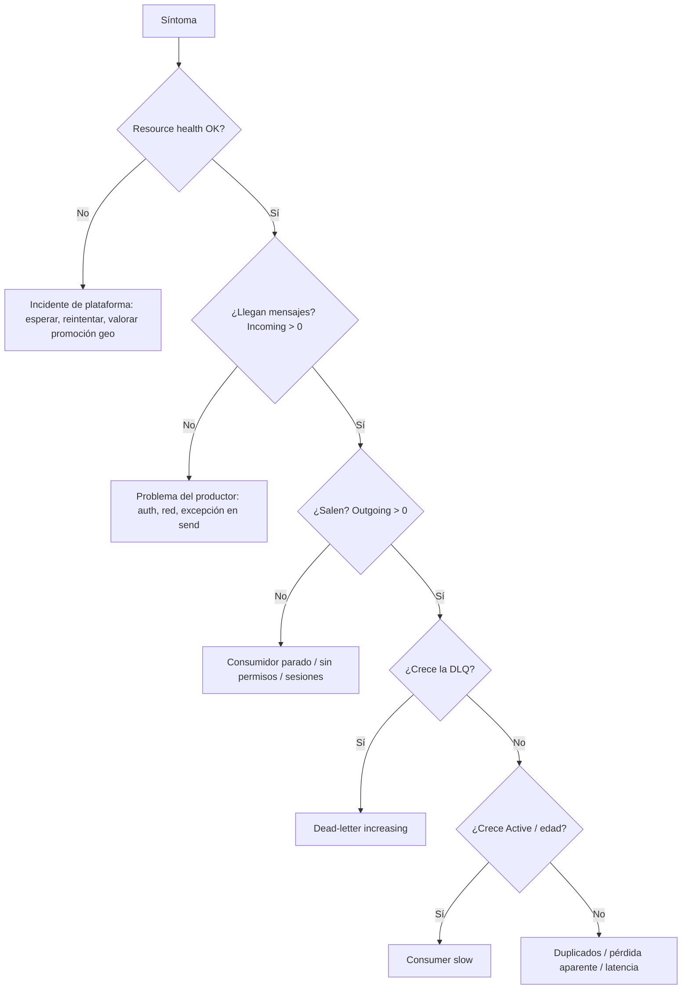

# 10 - Troubleshooting

> Runbooks: síntoma → causas ordenadas por probabilidad → cómo confirmarlas → arreglo. Verificado contra la [guía oficial de troubleshooting](https://learn.microsoft.com/azure/service-bus-messaging/service-bus-troubleshooting-guide) y la [referencia de excepciones](https://learn.microsoft.com/azure/service-bus-messaging/service-bus-messaging-exceptions-latest) — nov-2026.

## Contenido
- [[#Metodo de diagnostico]]
- [[#Mapa de ServiceBusFailureReason]]
- [[#Troubleshooting - Messages stuck]]
- [[#Troubleshooting - Lock expired]]
- [[#Troubleshooting - Dead-letter increasing]]
- [[#Troubleshooting - Consumer slow]]
- [[#Troubleshooting - Connection failures]]
- [[#Troubleshooting - Authorization failures]]
- [[#Troubleshooting - Session lock problems]]
- [[#Troubleshooting - Throttling y ServerBusy]]
- [[#Troubleshooting - Mensajes duplicados]]
- [[#Troubleshooting - Mensajes perdidos]]
- [[#Troubleshooting - Message size exceeded]]
- [[#Troubleshooting - Entity not found]]
- [[#Troubleshooting - Transaction failures]]

---

## Metodo de diagnostico
Antes de tocar código:
1. **¿Es el servicio?** Azure Service Health + **Resource health** del namespace. Si hay incidente, el SDK reintenta los transitorios; asegúrate de que tu app reanuda tras una caída larga. Nota: Resource health puede marcar el periodo no saludable unos minutos más largo que el real.
2. **¿Es una entidad o todo el namespace?** Divide las métricas por `EntityName`.
3. **¿Qué dicen las métricas?** `ActiveMessages`, `DeadletteredMessages`, `Incoming/Outgoing`, `UserErrors`, `ServerErrors`, `ThrottledRequests`, `ActiveConnections`.
4. **¿Qué dice la excepción?** `ServiceBusException.Reason` + `IsTransient` (ver el mapa siguiente).
5. **¿Qué dice la DLQ?** Agrupa por `DeadLetterReason` ([[03 - Confiabilidad y manejo de errores#Dead Letter Queue|Dead Letter Queue]]).
6. **¿Qué cambió?** Despliegue, configuración de red, roles, contrato de mensaje, volumen.



---

## Mapa de ServiceBusFailureReason
| `Reason` | Transitorio | Significado | Ver |
|---|---|---|---|
| `ServiceTimeout` | Sí | Sin respuesta a tiempo (red o servicio) | [[#Troubleshooting - Connection failures]] |
| `ServiceCommunicationProblem` | Sí | Error de comunicación; si es sostenido, mira `ServerErrors` | [[#Troubleshooting - Connection failures]] |
| `ServiceBusy` | Sí | Throttling | [[#Troubleshooting - Throttling y ServerBusy]] |
| `MessageLockLost` | No | Lock expirado o link AMQP desconectado | [[#Troubleshooting - Lock expired]] |
| `SessionLockLost` | No | Igual para sesiones | [[#Troubleshooting - Session lock problems]] |
| `SessionCannotBeLocked` | No | Otra instancia tiene la sesión | [[#Troubleshooting - Session lock problems]] |
| `MessagingEntityNotFound` | No | La entidad no existe o nombre incorrecto | [[#Troubleshooting - Entity not found]] |
| `MessagingEntityDisabled` | No | Entidad deshabilitada (o envío/recepción deshabilitados) | [[#Troubleshooting - Entity not found]] |
| `MessageSizeExceeded` | No | Mensaje o batch por encima del límite | [[#Troubleshooting - Message size exceeded]] |
| `QuotaExceeded` | No | Entidad llena, demasiadas conexiones/entidades/receivers | [[#Troubleshooting - Throttling y ServerBusy]] |
| `MessageNotFound` | No | Defer/scheduled: el `SequenceNumber` ya no existe | [[02 - Queues y Topics#Message Settlement|Message Settlement]] |
| `MessagingEntityAlreadyExists` | No | Administración: ya existe | — |
| `GeneralError` | Depende | Mira el mensaje y el `InnerException` | — |

`UnauthorizedAccessException` no es un `ServiceBusException`: se lanza aparte → [[#Troubleshooting - Authorization failures]].

```csharp
catch (ServiceBusException ex) when (ex.IsTransient) { /* el SDK ya reintentó; decide backoff */ }
catch (ServiceBusException ex) when (ex.Reason == ServiceBusFailureReason.MessageLockLost) { /* no reintentes el complete */ }
```

---

## Troubleshooting - Messages stuck
**Síntoma**: `ActiveMessages` crece o no baja; los consumidores parecen vivos pero no procesan.

| # | Causa probable | Cómo confirmarla | Arreglo |
|---|---|---|---|
| 1 | Processor no arrancado o la app termina tras `StartProcessingAsync` (no bloquea) | Logs de arranque; `Outgoing = 0` | Hospedar en `BackgroundService` |
| 2 | Excepción no observada: `ProcessErrorAsync` registra errores que nadie mira | Logs de `ProcessErrorAsync` | Alertar sobre ellos |
| 3 | Consumidor apuntando a otra entidad/subscription o al emulador | Config desplegada | Corregir config |
| 4 | Entidad con sesiones y consumidor sin `SessionProcessor` (o al revés) | `RequiresSession` en la entidad | Usar el tipo de receptor correcto |
| 5 | Sin permisos `Data Receiver` | `UnauthorizedAccessException` | [[#Troubleshooting - Authorization failures]] |
| 6 | Mensajes **programados** o **diferidos**, no activos | `ScheduledMessages`; peek y mira `State` | Esperado; o recupera los diferidos por `SequenceNumber` |
| 7 | Una sesión bloqueada/caliente retiene el resto | Peek: todos con el mismo `SessionId` | [[#Troubleshooting - Session lock problems]] |
| 8 | Handler colgado (deadlock, sync-over-async, `await` sin timeout) | Dump/trazas: handlers que no terminan | Timeouts en dependencias, `args.CancellationToken`, sin `.Result` |
| 9 | Subscription sin regla que coincida → mensajes que **no** llegan (no "atascados") | Reglas de la subscription | [[02 - Queues y Topics#Filters y Rules|Filters y Rules]] |
| 10 | Entidad con recepción deshabilitada (`ReceiveDisabled`) | Estado de la entidad | Reactivar |

Comprobación rápida:
```bash
az servicebus queue show -g $RG --namespace-name $NS -n orders \
  --query "{status:status, active:countDetails.activeMessageCount, dlq:countDetails.deadLetterMessageCount, scheduled:countDetails.scheduledMessageCount, session:requiresSession}"
```

---

## Troubleshooting - Lock expired
**Síntoma**: `ServiceBusException` con `MessageLockLost` al completar; `DeliveryCount` alto; mensajes en DLQ con `MaxDeliveryCountExceeded` sin excepciones en el handler; efectos duplicados.

| # | Causa | Confirmar | Arreglo |
|---|---|---|---|
| 1 | Handler más largo que `LockDuration` y sin renovación | Duración p99 del handler vs lock | `MaxAutoLockRenewalDuration` ≥ duración máxima; o inbox de almacenamiento |
| 2 | **Prefetch** alto: el lock corre en el buffer local | `PrefetchCount`, edad al empezar a procesar | Prefetch 0 o ≈ 20 × tasa/s ([[05 - Seguridad y performance#Performance tuning|Performance tuning]]) |
| 3 | **Link AMQP desconectado** entre recepción y settlement (red, o el timeout de inactividad de 10 min del servicio) | Errores de conexión en los logs del SDK alrededor del fallo | Inevitable a veces → idempotencia. El lock se pierde aunque no haya expirado |
| 4 | Reloj del host desajustado (la auto-renovación usa la hora del sistema) | Comparar con NTP | Sincronizar el reloj |
| 5 | Thread pool starvation: la renovación no se ejecuta a tiempo | Contadores de thread pool; sync-over-async | Código asíncrono puro; menos concurrencia por proceso |
| 6 | Pausas largas de GC | Métricas de GC | Server GC, reducir asignaciones, menos concurrencia |
| 7 | Settlement desde otro receiver/cliente distinto del que recibió | Revisión de código | Completar con el mismo receiver (o `args.*` en el processor) |

> [!important] Qué hacer con un `MessageLockLost`
> No reintentes el `Complete`: ya no puedes. El mensaje se reentregará; tu handler **debe** ser idempotente. Registra el caso como métrica: un ratio alto es un problema de diseño, no de suerte.

Relación: [[02 - Queues y Topics#Message Lock y Lock Renewal|Message Lock y Lock Renewal]]

---

## Troubleshooting - Dead-letter increasing
**Síntoma**: `DeadletteredMessages` sube.

**Paso 1 — clasifica**, no reproceses aún:
```csharp
var counts = new Dictionary<string, int>();
long? from = null;
while (true)
{
    var batch = await dlqReceiver.PeekMessagesAsync(250, from, ct);   // máx. 250 por llamada
    if (batch.Count == 0) break;
    foreach (var m in batch)
    {
        var key = $"{m.DeadLetterReason} | {m.DeadLetterErrorDescription?[..Math.Min(80, m.DeadLetterErrorDescription.Length)]}";
        counts[key] = counts.GetValueOrDefault(key) + 1;
    }
    from = batch[^1].SequenceNumber + 1;
}
```

| `DeadLetterReason` | Causa | Acción |
|---|---|---|
| `MaxDeliveryCountExceeded` | Excepciones repetidas **o** locks perdidos (ver [[#Troubleshooting - Lock expired]]) | Mira logs del handler. Si no hay excepciones, son locks |
| `MaxDeliveryCountExceeded` + errores de *receiver closed* | Settlement después de cerrar el receiver o la conexión (también por el timeout de inactividad de 10 min) | Completar antes de cerrar; no guardar mensajes para completarlos más tarde |
| (sin razón de sistema) con *dead-lettering on filter evaluation exceptions* | Un filtro SQL lanzó error al evaluarse | Corregir la regla |
| `TTLExpiredException` | Expiró con `DeadLetteringOnMessageExpiration` | Consumidor demasiado lento o parado; ¿el TTL es razonable? |
| `HeaderSizeExceeded` | Se superó la cuota de tamaño del mensaje (la doc lo describe como "message too large") | Reducir tamaño; no acumules historial de reintentos en `ApplicationProperties` |
| `Session ID is null` | Mensaje sin `SessionId` reenviado a entidad con sesiones (p. ej. auto-forward) | Poner `SessionId` en origen |
| `MaxTransferHopCountExceeded` | Más de 4 saltos de auto-forward/send-via | Simplificar la topología |
| Razón propia (`ValidationFailed`, `DeserializationFailed`…) | Dead-letter explícito de tu código | Bug de productor o de contrato |

**Paso 2 — arregla la causa** (despliegue, contrato, dependencia).
**Paso 3 — reprocesa** de forma controlada y filtrada ([[03 - Confiabilidad y manejo de errores#Dead Letter Queue|Dead Letter Queue]]), sabiendo que [[03 - Confiabilidad y manejo de errores#Duplicate Detection|Duplicate Detection]] descartará reenvíos dentro de la ventana con el mismo `MessageId`.

---

## Troubleshooting - Consumer slow
**Síntoma**: la edad del mensaje más viejo crece; `Incoming > Outgoing` sostenido.

1. **Mide el handler** (p50/p95/p99) y descompón: ¿BD? ¿API externa? ¿serialización? Casi nunca es Service Bus ([[05 - Seguridad y performance#Performance tuning|Performance tuning]]).
2. Calcula la capacidad: `instancias × MaxConcurrentCalls / duración`. ¿Cubre la tasa de entrada en el pico?
3. Revisa:
| Causa | Arreglo |
|---|---|
| `MaxConcurrentCalls = 1` (valor por defecto del processor) | Súbelo según la dependencia |
| Sesiones con pocas claves o una sesión caliente | Mejor `SessionId`; `MaxConcurrentSessions` |
| Thread pool starvation con alta concurrencia (sobre todo session processor) | Async puro; si no basta, Microsoft sugiere probar `TryTimeout` más alto (p. ej. 5 min) o escalar horizontalmente |
| `SessionIdleTimeout` alto con muchas sesiones pequeñas | Bajarlo para cambiar de sesión antes |
| Retries dentro del handler que alargan cada mensaje | Un reintento corto; el resto, reprogramación |
| Dependencia saturada | Escalar la dependencia o limitar concurrencia (escalar consumidores empeora) |
| Throttling en Standard | [[#Troubleshooting - Throttling y ServerBusy]] |
| Receive por lotes que devuelve menos mensajes de los pedidos | Normal: el receptor espera 20 ms tras el primero. No asumas lotes llenos |

---

## Troubleshooting - Connection failures
**Síntoma**: `ServiceTimeout`, `ServiceCommunicationProblem`, `TimeoutException`, `SocketException`, fallos de handshake TLS.

| # | Causa | Confirmar | Arreglo |
|---|---|---|---|
| 1 | Firewall/NSG bloquea AMQP | `telnet <ns>.servicebus.windows.net 5671` (o `tnc ... -port 5671` en Windows) | Abrir 5671 y 5672, o usar `AmqpWebSockets` (443) |
| 2 | Proxy corporativo | Solo funciona 443 | `TransportType = AmqpWebSockets` + `WebProxy` en `ServiceBusClientOptions` |
| 3 | **DNS de Private Endpoint** mal configurado | `nslookup` desde dentro de la VNet: debe dar `10.x` | Vincular la zona `privatelink.servicebus.windows.net` a la VNet |
| 4 | Acceso público desactivado y cliente fuera de la VNet | Logs `VNetAndIPFilteringLogs` (Deny) | Conectar por VNet o añadir regla IP |
| 5 | Agotamiento de sockets: un `ServiceBusClient` por operación | `ActiveConnections` creciente | Cliente singleton; `DisposeAsync` al apagar |
| 6 | Connection string con parámetros legacy (`TransportType=...`, `Authentication=Managed Identity`) | Revisar config | El SDK moderno los **ignora**; configúralo en las opciones |
| 7 | Proxy que intercepta TLS o trust store desactualizado | Error de cadena de certificados | Confiar en la raíz, actualizar CA bundle; **nunca** desactivar la validación |
| 8 | Reinicios/actualizaciones del servicio | Desconexiones de segundos, throttling momentáneo | Nada: el SDK reconecta. Asegúrate de no tener retries a 0 |

```csharp
var client = new ServiceBusClient(fqdn, credential, new ServiceBusClientOptions
{
    TransportType = ServiceBusTransportType.AmqpWebSockets,
    WebProxy = new WebProxy("http://proxy.corp:8080")
});
```
Comprobación general: `curl https://<ns>.servicebus.windows.net/` debe devolver un feed Atom; un 400 o un error TLS apunta a red/certificados.

---

## Troubleshooting - Authorization failures
**Síntoma**: `UnauthorizedAccessException` ("'Send' claim(s) are required…", "'Listen' claim(s)…"), "Put token failed", 401/403.

| # | Causa | Arreglo |
|---|---|---|
| 1 | La identidad no tiene el rol adecuado **en ese ámbito** | `Data Sender` para enviar, `Data Receiver` para recibir; en la entidad correcta (¡la subscription, no el topic, para recibir!) |
| 2 | Asignación de rol reciente | Esperar unos minutos de propagación |
| 3 | `DefaultAzureCredential` elige otra identidad (Visual Studio, Azure CLI, otra MI) | Logs de Azure.Identity; usar `ManagedIdentityCredential` con client id explícito |
| 4 | User-assigned MI sin `AZURE_CLIENT_ID` | Pasar el client id |
| 5 | App que llama al Administration Client (`QueueExistsAsync`) sin permisos de gestión | Crear entidades en IaC; la app no necesita `Manage` |
| 6 | `disableLocalAuth = true` y la app sigue usando SAS | Migrar a Entra ID |
| 7 | SAS: política sin el derecho necesario o clave regenerada | Revisar política; rotación primaria/secundaria |
| 8 | AKS workload identity incompleta | Service account con client id anotado, label `azure.workload.identity/use` en el pod, federated credential con el issuer OIDC del clúster |
| 9 | Reloj del host desajustado | Sincronizar: los tokens validan `nbf`/`exp` |
| 10 | Scope del token incorrecto en clientes propios | `https://servicebus.azure.net/.default` |

En Premium, `RuntimeAuditLogs` muestra qué identidad (`AuthKey`) y qué tipo de auth (`AuthType`) intentó cada operación.

Relación: [[05 - Seguridad y performance#Seguridad con Entra ID y RBAC|Seguridad con Entra ID y RBAC]] · [[06 - Laboratorios#Lab 10 - Managed Identity|Lab 10 - Managed Identity]]

---

## Troubleshooting - Session lock problems
**Síntomas y causas**:
| Síntoma | Causa | Arreglo |
|---|---|---|
| `SessionLockLost` | Lock de sesión expirado (sin renovación o handler largo) o link AMQP desconectado | `MaxAutoLockRenewalDuration`; idempotencia; handlers cortos |
| `SessionCannotBeLocked` | Otra instancia ya tiene esa sesión (esperado con varias réplicas) | Normal con `AcceptSessionAsync(sessionId)`; usa `AcceptNextSessionAsync` o el session processor |
| Una sesión no avanza | Mensaje venenoso al principio de la sesión: bloquea el resto | DeadLetter explícito tras N intentos; la sesión sigue |
| Cambio de sesión lento | `SessionIdleTimeout` alto con muchas sesiones de pocos mensajes | Bajarlo |
| Procesamiento en serie inesperado | `SessionId` de baja cardinalidad (`CustomerId`, `Region`) | Clave más fina (`OrderId`) |
| Envío rechazado: "the sessionid was not set on a message" | Mensaje sin `SessionId` a entidad con sesiones | Asignar `SessionId` siempre |
| Desorden pese a sesiones | `MaxConcurrentCallsPerSession > 1` | Ponerlo a 1 si el orden importa |
| Processor colgado con `MaxConcurrentSessions` muy alto | Thread pool starvation | Bajar la concurrencia por host, escalar hosts |

Relación: [[03 - Confiabilidad y manejo de errores#Sessions|Sessions]] · [[03 - Confiabilidad y manejo de errores#ServiceBusSessionProcessor|ServiceBusSessionProcessor]]

---

## Troubleshooting - Throttling y ServerBusy
**Síntoma**: `ServiceBusException` con `ServiceBusy` (transitorio, el SDK reintenta) o `QuotaExceeded` (no transitorio); `ThrottledRequests > 0`; latencia creciente.

| Tier | Mecanismo | Causas típicas | Arreglo |
|---|---|---|---|
| Basic/Standard | Créditos: 1 000 operaciones/s por namespace; gestión y evaluación de filtros cuestan más | Picos, muchas operaciones de gestión, polling agresivo, muchos filtros SQL | Batching, menos gestión en runtime, correlation filters, repartir en namespaces o pasar a Premium |
| Premium | CPU/memoria de las MUs. `MessagingErrorSubCode`: CPU, Storage (checkpoints pendientes), Namespace | Carga mayor que las MUs; mensajes grandes | Más MUs / autoscale; revisar `PendingCheckpointOperationCount` |
| Todos | **5 000 receive requests concurrentes por entidad** (suma de subscriptions de un topic) | Cientos de receptores ociosos | Menos receptores, cerrar los que no se usan, repartir entre entidades |
| Todos | **5 000 conexiones AMQP por namespace** | Clientes no reutilizados | Singleton |
| Geo-Replication | Lag por encima del máximo configurado | Secundario atrasado o caído | Resolver lag o quitar el secundario |

`QuotaExceeded` por **entidad llena** (`Size` = máximo): consumidor parado, subscription huérfana o TTL muy largo. Mientras no se libere espacio, los envíos fallan para todos los productores de esa entidad.

> [!note] Contadores a 0 durante el throttling
> Cuando el namespace está throttled, la información de entidad puede devolver los contadores de mensajes a 0. No concluyas que la cola está vacía.

---

## Troubleshooting - Mensajes duplicados
**Síntoma**: un efecto de negocio ocurre dos veces.

Recorre la tabla de [[03 - Confiabilidad y manejo de errores#At-least-once delivery|At-least-once delivery]]. Preguntas para localizar el origen:
1. ¿Los dos procesamientos tienen el **mismo `MessageId`** y **mismo `SequenceNumber`**? → reentrega del mismo mensaje (lock perdido, crash, complete fallido). Solución: idempotencia del consumidor.
2. ¿Mismo `MessageId` pero **distinto `SequenceNumber`**? → el mensaje se envió dos veces (retry del productor, relay del outbox, reprocesado de DLQ) y DD no lo filtró (desactivado, fuera de ventana, o con particionado y distinta partición/`PartitionKey`).
3. ¿`MessageId` **distinto**? → el productor genera IDs aleatorios en cada intento. Hazlos deterministas (Id del outbox, clave de negocio).
4. ¿`DeliveryCount > 1`? → hubo reentrega.
5. ¿Hubo una **promoción forzada** de Geo-Replication? → cambios de estado (Complete) no replicados.

---

## Troubleshooting - Mensajes perdidos
**Síntoma**: "envié un mensaje y nadie lo procesó". Antes de culpar al broker, que no pierde mensajes confirmados salvo en una promoción forzada de geo-replicación asíncrona:

| # | Dónde está realmente | Cómo comprobarlo |
|---|---|---|
| 1 | Nunca se envió (excepción ignorada, proceso muerto tras `SaveChanges`) | Logs del productor; ¿tienes outbox? → [[08 - Patrones de arquitectura#Outbox Pattern|Outbox Pattern]] |
| 2 | Descartado por **duplicate detection** | `Incoming` sube sin `Active`; mismo `MessageId` que uno anterior en la ventana |
| 3 | **Ninguna regla** de subscription coincidió | Reglas; ¿borraste el `$Default` sin añadir otra? |
| 4 | **Expiró** (TTL) y se borró (sin `DeadLetteringOnMessageExpiration`) | TTL efectivo = mín(mensaje, entidad) |
| 5 | Está en la **DLQ** | Peek de `$DeadLetterQueue` |
| 6 | Está **programado** o **diferido** | `ScheduledMessages`; peek y mira `State` |
| 7 | Lo consumió otro proceso (otra app, un test, el emulador apuntando a prod, una subscription compartida por dos servicios) | `Outgoing`; quién tiene `Data Receiver` |
| 8 | `ReceiveAndDelete` y el consumidor falló | Modo de recepción |
| 9 | Prefetch con `ReceiveAndDelete` y el proceso murió con mensajes en el buffer | Modo + prefetch |
| 10 | La entidad se borró (`AutoDeleteOnIdle`, IaC, alguien) | `OperationalLogs` y Activity log |

---

## Troubleshooting - Message size exceeded
**Síntoma**: `MessageSizeExceeded` al enviar.

| Causa | Arreglo |
|---|---|
| Mensaje > 256 KB (Standard) o > máximo configurado en la entidad (Premium, 1 MB por defecto) | [[08 - Patrones de arquitectura#Claim Check Pattern|Claim Check Pattern]] o subir `MaxMessageSizeInKilobytes` en Premium |
| **Batch** > 1 MB en Premium (aunque los mensajes grandes estén activados) | Enviar los mensajes > 1 MB individualmente; `ServiceBusMessageBatch` no detecta este caso |
| Propiedades > 64 KB en total (o una > 32 KB) | Sacar datos de `ApplicationProperties` al body |
| Mensaje grande vía HTTP | Más de 1 MB solo con AMQP |
| Lotes construidos a mano con `SendMessagesAsync(lista)` | Usar `CreateMessageBatchAsync` + `TryAddMessage` |

Recuerda: un mensaje > 1 MB en un topic cuenta para el tamaño de la entidad X + 1 veces (X = subscriptions que coinciden).

---

## Troubleshooting - Entity not found
**Síntoma**: `MessagingEntityNotFound` o "entity is no longer available"; `MessagingEntityDisabled`.

| Causa | Comprobar |
|---|---|
| Nombre mal escrito o mayúsculas/minúsculas inesperadas | Config vs portal |
| Recibir de un **topic** en lugar de `topic/subscriptions/sub` | Usar `CreateProcessor(topic, subscription)` |
| Distinto namespace (dev vs prod, alias Geo-DR) | FQDN del cliente |
| Borrada por `AutoDeleteOnIdle` | `OperationalLogs` ("AutoDelete Delete Queue") |
| Borrada por IaC (modo *complete*) o por alguien | Activity log (ARM) y `OperationalLogs` (plano de datos) |
| Entidad deshabilitada (`Disabled`, `SendDisabled`, `ReceiveDisabled`) | `status` de la entidad |
| Nombres con `/` mostrados como `~` en portal/CLI | Esperado: ARM traduce `/` ↔ `~`; el SDK usa `/` |

> [!warning] Los locks de recursos de ARM no protegen frente al plano de datos
> Un `CanNotDelete` en el namespace no impide borrar una queue con el SDK o Service Bus Explorer. Quita los permisos `Manage`/`Data Owner` a quien no deba borrar.

---

## Troubleshooting - Transaction failures
| Síntoma | Causa | Arreglo |
|---|---|---|
| Error al usar varias entidades en la transacción | Falta `EnableCrossEntityTransactions = true` | Activarlo en un cliente dedicado |
| `InvalidOperationException` al recibir dentro de la transacción | La primera operación del cliente fue un envío a otra entidad (send-via) | Recibir primero; cliente dedicado |
| Timeout de la transacción | Más de 2 min desde la primera operación | Trabajo pesado fuera del `TransactionScope` |
| Error transitorio dentro de la transacción no se reintenta | Diseño intencionado (evita interbloqueos) | Reintenta la transacción completa |
| "Can't send more than 100 messages in a single transaction" | Límite de 100 mensajes por transacción | Lotes más pequeños |
| Transacción "atómica" con SQL que no lo es | Service Bus no participa en 2PC | [[08 - Patrones de arquitectura#Outbox Pattern|Outbox Pattern]] |
| Entidades en distintos namespaces | No soportado | Rediseñar o aceptar outbox/idempotencia |
| Falla en Basic | Basic no tiene transacciones | Standard o Premium |

Relación: [[03 - Confiabilidad y manejo de errores#Transactions|Transactions]]
