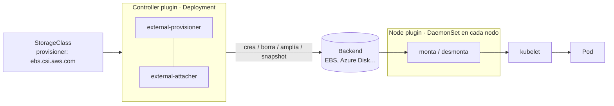

---
tags:
  - kubernetes
  - storage
aliases:
  - CSI Driver
  - CSI
  - Container Storage Interface
  - CSI Plugin
  - Driver CSI
---

# CSI Driver

> [!abstract] En 30 segundos
> - **Qué es:** un plugin que conecta Kubernetes con un sistema de almacenamiento concreto (EBS, Azure Disk, Ceph, NFS…).
> - **Analogía:** el driver de una impresora. El sistema operativo sabe "imprimir"; el driver sabe hablar con *esa* impresora.
> - **Recuerda:** **CSI es al almacenamiento lo que [[Networking#CNI|CNI]] es a la red.**

---

## Qué es

Un **CSI Driver** implementa la **Container Storage Interface**, un estándar abierto que define cómo un orquestador habla con un sistema de almacenamiento.

## Para qué sirve

Permite integrar **cualquier** proveedor de almacenamiento **sin modificar Kubernetes**.

| Antes (*in-tree*) | Ahora (*out-of-tree*, CSI) |
|---|---|
| Los drivers vivían dentro del código de Kubernetes | Se instalan por separado (Helm, add-on del proveedor) |
| Un bug de un proveedor obligaba a esperar una versión de Kubernetes | Cada proveedor publica a su ritmo |
| — | Los antiguos drivers in-tree **se migraron** a CSI |

## Cómo se despliega



| Parte | Cómo se despliega | Qué hace |
|---|---|---|
| **Controller plugin** | Normalmente un Deployment | Crea, borra, amplía y toma snapshots de volúmenes en el backend. Usa *sidecars* como `external-provisioner` y `external-attacher` |
| **Node plugin** | DaemonSet en cada [[Worker Node]] | Monta y desmonta el volumen en el nodo para que el [[kubelet]] lo entregue al [[Workloads#Pod\|Pod]] |

El driver se referencia en el campo `provisioner` de una [[StorageClass]].

> [!tip] Snapshots de volúmenes
> Muchos drivers soportan `VolumeSnapshot`: copias puntuales de un [[PersistentVolumeClaim]] que se pueden restaurar en un PVC nuevo. Requiere los CRDs y el controlador de snapshots instalados.

---

## Ejemplo (AWS EBS)

### Comandos

```bash
# Drivers CSI registrados en el clúster
kubectl get csidrivers

# Drivers disponibles en cada nodo
kubectl get csinodes

# Pods del driver
kubectl get pods -n kube-system -l app.kubernetes.io/name=aws-ebs-csi-driver

# Instalar el driver con Helm
helm repo add aws-ebs-csi-driver https://kubernetes-sigs.github.io/aws-ebs-csi-driver
helm install aws-ebs-csi-driver aws-ebs-csi-driver/aws-ebs-csi-driver -n kube-system
```

### Usarlo desde una StorageClass

```yaml
apiVersion: storage.k8s.io/v1
kind: StorageClass
metadata:
  name: ebs-gp3
provisioner: ebs.csi.aws.com      # ← aquí se elige el driver
parameters:
  type: gp3
volumeBindingMode: WaitForFirstConsumer
```

---

## Relacionado
[[StorageClass]] · [[PersistentVolume]] · [[PersistentVolumeClaim]] · [[Volume]] · [[kubelet]] · [[Networking#CNI|CNI]] · [[Helm]]

> [!info] 📚 Estudio guiado
> Capítulo: [[05 - Configuración y almacenamiento]] · Índice: [[00 - Kubernetes - Índice]]
