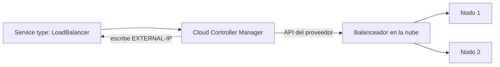

---
tags:
  - kubernetes
  - architecture
  - cloud
aliases:
  - Cloud Controller Manager
  - cloud-controller-manager
  - CCM
  - Cloud Provider
---

# Cloud Controller Manager

> [!abstract] En 30 segundos
> - **Qué es:** el componente que **traduce objetos de Kubernetes en recursos reales de la nube** (balanceadores, rutas, datos de las VMs).
> - **Analogía:** un traductor. Kubernetes dice "quiero un LoadBalancer"; el CCM se lo pide a AWS, Azure o GCP en su propio idioma.
> - **Recuerda:** en local (minikube, kind) **no hay CCM**, por eso tu `LoadBalancer` se queda en `<pending>`.

---

## Qué es

El **Cloud Controller Manager** (CCM) es un componente **opcional** del [[Control Plane]] con la **lógica específica de cada proveedor** (AWS, Azure, GCP, DigitalOcean, OpenStack…). Separa ese código del núcleo de Kubernetes para que cada proveedor lo mantenga a su ritmo.

## Sus tres controladores

| Controlador | Qué hace |
|---|---|
| **Node** | Al registrarse un nodo, consulta a la nube su zona, tipo de instancia e IPs. Elimina el objeto `Node` cuando la VM se borra en el proveedor |
| **Route** | Configura las rutas de la red de la nube para que se alcancen los Pods de distintos nodos (depende del modelo de red) |
| **Service** | Al crear un [[Networking#Kubernetes Service\|Service]] de tipo [[Networking#LoadBalancer\|LoadBalancer]], crea el balanceador en la nube, le asigna una IP (pública o interna, según anotaciones) y lo mantiene actualizado |



## Problemas típicos

> [!tip] ¿Por qué mi Service LoadBalancer se queda en `<pending>`?
> En clústeres locales (minikube, kind, bare-metal) no hay CCM que cree el balanceador, así que `EXTERNAL-IP` queda en `<pending>`. Soluciones:
> - `minikube tunnel` en minikube.
> - **MetalLB** en bare-metal.
> - Usar [[Networking#NodePort|NodePort]] o [[Networking#Ingress|Ingress]] / [[Networking#Kubernetes Gateway API|Gateway API]].

> [!warning] No confundir con el CSI Driver
> El CCM **ya no** gestiona discos. Los volúmenes en la nube se gestionan con un [[CSI Driver]] y una [[StorageClass]].

---

## Ejemplo

### Comandos útiles

```bash
# ¿El clúster ejecuta un cloud-controller-manager?
kubectl get pods -n kube-system | grep -i cloud-controller

# Crear un Service LoadBalancer y ver cómo el CCM asigna la IP externa
kubectl expose deployment python-django-app --type=LoadBalancer --port=80 --target-port=8000
kubectl get svc python-django-app -w

# Si el balanceador no se crea, los eventos dicen por qué
kubectl describe svc python-django-app

# Datos que el CCM agregó al nodo (providerID, zona, tipo de instancia)
kubectl get node <nodo> -o jsonpath='{.spec.providerID}'
kubectl get node <nodo> --show-labels
```

### Anotaciones que lee el CCM (ejemplo en AWS)

```yaml
apiVersion: v1
kind: Service
metadata:
  name: web-publico
  annotations:
    service.beta.kubernetes.io/aws-load-balancer-type: "nlb"
    service.beta.kubernetes.io/aws-load-balancer-scheme: "internet-facing"   # o "internal"
spec:
  type: LoadBalancer
  selector:
    app: web
  ports:
    - port: 80
      targetPort: 8080
```

---

## Relacionado
[[Control Plane]] · [[Kube-controller-manager]] · [[Networking#LoadBalancer|LoadBalancer]] · [[Networking#Kubernetes Service|Kubernetes Service]] · [[Worker Node]] · [[CSI Driver]]

> [!info] 📚 Estudio guiado
> Capítulo: [[04 - Networking y tráfico]] · [[12 - Kubernetes en la nube]] · Índice: [[00 - Kubernetes - Índice]]
