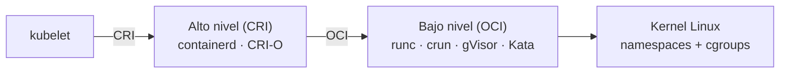

---
tags:
  - kubernetes
  - architecture
aliases:
  - Container Runtime
  - Runtime de contenedores
  - Motor de contenedores
  - CRI
  - Container Runtime Interface
  - containerd
  - CRI-O
  - dockershim
---

# Container Runtime

> [!abstract] En 30 segundos
> - **Qué es:** el software de cada nodo que **descarga imágenes y ejecuta contenedores**.
> - **Analogía:** el motor de un coche. El [[kubelet]] es el conductor: decide qué hacer, pero quien mueve las ruedas es el runtime.
> - **Recuerda:** hoy el runtime es **containerd** o **CRI-O**, no Docker. Tus imágenes hechas con Docker siguen funcionando igual.

---

## Qué es

El **Container Runtime** (entorno de ejecución de contenedores) es el componente que crea y gestiona los contenedores en el nodo. Kubernetes habla con él a través de la **CRI** (*Container Runtime Interface*), una API estándar que permite cambiar de runtime sin tocar Kubernetes.

## Cómo funciona

Cuando el [[kubelet]] recibe un [[Workloads#Pod|Pod]], le pide al runtime (vía CRI) que:
1. Descargue (*pull*) las imágenes.
2. Cree el *sandbox* del Pod (namespaces de red, IPC…) y los contenedores.
3. Los arranque, detenga, elimine y reporte su estado y logs.

### Dos niveles de runtime



| Nivel | Ejemplos | Qué hace |
|---|---|---|
| **Alto nivel (CRI)** | `containerd` (por defecto en EKS, GKE, AKS y kubeadm), `CRI-O` (por defecto en OpenShift) | Gestiona imágenes, ciclo de vida y habla con el kubelet |
| **Bajo nivel (OCI)** | `runc`, `crun`, `gVisor`, `Kata Containers` | Crea el proceso aislado usando *namespaces* y *cgroups* del kernel |

## Lo que confunde a todo el mundo

> [!warning] Docker Engine ya no es el runtime de Kubernetes
> Desde **Kubernetes 1.24** se eliminó el `dockershim`, así que Docker Engine no se usa directamente como runtime.
> - **Las imágenes creadas con Docker siguen funcionando**: cumplen el estándar OCI y containerd/CRI-O las ejecutan igual.
> - Si de verdad necesitas Docker Engine como runtime, existe el adaptador externo `cri-dockerd`.

> [!tip] `crictl` en lugar de `docker`
> Para depurar contenedores directamente en un nodo usa `crictl`, que habla CRI con cualquier runtime compatible.

---

## Ejemplo

### Comandos útiles

```bash
# Ver qué runtime y versión usa cada nodo (columna CONTAINER-RUNTIME)
kubectl get nodes -o wide

# --- En el nodo ---
sudo crictl ps                 # contenedores
sudo crictl pods               # Pods (sandboxes)
sudo crictl images             # imágenes descargadas
sudo crictl logs <container-id>
systemctl status containerd
```

### Usar un runtime alternativo con `RuntimeClass` (gVisor para más aislamiento)

```yaml
apiVersion: node.k8s.io/v1
kind: RuntimeClass
metadata:
  name: gvisor
handler: runsc            # nombre del handler configurado en containerd
---
apiVersion: v1
kind: Pod
metadata:
  name: app-aislada
spec:
  runtimeClassName: gvisor
  containers:
    - name: app
      image: nginx:1.28
```

---

## Relacionado
[[kubelet]] · [[Worker Node]] · [[Workloads#Pod|Pod]] · [[Networking#CNI|CNI]]

> [!info] 📚 Estudio guiado
> Capítulo: [[02 - Fundamentos y arquitectura]] · Índice: [[00 - Kubernetes - Índice]]
