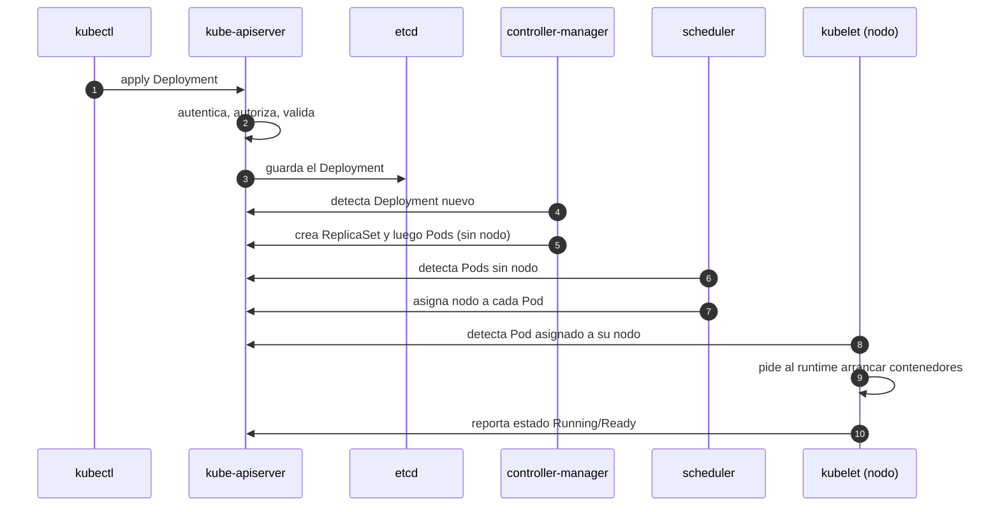

---
tags:
  - kubernetes
  - architecture
aliases:
  - Control Plane
  - Plano de Control
  - Master Node
  - Nodo Maestro
  - kube-apiserver
  - API Server
  - etcd
  - kube-scheduler
  - Scheduler
---

# Control Plane

> [!abstract] En 30 segundos
> - **Qué es:** el "cerebro" del clúster. Guarda el estado deseado, decide dónde corre cada [[Workloads#Pod|Pod]] y reacciona a los cambios.
> - **Analogía:** la torre de control de un aeropuerto. No vuela aviones (no ejecuta tus contenedores), pero decide quién despega, por qué pista y qué hacer si algo falla.
> - **Recuerda:** todo pasa por el **API Server**, y todo el estado vive en **etcd**. Si pierdes etcd sin backup, pierdes el clúster.

---

## Qué es

El **Control Plane** (plano de control; antes se le llamaba *master node*) es el conjunto de componentes que **toman las decisiones globales del clúster**. Los contenedores de tus aplicaciones **no** corren aquí: corren en los [[Worker Node]]s.

## Componentes

| Componente | Qué hace | Si falla… |
|---|---|---|
| **kube-apiserver** | Puerta de entrada de todo el clúster. Expone la API REST, autentica y autoriza peticiones (de `kubectl`, del [[kubelet]], de los controladores). Es el **único** que habla con etcd | Nadie puede leer ni cambiar nada. Los Pods existentes siguen corriendo |
| **etcd** | Base de datos clave-valor distribuida y consistente con **todo** el estado del clúster | Sin quórum, el clúster queda en solo lectura o caído. Sin backup = clúster perdido |
| **kube-scheduler** | Observa Pods sin nodo asignado y elige el mejor nodo según recursos, afinidades, *taints/tolerations* y restricciones | Los Pods nuevos se quedan en `Pending` |
| **[[Kube-controller-manager]]** | Ejecuta los bucles de control que llevan el estado actual hacia el deseado (réplicas, nodos, endpoints, jobs…) | No se recrean Pods caídos ni avanzan los rollouts |
| **[[Cloud Controller Manager]]** *(opcional)* | Integra el clúster con la API del proveedor de nube (balanceadores, nodos, rutas) | Los Services `LoadBalancer` se quedan en `<pending>` |

## Cómo funciona: qué pasa con un `kubectl apply`



> [!tip] La idea clave
> Ningún componente "llama" a otro directamente. Todos **observan** (*watch*) el API Server y reaccionan a lo que cambia. Por eso Kubernetes es tan tolerante a fallos: si un componente se reinicia, retoma el trabajo leyendo el estado actual.

## Lo que debes saber para producción

> [!warning] Alta disponibilidad
> En producción el Control Plane debe ser redundante: al menos **3 nodos** de control (o de etcd) para mantener el quórum. En servicios gestionados (EKS, GKE, AKS) el proveedor administra el Control Plane por ti y tú no ves estos Pods.

---

## Ejemplo

### Comandos útiles

```bash
# Ver la dirección del API Server y servicios principales
kubectl cluster-info

# Listar los nodos y sus roles (control-plane / worker)
kubectl get nodes -o wide

# Ver los componentes del Control Plane (en kubeadm/minikube corren como static Pods)
kubectl get pods -n kube-system

# Comprobar la salud del API Server
kubectl get --raw='/readyz?verbose'
```

### Backup de etcd (en un nodo del Control Plane)

```bash
ETCDCTL_API=3 etcdctl snapshot save /backup/etcd-snapshot.db \
  --endpoints=https://127.0.0.1:2379 \
  --cacert=/etc/kubernetes/pki/etcd/ca.crt \
  --cert=/etc/kubernetes/pki/etcd/server.crt \
  --key=/etc/kubernetes/pki/etcd/server.key
```

### Dónde viven los manifiestos (clústeres kubeadm)

```bash
ls /etc/kubernetes/manifests/
# etcd.yaml  kube-apiserver.yaml  kube-controller-manager.yaml  kube-scheduler.yaml
```

---

## Relacionado
[[Worker Node]] · [[Kube-controller-manager]] · [[Cloud Controller Manager]] · [[kubelet]] · [[Networking#Kube-proxy|Kube-proxy]] · [[Custom Controller]]

> [!info] 📚 Estudio guiado
> Capítulo: [[02 - Fundamentos y arquitectura]] · Índice: [[00 - Kubernetes - Índice]]
