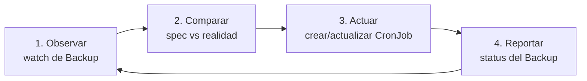

---
tags:
  - kubernetes
  - extensibility
aliases:
  - Custom Controller
  - Custom Controllers
  - Controlador personalizado
  - Operator
  - Operators
  - Kubernetes Operator
  - Operator Pattern
---

# Custom Controller

> [!abstract] En 30 segundos
> - **Qué es:** un programa tuyo (o de un tercero) que aplica el **bucle de reconciliación** de Kubernetes a recursos propios.
> - **Analogía:** contratar a un operador humano experto en PostgreSQL… y convertir su conocimiento en código que trabaja 24/7.
> - **Recuerda:** la reconciliación debe ser **idempotente**: ejecutarla 1 o 100 veces produce el mismo resultado.

---

## Qué es

Un **Custom Controller** funciona igual que los controladores integrados del [[Kube-controller-manager]], pero lo escribe y despliega un tercero, normalmente como un [[Workloads#Deployment|Deployment]] dentro del clúster. Es quien **da vida** a los objetos definidos con una [[Custom Resource Definition]].

## Cómo funciona



1. **Observar** (*watch*) en el API Server los objetos que le interesan (`Backup`, `Ingress`, `HTTPRoute`…).
2. **Comparar** el estado deseado (`spec`) con el real.
3. **Actuar**: crear, modificar o borrar recursos (Pods, Services, Jobs, balanceadores externos…).
4. **Reportar** el resultado en el `status` del objeto.

> [!info] ¿Qué es un Operator?
> Cuando una CRD + su controlador encapsulan el **conocimiento operativo** de una aplicación compleja (instalar, escalar, respaldar, actualizar una base de datos), el conjunto se llama **Operator**.

### Ejemplos reales

| Tipo | Ejemplos |
|---|---|
| Controladores de tráfico | Un [[Networking#Ingress Controller\|Ingress Controller]] (Traefik, HAProxy) o una implementación de [[Networking#Kubernetes Gateway API\|Gateway API]] convierte objetos en configuración de proxy |
| Service mesh | El plano de control de Istio ([[Networking#Service Mesh\|Service Mesh]]) |
| Operators de datos | CloudNativePG (PostgreSQL), Strimzi (Kafka) |
| Plataforma | cert-manager, Argo CD |

## Reglas de diseño

> [!warning] La reconciliación debe ser idempotente
> El controlador ejecuta la reconciliación muchas veces para el mismo objeto (reinicios, re-sincronizaciones periódicas). Cada ejecución debe dar el mismo resultado **sin duplicar recursos**.
> - **`ownerReferences`**: los recursos creados se borran solos junto con el objeto padre.
> - **Finalizers**: para limpiar recursos **externos** (un bucket, un DNS) antes de que el objeto desaparezca.

> [!tip] Herramientas para construirlos
> | Lenguaje | Herramienta |
> |---|---|
> | Go | **Kubebuilder**, **Operator SDK** (ambos sobre `controller-runtime`) |
> | Python | **Kopf** |
> | Java | **Java Operator SDK** |
> | Rust | **kube-rs** |
> | .NET | **KubeOps** |

---

## Ejemplo

### Crear un operador con Kubebuilder

```bash
# Esqueleto del proyecto y de la API
kubebuilder init --domain example.com --repo github.com/jorge/backup-operator
kubebuilder create api --group apps --version v1 --kind Backup

# Instalar las CRDs y ejecutar el controlador en local contra el clúster
make install
make run

# Una vez desplegado: Pods y logs
kubectl get deploy -n backup-operator-system
kubectl logs -n backup-operator-system deploy/backup-operator-controller-manager
```

### Función de reconciliación mínima (Go, `controller-runtime`)

```go
func (r *BackupReconciler) Reconcile(ctx context.Context, req ctrl.Request) (ctrl.Result, error) {
    // 1. Leer el Custom Resource
    var backup appsv1.Backup
    if err := r.Get(ctx, req.NamespacedName, &backup); err != nil {
        return ctrl.Result{}, client.IgnoreNotFound(err)
    }

    // 2. Construir el recurso deseado (un CronJob que ejecute el respaldo)
    cronJob := buildCronJob(&backup)
    _ = ctrl.SetControllerReference(&backup, cronJob, r.Scheme) // ownerReference

    // 3. Crear o actualizar hasta alcanzar el estado deseado (idempotente)
    if _, err := controllerutil.CreateOrUpdate(ctx, r.Client, cronJob, func() error { return nil }); err != nil {
        return ctrl.Result{}, err
    }

    // 4. Reportar el estado
    backup.Status.Ready = true
    return ctrl.Result{}, r.Status().Update(ctx, &backup)
}
```

---

## Relacionado
[[Custom Resource Definition]] · [[Kube-controller-manager]] · [[Networking#Ingress Controller|Ingress Controller]] · [[Networking#Kubernetes Gateway API|Kubernetes Gateway API]] · [[Networking#Service Mesh|Service Mesh]] · [[Helm]]

> [!info] 📚 Estudio guiado
> Capítulo: [[02 - Fundamentos y arquitectura]] · Índice: [[00 - Kubernetes - Índice]]
