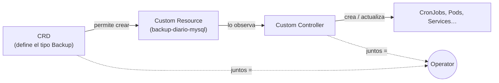

---
tags:
  - kubernetes
  - extensibility
aliases:
  - Custom Resource Definition
  - Custom Resource Definitions
  - CRD
  - CRDs
  - Custom Resource
  - CR
  - Recurso personalizado
---

# Custom Resource Definition

> [!abstract] En 30 segundos
> - **Qué es:** la forma de **añadir tipos de objeto nuevos** a la API de Kubernetes (`Backup`, `Certificate`, `HTTPRoute`…).
> - **Analogía:** crear una tabla nueva en una base de datos. Defines el esquema; a partir de ahí puedes insertar filas. Pero una tabla, sola, no *hace* nada.
> - **Recuerda:** **CRD = solo datos.** El comportamiento lo pone un [[Custom Controller]]. CRD + controlador = **Operator**.

---

## Qué es

Una **Custom Resource Definition** (CRD) registra un nuevo `kind` en el API Server sin modificar el código de Kubernetes. Cada objeto de ese tipo se llama **Custom Resource** (CR) y se usa con `kubectl` igual que un recurso nativo.

## Para qué sirve

Modelar conceptos propios de una herramienta o de tu dominio. Gran parte del ecosistema se construye así:

| Proyecto | CRDs que añade |
|---|---|
| [[Networking#Kubernetes Gateway API\|Gateway API]] | `GatewayClass`, `Gateway`, `HTTPRoute` |
| Istio ([[Networking#Service Mesh\|Service Mesh]]) | `VirtualService`, `DestinationRule` |
| cert-manager | `Certificate`, `Issuer` |
| Argo CD | `Application` |
| Prometheus Operator | `ServiceMonitor` |

## CRD vs Custom Resource vs Operator



| Pieza | Qué es | ¿Hace algo sola? |
|---|---|---|
| **CRD** | La definición del tipo (esquema) | No |
| **Custom Resource** | Una instancia concreta | No: el API Server solo la valida y guarda en etcd |
| **[[Custom Controller]]** | El programa que reacciona a los CR | Sí |

> [!tip] Validación con OpenAPI
> La CRD define un `openAPIV3Schema` con el que el API Server **rechaza objetos mal formados**, igual que con los recursos nativos. Con `additionalPrinterColumns` puedes añadir columnas a `kubectl get`.

> [!danger] Borrar una CRD borra todos sus objetos
> Al eliminar una CRD, Kubernetes elimina **todos los Custom Resources de ese tipo en todos los namespaces**. Cuidado al desinstalar operadores (por eso [[Helm]] no borra las CRDs al desinstalar).

---

## Ejemplo

### YAML: la CRD y un Custom Resource

```yaml
apiVersion: apiextensions.k8s.io/v1
kind: CustomResourceDefinition
metadata:
  name: backups.example.com   # <plural>.<group>
spec:
  group: example.com
  scope: Namespaced
  names:
    kind: Backup
    plural: backups
    singular: backup
    shortNames: ["bk"]
  versions:
    - name: v1
      served: true
      storage: true
      schema:
        openAPIV3Schema:
          type: object
          properties:
            spec:
              type: object
              required: ["database", "schedule"]
              properties:
                database:
                  type: string
                schedule:
                  type: string
                retentionDays:
                  type: integer
                  minimum: 1
---
apiVersion: example.com/v1
kind: Backup
metadata:
  name: backup-diario-mysql
spec:
  database: mysql-0
  schedule: "0 3 * * *"
  retentionDays: 7
```

### Comandos

```bash
# CRDs instaladas
kubectl get crd

# Esquema y versiones
kubectl describe crd backups.example.com

# Documentación del nuevo tipo, como si fuera nativo
kubectl explain backup.spec

# Se trabaja igual que con cualquier recurso
kubectl apply -f backup.yaml
kubectl get backups
kubectl get bk      # nombre corto definido en la CRD
```

---

## Relacionado
[[Custom Controller]] · [[Kube-controller-manager]] · [[Networking#Kubernetes Gateway API|Kubernetes Gateway API]] · [[Networking#Service Mesh|Service Mesh]] · [[Helm]]

> [!info] 📚 Estudio guiado
> Capítulo: [[02 - Fundamentos y arquitectura]] · Índice: [[00 - Kubernetes - Índice]]
