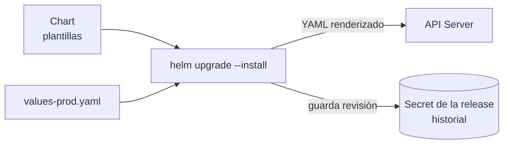

---
tags:
  - kubernetes
  - tooling
aliases:
  - Helm
  - Helm Chart
  - Helm Charts
  - Chart
  - Charts
  - Helm Release
  - values.yaml
---

# Helm

> [!abstract] En 30 segundos
> - **Qué es:** el **gestor de paquetes de Kubernetes**: empaqueta todos los YAML de una app en un *chart* parametrizable.
> - **Analogía:** NuGet/npm para Kubernetes. Un chart es el paquete; `values.yaml` son las opciones de instalación.
> - **Recuerda:** `helm upgrade --install` para desplegar, `helm template` para ver el YAML final, `helm rollback` para volver atrás.

---

## Qué es

**Helm** agrupa los manifiestos de una aplicación ([[Workloads#Deployment|Deployment]], [[Networking#Kubernetes Service|Service]], [[ConfigMap]], [[Networking#Ingress|Ingress]]…) en una unidad reutilizable con plantillas.

## Para qué sirve

Evita copiar y mantener a mano decenas de YAML por entorno, y guarda un **historial de versiones** de cada instalación (upgrade y rollback en un comando). Es la forma habitual de instalar piezas de plataforma: controladores de tráfico, una [[Networking#Service Mesh|Service Mesh]], un [[CSI Driver]], cert-manager…

## Conceptos clave

| Concepto | Qué es | Ejemplo |
|---|---|---|
| **Chart** | El paquete: plantillas + `Chart.yaml` + `values.yaml` | `jetstack/cert-manager` |
| **Values** | Parámetros que personalizan el chart. Se sobrescriben con `-f valores.yaml` o `--set clave=valor` | `replicaCount: 3` |
| **Release** | Una instalación concreta de un chart, con nombre y namespace. Un chart puede instalarse varias veces | `my-app` en `prod` |
| **Repository** | Donde se publican charts (HTTP o registros **OCI**) | `oci://registry/charts` |



## Cosas que debes saber

> [!tip] Helm 3+ no tiene servidor (adiós Tiller)
> Helm habla directamente con el API Server usando tu `kubeconfig` y **respeta tus permisos RBAC**. El estado de cada release se guarda como un [[Secret]] en su namespace. **Helm 4** (noviembre de 2025) mantiene este modelo; los charts de Helm 3 siguen funcionando.

> [!warning] Las CRDs y Helm
> Las [[Custom Resource Definition|CRDs]] de la carpeta `crds/` de un chart se instalan **una sola vez**: `helm upgrade` **no las actualiza** y `helm uninstall` **no las borra** (para no eliminar datos). Por eso muchos proyectos piden instalarlas o actualizarlas por separado, o exponen una opción como `crds.enabled=true`.

---

## Ejemplo

### Comandos del día a día

```bash
# Agregar un repositorio y actualizar el índice
helm repo add jetstack https://charts.jetstack.io
helm repo update

# Buscar charts y ver sus valores configurables
helm search repo cert-manager
helm show values jetstack/cert-manager > values-default.yaml

# Instalar (o actualizar si ya existe) en su propio namespace
helm upgrade --install cert-manager jetstack/cert-manager \
  -n cert-manager --create-namespace \
  --set crds.enabled=true -f mis-valores.yaml

# Renderizar las plantillas SIN instalar (revisa siempre el YAML final)
helm template my-app ./mi-chart -f values-prod.yaml

# Releases, historial y rollback
helm list -A
helm history cert-manager -n cert-manager
helm rollback cert-manager 1 -n cert-manager

# Desinstalar
helm uninstall cert-manager -n cert-manager

# Crear el esqueleto de un chart propio
helm create mi-chart
```

### Estructura de un chart

```text
mi-chart/
├── Chart.yaml          # nombre, versión del chart y appVersion
├── values.yaml         # valores por defecto
├── crds/               # CRDs (opcional)
└── templates/
    ├── deployment.yaml
    ├── service.yaml
    └── _helpers.tpl
```

### Valores → plantilla

```yaml
# values.yaml
replicaCount: 2
image:
  repository: python-django-app
  tag: "1.0.0"
service:
  port: 80
```

```yaml
# templates/deployment.yaml
apiVersion: apps/v1
kind: Deployment
metadata:
  name: {{ .Release.Name }}-app
spec:
  replicas: {{ .Values.replicaCount }}
  selector:
    matchLabels:
      app: {{ .Release.Name }}
  template:
    metadata:
      labels:
        app: {{ .Release.Name }}
    spec:
      containers:
        - name: app
          image: "{{ .Values.image.repository }}:{{ .Values.image.tag }}"
          ports:
            - containerPort: 8000
```

---

## Relacionado
[[Custom Resource Definition]] · [[Custom Controller]] · [[Networking#Ingress Controller|Ingress Controller]] · [[Networking#Service Mesh|Service Mesh]] · [[Workloads#Deployment|Deployment]] · [[Secret]]

> [!info] 📚 Estudio guiado
> Capítulo: [[11 - Helm, Kustomize y CI-CD]] · Índice: [[00 - Kubernetes - Índice]]
