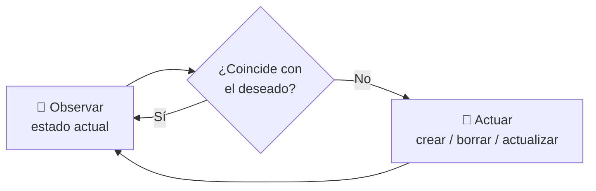

---
tags:
  - kubernetes
  - architecture
aliases:
  - Kube-controller-manager
  - kube-controller-manager
  - Controller Manager
  - Controladores
  - Reconciliation Loop
  - Bucle de reconciliación
---

# Kube-controller-manager

> [!abstract] En 30 segundos
> - **Qué es:** un proceso del [[Control Plane]] que ejecuta **todos los controladores integrados** de Kubernetes.
> - **Analogía:** un termostato. Tú fijas 22 °C (estado deseado); él mide la temperatura (estado actual) y enciende o apaga la calefacción hasta igualarlas. Para siempre.
> - **Recuerda:** el patrón **observar → comparar → actuar** es la base de *todo* Kubernetes, incluidos los Operators.

---

## Qué es

El **kube-controller-manager** ejecuta, en un solo proceso, los **controladores integrados**. Un controlador es un bucle infinito (*control loop*) que observa el clúster a través del API Server y actúa para acercar el **estado actual** al **estado deseado**. Es lo que hace a Kubernetes "auto-reparable".

## El patrón de reconciliación



Es el mismo patrón que se usa para escribir un [[Custom Controller]] u Operator.

## Controladores principales

| Controlador | Qué reconcilia |
|---|---|
| **ReplicaSet** | Que exista el número de [[Workloads#Pod\|Pods]] declarado en cada [[Workloads#ReplicaSet\|ReplicaSet]] (si uno muere, crea otro) |
| **Deployment** | Los ReplicaSets de un [[Workloads#Deployment\|Deployment]] durante actualizaciones y *rollbacks* |
| **StatefulSet, DaemonSet, Job, CronJob** | Sus respectivos workloads |
| **Node** | Detecta nodos que dejan de responder y los marca `NotReady` |
| **EndpointSlice** | La lista de IPs de Pods listos detrás de cada [[Networking#Kubernetes Service\|Service]] |
| **ServiceAccount, Namespace** | Cuentas por defecto y borrado en cascada de namespaces |
| **PersistentVolume** | Liga cada [[PersistentVolumeClaim]] con su [[PersistentVolume]] |

> [!warning] Elección de líder (*leader election*)
> En un Control Plane con alta disponibilidad hay varias copias del controller-manager, pero **solo una está activa** (el líder). Las demás esperan para tomar el relevo. Así se evita que dos copias creen Pods duplicados.

---

## Ejemplo

### Comandos útiles

```bash
# Ver el Pod del controller-manager (kubeadm/minikube)
kubectl get pods -n kube-system -l component=kube-controller-manager

# Revisar sus logs (útil cuando los Pods de un ReplicaSet no se crean)
kubectl logs -n kube-system -l component=kube-controller-manager

# Ver qué instancia es el líder actual
kubectl get lease kube-controller-manager -n kube-system -o yaml
```

### Ver la reconciliación en vivo

```bash
# Terminal 1: observa los Pods
kubectl get pods -w

# Terminal 2: borra un Pod de un Deployment… y mira cómo aparece otro
kubectl delete pod <pod-de-un-deployment>
```

### Extracto del manifiesto (`/etc/kubernetes/manifests/kube-controller-manager.yaml`)

```yaml
spec:
  containers:
    - name: kube-controller-manager
      command:
        - kube-controller-manager
        - --kubeconfig=/etc/kubernetes/controller-manager.conf
        - --leader-elect=true
        - --controllers=*,bootstrapsigner,tokencleaner
        - --node-monitor-grace-period=40s
```

---

## Relacionado
[[Control Plane]] · [[Cloud Controller Manager]] · [[Custom Controller]] · [[Workloads#ReplicaSet|ReplicaSet]] · [[Workloads#Deployment|Deployment]]

> [!info] 📚 Estudio guiado
> Capítulo: [[02 - Fundamentos y arquitectura]] · Índice: [[00 - Kubernetes - Índice]]
