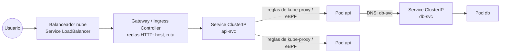
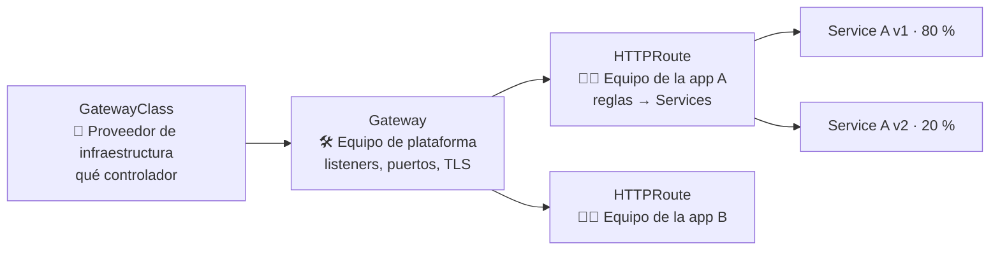

---
tags:
  - kubernetes
  - networking
aliases:
  - Kubernetes Service
  - Service
  - SVC
  - K8s Service
  - ClusterIP
  - Cluster IP
  - Internal Service
  - NodePort
  - Node Port
  - NodePort Service
  - LoadBalancer
  - Load Balancer Service
  - External LoadBalancer
  - Headless Service
  - Headless Services
  - None ClusterIP
  - Headless SVC
  - Ingress
  - Ingress Resource
  - K8s Ingress
  - Ingress API
  - Ingress Controller
  - Ingress Controllers
  - NGINX Ingress Controller
  - ALB Ingress Controller
  - Kubernetes Gateway API
  - Gateway API
  - GatewayClass
  - HTTPRoute
  - K8s Gateway API
  - Kube-proxy
  - Kube Proxy
  - Cube proxy
  - Service Mesh
  - Mesh de Servicios
  - Istio
  - Envoy Proxy
  - CNI
  - Container Network Interface
  - CNI Plugin
---

# Networking

> [!abstract] En 30 segundos
> - Cada **Pod** tiene su propia IP, pero esa IP **cambia** cada vez que el Pod se recrea.
> - Un **Service** da un nombre y una IP **estables** delante de un grupo de Pods (elegidos por labels).
> - Para entrar **desde fuera** por HTTP(S) se usa **Gateway API** (moderno) o **Ingress** (clásico) delante de los Services.
> - Por debajo, el **CNI** da red a los Pods y **kube-proxy** (o eBPF) programa las reglas que hacen funcionar los Services.

## Contenido

| Bloque | Conceptos |
|---|---|
| **Services** (tráfico interno y exposición básica) | [[#Kubernetes Service]] · [[#ClusterIP]] · [[#NodePort]] · [[#LoadBalancer]] · [[#Headless Service]] |
| **Entrada HTTP(S)** (norte-sur) | [[#Ingress]] · [[#Ingress Controller]] · [[#Kubernetes Gateway API]] |
| **Fontanería del clúster** | [[#Kube-proxy]] · [[#CNI]] |
| **Servicio a servicio** (este-oeste) | [[#Service Mesh]] |

## El camino de una petición



## Tipos de Service de un vistazo

| Tipo | ¿Accesible desde…? | IP que obtiene | Cuándo usarlo |
|---|---|---|---|
| [[#ClusterIP]] *(por defecto)* | Solo dentro del clúster | IP virtual interna | Comunicación entre microservicios |
| [[#NodePort]] | Red de los nodos (`IP-nodo:30000-32767`) | ClusterIP + puerto en cada nodo | Pruebas, laboratorios, bare-metal sencillo |
| [[#LoadBalancer]] | Internet o red interna (según anotaciones) | ClusterIP + NodePort + balanceador de la nube | Exponer **un** punto de entrada (normalmente el Gateway/Ingress) |
| [[#Headless Service]] (`clusterIP: None`) | Dentro del clúster, **directo a cada Pod** | Ninguna: el DNS devuelve las IPs de los Pods | StatefulSets, bases de datos con réplicas |
| `ExternalName` | Dentro del clúster | Ninguna: alias DNS (CNAME) a un nombre externo | Apuntar a un servicio fuera del clúster con un nombre interno |

## Los cuatro puertos (fuente clásica de confusión)

| Campo | Dónde se define | Qué es |
|---|---|---|
| `containerPort` | Pod | Puerto donde **escucha la app** (informativo) |
| `targetPort` | Service | Puerto del **Pod** al que el Service envía el tráfico (debe coincidir con la app) |
| `port` | Service | Puerto del **Service** (el que usan los clientes: `http://mi-svc:80`) |
| `nodePort` | Service NodePort/LB | Puerto abierto **en cada nodo** (30000-32767) |

> [!example] Ejemplo
> `curl http://<IP-nodo>:30007` → **nodePort** 30007 → Service **port** 80 → Pod **targetPort** 8000 → la app escucha en **containerPort** 8000.

---

## Kubernetes Service

> [!abstract] En una frase
> Un nombre DNS y una IP **estables** que reparten el tráfico entre los Pods que coinciden con un selector de labels.

### Qué es
Un **Service** (`svc`) es un objeto de abstracción que se coloca delante de un conjunto de [[Workloads#Pod|Pods]]. Los Pods van y vienen; el Service se queda.

### Para qué sirve

| Función | Cómo |
|---|---|
| **Descubrimiento de servicios** | Elige sus Pods por **labels y selectors**, no por IP. Kubernetes mantiene la lista de IPs de Pods **listos** en las **EndpointSlices** |
| **Balanceo de carga** | Reparte las conexiones entre los Pods listos (las reglas las programa [[#Kube-proxy]]; la elección por defecto es aleatoria, no un reparto exacto) |
| **Exposición** | El `type` decide el alcance: solo interno o también externo |
| **DNS** | Cada Service obtiene `<servicio>.<namespace>.svc.cluster.local` (CoreDNS) |

> [!warning] Service sin tráfico = casi siempre labels
> Si el `selector` no coincide **exactamente** con las labels de los Pods, el Service no tiene endpoints. Compruébalo con `kubectl get endpointslices -l kubernetes.io/service-name=<svc>`. Si los Pods no están *Ready* (readiness probe fallando), tampoco reciben tráfico.

### Ejemplo

**Comandos:**
```bash
kubectl get svc
kubectl describe svc python-django-app-service      # mira la línea Endpoints
kubectl get endpointslices -l kubernetes.io/service-name=python-django-app-service
kubectl edit svc python-django-app-service
kubectl delete svc python-django-app-service
```

**YAML (`service.yaml`):**
```yaml
apiVersion: v1
kind: Service
metadata:
  name: python-django-app-service
spec:
  selector:
    app: sample-python-app     # ← debe coincidir con las labels de los Pods
  ports:
    - protocol: TCP
      port: 80                 # puerto del Service
      targetPort: 8000         # puerto de la app en el Pod
```

### Relacionado
[[Workloads#Pod|Pod]] · [[#ClusterIP]] · [[#NodePort]] · [[#LoadBalancer]] · [[#Headless Service]] · [[#Ingress]] · [[#Kube-proxy]]

---

## ClusterIP

> [!abstract] En una frase
> El tipo **por defecto**: una IP virtual interna, alcanzable solo desde dentro del clúster.

### Qué es
**ClusterIP** asigna al [[#Kubernetes Service|Service]] una IP virtual interna. Nadie fuera del clúster puede llegar a ella.

### Para qué sirve
Comunicación y balanceo **interno** entre microservicios (frontend → backend → base de datos). Es lo que usarás para casi todos tus Services; la exposición externa se hace después con un Gateway o Ingress delante.

### Ejemplo

**YAML (`clusterip-service.yaml`):**
```yaml
apiVersion: v1
kind: Service
metadata:
  name: my-internal-service
spec:
  type: ClusterIP              # se puede omitir: es el valor por defecto
  selector:
    app: sample-python-app
  ports:
    - port: 80
      targetPort: 8000
```

**Probarlo desde dentro del clúster:**
```bash
kubectl get svc my-internal-service
kubectl run -it --rm curl --image=curlimages/curl:8.11.1 --restart=Never -- \
  curl -s http://my-internal-service.default.svc.cluster.local
```

### Relacionado
[[#Kubernetes Service]] · [[#NodePort]] · [[#LoadBalancer]] · [[Workloads#Pod|Pod]] · [[#Kube-proxy]]

---

## NodePort

> [!abstract] En una frase
> Abre el **mismo puerto (30000-32767) en todos los nodos** y lo redirige al Service.

### Qué es
**NodePort** expone el [[#Kubernetes Service|Service]] en un puerto fijo de la IP de **cada** nodo del clúster. Incluye un ClusterIP por debajo.

### Para qué sirve
Acceder desde fuera del clúster a cualquiera que alcance la red de los nodos (VMs en una VPC, red corporativa). El tráfico va: `nodePort` → `port` del Service → `targetPort` del Pod.

> [!warning] Rango fijo y exposición directa
> `nodePort` debe estar entre **30000 y 32767**. Abrir puertos en los nodos no es la opción más segura ni cómoda para producción: expone los nodos directamente y obliga a los clientes a conocer sus IPs.

### Ejemplo

**YAML (`nodeport-service.yaml`):**
```yaml
apiVersion: v1
kind: Service
metadata:
  name: python-django-app-service
spec:
  type: NodePort
  selector:
    app: sample-python-app
  ports:
    - port: 80
      targetPort: 8000
      nodePort: 30007          # opcional; si se omite se asigna uno del rango
```

**Probarlo:**
```bash
minikube ip                               # IP del nodo en minikube
curl -L http://<NODE-IP>:30007/demo
```

### Relacionado
[[#Kubernetes Service]] · [[#ClusterIP]] · [[#LoadBalancer]] · [[#Ingress]] · [[#Kube-proxy]]

---

## LoadBalancer

> [!abstract] En una frase
> Pide a la nube un **balanceador real** que envía tráfico a los nodos del clúster.

### Qué es
**LoadBalancer** integra el [[#Kubernetes Service|Service]] con el balanceador del proveedor (AWS NLB/ELB, Azure Load Balancer, Google Cloud LB). Por dentro es **ClusterIP + NodePort + un balanceador externo delante**, creado por el [[Cloud Controller Manager]].

### Para qué sirve
Exponer la aplicación con una IP propia del balanceador.

| Mito | Realidad |
|---|---|
| "La IP es estática" | La asigna el proveedor al crear el Service y la **libera al borrarlo**. Para una IP fija, resérvala en la nube y referénciala con anotaciones del proveedor (p. ej. `service.beta.kubernetes.io/azure-pip-name`); `spec.loadBalancerIP` está obsoleto |
| "Siempre es pública" | Con anotaciones se crean **balanceadores internos** (p. ej. `service.beta.kubernetes.io/azure-load-balancer-internal: "true"`) |

> [!warning] En local se queda en `<pending>`
> En minikube o kind no hay [[Cloud Controller Manager]], así que `EXTERNAL-IP` queda en `<pending>`. Usa `minikube tunnel` o MetalLB.

> [!warning] Un balanceador por Service = factura alta
> Cada LoadBalancer es un recurso de pago. Con decenas de microservicios, pon **un solo** LoadBalancer delante de un [[#Kubernetes Gateway API|Gateway]] o [[#Ingress]] y enruta por host/ruta.

### Ejemplo

**YAML (`loadbalancer-service.yaml`):**
```yaml
apiVersion: v1
kind: Service
metadata:
  name: my-loadbalancer-service
spec:
  type: LoadBalancer
  selector:
    app: sample-python-app
  ports:
    - port: 80
      targetPort: 8000
```

**Comandos:**
```bash
kubectl get svc my-loadbalancer-service -w      # espera a que aparezca EXTERNAL-IP
kubectl describe svc my-loadbalancer-service    # eventos si no se crea
```

### Relacionado
[[#Kubernetes Service]] · [[#ClusterIP]] · [[#NodePort]] · [[#Ingress]] · [[Cloud Controller Manager]]

---

## Headless Service

> [!abstract] En una frase
> Un Service **sin IP virtual** (`clusterIP: None`): el DNS devuelve directamente las IPs de cada Pod.

### Qué es
Un **Headless Service** no hace proxy ni balanceo: es solo un registro DNS que devuelve los registros A de cada [[Workloads#Pod|Pod]] asociado.

### Para qué sirve
Conectar con **una réplica concreta**. Es imprescindible para [[Workloads#StatefulSet|StatefulSets]] (bases de datos, Kafka, Redis): cada réplica obtiene su propio nombre DNS, por ejemplo `mysql-0.my-db-headless.default.svc.cluster.local`, y así el cliente puede hablar con el primario o las réplicas sincronizarse entre sí.

| Service normal | Headless Service |
|---|---|
| `nslookup mi-svc` → **1 IP** (la ClusterIP) | `nslookup mi-svc` → **N IPs** (una por Pod) |
| Kubernetes elige el Pod | El cliente elige el Pod |

> [!tip] Créalo antes que el StatefulSet
> El StatefulSet lo referencia en `serviceName` pero **no lo crea**. Si no existe, las réplicas no obtienen su DNS individual.

### Ejemplo

**YAML (`headless-svc.yaml`):**
```yaml
apiVersion: v1
kind: Service
metadata:
  name: my-db-headless
spec:
  clusterIP: None          # ← esto lo convierte en headless
  selector:
    app: mysql
  ports:
    - port: 3306
      targetPort: 3306
```

**Comprobarlo:**
```bash
kubectl apply -f headless-svc.yaml
kubectl get svc            # CLUSTER-IP aparece como None

kubectl run -it --rm dns-test --image=busybox:1.37 --restart=Never -- \
  nslookup mysql-0.my-db-headless.default.svc.cluster.local
```

### Relacionado
[[#Kubernetes Service]] · [[Workloads#StatefulSet|StatefulSet]] · [[Workloads#Pod|Pod]] · [[#ClusterIP]]

---

## Ingress

> [!abstract] En una frase
> Reglas HTTP(S) (**host + ruta → Service**) para que muchas apps compartan **una sola** entrada al clúster.

### Qué es
**Ingress** es un objeto de la API (`networking.k8s.io/v1`) que describe cómo enrutar el tráfico HTTP/HTTPS externo hacia los [[#Kubernetes Service|Services]] internos. **Es solo una declaración**: lo ejecuta un [[#Ingress Controller]].

### Para qué sirve
Evitar un [[#LoadBalancer]] por aplicación (caro) o puertos [[#NodePort]] (inseguro) usando **una sola** IP de entrada:

| Capacidad | Ejemplo |
|---|---|
| Enrutamiento por **ruta** (*path-based*) | `dominio.com/app1` → svc-1 · `dominio.com/app2` → svc-2 |
| Enrutamiento por **host** (*host-based*) | `app1.dominio.com` → svc-1 · `app2.dominio.com` → svc-2 |
| **TLS** | Certificado guardado en un [[Secret]] de tipo `kubernetes.io/tls` (normalmente generado por cert-manager) |
| **Comodines** | `*.dominio.com` |

`pathType` admite `Exact`, `Prefix` e `ImplementationSpecific`.

> [!warning] Sin Ingress Controller no pasa nada
> Crear el objeto `Ingress` no enruta nada por sí solo. La columna `ADDRESS` queda vacía hasta que haya un [[#Ingress Controller]] instalado que lo lea.

> [!warning] Las limitaciones que dieron origen a Gateway API
> La especificación de Ingress solo cubre host + ruta + TLS. Todo lo demás (*rate limiting*, reescrituras, canary, cabeceras) se resolvía con **anotaciones propietarias** de cada controlador, nada portables. Por eso nació la [[#Kubernetes Gateway API]].

### Ejemplo

**YAML (`ingress.yaml`):**
```yaml
apiVersion: networking.k8s.io/v1
kind: Ingress
metadata:
  name: ingress-example
spec:
  ingressClassName: nginx        # qué controlador lo procesa
  rules:
    - host: foo.bar.com
      http:
        paths:
          - path: /bar
            pathType: Prefix
            backend:
              service:
                name: my-service-name
                port:
                  number: 80
```

**Comandos:**
```bash
kubectl apply -f ingress.yaml
kubectl get ingress
kubectl describe ingress ingress-example

# Probar simulando el host
curl -H "Host: foo.bar.com" http://<INGRESS-IP>/bar
```

### Relacionado
[[#Ingress Controller]] · [[#Kubernetes Service]] · [[#LoadBalancer]] · [[#NodePort]] · [[#Kubernetes Gateway API]] · [[Secret]]

---

## Ingress Controller

> [!abstract] En una frase
> El programa (un proxy dentro del clúster) que **lee los objetos Ingress y los convierte en configuración real** de enrutamiento.

### Qué es
Un **Ingress Controller** es un [[Custom Controller|controlador]] que corre como Pods en el clúster (o integra un balanceador externo) y vigila continuamente los objetos [[#Ingress]].

### Para qué sirve
Traduce las reglas declaradas en configuración del proxy (por ejemplo, regenerando su `nginx.conf` o las reglas de un balanceador de la nube). Sin él, los Ingress no tienen efecto.

> [!danger] `ingress-nginx` está retirado
> El controlador comunitario **`kubernetes/ingress-nginx`** (el que instala `minikube addons enable ingress` y el de casi todos los tutoriales) fue **retirado por SIG Network**: anunciado en noviembre de 2025, con mantenimiento solo hasta **marzo de 2026**. Ya no recibe releases ni parches de seguridad. Los clústeres existentes siguen funcionando.

| Si empiezas un proyecto nuevo | Opciones |
|---|---|
| **Recomendado** | [[#Kubernetes Gateway API\|Gateway API]] con una implementación mantenida: Envoy Gateway, Istio, Cilium, NGINX Gateway Fabric, Traefik, Kong, Application Gateway for Containers (Azure) |
| **Si necesitas Ingress** | Otro controlador mantenido: Traefik, HAProxy, Kong, el **NGINX Ingress Controller de F5/NGINX Inc.** (proyecto distinto), o el gestionado del proveedor: AWS Load Balancer Controller, AGIC/AGC (Azure), GKE Ingress |
| **Para aprender en local** | `ingress-nginx` sigue sirviendo: los conceptos de Ingress no cambian |

> [!tip] IngressClass
> Con varios controladores, cada Ingress elige el suyo con `spec.ingressClassName`. Una `IngressClass` con la anotación `ingressclass.kubernetes.io/is-default-class: "true"` se usa cuando no se indica ninguna.

### Ejemplo

**Comandos (laboratorio con minikube):**
```bash
# Habilitar el controlador (ingress-nginx; solo para aprender)
minikube addons enable ingress

# Ver sus Pods
kubectl get pods -n ingress-nginx

# Logs: confirman si leyó tus reglas
kubectl logs -n ingress-nginx <pod-del-ingress-controller>
```

### Relacionado
[[#Ingress]] · [[#Kubernetes Service]] · [[#Kubernetes Gateway API]] · [[Helm]] · [[Custom Controller]]

---

## Kubernetes Gateway API

> [!abstract] En una frase
> El **sucesor de Ingress**: separa la infraestructura (Gateway) de las rutas (HTTPRoute) y trae de serie lo que Ingress solo hacía con anotaciones.

### Qué es
La **Gateway API** es un estándar de Kubernetes, implementado con [[Custom Resource Definition|CRDs]], para gestionar el tráfico de entrada (norte-sur) y, cada vez más, también el interno. Es **GA desde octubre de 2023 (v1.0)**.

> [!warning] Las CRDs no vienen instaladas
> Kubernetes no trae la Gateway API de serie: las CRDs las instala la implementación elegida o el administrador (`kubectl apply -f .../standard-install.yaml`).

### Para qué sirve: un objeto por rol



| Objeto | Lo define | Qué contiene |
|---|---|---|
| `GatewayClass` | Proveedor de infraestructura / plataforma | Qué controlador implementa los Gateways |
| `Gateway` | Administradores del clúster | Puntos de escucha (*listeners*), puertos, certificados TLS |
| `HTTPRoute` (y `GRPCRoute`…) | Equipos de desarrollo | Reglas de enrutamiento hacia los Services |

### Qué es portable y qué no

| Nivel | Funciones |
|---|---|
| **Core / Extended** (portables entre implementaciones) | *Matching* por ruta, cabeceras, query y método · **reparto de tráfico por peso** (canary) · redirecciones · reescritura de URL · modificación de cabeceras · *mirroring* · TLS · `GRPCRoute` (GA en v1.1) |
| **Experimental** | `TCPRoute`, `UDPRoute`, `TLSRoute` |
| **Específico de cada implementación** | *Rate limiting*, autenticación, WAF, reintentos avanzados… con **políticas propias** (p. ej. `BackendTrafficPolicy` / `SecurityPolicy` en Envoy Gateway) |

Comparativa completa con Ingress en [[18 - Trade-offs]].

### Ejemplo: canary 80/20 con Envoy Gateway

**YAML (`gateway-setup.yaml`):**
```yaml
apiVersion: gateway.networking.k8s.io/v1
kind: GatewayClass
metadata:
  name: eg-gateway-class
spec:
  controllerName: gateway.envoyproxy.io/gatewayclass-controller
---
apiVersion: gateway.networking.k8s.io/v1
kind: Gateway
metadata:
  name: eg-gateway
spec:
  gatewayClassName: eg-gateway-class
  listeners:
    - name: http
      protocol: HTTP
      port: 80
---
apiVersion: gateway.networking.k8s.io/v1
kind: HTTPRoute
metadata:
  name: http-app-route
spec:
  parentRefs:
    - name: eg-gateway          # se "engancha" al Gateway
  hostnames:
    - "backends.example"
  rules:
    - backendRefs:
        - name: backend-service-1
          port: 3000
          weight: 80            # 80 % a la versión estable
        - name: backend-service-2
          port: 3000
          weight: 20            # 20 % a la versión nueva
```

**Comandos:**
```bash
kubectl apply -f gateway-setup.yaml
kubectl get gatewayclass,gateway,httproute
kubectl describe httproute http-app-route    # condiciones Accepted / ResolvedRefs
```

### Relacionado
[[#Ingress]] · [[#Ingress Controller]] · [[#Kubernetes Service]] · [[Custom Resource Definition]] · [[Custom Controller]]

---

## Kube-proxy

> [!abstract] En una frase
> El componente de cada nodo que **programa reglas en el kernel** para que la IP de un Service llegue a alguno de sus Pods. No transporta el tráfico: solo escribe las reglas.

### Qué es
**Kube-proxy** corre en cada nodo (normalmente como **DaemonSet** en `kube-system`), tanto en el [[Control Plane]] como en los [[Worker Node]]s.

### Para qué sirve
Cuando creas un [[#Kubernetes Service|Service]], kube-proxy lee sus IPs de Pods desde las **EndpointSlices** (la API antigua `Endpoints` está obsoleta desde 1.33) y escribe reglas en el kernel para que el tráfico a `IP-del-Service:puerto` se redirija a la IP de un Pod. **Quien enruta los paquetes es el kernel**, no kube-proxy.

### Modos de funcionamiento

| Modo | Cómo elige el Pod | Notas |
|---|---|---|
| `iptables` *(el más común)* | **Aleatorio / probabilístico** | Escala peor con miles de Services |
| `ipvs` | **Round-robin** por defecto (configurable: `lc`, `sh`…) | Mejor rendimiento a gran escala |
| `nftables` | Aleatorio | **GA desde 1.33**. Sucesor moderno de iptables en kernels recientes |
| *Sin kube-proxy* (eBPF) | Lo decide el CNI | **Cilium** lo sustituye (`kubeProxyReplacement`); así funcionan GKE Dataplane V2 y Azure CNI Powered by Cilium |

> [!warning] Por defecto **no** prioriza Pods locales
> Se balancea entre **todos** los Pods del clúster. Para preferir el nodo o la zona local hay que configurarlo:
> - `internalTrafficPolicy: Local` (tráfico interno solo a Pods del mismo nodo).
> - `externalTrafficPolicy: Local` (externo solo a Pods locales; además **conserva la IP de origen** del cliente).
> - `trafficDistribution: PreferClose` (GA en 1.33): prefiere la misma zona sin perder resiliencia.

Diagramas del flujo completo en [[04 - Networking y tráfico]].

### Ejemplo

**Comandos:**
```bash
# Un Pod de kube-proxy por nodo
kubectl get pods -n kube-system -l k8s-app=kube-proxy -o wide

# Modo configurado (iptables / ipvs / nftables)
kubectl get configmap kube-proxy -n kube-system -o yaml | grep mode

# Logs para diagnosticar reglas
kubectl logs -n kube-system <pod-kube-proxy>
```

### Relacionado
[[#Kubernetes Service]] · [[#ClusterIP]] · [[#NodePort]] · [[Worker Node]] · [[Control Plane]] · [[Workloads#Pod|Pod]] · [[#CNI]]

---

## Service Mesh

> [!abstract] En una frase
> Una capa de infraestructura que añade **mTLS, control de tráfico, reintentos y observabilidad** a la comunicación entre servicios, sin tocar su código.

### Qué es
Una **Service Mesh** (malla de servicios) gestiona el tráfico **servicio a servicio** dentro del clúster (este-oeste). Herramientas como Istio se integran extendiendo la API con [[Custom Resource Definition|CRDs]] y [[Custom Controller|controladores]].

### Para qué sirve

| Capacidad | Qué aporta |
|---|---|
| **Seguridad (mTLS)** | Cifrado y autenticación mutua entre servicios, con certificados rotados automáticamente |
| **Gestión de tráfico** | Canary, Blue/Green, A/B por pesos o cabeceras (`VirtualService`, `DestinationRule` en Istio) |
| **Observabilidad** | Métricas de cada llamada y mapa de dependencias (Kiali) |
| **Resiliencia** | *Circuit breaking*, reintentos, *timeouts*, límites de tasa |

### Dos arquitecturas

| | **Con sidecar** (clásica) | **Sin sidecar** (moderna) |
|---|---|---|
| Cómo | Se inyecta un proxy (Envoy) **en cada Pod** mediante un *Mutating Admission Webhook* | Un proxy **por nodo** para capa 4 + proxies opcionales para capa 7 |
| Ejemplos | Istio (modo sidecar), **Linkerd** (sidecars ultraligeros en Rust) | **Istio ambient** (GA desde Istio 1.24, nov. 2024: `ztunnel` + *waypoint proxies*), **Cilium Service Mesh** (eBPF) |
| Coste | CPU, memoria y latencia extra **en cada Pod** | Mucho menor |

> [!warning] Antes de instalar una mesh
> Añade complejidad operativa real. Pregúntate si la necesitas: mTLS y observabilidad básica a veces se cubren con el CNI (Cilium) y OpenTelemetry.

### Ejemplo (Istio)

```bash
# Instalar con istioctl (perfil demo para aprender; "ambient" para el modo sin sidecar)
istioctl install --set profile=demo -y

# Inyección automática de sidecars en un namespace
kubectl label namespace default istio-injection=enabled

# Recursos de la mesh
kubectl get virtualservices
kubectl get destinationrules
```

> [!tip] Instalar con Helm
> En producción Istio suele instalarse con Helm: `helm repo add istio https://istio-release.storage.googleapis.com/charts` y después los charts `base` e `istiod`.

### Relacionado
[[Workloads#Pod|Pod]] · [[Custom Resource Definition]] · [[Custom Controller]] · [[#Kubernetes Gateway API]] · [[#Ingress]] · [[Helm]]

---

## CNI

> [!abstract] En una frase
> El plugin que **da IP a cada Pod y conecta todos los Pods entre sí**, estén en el nodo que estén.

### Qué es
**CNI** (*Container Network Interface*) es una especificación, y el plugin que la implementa es software **externo** a Kubernetes. El [[Container Runtime]] (containerd o CRI-O) lo invoca al crear cada Pod.

### Para qué sirve
Cumplir el **modelo de red de Kubernetes**:
1. Cada [[Workloads#Pod|Pod]] tiene una **IP única** del rango asignado a su nodo.
2. **Todos los Pods se alcanzan entre sí sin NAT**, aunque estén en nodos distintos.

### Qué CNI elegir

| CNI | Puntos clave | NetworkPolicies |
|---|---|---|
| **Cilium** | eBPF, políticas L3-L7, puede sustituir kube-proxy. El más extendido hoy; base de GKE Dataplane V2 y Azure CNI Powered by Cilium | ✅ |
| **Calico** | Políticas muy completas, BGP | ✅ |
| **Flannel** | Muy simple | ❌ No las aplica por sí solo |
| **AWS VPC CNI** | Pods con IPs de la VPC | ✅ (con su agente de políticas) |
| **Azure CNI** | Overlay o con IPs de la VNet | ✅ (con Azure NPM, Calico o Cilium) |
| ~~Weave Net~~ | **Abandonado** (Weaveworks cerró en 2024). No usar | — |

> [!danger] El CNI decide si las NetworkPolicies funcionan
> Si el plugin no las soporta, el objeto `NetworkPolicy` **se acepta pero no hace nada**, sin ningún error. Ver [[04 - Networking y tráfico#NetworkPolicy]].

### Ejemplo

**Instalar Cilium con Helm (en un clúster creado sin CNI):**
```bash
helm repo add cilium https://helm.cilium.io/
helm install cilium cilium/cilium --namespace kube-system
cilium status --wait     # CLI de Cilium
```
- En **kind**: crea el clúster con `networking.disableDefaultCNI: true`.
- En **minikube**: `minikube start --cni=cilium` o `--cni=calico`.

**Comprobar la red de Pods:**
```bash
# Pods del CNI (cilium, calico-node…) en kube-system
kubectl get pods -n kube-system -o wide

# Conectividad directa a la IP de un Pod
kubectl get pod <pod> -o wide
kubectl run -it --rm curl --image=curlimages/curl:8.11.1 --restart=Never -- curl -s http://<POD-IP>:80
```

### Relacionado
[[Workloads#Pod|Pod]] · [[Worker Node]] · [[#Kube-proxy]] · [[Container Runtime]] · [[#Kubernetes Service]]

> [!info] 📚 Estudio guiado
> Capítulo: [[04 - Networking y tráfico]] · Índice: [[00 - Kubernetes - Índice]]
