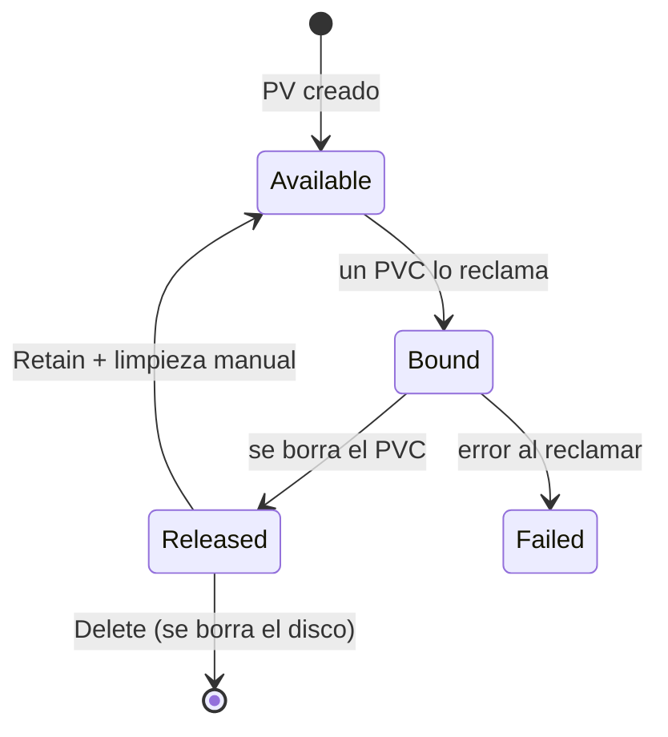

---
tags:
  - kubernetes
  - storage
aliases:
  - PersistentVolume
  - PersistentVolumes
  - PV
  - Persistent Volume
  - Volumen Persistente
---

# PersistentVolume

> [!abstract] En 30 segundos
> - **Qué es:** la representación en Kubernetes de un **disco real** (disco en la nube, NFS, iSCSI…).
> - **Analogía:** una plaza de aparcamiento. Existe aunque no haya coche; el [[PersistentVolumeClaim|PVC]] es el ticket que te la asigna.
> - **Recuerda:** el PV es **de clúster** (sin namespace); el PVC es **de namespace**. Relación 1 a 1.

---

## Qué es

Un **PersistentVolume** (`pv`) es un recurso del clúster que representa almacenamiento real. Su ciclo de vida es **independiente** de cualquier [[Workloads#Pod|Pod]]. No pertenece a ningún namespace.

## Para qué sirve

Separa **quién provee** el almacenamiento (el administrador o una [[StorageClass]]) de **quién lo consume** (el desarrollador, mediante un [[PersistentVolumeClaim]]).

| Aprovisionamiento | Quién crea el PV |
|---|---|
| **Estático** | El administrador, a mano |
| **Dinámico** *(lo normal)* | Una [[StorageClass]] y su [[CSI Driver]], automáticamente al aparecer un PVC |

## Propiedades clave

### Modos de acceso (`accessModes`)

| Modo | Sigla | Significa |
|---|---|---|
| `ReadWriteOnce` | RWO | Lectura/escritura desde **un nodo** |
| `ReadOnlyMany` | ROX | Solo lectura desde varios nodos |
| `ReadWriteMany` | RWX | Lectura/escritura desde varios nodos (NFS, Azure Files, EFS…) |
| `ReadWriteOncePod` | RWOP | Lectura/escritura desde **un solo Pod** |

> [!tip] RWO es por nodo, no por Pod
> `ReadWriteOnce` permite que **varios Pods** lo monten si están en el **mismo nodo**. Para exclusividad real de un Pod, usa `ReadWriteOncePod`.

### Política de reclamo (`persistentVolumeReclaimPolicy`)

| Política | Al borrar el PVC… |
|---|---|
| `Retain` | Se conservan el PV y los datos. Limpieza **manual** |
| `Delete` | Se borra el PV **y el disco** subyacente |
| ~~`Recycle`~~ | Obsoleto |

### Ciclo de vida (`STATUS`)



> [!warning] `Released` no significa reutilizable
> Con `Retain`, al borrar el PVC el PV pasa a `Released` pero **no** vuelve solo a `Available`: guarda la referencia al PVC anterior y sus datos. Para reutilizarlo: limpia los datos y elimina `spec.claimRef`, o borra y recrea el PV.

---

## Ejemplo: aprovisionamiento estático

### YAML

```yaml
apiVersion: v1
kind: PersistentVolume
metadata:
  name: pv-local-demo
spec:
  capacity:
    storage: 5Gi
  accessModes:
    - ReadWriteOnce
  persistentVolumeReclaimPolicy: Retain
  storageClassName: manual
  hostPath:                 # solo para laboratorio local
    path: /mnt/data
```

### Comandos

```bash
kubectl get pv                        # sin namespace
kubectl describe pv pv-local-demo     # capacidad, modo, política y PVC ligado
kubectl delete pv pv-local-demo
```

---

## Relacionado
[[PersistentVolumeClaim]] · [[StorageClass]] · [[CSI Driver]] · [[Volume]] · [[Workloads#StatefulSet|StatefulSet]]

> [!info] 📚 Estudio guiado
> Capítulo: [[05 - Configuración y almacenamiento]] · Índice: [[00 - Kubernetes - Índice]]
