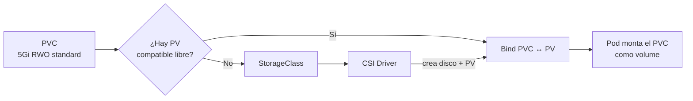

---
tags:
  - kubernetes
  - storage
aliases:
  - PersistentVolumeClaim
  - PersistentVolumeClaims
  - PVC
  - Persistent Volume Claim
  - volumeClaimTemplates
---

# PersistentVolumeClaim

> [!abstract] En 30 segundos
> - **Qué es:** una **petición de almacenamiento**: "quiero 5 GiB, RWO, de la clase `standard`".
> - **Analogía:** el ticket de aparcamiento. Tú pides una plaza con ciertas características; el sistema te asigna una ([[PersistentVolume|PV]]).
> - **Recuerda:** el Pod **solo conoce el nombre del PVC**, nunca el disco real. PVC ↔ PV es 1 a 1.

---

## Qué es

Un **PersistentVolumeClaim** (`pvc`) es una solicitud de almacenamiento hecha por una aplicación. Indica tamaño, modo de acceso y, opcionalmente, [[StorageClass]]. Kubernetes lo liga (*bind*) a un [[PersistentVolume]] compatible. **Sí pertenece a un namespace.**

## Para qué sirve

Que los [[Workloads#Pod|Pods]] usen almacenamiento persistente **sin conocer la infraestructura** (tipo de disco, proveedor, servidor NFS).

## Cómo funciona



1. Se crea el PVC.
2. Si hay un PV compatible libre, se liga. Si no, y hay [[StorageClass]], el [[CSI Driver]] crea uno nuevo dinámicamente.
3. El Pod monta el PVC como un [[Volume]].

## Problemas típicos

> [!warning] PVC atascado en `Pending`
> | Causa | Cómo saberlo |
> |---|---|
> | No hay PV compatible ni aprovisionamiento dinámico | `kubectl describe pvc` → evento `no persistent volumes available` |
> | La StorageClass usa `WaitForFirstConsumer` y ningún Pod lo usa todavía | **Normal**: se liga cuando el Pod se programa |
> | `storageClassName` mal escrito | El evento menciona la clase inexistente |

> [!tip] PVC en StatefulSets
> Un [[Workloads#StatefulSet|StatefulSet]] no usa PVCs creados a mano: usa `volumeClaimTemplates` para generar **un PVC por réplica** (`www-web-0`, `www-web-1`…).
> - **Por defecto** esos PVC **no se borran** al eliminar o escalar hacia abajo el StatefulSet (protege tus datos).
> - Desde **1.32 (GA)** puedes cambiarlo con `persistentVolumeClaimRetentionPolicy` (`whenDeleted` / `whenScaled`: `Retain` o `Delete`).

---

## Ejemplo

### YAML: PVC + Pod que lo usa

```yaml
apiVersion: v1
kind: PersistentVolumeClaim
metadata:
  name: data-pvc
spec:
  accessModes:
    - ReadWriteOnce
  storageClassName: standard
  resources:
    requests:
      storage: 5Gi
---
apiVersion: v1
kind: Pod
metadata:
  name: app-con-datos
spec:
  containers:
    - name: app
      image: nginx:1.28
      volumeMounts:
        - name: datos
          mountPath: /usr/share/nginx/html
  volumes:
    - name: datos
      persistentVolumeClaim:
        claimName: data-pvc        # el Pod solo conoce el nombre del PVC
```

### Comandos

```bash
# Estado de los PVC (Bound / Pending)
kubectl get pvc

# Diagnosticar por qué no se liga
kubectl describe pvc data-pvc

# Ampliar el tamaño (requiere allowVolumeExpansion: true en la StorageClass)
kubectl patch pvc data-pvc -p '{"spec":{"resources":{"requests":{"storage":"10Gi"}}}}'

# Eliminar (¡con reclaimPolicy Delete también se borra el disco!)
kubectl delete pvc data-pvc
```

---

## Relacionado
[[PersistentVolume]] · [[StorageClass]] · [[Volume]] · [[CSI Driver]] · [[Workloads#StatefulSet|StatefulSet]] · [[Workloads#Pod|Pod]]

> [!info] 📚 Estudio guiado
> Capítulo: [[05 - Configuración y almacenamiento]] · Índice: [[00 - Kubernetes - Índice]]
