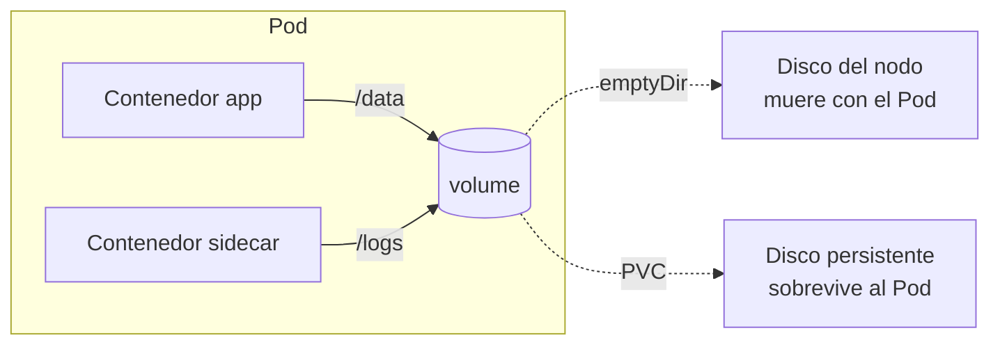

---
tags:
  - kubernetes
  - storage
aliases:
  - Volume
  - Volumes
  - Volumen
  - K8s Volume
  - emptyDir
  - hostPath
---

# Volume

> [!abstract] En 30 segundos
> - **Qué es:** un directorio que se declara **en el Pod** y que cada contenedor monta donde quiera.
> - **Analogía:** una carpeta compartida en red. El Pod la "conecta" y cada contenedor decide en qué ruta verla.
> - **Recuerda:** el **tipo** de volumen decide cuánto viven los datos. `emptyDir` muere con el Pod; un PVC sobrevive a él.

---

## Qué es

Un **Volume** se declara en `spec.volumes` del [[Workloads#Pod|Pod]], y cada contenedor lo monta con `volumeMounts`. Sin volúmenes, cada contenedor tiene su propio sistema de archivos **efímero y privado**.

## Para qué sirve

1. **Persistencia**: que los datos no se pierdan al reiniciarse un contenedor.
2. **Compartición**: que varios contenedores del mismo Pod (app + *sidecar*) lean y escriban los mismos archivos.

## Tipos más comunes

| Tipo | Origen de los datos | ¿Cuánto viven? | Uso típico |
|---|---|---|---|
| `emptyDir` | Directorio vacío en el nodo | Mientras exista el **Pod** (sobrevive a reinicios del contenedor) | Caché, archivos temporales compartidos |
| `hostPath` | Directorio del **nodo** | Lo que viva el nodo | Solo agentes del sistema (DaemonSets de logs) |
| `configMap` / `secret` | Un [[ConfigMap]] o [[Secret]] | Lo que viva el objeto | Archivos de configuración, certificados |
| `projected` | Varias fuentes en un mismo directorio (Secret + ConfigMap + token de SA + downwardAPI) | Lo que vivan las fuentes | Montar todo junto en `/etc/app` |
| `persistentVolumeClaim` | Almacenamiento real vía [[PersistentVolumeClaim]] | **Independiente del Pod** | Bases de datos, archivos subidos |



## Errores comunes

> [!warning] `emptyDir` no es persistente
> Se borra junto con el Pod. Si el Pod se reprograma en otro nodo, los datos se pierden. Para datos que deben sobrevivir usa un [[PersistentVolumeClaim]].

> [!danger] Evita `hostPath` en producción
> Expone el sistema de archivos del nodo al contenedor (riesgo de seguridad) y ata el Pod a un nodo concreto. Resérvalo para agentes del sistema desplegados como DaemonSet.

---

## Ejemplo: dos contenedores comparten un `emptyDir`

### YAML

```yaml
apiVersion: v1
kind: Pod
metadata:
  name: shared-pod
spec:
  volumes:
    - name: shared-data
      emptyDir: {}
  containers:
    - name: writer
      image: busybox:1.37
      command: ["sh", "-c", "echo 'hola desde writer' > /data/index.html && sleep 3600"]
      volumeMounts:
        - name: shared-data
          mountPath: /data
    - name: reader
      image: busybox:1.37
      command: ["sh", "-c", "sleep 3600"]
      volumeMounts:
        - name: shared-data
          mountPath: /data
```

### Comprobarlo

```bash
# Ver volúmenes declarados y montados
kubectl describe pod shared-pod

# Leer desde "reader" lo que escribió "writer"
kubectl exec -it shared-pod -c reader -- cat /data/index.html
```

---

## Relacionado
[[Workloads#Pod|Pod]] · [[PersistentVolume]] · [[PersistentVolumeClaim]] · [[StorageClass]] · [[CSI Driver]] · [[ConfigMap]] · [[Secret]]

> [!info] 📚 Estudio guiado
> Capítulo: [[05 - Configuración y almacenamiento]] · Índice: [[00 - Kubernetes - Índice]]
