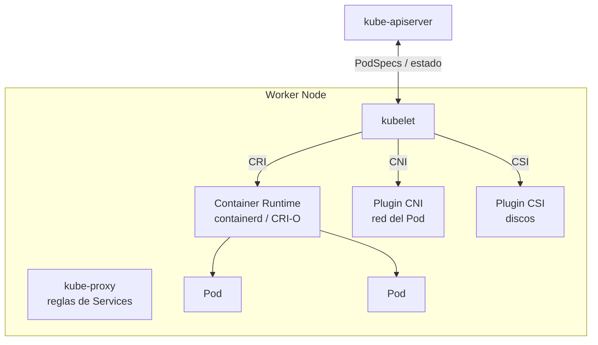

---
tags:
  - kubernetes
  - architecture
aliases:
  - Worker Node
  - Worker Nodes
  - Nodo de trabajo
  - Nodo worker
  - Node
  - Nodo
---

# Worker Node

> [!abstract] En 30 segundos
> - **Qué es:** una máquina (física o virtual) del clúster donde **realmente corren tus [[Workloads#Pod|Pods]]**.
> - **Analogía:** si el [[Control Plane]] es la torre de control, los Worker Nodes son los aviones: hacen el trabajo y obedecen instrucciones.
> - **Recuerda:** cada nodo lleva tres piezas fijas: **kubelet**, **kube-proxy** y **container runtime**.

---

## Qué es

Un **Worker Node** (nodo de trabajo) aporta la capacidad de cómputo (CPU, memoria, disco, red) del clúster. Lo gestiona el [[Control Plane]]: el scheduler decide qué Pods le tocan y el nodo se encarga de ejecutarlos.

## Componentes de cada nodo



| Componente | Función |
|---|---|
| **[[kubelet]]** | Agente que recibe del API Server los Pods asignados al nodo y se asegura de que sus contenedores estén corriendo y sanos |
| **[[Networking#Kube-proxy\|Kube-proxy]]** | Programa reglas en el kernel (iptables, IPVS o nftables) que implementan los [[Networking#Kubernetes Service\|Services]]. Algunos CNIs con eBPF (Cilium) lo sustituyen |
| **[[Container Runtime]]** | Descarga imágenes y ejecuta contenedores (containerd, CRI-O) |
| **Plugin [[Networking#CNI\|CNI]]** | Da IP y red a cada Pod |
| **Plugin de nodo [[CSI Driver\|CSI]]** *(si aplica)* | Monta los volúmenes persistentes en el nodo |

## Mantenimiento de un nodo

Antes de actualizar o apagar un nodo, sigue siempre este orden:

| Paso | Comando | Efecto |
|---|---|---|
| 1 | `kubectl cordon <nodo>` | Lo marca *unschedulable*: no recibe Pods nuevos |
| 2 | `kubectl drain <nodo> --ignore-daemonsets --delete-emptydir-data` | Desaloja los Pods de forma ordenada (respeta los PodDisruptionBudgets) |
| 3 | *(mantenimiento)* | Actualizar, reiniciar, etc. |
| 4 | `kubectl uncordon <nodo>` | Lo vuelve a habilitar |

> [!warning] Nodo en estado `NotReady`
> Si el [[kubelet]] deja de reportar al API Server, el nodo pasa a `NotReady` y, tras un tiempo de tolerancia (≈5 min por defecto), sus Pods se desalojan y se recrean en otros nodos. **Solo** se recrean si los gestiona un controlador ([[Workloads#Deployment|Deployment]], [[Workloads#StatefulSet|StatefulSet]], etc.). Los Pods sueltos se pierden.

---

## Ejemplo

### Comandos útiles

```bash
# Listar nodos con IP, versión del kubelet y runtime
kubectl get nodes -o wide

# Ver capacidad, recursos asignados, condiciones y taints de un nodo
kubectl describe node worker-1

# Ver consumo de CPU/memoria por nodo (requiere metrics-server)
kubectl top nodes

# Etiquetar un nodo para dirigir Pods hacia él
kubectl label node worker-1 disktype=ssd

# Aplicar un taint para que solo ciertos Pods se programen en el nodo
kubectl taint nodes worker-1 dedicated=gpu:NoSchedule
```

### Programar un Pod en nodos con una etiqueta (`nodeSelector`)

```yaml
apiVersion: v1
kind: Pod
metadata:
  name: app-en-ssd
spec:
  nodeSelector:
    disktype: ssd          # solo nodos con esta etiqueta
  containers:
    - name: app
      image: nginx:1.28    # versión fija, nunca latest
```

---

## Relacionado
[[Control Plane]] · [[kubelet]] · [[Container Runtime]] · [[Networking#Kube-proxy|Kube-proxy]] · [[Networking#CNI|CNI]] · [[Networking#NodePort|NodePort]] · [[Workloads#Pod|Pod]]

> [!info] 📚 Estudio guiado
> Capítulo: [[02 - Fundamentos y arquitectura]] · [[06 - Scheduling y recursos]] · Índice: [[00 - Kubernetes - Índice]]
