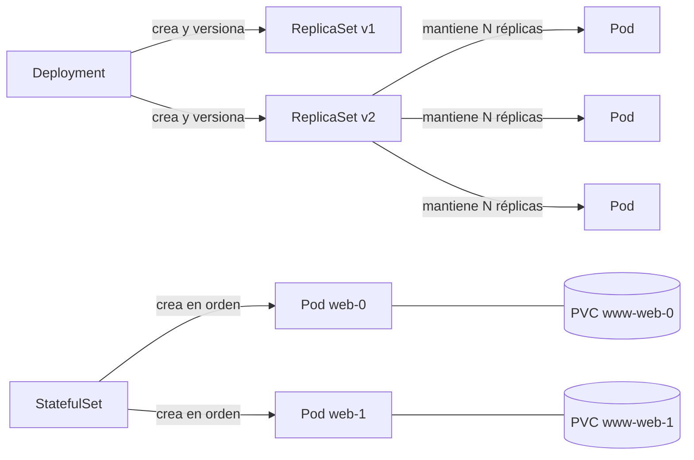
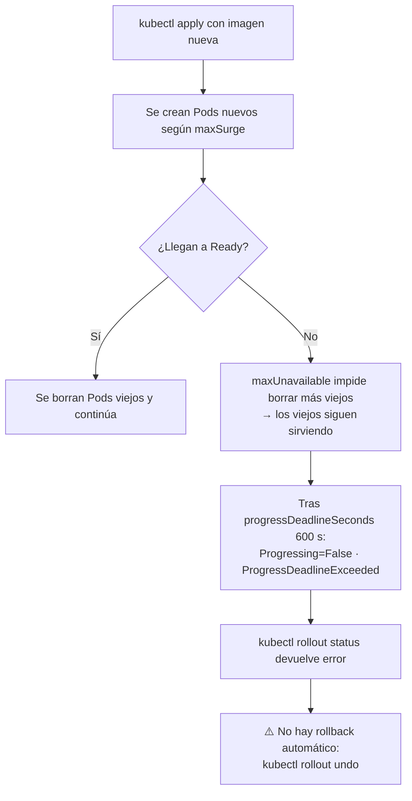

---
tags:
  - kubernetes
  - workloads
aliases:
  - Pod
  - Pods
  - K8s Pod
  - ReplicaSet
  - ReplicaSets
  - RS
  - Replication Controller
  - Deployment
  - Deployments
  - deploy
  - StatefulSet
  - StatefulSets
  - sts
---

# Workloads

> [!abstract] En 30 segundos
> Casi nunca creas Pods a mano. Declaras **un controlador** y él crea y vigila los Pods por ti:
> - **Deployment** → apps **sin estado** (APIs, webs). Lo usarás el 90 % del tiempo.
> - **StatefulSet** → apps **con estado** que necesitan identidad fija y su propio disco (bases de datos, Kafka).
> - **ReplicaSet** → la pieza interna que usa el Deployment. No lo gestiones directamente.

## Contenido
- [[#Pod]] · [[#ReplicaSet]] · [[#Deployment]] · [[#StatefulSet]]

## Cómo se relacionan



| | Pod suelto | ReplicaSet | Deployment | StatefulSet |
|---|---|---|---|---|
| **Se recrea si muere** | ❌ | ✅ | ✅ | ✅ |
| **Actualizaciones sin downtime** | ❌ | ❌ | ✅ Rolling update | ✅ Rolling (orden inverso) |
| **Rollback** | ❌ | ❌ | ✅ `rollout undo` | ✅ (sin historial de ReplicaSets) |
| **Nombre de Pod** | El que pongas | Aleatorio | Aleatorio (`web-7d9f…`) | Fijo y ordenado (`web-0`, `web-1`) |
| **Disco** | Compartido o ninguno | Compartido o ninguno | Compartido o ninguno | **Uno propio por réplica** |
| **Úsalo para** | Pruebas rápidas | — (lo gestiona el Deployment) | APIs, webs, workers | Bases de datos, colas, clústeres |

---

## Pod

> [!abstract] En una frase
> La **unidad mínima** de Kubernetes: uno o varios contenedores que comparten IP y se programan siempre juntos en el mismo nodo.

### Qué es
Un **Pod** es una envoltura (*wrapper*) sobre uno o más contenedores. Kubernetes nunca ejecuta contenedores "sueltos": siempre dentro de un Pod.

### Para qué sirve
Ejecutar aplicaciones en los [[Worker Node]]s. Lo normal es **un contenedor por Pod**. Se meten varios solo cuando están íntimamente acoplados: un *sidecar* (proxy, recolector de logs) o *init containers* que preparan algo antes de arrancar la app.

### Qué comparten los contenedores de un Pod

| Comparten | No comparten |
|---|---|
| **Red**: misma IP y puertos. Se hablan por `localhost` (y no pueden escuchar el mismo puerto) | **Sistema de archivos**: cada contenedor tiene el suyo |
| **IPC** | Los [[Volume\|volúmenes]] solo se comparten si se declaran en el Pod **y** se montan en cada contenedor |
| **Nodo**: siempre se programan juntos | |

> [!info] Sidecars nativos (GA desde 1.33)
> Un `initContainer` con `restartPolicy: Always` es un **sidecar nativo**: arranca antes que la app, sigue vivo mientras ella corre y se detiene después. Ciclo de vida completo, init containers y terminación ordenada en [[03 - Objetos y workloads#Pod]].

### Política de reinicio (`restartPolicy`)

Se define a nivel de Pod y se aplica a sus contenedores:

| Valor | Reinicia el contenedor… | Uso típico |
|---|---|---|
| `Always` *(por defecto)* | Siempre que se detiene | Servicios (Deployments) |
| `OnFailure` | Solo si sale con código ≠ 0 | Jobs |
| `Never` | Nunca | Tareas de un solo intento |

> [!warning] Los Pods son efímeros
> Si un Pod muere, pierde su IP y todo lo que no esté en un volumen persistente. Un Pod suelto **no se recrea**. En producción, siempre a través de un [[#Deployment]] o [[#StatefulSet]].

### Ejemplo

**Comandos:**
```bash
# Crear y ejecutar un Pod (versión fija de la imagen)
kubectl run nginx1 --image=nginx:1.28

# Crear un Pod indicando el puerto
kubectl run apache1 --image=httpd:2.4 --port=80

# Listar Pods con IP y nodo
kubectl get pods -o wide

# Eventos y detalles (lo primero que miras cuando algo falla)
kubectl describe pod nginx1

# Logs del contenedor (y del intento anterior si se reinició)
kubectl logs nginx1
kubectl logs nginx1 --previous

# Shell dentro del Pod
kubectl exec -it nginx1 -- /bin/bash

# Eliminar
kubectl delete pod nginx1
```

**YAML (`pod.yaml`):**
```yaml
apiVersion: v1
kind: Pod
metadata:
  name: nginx-pod
  labels:
    app: frontend
spec:
  restartPolicy: Always
  containers:
    - name: nginx
      image: nginx:1.28
      ports:
        - containerPort: 80
```

### Relacionado
[[#Deployment]] · [[#ReplicaSet]] · [[#StatefulSet]] · [[Container Runtime]] · [[kubelet]] · [[Networking#CNI|CNI]] · [[Networking#Kubernetes Service|Kubernetes Service]] · [[ConfigMap]] · [[Secret]] · [[Volume]]

---

## ReplicaSet

> [!abstract] En una frase
> Garantiza que **siempre haya N copias** de un Pod. Si una muere, crea otra.

### Qué es
Un **ReplicaSet** es un objeto (y su controlador) que mantiene un número exacto de réplicas idénticas de un [[#Pod]].

### Para qué sirve
**Auto-recuperación** (*self-healing*) y escalado. Si un Pod falla, se borra o cae su nodo, el ReplicaSet detecta que hay menos réplicas de las deseadas y crea otra. Identifica "sus" Pods por **labels y selectors**, no por nombre.

> [!tip] No lo gestiones directamente
> En la práctica no se crean ReplicaSets a mano: se crean [[#Deployment|Deployments]], que gestionan los ReplicaSets por ti (uno por versión de la app).

> [!info] ReplicaSet ≠ ReplicationController
> No es un cambio de nombre: son **dos objetos distintos** que conviven en la API.
> | | ReplicationController (`v1`) | ReplicaSet (`apps/v1`) |
> |---|---|---|
> | Selectores | Solo por igualdad (`app=web`) | También por conjuntos (`matchExpressions`: `In`, `NotIn`, `Exists`) |
> | Estado | Desaconsejado | Actual (vía Deployment) |

> [!warning] Todo depende de los labels
> Si cambias a mano la etiqueta de un Pod en ejecución, el ReplicaSet deja de contarlo y crea **otro** al instante para reponer la cantidad. El Pod "huérfano" sigue corriendo.

### Ejemplo

**Comandos:**
```bash
kubectl get rs
kubectl get rs -o wide

# Ver toda la cadena Deployment → ReplicaSet → Pods
kubectl get deploy,rs,pods -l app=nginx
```

**YAML (`replicaset.yaml`):**
```yaml
apiVersion: apps/v1
kind: ReplicaSet
metadata:
  name: nginx-replicaset
  labels:
    app: nginx
spec:
  replicas: 3
  selector:
    matchLabels:
      app: nginx        # ← debe coincidir…
  template:
    metadata:
      labels:
        app: nginx      # ← …con esta etiqueta
    spec:
      containers:
        - name: nginx
          image: nginx:1.28
```

### Relacionado
[[#Pod]] · [[#Deployment]] · [[Kube-controller-manager]] · [[Networking#Kubernetes Service|Kubernetes Service]]

---

## Deployment

> [!abstract] En una frase
> El objeto estándar para apps **sin estado**: declara qué versión quieres y cuántas réplicas, y él se encarga de actualizar sin downtime y de volver atrás si hace falta.

### Qué es
Un **Deployment** es un workload de alto nivel que gestiona de forma declarativa el despliegue, la actualización y el escalado de aplicaciones *stateless*. Por debajo crea un [[#ReplicaSet]] por cada versión.

### Para qué sirve

| Capacidad | Cómo |
|---|---|
| Actualizar sin downtime | Estrategia `RollingUpdate` (por defecto), con `maxSurge` y `maxUnavailable` |
| Volver atrás | `kubectl rollout undo` (conserva ReplicaSets antiguos según `revisionHistoryLimit`) |
| Escalar | `kubectl scale` o automáticamente con un HPA ([[08 - Escalado]]) |

### Estrategias de actualización

`spec.strategy.type` **solo** admite dos valores:

| Estrategia | Qué hace | Downtime |
|---|---|---|
| `RollingUpdate` *(por defecto)* | Sustituye Pods viejos por nuevos poco a poco | No (si hay readiness probe) |
| `Recreate` | Borra todos los viejos y luego crea los nuevos | Sí |

> [!warning] Canary y Blue/Green **no** son estrategias del Deployment
> Se construyen **encima**: dos Deployments con un Service, Ingress o Gateway que reparte el tráfico, o con herramientas como **Argo Rollouts**, **Flagger** o una service mesh. Ver [[07 - Salud, fiabilidad y despliegues#Estrategias de despliegue]].

> [!tip] Sin readiness probe no hay rolling update sin downtime
> La `readinessProbe` le dice a Kubernetes cuándo un Pod nuevo está listo para recibir tráfico. Sin ella, el Pod entra en el Service en cuanto arranca el proceso, aunque la app aún no responda.

### Qué pasa cuando falla un rollout

Por ejemplo, una imagen que no existe (`ImagePullBackOff`) o que se cae al arrancar (`CrashLoopBackOff`):



> [!danger] No hay rollback automático
> El rollout queda **atascado**, no "se detiene" por lógica propia. Los Pods antiguos siguen sirviendo, pero alguien (tú o el pipeline) tiene que ejecutar `kubectl rollout undo`, o usar Argo Rollouts para automatizarlo.

### Ejemplo

**Comandos:**
```bash
# Crear un Deployment básico (versión fija)
kubectl create deployment apache-deploy --image=httpd:2.4

# Listar
kubectl get deploy

# Escalar a 5 réplicas
kubectl scale deployment apache-deploy --replicas=5

# Aplicar cambios desde un archivo
kubectl apply -f deployment.yaml

# Seguir, consultar y deshacer un rollout
kubectl rollout status deployment/nginx-deployment
kubectl rollout history deployment/nginx-deployment
kubectl rollout undo deployment/nginx-deployment

# Detalles y eventos
kubectl describe deployment apache-deploy
```

**YAML (`deployment.yaml`):**
```yaml
apiVersion: apps/v1
kind: Deployment
metadata:
  name: nginx-deployment
  labels:
    app: nginx
spec:
  replicas: 3
  strategy:
    type: RollingUpdate
    rollingUpdate:
      maxSurge: 1           # como máximo 1 Pod extra durante la actualización
      maxUnavailable: 0     # nunca bajar de 3 Pods listos
  selector:
    matchLabels:
      app: nginx
  template:
    metadata:
      labels:
        app: nginx
    spec:
      containers:
        - name: nginx
          image: nginx:1.28        # versión fija: nunca latest
          ports:
            - containerPort: 80
          readinessProbe:          # imprescindible para no tener downtime
            httpGet:
              path: /
              port: 80
            periodSeconds: 5
```

> [!warning] Fija siempre la versión de la imagen
> Con `latest`, `imagePullPolicy` pasa a ser `Always` por defecto y dos réplicas pueden acabar ejecutando **versiones distintas**. Además, no sabes qué versión desplegaste ni a cuál volver.

### Relacionado
[[#Pod]] · [[#ReplicaSet]] · [[#StatefulSet]] · [[Networking#Kubernetes Service|Kubernetes Service]] · [[ConfigMap]] · [[Secret]]

---

## StatefulSet

> [!abstract] En una frase
> Como un Deployment, pero cada réplica tiene **nombre fijo, DNS propio y su propio disco**, que la siguen aunque el Pod se recree.

### Qué es
Un **StatefulSet** es el workload para aplicaciones **con estado**: bases de datos (PostgreSQL, MySQL, MongoDB), motores de búsqueda o mensajería (Kafka, Redis).

### Para qué sirve
Da a cada réplica una **identidad persistente** (*sticky identity*):

| Garantía | Ejemplo |
|---|---|
| **Nombre ordenado y estable** | `web-0`, `web-1`, `web-2` (si `web-1` muere, vuelve como `web-1`) |
| **DNS propio por réplica** (vía [[Networking#Headless Service\|Headless Service]]) | `web-0.nginx-headless.default.svc.cluster.local` |
| **Disco propio por réplica** (vía `volumeClaimTemplates`) | PVC `www-web-0` siempre se monta en `web-0` |

> [!warning] El Headless Service lo creas tú
> El campo `serviceName` debe apuntar a un [[Networking#Headless Service|Headless Service]] que **hay que crear aparte**: el StatefulSet no lo crea. Créalo antes que el StatefulSet.

### Orden de creación, borrado y actualización

| Situación | Comportamiento |
|---|---|
| **Crear / escalar hacia arriba** con `podManagementPolicy: OrderedReady` *(por defecto)* | Uno a uno: `web-1` no se crea hasta que `web-0` está **Running y Ready** |
| **Borrar / escalar hacia abajo** (`OrderedReady`) | En orden inverso: primero la réplica más alta |
| Con `podManagementPolicy: Parallel` | Todos a la vez (la identidad estable se mantiene) |
| **Actualizar** (`updateStrategy: RollingUpdate`) | De la réplica más alta a la `0`. Con `partition` puedes actualizar solo las réplicas ≥ N (canary) |

> [!warning] Una readiness probe mal configurada bloquea el escalado
> Con `OrderedReady`, si `web-0` nunca llega a Ready, `web-1` nunca se crea.

### ¿Qué pasa con los discos al borrar o escalar?

Se controla con `persistentVolumeClaimRetentionPolicy` (**GA desde 1.32**):

```yaml
spec:
  persistentVolumeClaimRetentionPolicy:
    whenDeleted: Retain   # o Delete: borra los PVC al eliminar el StatefulSet
    whenScaled: Retain    # o Delete: borra los PVC de las réplicas eliminadas al escalar hacia abajo
```

> [!tip] Por defecto, tus datos se conservan
> El valor por defecto es `Retain` / `Retain`: al borrar o escalar hacia abajo, los [[PersistentVolumeClaim|PVC]] **no se eliminan** (protección contra pérdida de datos). Para liberarlos, `kubectl delete pvc <nombre>` o configura `Delete`.

### Ejemplo

**Comandos:**
```bash
kubectl get statefulset
kubectl apply -f statefulset.yaml

# Probar el DNS de una réplica concreta
kubectl run -it --rm dns-test --image=busybox:1.37 --restart=Never -- \
  nslookup web-0.nginx-headless.default.svc.cluster.local

# Borrar explícitamente el PVC de una réplica (con la política Retain)
kubectl delete pvc www-web-0
```

**YAML (`statefulset.yaml`):**
```yaml
apiVersion: v1
kind: Service                 # 1) el Headless Service, creado aparte
metadata:
  name: nginx-headless
spec:
  clusterIP: None
  selector:
    app: nginx
  ports:
    - port: 80
---
apiVersion: apps/v1
kind: StatefulSet             # 2) el StatefulSet que lo referencia
metadata:
  name: web
spec:
  serviceName: "nginx-headless"
  replicas: 3
  selector:
    matchLabels:
      app: nginx
  template:
    metadata:
      labels:
        app: nginx
    spec:
      containers:
        - name: nginx
          image: nginx:1.28
          volumeMounts:
            - name: www
              mountPath: /usr/share/nginx/html
  volumeClaimTemplates:       # 3) un PVC por réplica: www-web-0, www-web-1…
    - metadata:
        name: www
      spec:
        accessModes: [ "ReadWriteOnce" ]
        storageClassName: "standard"
        resources:
          requests:
            storage: 1Gi
```

### Relacionado
[[#Pod]] · [[#Deployment]] · [[Networking#Headless Service|Headless Service]] · [[PersistentVolume]] · [[PersistentVolumeClaim]] · [[StorageClass]]

> [!info] 📚 Estudio guiado
> Capítulo: [[03 - Objetos y workloads]] · [[07 - Salud, fiabilidad y despliegues]] · Índice: [[00 - Kubernetes - Índice]]
