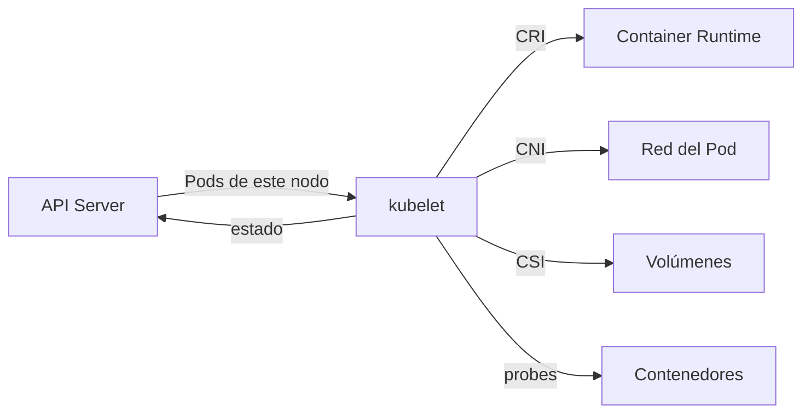

---
tags:
  - kubernetes
  - architecture
aliases:
  - kubelet
  - Kubelet
  - Node Agent
  - Static Pod
  - Static Pods
---

# kubelet

> [!abstract] En 30 segundos
> - **Qué es:** el agente que corre en **cada nodo** y convierte "este Pod debe existir aquí" en contenedores reales.
> - **Analogía:** el capataz de una obra. Recibe los planos del API Server, da órdenes a los obreros (el runtime) y reporta el avance.
> - **Recuerda:** el kubelet **no es un Pod**: es un proceso del sistema (`systemd`). Por eso se diagnostica con `journalctl`, no con `kubectl logs`.

---

## Qué es

El **kubelet** es el agente principal de cada nodo del clúster (en los [[Worker Node]]s y, normalmente, también en los nodos del [[Control Plane]]). A diferencia de casi todo lo demás en Kubernetes, corre como servicio del sistema operativo.

## Qué hace (en orden)

1. **Observa** en el API Server los Pods asignados a su nodo (los *PodSpecs*).
2. **Ordena** al [[Container Runtime]] (vía la interfaz **CRI**) descargar imágenes y crear o detener contenedores.
3. **Monta volúmenes** ([[ConfigMap]], [[Secret]], [[PersistentVolumeClaim]] a través del [[CSI Driver]]) y configura la red del Pod mediante el [[Networking#CNI|CNI]].
4. **Ejecuta las sondas de salud** (*liveness*, *readiness*, *startup*) y reinicia contenedores según la `restartPolicy`.
5. **Reporta** al API Server el estado del nodo y de sus Pods, y desaloja Pods cuando el nodo se queda sin recursos (*node-pressure eviction*).



## Conceptos que debes conocer

> [!tip] Static Pods
> El kubelet también puede ejecutar Pods leyendo manifiestos de un directorio local (por defecto `/etc/kubernetes/manifests`), **sin pasar por el API Server**. Así es como kubeadm arranca los propios componentes del [[Control Plane]] (kube-apiserver, etcd, scheduler, controller-manager): el problema "huevo y gallina" se resuelve así.

> [!warning] Si el kubelet cae, el nodo queda `NotReady`
> Los contenedores existentes pueden seguir corriendo, pero el nodo deja de reportar su estado, no recibe Pods nuevos y, pasado el tiempo de tolerancia, sus Pods se desalojan a otros nodos.

---

## Ejemplo

### Comandos útiles (ejecutados en el nodo)

```bash
# Estado del servicio
systemctl status kubelet

# Logs del kubelet: aquí aparecen errores de montaje, de imagen, de CNI…
journalctl -u kubelet -f

# Reiniciar tras cambiar su configuración
sudo systemctl restart kubelet

# Ver la configuración
cat /var/lib/kubelet/config.yaml

# Desde fuera: versión del kubelet de cada nodo
kubectl get nodes -o wide
```

### Sondas de salud que ejecuta el kubelet

```yaml
apiVersion: v1
kind: Pod
metadata:
  name: app-con-sondas
spec:
  containers:
    - name: app
      image: nginx:1.28
      ports:
        - containerPort: 80
      livenessProbe:          # ¿está vivo? Si falla → reinicia el contenedor
        httpGet:
          path: /
          port: 80
        initialDelaySeconds: 5
        periodSeconds: 10
      readinessProbe:         # ¿puede recibir tráfico? Si falla → se saca del Service
        httpGet:
          path: /
          port: 80
        periodSeconds: 5
```

> [!example] Liveness vs readiness en una línea
> **Liveness** falla → el kubelet **reinicia** el contenedor. **Readiness** falla → el Pod **deja de recibir tráfico**, pero no se reinicia. Detalle completo en [[07 - Salud, fiabilidad y despliegues]].

---

## Relacionado
[[Worker Node]] · [[Control Plane]] · [[Container Runtime]] · [[Workloads#Pod|Pod]] · [[Networking#CNI|CNI]] · [[CSI Driver]]

> [!info] 📚 Estudio guiado
> Capítulo: [[02 - Fundamentos y arquitectura]] · [[07 - Salud, fiabilidad y despliegues]] · Índice: [[00 - Kubernetes - Índice]]
