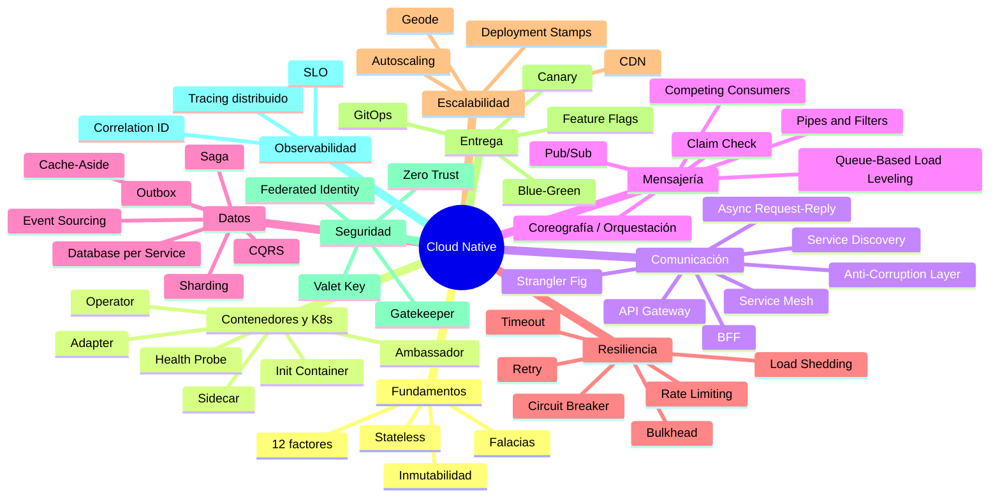

# ☁️ CN 00 - Patrones de diseño Cloud Native · Índice

> [!info] Qué es esta carpeta
> Un curso completo de **patrones de diseño para aplicaciones cloud native**: qué problema resuelve cada patrón, cómo funciona, cuándo usarlo y cuándo **no**, con ejemplos en .NET, Kubernetes y Azure.
> Los patrones que ya tienen una nota detallada en [[🏗️ Diseño de Microservicios]] se resumen aquí y se enlazan; no se duplican.

## Contenido
- [[#🧭 Cómo usar estas notas]]
- [[#📚 Capítulos]]
- [[#🗺️ Mapa de patrones]]
- [[#🔎 Busco un patrón para…]]
- [[#📈 Rutas de estudio]]
- [[#📖 Fuentes principales]]

---

## 🧭 Cómo usar estas notas

1. **Empieza por [[CN 01 - Fundamentos Cloud Native]]**: sin entender qué significa "cloud native" (y las falacias de la computación distribuida) los patrones parecen recetas arbitrarias.
2. Lee los capítulos **02 → 10** en orden. Cada uno agrupa los patrones por el **problema** que resuelven.
3. Usa [[CN 11 - Antipatrones]] y [[CN 12 - Guía de decisión y trade-offs]] para **elegir**: el error más común no es desconocer un patrón, sino aplicarlo donde no hace falta.
4. Repasa con [[CN 13 - Preguntas de entrevista]] y [[CN 14 - Cheatsheet]].

### Plantilla de cada patrón

Todos los patrones se explican con la misma estructura, para que se puedan comparar:

| Sección | Qué responde |
|---|---|
| **Problema** | ¿Qué duele si no lo uso? |
| **Solución** | La idea en una o dos frases |
| **Cómo funciona** | Diagrama y mecánica |
| **Ejemplo** | Código o configuración real (.NET / Kubernetes / Azure) |
| **Cuándo usarlo / cuándo no** | Criterio de aplicación |
| **Trade-offs** | Lo que cuesta: todo patrón tiene un precio |
| **Relacionados** | Con qué se combina o se confunde |

> [!warning] Sobre la "completitud"
> No existe una lista oficial y cerrada de "patrones cloud native". Esta carpeta reúne los catálogos más usados (ver [[#📖 Fuentes principales]]): el *Cloud Design Patterns* de Microsoft, *Kubernetes Patterns* (Ibryam y Huß), *Designing Distributed Systems* (Burns), *microservices.io* (Richardson) y *The Twelve-Factor App*. Cubre los patrones que aparecen en todos o casi todos; patrones muy específicos de un proveedor se mencionan sólo cuando aportan.

---

## 📚 Capítulos

| # | Capítulo | Patrones principales | Nivel |
|---|---|---|---|
| 01 | [[CN 01 - Fundamentos Cloud Native]] | Definición CNCF, 12/15 factores, falacias, *cattle vs pets*, infraestructura inmutable | 🟢 Base |
| 02 | [[CN 02 - Patrones de contenedores y Kubernetes]] | Sidecar, Ambassador, Adapter, Init Container, Health Probe, Predictable Demands, Operator, Leader Election | 🟢 Base |
| 03 | [[CN 03 - Comunicación, enrutamiento y APIs]] | API Gateway, Gateway Routing/Aggregation/Offloading, BFF, Service Discovery, Service Mesh, Async Request-Reply, ACL, Strangler Fig | 🔵 Intermedio |
| 04 | [[CN 04 - Mensajería y arquitectura orientada a eventos]] | Pub/Sub, Competing Consumers, Queue-Based Load Leveling, Priority Queue, Claim Check, Pipes & Filters, Coreografía vs Orquestación, DLQ, Inbox | 🔵 Intermedio |
| 05 | [[CN 05 - Patrones de gestión de datos]] | Database per Service, Saga, Outbox, CQRS, Event Sourcing, CDC, Cache-Aside, Materialized View, Sharding, Index Table, Valet Key | 🟣 Avanzado |
| 06 | [[CN 06 - Resiliencia y tolerancia a fallos]] | Timeout, Retry, Circuit Breaker, Bulkhead, Fallback, Rate Limiting, Throttling, Load Shedding, Compensating Transaction, Scheduler Agent Supervisor | 🟣 Avanzado |
| 07 | [[CN 07 - Escalabilidad y rendimiento]] | Stateless, escalado horizontal, autoscaling, Deployment Stamps, Geode, CDN / Static Content Hosting, Compute Resource Consolidation | 🟣 Avanzado |
| 08 | [[CN 08 - Despliegue, configuración y entrega]] | IaC, GitOps, Rolling, Blue-Green, Canary, Shadow, Feature Flags, External Configuration Store | 🟣 Avanzado |
| 09 | [[CN 09 - Seguridad]] | Zero Trust, Federated Identity, Gatekeeper, Workload Identity, Secret Store, mTLS, Quarantine | 🟠 Producción |
| 10 | [[CN 10 - Observabilidad]] | Logs/métricas/trazas, Correlation ID, Distributed Tracing, Health Endpoint Monitoring, RED/USE, SLI/SLO | 🟠 Producción |
| 11 | [[CN 11 - Antipatrones]] | Monolito distribuido, BD compartida, Chatty I/O, Retry Storm, Noisy Neighbor… | ⚖️ Criterio |
| 12 | [[CN 12 - Guía de decisión y trade-offs]] | Problema → patrón, combinaciones, arquitectura de referencia | ⚖️ Criterio |
| 13 | [[CN 13 - Preguntas de entrevista]] | 32 preguntas Junior → Staff con respuesta | 🎯 Repaso |
| 14 | [[CN 14 - Cheatsheet]] | Todos los patrones en una línea | 🎯 Repaso |

---

## 🗺️ Mapa de patrones

### Cómo se relacionan (la historia en 8 pasos)

1. **Cloud native** significa diseñar para un entorno donde las máquinas son desechables y la red falla ([[CN 01 - Fundamentos Cloud Native|cap. 01]]).
2. La unidad de despliegue es el **contenedor**, y Kubernetes ofrece primitivas (Pod, probes, controladores) sobre las que se construyen patrones como **Sidecar** u **Operator** ([[CN 02 - Patrones de contenedores y Kubernetes|cap. 02]]).
3. Al dividir en servicios, hay que **encontrarlos y exponerlos**: Service Discovery, API Gateway, Service Mesh ([[CN 03 - Comunicación, enrutamiento y APIs|cap. 03]]).
4. Para **desacoplarlos en el tiempo** se usa mensajería: colas, eventos, Pub/Sub ([[CN 04 - Mensajería y arquitectura orientada a eventos|cap. 04]]).
5. Cada servicio es dueño de sus datos, así que la consistencia se vuelve **eventual** y aparecen Saga, Outbox y CQRS ([[CN 05 - Patrones de gestión de datos|cap. 05]]).
6. Como la red falla, cada llamada necesita **timeout, retry, circuit breaker y bulkhead** ([[CN 06 - Resiliencia y tolerancia a fallos|cap. 06]]).
7. Lo anterior permite **escalar y desplegar** de forma independiente y segura ([[CN 07 - Escalabilidad y rendimiento|cap. 07]], [[CN 08 - Despliegue, configuración y entrega|cap. 08]]).
8. Y nada de eso es operable sin **seguridad por defecto** y **observabilidad** ([[CN 09 - Seguridad|cap. 09]], [[CN 10 - Observabilidad|cap. 10]]).

> [!important] El hilo conductor: la [[Idempotencia]]
> Retry, mensajería *at-least-once*, Saga, Outbox e Inbox **sólo son seguros si las operaciones son idempotentes**. Si sólo recuerdas un concepto transversal, que sea este.

---

## 🔎 Busco un patrón para…

| Necesito… | Patrón(es) | Capítulo |
|---|---|---|
| Añadir logging/proxy/TLS a un contenedor sin tocar su código | Sidecar, Ambassador, Adapter | [[CN 02 - Patrones de contenedores y Kubernetes\|02]] |
| Automatizar la operación de software con estado en Kubernetes | Operator | [[CN 02 - Patrones de contenedores y Kubernetes\|02]] |
| Un punto de entrada único para los clientes | API Gateway, BFF | [[CN 03 - Comunicación, enrutamiento y APIs\|03]] |
| Migrar un monolito sin reescribirlo de golpe | Strangler Fig + Anti-Corruption Layer | [[CN 03 - Comunicación, enrutamiento y APIs\|03]] |
| Operaciones que tardan minutos detrás de una API HTTP | Async Request-Reply | [[CN 03 - Comunicación, enrutamiento y APIs\|03]] |
| Absorber picos de carga | Queue-Based Load Leveling, Competing Consumers | [[CN 04 - Mensajería y arquitectura orientada a eventos\|04]] |
| Enviar mensajes grandes por un bus con límite de tamaño | Claim Check | [[CN 04 - Mensajería y arquitectura orientada a eventos\|04]] |
| Una "transacción" que abarca varios servicios | Saga (+ Compensating Transaction) | [[CN 05 - Patrones de gestión de datos\|05]] |
| Guardar en BD **y** publicar un evento sin perder ninguno | Transactional Outbox | [[CN 05 - Patrones de gestión de datos\|05]] |
| Lecturas muy distintas de las escrituras | CQRS, Materialized View | [[CN 05 - Patrones de gestión de datos\|05]] |
| Que un servicio caído no tumbe a los demás | Timeout + Circuit Breaker + Bulkhead | [[CN 06 - Resiliencia y tolerancia a fallos\|06]] |
| Proteger mi API de abuso o de un cliente ruidoso | Rate Limiting, Throttling | [[CN 06 - Resiliencia y tolerancia a fallos\|06]] |
| Escalar a muchos clientes/regiones aislados | Deployment Stamps, Geode | [[CN 07 - Escalabilidad y rendimiento\|07]] |
| Desplegar sin downtime y con rollback rápido | Blue-Green, Canary, Feature Flags | [[CN 08 - Despliegue, configuración y entrega\|08]] |
| Que el cliente descargue un fichero sin pasar por mi API | Valet Key | [[CN 05 - Patrones de gestión de datos\|05]] / [[CN 09 - Seguridad\|09]] |
| Eliminar secretos del código | Workload Identity, External Secret Store | [[CN 09 - Seguridad\|09]] |
| Seguir una petición a través de 10 servicios | Distributed Tracing + Correlation ID | [[CN 10 - Observabilidad\|10]] |

---

## 📈 Rutas de estudio

- **Ruta esencial (1 semana):** 01 → 02 (Sidecar, Health Probe) → 03 (API Gateway, BFF) → 04 (Pub/Sub, Competing Consumers) → 06 completo → 14.
- **Ruta arquitecto (3 semanas):** todos los capítulos en orden + leer las notas detalladas enlazadas de [[🏗️ Diseño de Microservicios]] + 11 y 12 dos veces.
- **Ruta entrevista Senior .NET:** 01 → 03 → 05 → 06 → 10 → 13, practicando las preguntas en voz alta.
- **Requisitos previos recomendados:** [[Docker - Índice]], [[00 - Kubernetes - Índice]] (capítulos 02–07), [[Teorema CAP y BASE]], [[Idempotencia]].

---

## 📖 Fuentes principales

| Fuente | Qué aporta |
|---|---|
| Microsoft, *Cloud Design Patterns* (Azure Architecture Center) — https://learn.microsoft.com/azure/architecture/patterns/ | El catálogo más amplio y mantenido de patrones cloud (≈40), con cuándo usar y cuándo no |
| Bilgin Ibryam y Roland Huß, *Kubernetes Patterns*, 2.ª ed. (O'Reilly, 2023) | Patrones específicos de Kubernetes: fundacionales, de comportamiento, estructurales, de configuración, seguridad y avanzados |
| Brendan Burns, *Designing Distributed Systems* (O'Reilly; 1.ª ed. 2018, 2.ª ed. 2024) | Sidecar, Ambassador, Adapter y patrones multi-nodo (sharding, scatter/gather, work queue) |
| Chris Richardson, *Microservices Patterns* (Manning, 2018) y https://microservices.io | Saga, Outbox, CQRS, API Composition, Database per Service |
| Adam Wiggins, *The Twelve-Factor App* — https://12factor.net | Principios de aplicaciones aptas para la nube |
| CNCF, *Cloud Native Definition v1.0* — https://github.com/cncf/toc/blob/main/DEFINITION.md | Definición de referencia de "cloud native" |
| Gregor Hohpe y Bobby Woolf, *Enterprise Integration Patterns* (2003) | Origen de casi todos los patrones de mensajería |
| Michael Nygard, *Release It!*, 2.ª ed. (2018) | Origen de Circuit Breaker, Bulkhead y patrones de estabilidad |

> [!note] Nota sobre la verificación
> Los nombres, definiciones y recomendaciones siguen esas fuentes. Donde una afirmación es criterio propio (p. ej. "esto suele ser excesivo para un equipo pequeño") se indica como recomendación, no como hecho. Las APIs y productos cambian: comprueba la documentación oficial antes de usar un fragmento de código en producción.

---
⬅️ [[🗺️ Índice - Ingeniería de Software|Volver al índice general]]
