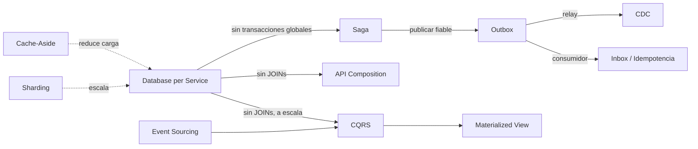

# CN 05 - Patrones de gestión de datos

> [!info] Objetivo del capítulo
> Cómo gestionar datos cuando cada servicio tiene su propio almacén, la red es lenta y los datos no caben en una sola máquina.
> Contexto teórico: [[Teorema CAP y BASE]], [[ACID en Bases de Datos]], [[Bases de Datos SQL vs NoSQL]].

## Contenido
- [[#1. Database per Service]]
- [[#2. Saga]] · [[#3. Transactional Outbox]] · [[#4. CQRS]] · [[#5. Event Sourcing]]
- [[#6. Change Data Capture (CDC)]]
- [[#7. Cache-Aside]] (y otras estrategias de caché)
- [[#8. Materialized View]]
- [[#9. Sharding]]
- [[#10. Index Table]]
- [[#11. Valet Key]]
- [[#12. Static Content Hosting]]
- [[#Cómo encajan]]

---

## 1. Database per Service

**Problema.** Si varios servicios comparten la misma base de datos, un cambio de esquema en una tabla rompe a otros, no pueden desplegarse ni escalar de forma independiente y la BD es un punto de acoplamiento y contención.

**Solución.** Cada servicio es **dueño exclusivo** de sus datos. Los demás sólo acceden a ellos a través de su **API o de sus eventos**, nunca directamente a sus tablas.

Niveles de aislamiento (de menor a mayor coste):
1. **Esquema privado** por servicio en el mismo servidor.
2. **Base de datos** por servicio en el mismo servidor.
3. **Servidor** por servicio (permite elegir tecnología: SQL para pedidos, documento para catálogo, Redis para sesiones — *polyglot persistence*).

**Consecuencias (el precio):**
- No hay `JOIN` entre servicios → API Composition o CQRS.
- No hay transacciones ACID entre servicios → **Saga**.
- Publicar cambios de forma fiable → **Outbox** o **CDC**.
- Datos duplicados entre servicios (copias locales) → consistencia eventual.

> [!warning] La base de datos compartida es el antipatrón nº 1
> Es la causa más frecuente del **monolito distribuido**. Ver [[CN 11 - Antipatrones]].

---

## 2. Saga

> Nota detallada: [[Saga Pattern]].

**Problema.** Un proceso de negocio (crear pedido → cobrar → reservar stock → programar envío) toca varios servicios con bases de datos distintas; no se puede usar una transacción distribuida (2PC) porque no escala, bloquea recursos y muchos almacenes cloud no la soportan.

**Solución.** Una **secuencia de transacciones locales**; cada una publica un evento o mensaje que dispara la siguiente. Si un paso falla, se ejecutan **transacciones compensatorias** que deshacen *semánticamente* los pasos anteriores (reembolsar, liberar stock). Coordinación por **coreografía u orquestación** ([[CN 04 - Mensajería y arquitectura orientada a eventos#7. Coreografía vs Orquestación|ver cap. 04]]).

**Lo que hay que recordar:** una Saga **no es aislada** (la "I" de ACID): otros procesos ven estados intermedios. Contramedidas: estados explícitos (`PendienteDePago`), *semantic locks*, releer valores antes de actuar. Las compensaciones también deben ser idempotentes y pueden fallar (reintentar hasta éxito o intervención manual).

---

## 3. Transactional Outbox

> Nota detallada: [[Transactional Outbox]].

**Problema (*dual write*).** Guardar en la BD y publicar en el broker son dos operaciones sin transacción común. Si guardas y luego falla la publicación, pierdes el evento; si publicas y luego falla el commit, publicas un evento falso.

**Solución.** En la **misma transacción local** guardas el cambio de negocio **y** el evento en una tabla `Outbox`. Un proceso aparte (*relay*: *polling* o CDC) lee la tabla y publica en el broker, marcando lo enviado. Garantiza *at-least-once* → el consumidor usa **Inbox/idempotencia**.

Librerías .NET con Outbox integrado: MassTransit, NServiceBus, Wolverine, CAP (DotNetCore.CAP).

---

## 4. CQRS

> Nota detallada: [[CQRS (Command Query Responsibility Segregation)]].

**Problema.** Un mismo modelo para escribir (con reglas de negocio, normalizado) y para leer (pantallas que combinan muchos datos, búsquedas, informes) acaba siendo malo para ambos. Además, lecturas y escrituras suelen tener cargas muy distintas (100:1).

**Solución.** Separar el modelo de **comandos** (escritura) del de **consultas** (lectura). Puede ser sólo en código (dos modelos, misma BD) o con **almacenes distintos** sincronizados por eventos (lectura eventualmente consistente).

**Cuándo no:** dominios CRUD sencillos. Greg Young y Martin Fowler insisten en que se aplique a partes concretas del sistema, no a todo.

---

## 5. Event Sourcing

> Nota detallada: [[Event Sourcing]].

**Problema.** Guardar sólo el estado actual pierde el historial: no sabes cómo se llegó ahí, no puedes reconstruir estados pasados ni auditar.

**Solución.** Guardar la **secuencia de eventos** (`PedidoCreado`, `LineaAñadida`, `PedidoPagado`) como fuente de verdad; el estado actual se obtiene reproduciéndolos (con *snapshots* para rendimiento). Casi siempre se combina con CQRS para las lecturas.

**Coste:** alto (versionado de eventos para siempre, proyecciones, el GDPR y el "derecho al olvido" frente a un log inmutable — se suele resolver con *crypto-shredding*). Úsalo donde el historial **es** valor de negocio (contabilidad, banca, logística), no por defecto.

---

## 6. Change Data Capture (CDC)

**Problema.** Necesitas propagar los cambios de una base de datos a otros sistemas (búsqueda, caché, analítica, otro servicio) sin modificar la aplicación que escribe, o como *relay* del Outbox.

**Solución.** Leer el **log de transacciones** de la BD (binlog de MySQL, WAL de PostgreSQL, CDC de SQL Server, Change Feed de Cosmos DB) y convertir cada cambio en un evento.

```
App ─► SQL Server ──(log de transacciones)──► Debezium ─► Kafka ─► Elasticsearch / otro servicio
```

**Herramientas:** Debezium (Kafka Connect), Azure Cosmos DB Change Feed, SQL Server CDC / Change Tracking, AWS DMS.

**Trade-offs.** ✅ No toca la app, captura todo, orden fiable. ❌ Expone el **esquema interno** de tablas como contrato (si cambias una columna, rompes a los consumidores): por eso se recomienda usarlo sobre una **tabla Outbox** (eventos diseñados) más que sobre tablas de negocio. Operar Kafka Connect/Debezium no es trivial.

---

## 7. Cache-Aside

**Problema.** Leer repetidamente los mismos datos de la BD es lento y caro, y la BD se convierte en el cuello de botella.

**Solución (*lazy loading*).** La **aplicación** gestiona la caché:
1. Busca en la caché.
2. Si está (*hit*), la devuelve.
3. Si no (*miss*), lee de la BD, **guarda en la caché con TTL** y la devuelve.
4. Al escribir, actualiza la BD e **invalida** (borra) la entrada de la caché.

```csharp
// .NET 9+: HybridCache (caché L1 en memoria + L2 distribuida, con protección contra stampede)
public async Task<Producto?> ObtenerAsync(int id, CancellationToken ct) =>
    await _cache.GetOrCreateAsync(
        $"producto:{id}",
        async token => await _db.Productos.FindAsync([id], token),
        new HybridCacheEntryOptions { Expiration = TimeSpan.FromMinutes(10) },
        cancellationToken: ct);

public async Task ActualizarAsync(Producto p, CancellationToken ct)
{
    _db.Update(p);
    await _db.SaveChangesAsync(ct);
    await _cache.RemoveAsync($"producto:{p.Id}", ct);   // invalidar, no actualizar
}
```

> [!note] Por qué invalidar y no actualizar la caché al escribir
> Con escrituras concurrentes, "actualizar BD y luego caché" puede dejar en la caché un valor antiguo si dos escrituras se intercalan. Borrar la entrada es más seguro: la siguiente lectura carga el valor bueno. Aun así queda una pequeña ventana de inconsistencia; el TTL es la red de seguridad.

### Problemas clásicos de caché

| Problema | Qué pasa | Mitigación |
|---|---|---|
| **Cache stampede** (*thundering herd*) | Expira una clave muy usada y miles de peticiones van a la BD a la vez | Bloqueo por clave / *request coalescing* (HybridCache lo hace), refresco anticipado, TTL con *jitter* |
| **Cache penetration** | Peticiones de claves que no existen siempre llegan a la BD | Cachear también el "no existe" (con TTL corto), filtro de Bloom |
| **Datos obsoletos** | La caché devuelve datos viejos | TTL adecuado, invalidación por eventos |
| **Caché fría** | Tras un reinicio, todo es *miss* | Precalentar (*warm-up*) las claves críticas |
| **Caché como fuente de verdad** | Se pierde la caché y se pierden datos | La caché siempre debe poder reconstruirse |

### Otras estrategias

| Estrategia | Quién escribe en la caché | Uso |
|---|---|---|
| **Cache-Aside** | La app, bajo demanda | La más común; tolera que la caché caiga |
| **Read-Through** | La caché carga de la BD por sí sola | Cuando el proveedor de caché lo soporta |
| **Write-Through** | Se escribe en caché y BD de forma síncrona | Lecturas siempre frescas; escrituras más lentas |
| **Write-Behind** (*write-back*) | Se escribe en caché; la BD se actualiza después, de forma asíncrona | Escrituras rápidas; **riesgo de pérdida** si la caché cae |

Detalle en Redis: [[00 - Redis - Índice]] (Nivel 03 - Redis como caché).

---

## 8. Materialized View

**Problema.** Los datos están almacenados de la forma óptima para escribir (normalizados, o como eventos), pero las consultas necesitan combinarlos o agregarlos, y hacerlo en cada consulta es lento.

**Solución.** Generar **vistas precalculadas** con la forma exacta que necesita la consulta, actualizadas cuando cambian los datos de origen (por eventos, CDC o un proceso periódico). La vista es **desechable**: se puede reconstruir desde el origen.

```
Eventos de Pedidos ─┐
Eventos de Clientes ├─► Proyector ─► Vista "ResumenPedidosPorCliente" (Cosmos DB / Redis / tabla)
Eventos de Envíos  ─┘
```

**Es la pieza de lectura de CQRS** y la forma de resolver los `JOIN` entre servicios de forma eficiente.
**Trade-offs.** Consistencia eventual (la vista va con retraso), almacenamiento extra, lógica de proyección que mantener y reconstruir.

---

## 9. Sharding

**Problema.** Un único almacén tiene límites: tamaño, conexiones, IOPS, throughput de escritura, latencia geográfica. Escalar verticalmente tiene techo y es caro.

**Solución.** **Particionar horizontalmente** los datos en varios almacenes (*shards*), cada uno con un subconjunto de filas, según una **clave de sharding** (*shard key*).

| Estrategia | Cómo asigna | Ventaja | Inconveniente |
|---|---|---|---|
| **Lookup** (directorio) | Una tabla de mapeo clave → shard | Flexible; se puede mover un tenant de shard | El mapa es una dependencia extra (cachéala) |
| **Range** (rangos) | Por rangos de la clave (fechas, A–M / N–Z) | Consultas por rango eficientes | **Hotspots** (todos escriben en el rango "hoy") |
| **Hash** | `hash(clave) % N` o *consistent hashing* | Distribución uniforme | Consultas por rango cruzan todos los shards; con `% N`, cambiar N obliga a mover casi todo (usa *consistent hashing*) |

**Elegir la clave es la decisión crítica:** debe tener **alta cardinalidad**, distribuir la carga de forma uniforme y coincidir con el patrón de acceso principal (las consultas deberían ir a **un** shard). Ejemplo habitual en SaaS: `tenantId`.

**Lo que se pierde:** `JOIN` y transacciones entre shards; consultas que cruzan shards (*scatter/gather*) son lentas; rebalancear es costoso.

**En la práctica cloud:** muchas BD gestionadas lo hacen por ti — Azure Cosmos DB (*partition key*), Azure Database for PostgreSQL con *elastic clusters* (basados en Citus), MongoDB, DynamoDB. En Azure SQL, el sharding es a nivel de aplicación con las *Elastic Database tools* (Hyperscale escala el almacenamiento de una sola BD, no es sharding). Elegir bien la *partition key* sigue siendo tu responsabilidad.

---

## 10. Index Table

**Problema.** En un almacén NoSQL o particionado sólo puedes buscar eficientemente por la clave principal; buscar por otro campo (email en vez de ID de cliente) implica recorrer todo.

**Solución.** Crear y mantener **tablas de índice secundario** cuya clave es el campo de búsqueda y cuyo valor es la clave principal (o una copia de los datos necesarios).

```
Clientes (PK = clienteId)        ÍndicePorEmail (PK = email)
  c-1 → {email: a@x.com, ...}      a@x.com → c-1
```

**Trade-offs.** Hay que mantener el índice al escribir (dos escrituras → riesgo de inconsistencia si no hay transacción; usa la que ofrezca el almacén o eventos). Muchas BD ya tienen índices secundarios: úsalo sólo si la tuya no los tiene o son caros.

---

## 11. Valet Key

**Problema.** Los clientes suben o descargan ficheros grandes **a través de tu API**, que se convierte en intermediario: consume ancho de banda, memoria y CPU, y escala mal.

**Solución.** La API **valida al usuario** y le entrega un **token de acceso restringido y temporal** (la "llave de aparcacoches", que abre el coche pero no el maletero) para que hable **directamente** con el almacenamiento.

```
1. Cliente ─"quiero subir foto"─► API (autentica y autoriza)
2. API ─► genera SAS: sólo escritura, sólo ese blob, 5 minutos
3. Cliente ─PUT directo─► Blob Storage
```

```csharp
// Azure Blob Storage: SAS de delegación de usuario (firmada con Entra ID, no con la account key)
UserDelegationKey key = (await blobService.GetUserDelegationKeyAsync(DateTimeOffset.UtcNow, DateTimeOffset.UtcNow.AddMinutes(10))).Value;
var blob = container.GetBlobClient($"usuarios/{userId}/{Guid.NewGuid()}.jpg");
var sas = new BlobSasBuilder
{
    BlobContainerName = container.Name,
    BlobName = blob.Name,
    Resource = "b",
    ExpiresOn = DateTimeOffset.UtcNow.AddMinutes(5)
};
sas.SetPermissions(BlobSasPermissions.Create | BlobSasPermissions.Write);
var uri = new BlobUriBuilder(blob.Uri) { Sas = sas.ToSasQueryParameters(key, blobService.AccountName) }.ToUri();
return Results.Ok(new { uploadUrl = uri });
```

Equivalentes: *pre-signed URLs* de S3, *signed URLs* de GCS.

**Seguridad:** permisos mínimos, caducidad corta, ámbito a un solo objeto, validar el contenido **después** de la subida (tipo, tamaño, antivirus — ver patrón Quarantine en [[CN 09 - Seguridad]]). Prefiere SAS de delegación de usuario sobre SAS firmadas con la clave de la cuenta.

---

## 12. Static Content Hosting

**Problema.** Servir ficheros estáticos (JS, CSS, imágenes, la SPA completa) desde tus instancias de cómputo desperdicia recursos caros.

**Solución.** Publicarlos en un **almacenamiento** preparado para servirlos (Azure Storage static website, Azure Static Web Apps, S3) y ponerles delante una **CDN** (Azure Front Door, CloudFront). Ver [[CN 07 - Escalabilidad y rendimiento]].

**Detalles:** versionar los nombres de ficheros (`app.3f9a2c.js`) para poder cachear con TTL largo; configurar CORS; el contenido debe ser público o protegerse con Valet Key.

---

## Cómo encajan



## Puntos clave

- **Database per Service** es la decisión que obliga a todo lo demás.
- Saga = transacciones locales + compensaciones; **no** es aislada.
- Outbox resuelve el *dual write*; Inbox la duplicación en el consumidor.
- CQRS y Event Sourcing son potentes y caros: aplícalos a partes concretas.
- Cache-Aside: leer → miss → cargar con TTL; escribir → **invalidar**. Vigila el *stampede*.
- Sharding: la **clave** lo es todo (cardinalidad, uniformidad, patrón de acceso).
- Valet Key: el cliente habla con el almacenamiento directamente, con un token mínimo y breve.

## Errores comunes

- Microservicios con base de datos compartida.
- Saga sin compensaciones idempotentes ni plan para cuando la compensación falla.
- Caché sin TTL o usada como fuente de verdad.
- Clave de sharding con baja cardinalidad (país, estado) → hotspots.
- CDC directamente sobre tablas de negocio → esquema interno convertido en contrato público.
- SAS con permisos de cuenta completa y caducidad de un año.

## 🎯 Para entrevistas

- *"¿Cómo haces una transacción entre dos microservicios?"* → No la haces: Saga (+ Outbox + idempotencia); explicar por qué no 2PC.
- *"¿Qué es el problema del dual write?"* → BD + broker sin transacción común; Outbox o CDC.
- *"Explica Cache-Aside y un problema que tenga."* → flujo + stampede/obsoletos con mitigaciones.
- *"¿Cómo elegirías la partition key en Cosmos DB para un SaaS multi-tenant?"* → `tenantId` si los tenants son de tamaño parecido; jerárquica (`tenantId` + otra) o shards dedicados si hay tenants enormes.
- *"¿Cómo permitirías subir ficheros de 2 GB?"* → Valet Key (SAS) + subida directa por bloques + validación posterior.

## Referencias

- Microsoft, *Cache-Aside*, *Materialized View*, *Sharding*, *Index Table*, *Valet Key*, *Static Content Hosting*, *CQRS*, *Event Sourcing*, *Saga*: https://learn.microsoft.com/azure/architecture/patterns/
- Chris Richardson, *Database per service*, *Transactional outbox*: https://microservices.io/patterns/data/database-per-service.html
- Microsoft, *HybridCache library in ASP.NET Core*: https://learn.microsoft.com/aspnet/core/performance/caching/hybrid
- Debezium: https://debezium.io/
- Martin Kleppmann, *Designing Data-Intensive Applications* (O'Reilly, 2017) — capítulos de particionado, replicación y transacciones.

---
⬅️ [[CN 04 - Mensajería y arquitectura orientada a eventos]] · ➡️ [[CN 06 - Resiliencia y tolerancia a fallos]]
