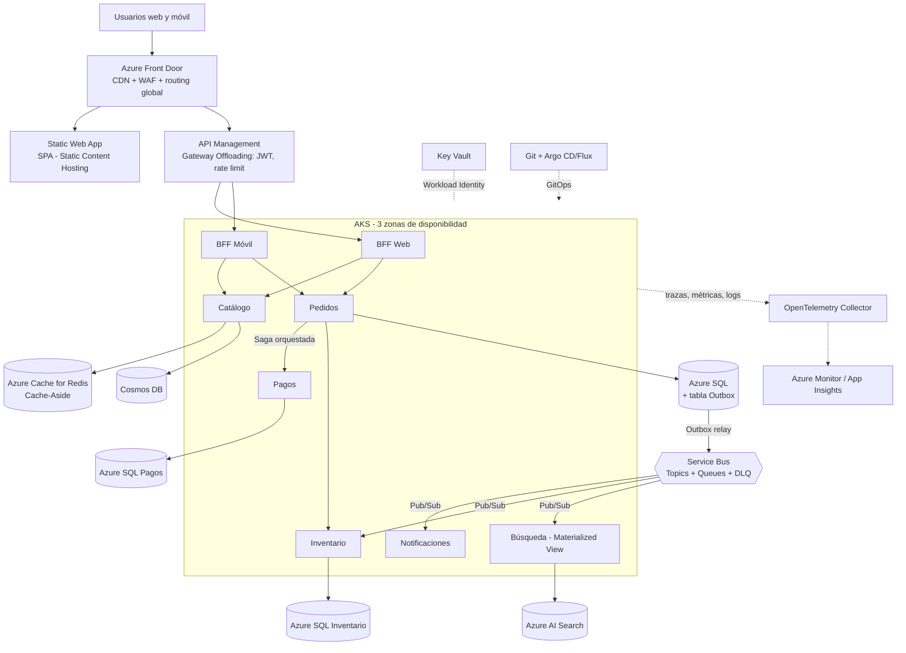

# CN 12 - Guía de decisión y trade-offs

> [!info] Objetivo del capítulo
> Pasar de "conozco los patrones" a "sé **cuándo** aplicar cada uno y **qué cuesta**". Incluye árboles de decisión, combinaciones habituales y una arquitectura de referencia completa.

## Contenido
- [[#1. Principio: el patrón mínimo suficiente]]
- [[#2. Árboles de decisión]]
- [[#3. Matriz de trade-offs]]
- [[#4. Combinaciones habituales]]
- [[#5. Madurez: qué adoptar en cada etapa]]
- [[#6. Arquitectura de referencia: e-commerce cloud native]]
- [[#7. Plantilla de ADR para justificar un patrón]]

---

## 1. Principio: el patrón mínimo suficiente

Cada patrón añade piezas que hay que operar, entender y depurar. El objetivo no es usar muchos patrones, sino **resolver los problemas reales con la menor complejidad posible**.

```
¿Existe el problema hoy (o hay evidencia de que existirá pronto)?
 ├─ No → no apliques el patrón. Anota la decisión y el disparador para revisarla.
 └─ Sí → ¿lo resuelve la plataforma (K8s, PaaS, mesh, broker) sin código?
          ├─ Sí → configúralo bien (sigue necesitando entender el patrón).
          └─ No → ¿existe una librería madura? (Polly, MassTransit, YARP…)
                   ├─ Sí → úsala.
                   └─ No → impleméntalo, con pruebas de fallo.
```

---

## 2. Árboles de decisión

### 2.1 ¿Cómo se comunican dos servicios?

```
¿El llamante necesita la respuesta para continuar?
├─ Sí → ¿responde en < ~1–2 s?
│        ├─ Sí → Síncrono (HTTP/gRPC) + Timeout + Retry + Circuit Breaker
│        └─ No → Async Request-Reply (202 + estado) o WebSocket/callback
└─ No → ¿Es una orden para un destinatario concreto?
         ├─ Sí → Comando por cola (Competing Consumers si hay que escalar)
         └─ No, es un hecho que interesa a otros → Evento por Pub/Sub
                  └─ ¿Importa el orden? → Particionar por clave (sessions/particiones)
```

### 2.2 ¿Cómo mantengo la consistencia entre servicios?

```
¿Los datos pueden estar en la misma BD y el mismo servicio?
├─ Sí → transacción ACID local. Fin. (lo más simple siempre gana)
└─ No → ¿El proceso necesita deshacer pasos si algo falla?
         ├─ Sí → Saga
         │        ├─ 2–4 pasos sencillos → coreografía
         │        └─ Muchos pasos / ramas / compensaciones → orquestación (Durable Functions, Temporal…)
         └─ No → eventos + consistencia eventual
  En ambos casos: Outbox al publicar, Inbox/idempotencia al consumir.
```

### 2.3 ¿Cómo leo datos que pertenecen a varios servicios?

```
¿Consulta poco frecuente y con pocos servicios implicados?
├─ Sí → API Composition (en paralelo)
└─ No → ¿Necesita ser muy rápida o compleja (búsqueda, informes)?
         ├─ Sí → CQRS + Materialized View alimentada por eventos/CDC
         └─ No → copia local de los datos necesarios (event-carried state transfer)
```

### 2.4 ¿Cómo protejo una llamada a una dependencia?

```
Siempre → Timeout (por intento y total)
¿Los fallos pueden ser transitorios y la operación es idempotente? → + Retry (backoff + jitter)
¿La dependencia puede caer durante minutos? → + Circuit Breaker + Fallback
¿Puede ser lenta y agotar recursos compartidos? → + Bulkhead (límite de concurrencia)
¿Es una API externa con cuota? → + Rate limiter de salida
```

### 2.5 ¿Qué estrategia de despliegue?

```
¿Puedes permitir downtime? → Recreate (sólo entornos no críticos)
¿Necesitas rollback instantáneo y puedes pagar 2× infra temporalmente? → Blue-Green
¿Quieres limitar el radio de impacto con tráfico real y tienes métricas? → Canary / Progressive Delivery
¿Ninguno de los anteriores es crítico? → Rolling Update (por defecto)
¿Separar el lanzamiento del despliegue? → + Feature Flags (combinable con todos)
```

### 2.6 ¿Cómo escalo?

```
¿Es una API? → HPA por CPU/RPS, mínimo 2–3 réplicas repartidas en zonas
¿Es un worker de cola? → KEDA por longitud de cola (puede escalar a 0)
¿Se satura la BD? → Cache-Aside → réplicas de lectura → CQRS → Sharding (en ese orden de coste)
¿Muchos tenants / límites de un único despliegue / residencia de datos? → Deployment Stamps
¿Usuarios globales con requisitos de latencia y disponibilidad extremos? → Geode (muy caro)
```

---

## 3. Matriz de trade-offs

Valoración cualitativa (criterio basado en las fuentes del índice y en la práctica común; no son mediciones): **↑** mejora, **↓** empeora, **=** sin efecto relevante.

| Patrón | Fiabilidad | Rendimiento | Escalabilidad | Coste | Complejidad operativa | Consistencia |
|---|---|---|---|---|---|---|
| Retry | ↑ | ↓ (latencia en fallos) | = | = | ↑ leve | riesgo de duplicados |
| Circuit Breaker | ↑ | ↑ en fallos | = | = | ↑ leve | = |
| Bulkhead | ↑ | = | = | ↓ (recursos reservados) | ↑ | = |
| Cache-Aside | ↑ (descarga la BD) | ↑↑ | ↑ | ↓ (otra pieza) | ↑ | ↓ (datos obsoletos) |
| CQRS | = | ↑ lecturas | ↑ | ↓ | ↑↑ | ↓ (eventual) |
| Event Sourcing | = | ↓ escrituras/reconstrucción | ↑ | ↓ | ↑↑↑ | auditoría completa |
| Saga | ↑ (sin 2PC) | = | ↑ | = | ↑↑ | ↓ (sin aislamiento) |
| Outbox | ↑↑ | ↓ leve | = | = | ↑ | ↑ (sin pérdidas) |
| Pub/Sub | ↑ (desacople) | = | ↑ | = | ↑ | ↓ (eventual) |
| API Gateway | ↓ (punto único si no HA) | ↓ (salto extra) | = | ↓ | ↑ | = |
| Service Mesh | ↑ | ↓ (proxies) | = | ↓↓ | ↑↑↑ | = |
| Deployment Stamps | ↑↑ (radio de impacto) | = | ↑↑ | ↓↓ | ↑↑ | = |
| Geode | ↑↑↑ | ↑↑ (latencia global) | ↑↑ | ↓↓↓ | ↑↑↑ | ↓↓ (conflictos) |
| Blue-Green | ↑ | = | = | ↓ (2×) | ↑ | = |
| Canary | ↑↑ | = | = | = | ↑↑ (métricas, tráfico) | = |
| Feature Flags | ↑ | = | = | = | ↑ (deuda) | = |

**Lectura de la tabla:** casi todos los patrones compran fiabilidad o escalabilidad **pagando** complejidad y consistencia. La pregunta de diseño siempre es si ese intercambio merece la pena **en tu contexto**.

---

## 4. Combinaciones habituales

| Combinación | Por qué van juntos |
|---|---|
| **Timeout + Retry + Circuit Breaker + Fallback** | La pipeline básica de resiliencia: cortar lo lento, reintentar lo transitorio, dejar de insistir, responder algo útil |
| **Outbox + Pub/Sub + Inbox** | Publicación fiable + consumo idempotente = "efectivamente una vez" |
| **Saga + Compensating Transaction + Outbox** | Proceso distribuido fiable con deshacer |
| **CQRS + Materialized View + Event-driven** | Escrituras con reglas, lecturas optimizadas y actualizadas por eventos |
| **Event Sourcing + CQRS** | Los eventos son la verdad; las proyecciones dan las lecturas |
| **Queue-Based Load Leveling + Competing Consumers + KEDA** | Absorber picos y escalar el procesamiento según la cola |
| **API Gateway + BFF + Gateway Offloading** | Entrada única, adaptada por cliente, con seguridad centralizada |
| **Strangler Fig + Anti-Corruption Layer + Feature Flags** | Migración gradual, protegida y reversible |
| **Deployment Stamps + Canary (anillos) + IaC** | Escala por unidades y despliegue progresivo stamp a stamp |
| **Workload Identity + External Secret Store + mTLS** | Seguridad sin secretos estáticos y con identidad de servicio |
| **Distributed Tracing + Correlation ID + logs estructurados** | Diagnóstico de punta a punta |

---

## 5. Madurez: qué adoptar en cada etapa

*Recomendación orientativa, no una norma: ajústala a tu contexto.*

| Etapa | Contexto | Patrones a adoptar | Lo que todavía **no** necesitas |
|---|---|---|---|
| **1. Inicio** | 1 equipo, producto nuevo | 12 factores, monolito modular en contenedor, health checks, Cache-Aside si hace falta, timeout/retry con Polly, IaC, CI/CD con rolling update, OpenTelemetry, Managed Identity | Microservicios, service mesh, CQRS, Event Sourcing, multirregión |
| **2. Crecimiento** | 2–4 equipos, más carga | Extraer servicios por bounded context (Strangler Fig), mensajería (Pub/Sub, colas), Outbox/Inbox, API Gateway, autoscaling (HPA/KEDA), feature flags, SLOs | Geode, operadores propios |
| **3. Escala** | Muchos equipos, muchos servicios | BFF, Saga orquestada, CQRS donde haga falta, canary/progressive delivery, GitOps, service mesh si hay requisitos de mTLS/tráfico, Deployment Stamps si hay muchos tenants | — |
| **4. Global** | Usuarios globales, SLO muy exigentes | Multirregión, Geode o stamps por región, Chaos Engineering continuo, cell-based architecture | — |

---

## 6. Arquitectura de referencia: e-commerce cloud native

Un ejemplo que combina los patrones de la carpeta (sobre Azure + AKS; equivalentes en otras nubes).



**Decisiones y patrones aplicados:**

| Área | Decisión | Patrón | Justificación |
|---|---|---|---|
| Entrada | Front Door + APIM + 2 BFF | Gateway Routing/Offloading, BFF | Web y móvil con necesidades distintas; seguridad centralizada |
| Estáticos | SPA en Static Web Apps tras CDN | Static Content Hosting | No consume cómputo de AKS |
| Catálogo | Cosmos DB + Redis | Database per Service, Cache-Aside | Lectura 100:1 sobre escritura |
| Checkout | Saga orquestada (crear pedido → cobrar → reservar → confirmar) | Saga, Compensating Transaction | Varios servicios con BD propia; reembolso/liberación como compensación |
| Eventos | Outbox en Pedidos → Service Bus Topics | Outbox, Pub/Sub, Inbox | Sin *dual write*; Notificaciones e Inventario reaccionan sin acoplarse |
| Búsqueda | Proyección a Azure AI Search | CQRS, Materialized View | Búsqueda por texto y facetas imposible en el modelo de escritura |
| Resiliencia | Pipeline estándar en cada `HttpClient`; fallback del catálogo a caché | Timeout, Retry, Circuit Breaker, Fallback | Recomendaciones y reseñas no críticas nunca tumban el checkout |
| Picos | Workers de Notificaciones con KEDA | Queue-Based Load Leveling, Competing Consumers | Black Friday: la cola absorbe el pico |
| Escalado | HPA por CPU en APIs, mínimo 3 réplicas en 3 zonas | Autoscaling, redundancia por zonas | Disponibilidad ante caída de una zona |
| Seguridad | Workload ID + Key Vault, NetworkPolicy deny por defecto | Workload Identity, Zero Trust | Sin secretos estáticos |
| Entrega | GitOps + canary con Argo Rollouts en Pedidos y Pagos | GitOps, Progressive Delivery | Rollback automático en los servicios críticos |
| Observabilidad | OpenTelemetry → Azure Monitor; SLO 99,9 % en checkout | Tracing, SLO, Health Endpoint | Diagnóstico de punta a punta; alertas por burn rate |

**Lo que deliberadamente NO incluye (y por qué):**
- **Event Sourcing**: el historial de pedidos se cubre con una tabla de estados y auditoría; el coste no se justifica.
- **Service Mesh**: con 7 servicios en .NET, Polly + NetworkPolicy + TLS en el ingress son suficientes. Se revisaría si aparecen requisitos de mTLS obligatorio o muchos lenguajes.
- **Geode / multirregión activo-activo**: el negocio es regional; DR activo-pasivo en una región emparejada cubre el RTO/RPO acordado.

---

## 7. Plantilla de ADR para justificar un patrón

Un **Architecture Decision Record** (Michael Nygard, 2011) documenta por qué se tomó una decisión. Úsalo para cada patrón que añadas:

```markdown
# ADR-012: Usar Transactional Outbox para publicar eventos de Pedidos

## Estado
Aceptado (2026-11-17)

## Contexto
Pedidos guarda en Azure SQL y publica `PedidoConfirmado` en Service Bus.
Hemos detectado 3 incidentes de eventos perdidos al reiniciarse un Pod entre
el commit y el envío (dual write).

## Decisión
Tabla Outbox en la misma transacción + relay con MassTransit.
Consumidores con Inbox (deduplicación por MessageId).

## Consecuencias
+ Sin eventos perdidos ni fantasma.
- Latencia de publicación +1–2 s (polling).
- Tabla que limpiar periódicamente.
- Los consumidores deben ser idempotentes (ya lo eran Inventario y Notificaciones; Facturación requiere cambios).

## Alternativas consideradas
- CDC con Debezium: descartado por coste operativo de Kafka Connect.
- Publicar y "esperar que no falle": descartado (ya ha fallado).
```

---

## Puntos clave

- Aplica el **patrón mínimo suficiente**; documenta lo que decides **no** aplicar y cuándo revisarlo.
- Antes de implementar un patrón, mira si la **plataforma** o una **librería madura** ya lo resuelven.
- Casi todos los patrones cambian **complejidad y consistencia** por **fiabilidad y escalabilidad**.
- Los patrones vienen en **combinaciones**; aprenderlas acelera el diseño.
- Un ADR por decisión relevante: contexto, decisión, consecuencias, alternativas.

## Referencias

- Microsoft, *Azure Architecture Center — Design patterns by pillar*: https://learn.microsoft.com/azure/architecture/patterns/
- Microsoft, *Architecture decision record*: https://learn.microsoft.com/azure/well-architected/architect-role/architecture-decision-record
- Michael Nygard, *Documenting Architecture Decisions* (2011): https://cognitect.com/blog/2011/11/15/documenting-architecture-decisions
- Neal Ford, Mark Richards et al., *Software Architecture: The Hard Parts* (O'Reilly, 2021) — análisis de trade-offs en sistemas distribuidos.

---
⬅️ [[CN 11 - Antipatrones]] · ➡️ [[CN 13 - Preguntas de entrevista]]
