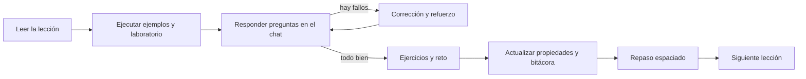

---
tags:
  - redis
  - MOC
aliases:
  - Redis
  - Curso Redis
  - Índice Redis
  - Redis MOC
type: moc
course: redis
created: 2026-11-03
---

# ⚡ 00 - Redis - Índice

> Sistema de aprendizaje de **Redis de cero a experto**, orientado a un perfil **Senior Software Engineer .NET**: fundamentos, estructuras de datos, caché, .NET, microservicios, alta disponibilidad, Cluster, seguridad, observabilidad y troubleshooting. Cada tema es una nota independiente con la misma estructura, laboratorio, preguntas de entrevista y ejercicios.

> [!info] Punto de partida
> - **Empieza aquí** → [[Qué es Redis]] (lección 0.1)
> - Ruta completa: niveles 0-10, objetivos, proyectos y criterios → [[01 - Redis - Roadmap]]
> - Cómo dependen los temas entre sí → [[02 - Redis - Mapa de conocimientos]]
> - Tu avance, repasos y bitácora → [[03 - Redis - Progreso]]
> - Requisito para los laboratorios → [[Docker - Índice]]

## Contenido
- [[#🧭 Cómo funciona el curso]]
- [[#🤝 Cómo pedirme cosas en el chat]]
- [[#🗂️ Estructura de carpetas]]
- [[#🏷️ Convenciones]]
- [[#📚 Niveles]]
- [[#📖 Lecciones publicadas]]
- [[#🔗 Conexiones con el resto del vault]]

---

## 🧭 Cómo funciona el curso

1. **Una lección por vez.** Cada lección es una nota con 14 secciones fijas: definición → problema → conceptos → funcionamiento interno → ejemplos → .NET → arquitectura → errores → buenas prácticas → entrevista → ejercicios → resumen → referencias → notas relacionadas.
2. **Comprobación antes de avanzar.** Al terminar la lección te hago preguntas en el chat, evalúo tus respuestas y corrijo los errores explicando el motivo. No pasamos al siguiente tema hasta que los fundamentos estén firmes.
3. **Práctica obligatoria.** Cada lección trae laboratorio o ejercicios; cada nivel termina con un proyecto o laboratorio integrador y un examen.
4. **Seguimiento.** Actualizas las propiedades de la nota (`status`, `mastery`, `next_review`) y los tableros de [[03 - Redis - Progreso]] se recalculan solos.
5. **Recuerdo activo.** Las respuestas a las preguntas de entrevista y las soluciones están plegadas: intenta responder antes de desplegarlas.



## 🤝 Cómo pedirme cosas en el chat

| Quiero… | Escribe algo como |
|---|---|
| Empezar el siguiente tema | «siguiente lección» |
| Que corrija mis respuestas | pega tus respuestas tal cual, sin pulirlas |
| Un examen | «examen de [tema]» o «examen del nivel N» |
| Más dificultad | «reto» o «reto senior de [tema]» |
| Practicar diagnóstico | «escenario de troubleshooting de [tema]» |
| Practicar diseño | «caso de diseño con Redis» |
| Repasar | «repaso de [tema]» o «flashcards de [tema]» |
| El proyecto del nivel | «proyecto del nivel N» |

## 🗂️ Estructura de carpetas

```text
Redis/
├── 00 - Redis - Índice.md                 ← este MOC
├── 01 - Redis - Roadmap.md                ← niveles 0-10: objetivos, lecciones, labs, proyectos, criterios
├── 02 - Redis - Mapa de conocimientos.md  ← dependencias entre temas y rutas alternativas
├── 03 - Redis - Progreso.md               ← tableros, checklist, repasos y bitácora
├── Nivel 00 - Fundamentos/
├── Nivel 01 - Redis básico/
├── Nivel 02 - Estructuras y operaciones avanzadas/
├── Nivel 03 - Redis como caché/
├── Nivel 04 - Redis con .NET/
├── Nivel 05 - Microservicios/
├── Nivel 06 - Persistencia y alta disponibilidad/
├── Nivel 07 - Cluster y escalabilidad/
├── Nivel 08 - Seguridad, monitoreo y administración/
├── Nivel 09 - Patrones y arquitectura empresarial/
├── Nivel 10 - Experto y troubleshooting/
├── Proyectos/        ← Proyecto 01…11: requisitos, arquitectura, decisiones (ADR) y enlace al código
├── Laboratorios/     ← entorno, failover con Sentinel, Cluster local y game days
├── Exámenes/         ← un examen por nivel con tus respuestas y la corrección
├── Recursos/         ← Glosario, Cheatsheet de comandos, Banco de preguntas de entrevista
└── Plantillas/       ← Plantilla - Lección Redis
```

- Las carpetas se crean a medida que llegan sus notas; Obsidian no necesita que existan antes.
- **El código de los proyectos vive fuera del vault**, en un repositorio propio (por ejemplo `redis-dotnet-lab/` con `docker-compose.yml`, `src/` y `tests/`). La nota del proyecto guarda requisitos, diagramas, decisiones y el enlace al repo.
- Los enlaces a lecciones que aún no existen aparecen como enlaces sin resolver. Es intencionado: el grafo muestra lo que falta.

## 🏷️ Convenciones

**Nombres de nota**
- El concepto con su nombre habitual: inglés técnico cuando es el término estándar (`Cache-aside`, `Hash slots`, `Redis Streams`) y español en títulos descriptivos (`Qué es Redis`, `Persistencia RDB`).
- Sin `?`, `/`, `:`, `#` ni `|`, que Windows u Obsidian no admiten en nombres de archivo: `Pub/Sub` → [[Redis Pub-Sub]].
- Si el concepto general ya tiene nota en el vault, la versión aplicada lleva el sufijo «con Redis» y enlaza a la general: [[Idempotencia]] → [[Idempotencia con Redis]].

**Propiedades de cada lección**

| Propiedad | Valores | Para qué |
|---|---|---|
| `status` | `pending` · `learning` · `review` · `mastered` | Ciclo de vida (ver [[03 - Redis - Progreso]]) |
| `level` | `beginner` · `intermediate` · `advanced` · `expert` | Dificultad del tema |
| `type` | `lesson` · `project` · `lab` · `exam` · `moc` | Filtrar en los tableros |
| `course_level` / `order` | `0`-`10` / `1…n` | Posición en el roadmap (la lección 0.1 es nivel 0, orden 1) |
| `mastery` | `0`-`4` | Dominio autoevaluado (escala en [[03 - Redis - Progreso]]) |
| `last_review` / `next_review` | fecha | Repaso espaciado |

**Etiquetas:** `redis`, `backend`, `architecture`, `learning` y la anidada `redis/nivel-N` para filtrar por nivel.

**Disponibilidad 🏷️**, para comandos y funciones que dependen de versión o distribución:

| Marca | Significa |
|---|---|
| **Core** | Cualquier Redis Open Source moderno |
| **≥x.y** | Requiere esa versión mínima |
| **R8** | Incluido en Redis Open Source 8+; en 7.x requería Redis Stack o módulos |
| **Ent** | Solo Redis Software, Redis Cloud o servicios gestionados (por ejemplo, Azure Managed Redis) |
| **Valkey≠** | Se comporta distinto, o no existe, en Valkey |

**Callouts:** `[!abstract]` resumen de 30 segundos · `[!question]-` preguntas plegadas para recuerdo activo · `[!success]-` soluciones · `[!warning]` riesgos · `[!bug]` código con problemas a propósito.

## 📚 Niveles

| Nivel | Tema | `level` | Entregable | Estado |
|---|---|---|---|---|
| 0 | [[01 - Redis - Roadmap#Nivel 0 — Fundamentos y conceptos esenciales\|Fundamentos y conceptos esenciales]] | beginner | Laboratorio 00 | 🟡 En curso |
| 1 | [[01 - Redis - Roadmap#Nivel 1 — Redis básico y comandos fundamentales\|Redis básico y comandos fundamentales]] | beginner | Proyecto 01 | ⚪ Pendiente |
| 2 | [[01 - Redis - Roadmap#Nivel 2 — Estructuras de datos y operaciones avanzadas\|Estructuras de datos y operaciones avanzadas]] | intermediate | Proyecto 02 | ⚪ Pendiente |
| 3 | [[01 - Redis - Roadmap#Nivel 3 — Redis como caché\|Redis como caché]] | intermediate | Proyecto 03 | ⚪ Pendiente |
| 4 | [[01 - Redis - Roadmap#Nivel 4 — Redis en aplicaciones backend y .NET\|Redis en aplicaciones backend y .NET]] | intermediate | Proyectos 04 y 05 | ⚪ Pendiente |
| 5 | [[01 - Redis - Roadmap#Nivel 5 — Redis en arquitecturas de microservicios\|Redis en arquitecturas de microservicios]] | advanced | Proyectos 06, 07 y 08 | ⚪ Pendiente |
| 6 | [[01 - Redis - Roadmap#Nivel 6 — Persistencia, replicación y alta disponibilidad\|Persistencia, replicación y alta disponibilidad]] | advanced | Laboratorio 06 | ⚪ Pendiente |
| 7 | [[01 - Redis - Roadmap#Nivel 7 — Redis Cluster, escalabilidad y rendimiento\|Redis Cluster, escalabilidad y rendimiento]] | advanced | Laboratorio 07 | ⚪ Pendiente |
| 8 | [[01 - Redis - Roadmap#Nivel 8 — Seguridad, monitoreo y administración\|Seguridad, monitoreo y administración]] | advanced | Proyecto 09 | ⚪ Pendiente |
| 9 | [[01 - Redis - Roadmap#Nivel 9 — Patrones avanzados y arquitectura empresarial\|Patrones avanzados y arquitectura empresarial]] | expert | Proyectos 10 y 11 | ⚪ Pendiente |
| 10 | [[01 - Redis - Roadmap#Nivel 10 — Redis experto, troubleshooting y optimización\|Redis experto, troubleshooting y optimización]] | expert | Laboratorio 10 | ⚪ Pendiente |

## 📖 Lecciones publicadas

| # | Lección | Estado |
|---|---|---|
| 0.1 | [[Qué es Redis]] | 🟡 `learning` |

La lista completa de lecciones, con su estado actualizado automáticamente, está en [[03 - Redis - Progreso]].

## 🔗 Conexiones con el resto del vault

| Área | Notas |
|---|---|
| Datos | [[Bases de Datos SQL vs NoSQL]] · [[ACID en Bases de Datos]] · [[Teorema CAP y BASE]] |
| Contenedores | [[Docker - Índice]] · [[Docker Compose]] · [[Redes en Docker]] · [[Volúmenes]] |
| Kubernetes | [[00 - Kubernetes - Índice]] · [[03 - Objetos y workloads]] (StatefulSet, base de [[Redis en Kubernetes]]) |
| Microservicios | [[🏗️ Diseño de Microservicios]] · [[CQRS (Command Query Responsibility Segregation)]] · [[Event Sourcing]] · [[Transactional Outbox]] · [[Idempotencia]] |
| Resiliencia | [[Circuit Breaker]] · [[Retry con Backoff Exponencial]] · [[Bulkhead]] |
| Arquitectura | [[Clean Architecture]] |
| Azure | [[Azure Monitor]] · [[00 - Indice y ruta de estudio\|Azure Service Bus]] (comparativa con Redis Streams en el Nivel 5) |
| Práctica previa | [[Comandos Redis - Opción 3 (Híbrida)]]: equipos como Hashes e índices por división con Sets |

---
⬅️ [[🗺️ Índice - Ingeniería de Software|Volver al índice de Ingeniería de Software]]
