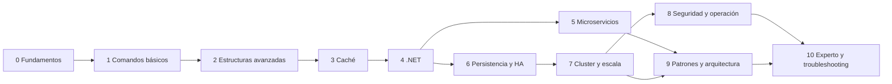

---
tags:
  - redis
  - roadmap
  - plan
aliases:
  - Roadmap Redis
  - Ruta de aprendizaje Redis
type: moc
course: redis
created: 2026-11-03
---

# 🗺️ 01 - Redis - Roadmap

> Once niveles, de cero a experto. Cada nivel tiene **objetivo**, **lecciones** (una nota por tema), **ejercicios**, **laboratorio o proyecto**, **criterios de dominio** y **preguntas de entrevista** representativas. Versiones de referencia: **Redis Open Source 8.10** y **StackExchange.Redis 3.x** (noviembre de 2026).

## Contenido
- [[#📈 Vista general]]
- [[#🔁 Cómo se estudia una lección y cómo se aprueba un nivel]]
- [[#Nivel 0 — Fundamentos y conceptos esenciales]]
- [[#Nivel 1 — Redis básico y comandos fundamentales]]
- [[#Nivel 2 — Estructuras de datos y operaciones avanzadas]]
- [[#Nivel 3 — Redis como caché]]
- [[#Nivel 4 — Redis en aplicaciones backend y .NET]]
- [[#Nivel 5 — Redis en arquitecturas de microservicios]]
- [[#Nivel 6 — Persistencia, replicación y alta disponibilidad]]
- [[#Nivel 7 — Redis Cluster, escalabilidad y rendimiento]]
- [[#Nivel 8 — Seguridad, monitoreo y administración]]
- [[#Nivel 9 — Patrones avanzados y arquitectura empresarial]]
- [[#Nivel 10 — Redis experto, troubleshooting y optimización]]
- [[#🚀 Proyectos y laboratorios]]
- [[#📝 Exámenes]]

---

## 📈 Vista general



Del 0 al 4 el orden es estricto. A partir del 4 hay dos pistas: **desarrollo** (5 → 9) y **operación** (6 → 7 → 8). El orden recomendado sigue siendo el numérico, pero puedes alternar según lo que necesites en el trabajo. Las dependencias detalladas están en [[02 - Redis - Mapa de conocimientos]].

| Nivel | Tema | `level` | Duración orientativa | Entregable |
|---|---|---|---|---|
| 0 | Fundamentos y conceptos esenciales | beginner | 1 semana | [[Laboratorio 00 - Entorno Redis y .NET]] |
| 1 | Redis básico y comandos fundamentales | beginner | 1-2 semanas | [[Proyecto 01 - Ranking de usuarios]] |
| 2 | Estructuras de datos y operaciones avanzadas | intermediate | 2-3 semanas | [[Proyecto 02 - Sistema de rate limiting]] |
| 3 | Redis como caché | intermediate | 2 semanas | [[Proyecto 03 - Caché de productos]] |
| 4 | Redis en aplicaciones backend y .NET | intermediate | 2-3 semanas | [[Proyecto 04 - Caché de consultas]] · [[Proyecto 05 - Gestión de sesiones]] |
| 5 | Redis en arquitecturas de microservicios | advanced | 2-3 semanas | [[Proyecto 06 - Distribución de eventos]] · [[Proyecto 07 - Sistema de colas]] · [[Proyecto 08 - Procesamiento de eventos con Redis Streams]] |
| 6 | Persistencia, replicación y alta disponibilidad | advanced | 1-2 semanas | [[Laboratorio 06 - Failover con Sentinel y .NET]] |
| 7 | Redis Cluster, escalabilidad y rendimiento | advanced | 2 semanas | [[Laboratorio 07 - Redis Cluster local]] |
| 8 | Seguridad, monitoreo y administración | advanced | 2 semanas | [[Proyecto 09 - Caching distribuido con observabilidad]] |
| 9 | Patrones avanzados y arquitectura empresarial | expert | 2-3 semanas | [[Proyecto 10 - Sistema de reservas con control de concurrencia]] · [[Proyecto 11 - Arquitectura de microservicios con Redis]] |
| 10 | Redis experto, troubleshooting y optimización | expert | 2-3 semanas y práctica continua | [[Laboratorio 10 - Game days de Redis]] |

> [!tip] Ritmo orientativo
> Con 5-7 h por semana, el recorrido completo lleva entre 19 y 26 semanas (5-6 meses). Si necesitas Redis en el trabajo ya, sigue la ruta rápida de [[02 - Redis - Mapa de conocimientos#⚡ Ruta rápida para el trabajo]] y vuelve después al orden completo.

> [!info] Disponibilidad 🏷️
> **Core** = cualquier Redis Open Source moderno · **≥x.y** = versión mínima · **R8** = incluido en Redis Open Source 8+ (en 7.x requería Redis Stack o módulos) · **Ent** = Redis Software, Redis Cloud o servicio gestionado · **Valkey≠** = distinto en Valkey. Detalle en [[00 - Redis - Índice#🏷️ Convenciones]].

---

## 🔁 Cómo se estudia una lección y cómo se aprueba un nivel

**Ciclo de cada lección**
1. Lee la nota completa (30-45 min).
2. Ejecuta los ejemplos en tu laboratorio Docker.
3. Responde en el chat las preguntas de comprobación; corrijo y refuerzo hasta que estén bien.
4. Haz los ejercicios 🟢 y 🟡 e intenta el 🔴.
5. Actualiza `status`, `mastery` y `next_review`, y anota dudas en la bitácora de [[03 - Redis - Progreso]].
6. Repasa en las fechas de repaso espaciado.

**Criterios para aprobar un nivel**
- Todas sus lecciones con `mastery ≥ 3`.
- Laboratorio o proyecto terminado, con un README que explique las decisiones técnicas.
- Examen del nivel con nota ≥ 80 %.
- Tres preguntas de entrevista del nivel respondidas en voz alta, en menos de 2 minutos cada una.

---

## Nivel 0 — Fundamentos y conceptos esenciales

> 🎯 **Objetivo:** entender qué es Redis, qué problema resuelve, cómo ejecuta los comandos y por qué es rápido (y cuándo deja de serlo), y tener un entorno de laboratorio reproducible.

| # | Lección | Qué aprenderás | Comandos / APIs | 🏷️ |
|---|---|---|---|---|
| 0.1 | [[Qué es Redis]] ✅ | Definición, problema que resuelve, estructuras de datos, atomicidad, roles, cuándo usarlo y cuándo no | `PING`, `SET`, `GET`, `INCR`, `HSET`, `ZADD` | Core |
| 0.2 | [[Redis como almacenamiento en memoria]] | RAM vs disco, volatilidad, coste por GB, overhead por clave, dimensionamiento | `INFO memory`, `MEMORY USAGE` | Core |
| 0.3 | [[Redis vs SQL Server, PostgreSQL y MongoDB]] | Modelo de datos, consultas, transacciones, durabilidad, escalado y cómo combinarlos | — | — |
| 0.4 | [[Redis vs Memcached]] | Tipos de datos, persistencia, replicación, modelo de hilos, cuándo Memcached aún tiene sentido | — | — |
| 0.5 | [[Arquitectura interna de Redis]] | Event loop, RESP, keyspace, `redisObject`, codificaciones, expiración, fork y copy-on-write | `OBJECT ENCODING`, `DEBUG` (solo lab) | Core |
| 0.6 | [[Modelo de ejecución single-threaded]] | Por qué un hilo es rápido, atomicidad, comandos que bloquean, hilos de fondo, I/O threads | `io-threads` | Core · I/O threads ≥6.0, reimplementados en 8.0 |
| 0.7 | [[Latencia y rendimiento en Redis]] | Round-trip vs tiempo de servidor, percentiles p50/p99, latencia intrínseca, primer benchmark | `redis-cli --latency`, `--intrinsic-latency`, `redis-benchmark` | Core |
| 0.8 | [[Ediciones, distribuciones y licencias de Redis]] | Open Source, Stack, Software, Cloud, Azure Managed Redis y Valkey; licencias y su impacto | — | — |
| 0.9 | [[Instalación de Redis con Docker]] | `docker run` y Compose, configuración, volúmenes, versiones y tags, Redis Insight | `docker compose`, `INFO server` | Core |

**Ejercicios prácticos**
- Explica Redis a un junior en 1 minuto y a un arquitecto en 3, con trade-offs.
- Clasifica 10 escenarios en «Redis sí / no / depende» y justifica cada uno.
- Lee la salida de `INFO` y localiza versión, memoria usada, clientes conectados, comandos procesados y persistencia.

**Laboratorio:** [[Laboratorio 00 - Entorno Redis y .NET]]. Docker Compose con Redis 8.10 y Redis Insight, volumen, `redis.conf` montado y usuario ACL básico; medición de latencia y benchmark con y sin pipelining; consola .NET que hace `PING`.

**Criterios de dominio**
- [ ] Explico qué es Redis, qué no es, y doy 3 casos de uso y 3 anti-casos con su motivo.
- [ ] Explico por qué un solo hilo es rápido y qué lo bloquea, con un ejemplo de comando peligroso.
- [ ] Distingo latencia de red y tiempo de ejecución, y sé medir las dos.
- [ ] Distingo Redis Open Source, Stack, Software, Cloud, Azure Managed Redis y Valkey, con su licencia.
- [ ] Levanto un entorno reproducible y verifico versión y módulos cargados.

**Entrevista:** «¿Por qué Redis es tan rápido?» · «¿Redis o Memcached?» · «¿Puede Redis perder datos?»

---

## Nivel 1 — Redis básico y comandos fundamentales

> 🎯 **Objetivo:** dominar los cinco tipos básicos, la expiración y el manejo del keyspace, y elegir la estructura correcta por patrón de acceso.

| # | Lección | Qué aprenderás | Comandos / APIs | 🏷️ |
|---|---|---|---|---|
| 1.1 | [[redis-cli y Redis Insight]] | Modo interactivo y por lotes, diagnósticos rápidos, exploración visual y perfilado | `redis-cli --scan`, `--bigkeys`, `--stat`, `HELP` | Core |
| 1.2 | [[Claves y keyspace en Redis]] | Convenciones de nombres, `SCAN` vs `KEYS`, `DEL` vs `UNLINK`, bases lógicas y por qué evitarlas | `EXISTS`, `TYPE`, `DEL`, `UNLINK`, `RENAME`, `SCAN`, `SELECT` | Core |
| 1.3 | [[Redis Strings]] | Strings binarios (máx. 512 MB), opciones de `SET`, operaciones múltiples, codificaciones `int`/`embstr`/`raw` | `SET … NX/XX/EX/PX/KEEPTTL/GET`, `GET`, `MGET`, `MSET`, `GETEX`, `GETDEL` | Core |
| 1.4 | [[Contadores atómicos con INCR y DECR]] | Atomicidad en la práctica, contadores, generación de IDs, límites | `INCR`, `INCRBY`, `DECR`, `DECRBY`, `INCRBYFLOAT`, `INCREX` | Core · `INCREX` ≥8.8 |
| 1.5 | [[Expiración y TTL]] | Expiración pasiva y activa, `TTL` -1/-2, segundos vs milisegundos, condiciones | `EXPIRE`, `PEXPIRE`, `EXPIREAT`, `TTL`, `PTTL`, `PERSIST`, `EXPIRETIME` | Core · `NX/XX/GT/LT` y `EXPIRETIME` ≥7.0 |
| 1.6 | [[Redis Hashes]] | Objetos como campo → valor, operaciones por campo, listpack vs hashtable, TTL por campo | `HSET`, `HGET`, `HMGET`, `HGETALL`, `HDEL`, `HINCRBY`, `HSCAN`, `HEXPIRE`, `HGETEX` | Core · TTL por campo ≥7.4 · `HGETEX/HSETEX/HGETDEL` ≥8.0 |
| 1.7 | [[Redis Lists]] | Colas y pilas, comandos bloqueantes, mover elementos de forma fiable | `LPUSH`, `RPUSH`, `LPOP`, `RPOP`, `LRANGE`, `LTRIM`, `LMOVE`, `BLPOP`, `BLMOVE` | Core · `LMOVEM/BLMOVEM` ≥8.10 |
| 1.8 | [[Redis Sets]] | Conjuntos únicos, pertenencia en O(1), álgebra de conjuntos | `SADD`, `SREM`, `SMEMBERS`, `SISMEMBER`, `SMISMEMBER`, `SINTER`, `SUNION`, `SDIFF`, `SINTERCARD`, `SSCAN` | Core · `SINTERCARD` ≥7.0 · `SUNIONCARD/SDIFFCARD` ≥8.10 |
| 1.9 | [[Redis Sorted Sets]] | Conjuntos ordenados por score, rankings, rangos por posición, score o lexicográficos | `ZADD`, `ZINCRBY`, `ZRANGE … BYSCORE/REV/LIMIT`, `ZRANK`, `ZSCORE`, `ZREM`, `ZPOPMIN` | Core · `ZRANGE` unificado ≥6.2 |
| 1.10 | [[Complejidad de los comandos Big O]] | Leer la complejidad en la documentación, O(1), O(log N), O(N), comandos peligrosos | `SCAN`, `HSCAN`, `SSCAN`, `ZSCAN` | Core |

**Ejercicios prácticos**
- Modela un perfil de usuario como String con JSON y como Hash; compara memoria con `MEMORY USAGE` y operaciones posibles.
- «Últimos 10 productos vistos» con `LPUSH` + `LTRIM`.
- «Usuarios con intereses en común» con `SINTER`.
- Recorre 100 000 claves con `SCAN` y explica por qué puede devolver duplicados.

**Proyecto:** [[Proyecto 01 - Ranking de usuarios]]. Leaderboard con Sorted Sets y perfiles en Hashes: puntuar, top N, posición de un jugador, vecinos en el ranking y rankings por periodo con TTL. Primero en `redis-cli` y después en una consola .NET mínima.

**Criterios de dominio**
- [ ] Elijo la estructura correcta para 10 escenarios sin consultar.
- [ ] Explico cada opción de `SET` (`NX`, `XX`, `EX`, `PX`, `KEEPTTL`, `GET`) y cuándo usarla.
- [ ] Explico la expiración pasiva y activa y qué significan `TTL` = -1 y -2.
- [ ] Sé por qué `KEYS` está prohibido en producción y uso `SCAN` bien (cursor, `MATCH`, `COUNT`, duplicados).
- [ ] Leo la complejidad de cualquier comando en la documentación y predigo su impacto.

**Entrevista:** «¿Hash o String con JSON?» · «¿Cómo implementarías "usuarios online ahora"?» · «¿`DEL` o `UNLINK`?»

---

## Nivel 2 — Estructuras de datos y operaciones avanzadas

> 🎯 **Objetivo:** usar las estructuras especializadas y componer operaciones atómicas de varios pasos (transacciones, Lua, Functions), sabiendo qué depende de la versión o la distribución.

| # | Lección | Qué aprenderás | Comandos / APIs | 🏷️ |
|---|---|---|---|---|
| 2.1 | [[Codificaciones internas de los tipos de datos]] | listpack, intset, quicklist, skiplist, hashtable; umbrales de conversión; memoria vs CPU | `OBJECT ENCODING`, `MEMORY USAGE`, `CONFIG GET *listpack*` | Core · hashes compactos ≥8.10 |
| 2.2 | [[Redis Bitmaps y Bitfields]] | Bits sobre strings: flags por usuario, retención diaria, contadores empaquetados | `SETBIT`, `GETBIT`, `BITCOUNT`, `BITOP`, `BITPOS`, `BITFIELD` | Core |
| 2.3 | [[Redis HyperLogLog]] | Cardinalidad aproximada con ~12 KB y error estándar del 0,81 % | `PFADD`, `PFCOUNT`, `PFMERGE` | Core |
| 2.4 | [[Redis Geospatial]] | Índices geográficos sobre sorted sets, búsquedas por radio y por caja | `GEOADD`, `GEOSEARCH`, `GEOSEARCHSTORE`, `GEODIST`, `GEOPOS` | Core · `GEOSEARCH` ≥6.2 |
| 2.5 | [[Redis Streams]] | Log append-only, IDs, lectura por rango y bloqueante, recorte | `XADD`, `XRANGE`, `XREAD`, `XLEN`, `XTRIM` | Core · ≥5.0 |
| 2.6 | [[Estructuras probabilísticas en Redis]] | Bloom, Cuckoo, Count-min sketch, Top-K y t-digest: precisión frente a memoria | `BF.ADD`, `BF.EXISTS`, `CF.ADD`, `CMS.INCRBY`, `TOPK.ADD`, `TDIGEST.ADD` | R8 |
| 2.7 | [[Redis JSON]] | Documentos JSON con JSONPath y actualizaciones parciales atómicas | `JSON.SET`, `JSON.GET`, `JSON.NUMINCRBY`, `JSON.ARRAPPEND` | R8 |
| 2.8 | [[Redis Query Engine]] | Índices secundarios sobre hashes y JSON, full-text, agregaciones y vectores | `FT.CREATE`, `FT.SEARCH`, `FT.AGGREGATE` | R8 |
| 2.9 | [[Redis TimeSeries]] *(opcional)* | Series temporales, retención, agregación y downsampling | `TS.ADD`, `TS.RANGE`, `TS.MRANGE`, `TS.CREATERULE` | R8 |
| 2.10 | [[Redis Arrays]] *(opcional)* | El tipo más reciente: secuencias dispersas indexadas por posición; su API se verificará en la lección | — | ≥8.8 |
| 2.11 | [[Transacciones con MULTI, EXEC y WATCH]] | Qué garantiza una transacción y qué no, ausencia de rollback, bloqueo optimista | `MULTI`, `EXEC`, `DISCARD`, `WATCH`, `UNWATCH` | Core |
| 2.12 | [[Pipelining]] | Round-trips, batching, pipelining vs transacciones; pipelining implícito de StackExchange.Redis | `redis-cli --pipe`, `IBatch` | Core |
| 2.13 | [[Lua scripting en Redis]] | Scripts atómicos, `KEYS` vs `ARGV`, caché de scripts, scripts de solo lectura, riesgos de seguridad | `EVAL`, `EVALSHA`, `EVAL_RO`, `SCRIPT LOAD` | Core · `EVAL_RO` ≥7.0 |
| 2.14 | [[Redis Functions]] | Librerías persistidas y replicadas; cuándo sustituyen a `EVAL` | `FUNCTION LOAD`, `FCALL`, `FCALL_RO`, `FUNCTION LIST` | ≥7.0 |
| 2.15 | [[Modelado de datos en Redis]] | Diseñar claves y estructuras por patrón de acceso, desnormalizar, índices secundarios manuales | — | Core |
| 2.16 | [[Rate limiting con Redis]] | Ventana fija, ventana deslizante (log y contador), token bucket; atomicidad y comparativa | `INCR` + `EXPIRE`, `ZADD`, `ZREMRANGEBYSCORE`, Lua, `INCREX` | Core · `INCREX` ≥8.8 |

**Ejercicios prácticos**
- Usuarios únicos diarios con HyperLogLog frente a un Set: mide la memoria con 1 millón de IDs.
- Retención de usuarios por día con bitmaps y `BITOP AND`.
- «Tiendas a menos de 3 km» con `GEOSEARCH`.
- Decrementar stock sin bajar de 0, de tres formas: `WATCH`, Lua y Function. Compara complejidad y comportamiento bajo contención.
- Mide 1000 comandos sin pipeline y con pipeline.

**Proyecto:** [[Proyecto 02 - Sistema de rate limiting]]. Librería y middleware de ASP.NET Core con tres algoritmos intercambiables (ventana fija, ventana deslizante con Sorted Set y token bucket en Lua), cabeceras `RateLimit-*`, pruebas de concurrencia y comparación con `INCREX` (🏷️ ≥8.8).

**Criterios de dominio**
- [ ] Explico por qué `MULTI/EXEC` no hace rollback y cuándo hace falta `WATCH`.
- [ ] Escribo un script Lua atómico pasando las claves en `KEYS` y explico por qué importa en Cluster.
- [ ] Mido la ganancia del pipelining y explico en qué se diferencia de una transacción.
- [ ] Calculo la memoria aproximada de HyperLogLog frente a Set para N elementos.
- [ ] Sé qué estructuras son core y cuáles requieren Redis 8+ (o Redis Stack en 7.x).

**Entrevista:** «Pipelining vs transacciones vs Lua» · «¿Cómo contarías visitantes únicos entre 100 millones de eventos?» · «¿Por qué Functions en lugar de `EVAL`?»

---

## Nivel 3 — Redis como caché

> 🎯 **Objetivo:** diseñar cachés correctas: patrones, expiración, invalidación, consistencia, desalojo y protección frente a stampede, penetration y avalanche.

| # | Lección | Qué aprenderás | Comandos / APIs | 🏷️ |
|---|---|---|---|---|
| 3.1 | [[Fundamentos de caching]] | Hit ratio, qué cachear y qué no, capas (L1, L2, CDN), coste/beneficio, cómo medir | — | — |
| 3.2 | [[Cache-aside]] | El patrón más usado: carga perezosa, escritura en la fuente e invalidación | `GET`, `SET … EX` | Core |
| 3.3 | [[Read-through]] | La caché carga por ti: proveedores y `GetOrCreate`, pros y contras | `HybridCache.GetOrCreateAsync` | — |
| 3.4 | [[Write-through]] | Escribir en caché y fuente a la vez: consistencia vs latencia de escritura | — | — |
| 3.5 | [[Write-behind]] | Escritura diferida a la fuente: rendimiento vs riesgo de pérdida | Streams o Lists como buffer | — |
| 3.6 | [[Estrategias de TTL en caché]] | TTL absoluto vs deslizante, TTL según volatilidad del dato, jitter | `EXPIRE`, `GETEX` | Core |
| 3.7 | [[Cache invalidation]] | Borrar vs actualizar, invalidación por eventos, claves versionadas, tags | `DEL`, `UNLINK`, Pub/Sub | Core |
| 3.8 | [[Cache consistency]] | Carreras entre BD y caché, borrado doble, invalidación por CDC, versionado | — | — |
| 3.9 | [[Eviction policies]] | `maxmemory` y las políticas de desalojo; `noeviction` para datos que no se pueden perder | `maxmemory`, `maxmemory-policy` | Core |
| 3.10 | [[LRU y LFU en Redis]] | LRU aproximado por muestreo, LFU con contadores logarítmicos y decaimiento | `maxmemory-samples`, `lfu-log-factor`, `lfu-decay-time`, `OBJECT FREQ` | Core |
| 3.11 | [[Cache stampede]] | Muchos misses simultáneos: mutex, single-flight, expiración anticipada probabilística, stale-while-revalidate | `SET … NX PX` | Core |
| 3.12 | [[Cache penetration]] | Peticiones a datos que no existen: caché negativa, Bloom filter, validación | `BF.EXISTS` | Core · Bloom R8 |
| 3.13 | [[Cache avalanche]] | Expiración masiva o caída de la caché: jitter, precalentamiento, HA, protección de la BD | — | — |
| 3.14 | [[Distributed caching]] | Caché local vs distribuida, L1 + L2, invalidación entre instancias, client-side caching | `CLIENT TRACKING` | Core · ≥6.0 |

**Ejercicios prácticos**
- Provoca un cache stampede con 200 peticiones concurrentes (k6 o NBomber) y mide el impacto en la BD; aplica un mutex y compara.
- Calcula un TTL con jitter para 1 millón de claves cargadas en el mismo minuto.
- Dibuja la carrera «lectura antigua escrita después de la invalidación» y propón dos soluciones.
- Limita la memoria a 50 MB y compara `allkeys-lru` y `allkeys-lfu` observando `evicted_keys` y el hit ratio.

**Proyecto:** [[Proyecto 03 - Caché de productos]]. API de catálogo (Minimal API + PostgreSQL o SQL Server) con cache-aside, invalidación al actualizar, protección contra stampede, caché negativa, TTL con jitter y métricas de hit ratio.

**Criterios de dominio**
- [ ] Explico los cuatro patrones (aside, read-through, write-through, write-behind) con sus modos de fallo.
- [ ] Diagnostico un stampede a partir de métricas y lo resuelvo de dos formas.
- [ ] Elijo la política de desalojo según el rol de la instancia y lo justifico.
- [ ] Explico una carrera de caché obsoleta y dos formas de evitarla.
- [ ] Diseño la invalidación de una entidad que aparece en varias claves.

**Entrevista:** «¿Cómo invalidarías la caché al actualizar un producto?» · «¿Qué es un cache stampede y cómo lo evitas?» · «¿Por qué borrar en lugar de actualizar la clave al invalidar?»

---

## Nivel 4 — Redis en aplicaciones backend y .NET

> 🎯 **Objetivo:** integrar Redis en aplicaciones .NET de producción: cliente bien configurado, abstracciones adecuadas, resiliencia, pruebas y arquitectura limpia.

| # | Lección | Qué aprenderás | Comandos / APIs | 🏷️ |
|---|---|---|---|---|
| 4.1 | [[StackExchange.Redis]] | Arquitectura del cliente (multiplexación, async), de 2.x a 3.x (nuevo núcleo de IO, RESP3 por defecto), NRedisStack | NuGet `StackExchange.Redis` | 3.x |
| 4.2 | [[ConnectionMultiplexer]] | Singleton, `ConfigurationOptions`, reconexión, eventos, timeouts y su diagnóstico | `ConnectionMultiplexer.ConnectAsync` | — |
| 4.3 | [[IDatabase y operaciones en StackExchange.Redis]] | `RedisKey`/`RedisValue`, `CommandFlags`, batches, transacciones con condiciones, scripts | `IDatabase`, `IBatch`, `ITransaction`, `LuaScript` | — |
| 4.4 | [[Redis con ASP.NET Core]] | Registro en DI, configuración y secretos, health checks, ciclo de vida | `AddSingleton<IConnectionMultiplexer>` | — |
| 4.5 | [[Redis en Minimal APIs]] | Endpoints con caché, filtros, resultados tipados, medición | `MapGet`, `IEndpointFilter` | — |
| 4.6 | [[IDistributedCache]] | La abstracción de ASP.NET Core y su implementación Redis (Redis Distributed Cache): API de bytes, expiración deslizante, límites | `AddStackExchangeRedisCache` | — |
| 4.7 | [[HybridCache]] | Caché L1 + L2, protección contra stampede, tags, serialización configurable | `AddHybridCache`, `GetOrCreateAsync`, `RemoveByTagAsync` | Desde .NET 9; el paquete soporta runtimes anteriores |
| 4.8 | [[Redis Output Cache]] | Cachear respuestas HTTP completas con Redis como almacén | `AddStackExchangeRedisOutputCache` | ASP.NET Core ≥8 |
| 4.9 | [[Serialización de datos en Redis]] | System.Text.Json con source generators, MessagePack, compresión, versionado del esquema | — | — |
| 4.10 | [[Redis con Entity Framework Core]] | Cachear consultas y entidades sin romper el tracking; invalidación al guardar | interceptores, decorators | — |
| 4.11 | [[Redis como caché de consultas]] | Claves derivadas de la consulta, paginación, invalidación por tags o versiones | — | — |
| 4.12 | [[Redis en Clean Architecture]] | Puertos en Application, adaptador en Infrastructure, decorators y pipeline behaviors | — | — |
| 4.13 | [[Redis con Polly y resiliencia]] | Timeouts, reintentos con cuidado, circuit breaker y fallback a la fuente | Polly v8 `ResiliencePipeline` | — |
| 4.14 | [[Sesiones distribuidas con Redis]] | Sesión de ASP.NET Core sobre Redis, claves de Data Protection compartidas, sticky vs distribuidas | `AddSession`, `PersistKeysToStackExchangeRedis` | — |
| 4.15 | [[Redis con Docker Compose]] | Entorno local completo: app + Redis + Redis Insight, healthchecks, volúmenes, configuración | `docker compose` | — |
| 4.16 | [[Testing con Redis y Testcontainers]] | Tests de integración contra un Redis real y efímero | `Testcontainers.Redis` | — |
| 4.17 | [[Redis con Aspire]] *(opcional)* | Orquestación local, service discovery y telemetría con Aspire | `AddRedis` | — |

> El despliegue en la nube ([[Redis en Azure]]) se ve en el Nivel 8, cuando ya conoces replicación, Cluster, ACL y TLS, que es lo que diferencia los niveles de servicio.

**Ejercicios prácticos**
- Provoca y lee una `RedisTimeoutException`: distingue si el problema es Redis, la red o el thread pool de tu aplicación.
- Implementa la misma caché con `IDistributedCache` y con `HybridCache` y compara código, latencia y comportamiento ante stampede.
- Repositorio EF Core con un decorator de caché e invalidación al guardar.
- Pipeline de Polly con timeout, circuit breaker y fallback a la base de datos; demuéstralo parando Redis.
- Test de integración con Testcontainers que verifique la invalidación.

**Proyectos**
- [[Proyecto 04 - Caché de consultas]]: capa de caché de consultas EF Core con HybridCache (L1 + L2 en Redis), invalidación por tags, fallback con Polly y tests con Testcontainers.
- [[Proyecto 05 - Gestión de sesiones]]: dos instancias detrás de YARP compartiendo sesión y claves de Data Protection en Redis, con expiración deslizante.

**Criterios de dominio**
- [ ] Explico por qué `ConnectionMultiplexer` es singleton y cómo multiplexa las peticiones.
- [ ] Interpreto un timeout del cliente y sé si el problema está en Redis, la red o mi aplicación.
- [ ] Elijo entre `IConnectionMultiplexer`, `IDistributedCache`, `HybridCache` y output caching con argumentos.
- [ ] Mi aplicación sigue funcionando, degradada, con Redis caído, y hay tests que lo demuestran.
- [ ] Integro Redis en Clean Architecture sin filtrar detalles de infraestructura al dominio.

**Entrevista:** «¿Qué pasa si creas un `ConnectionMultiplexer` por petición?» · «¿`HybridCache` o `IDistributedCache`?» · «¿Cómo cachearías consultas de EF Core sin servir datos obsoletos?»

---

## Nivel 5 — Redis en arquitecturas de microservicios

> 🎯 **Objetivo:** usar Redis como pieza de coordinación y mensajería entre servicios conociendo sus garantías reales: entrega, orden, exclusión mutua e idempotencia.

| # | Lección | Qué aprenderás | Comandos / APIs | 🏷️ |
|---|---|---|---|---|
| 5.1 | [[Redis en microservicios]] | Roles de Redis en una plataforma, propiedad de los datos, prefijos, multi-tenant, el anti-pattern de la BD compartida | — | — |
| 5.2 | [[Redis Pub-Sub]] | Mensajería fire-and-forget (at-most-once), patrones de canal, Pub/Sub fragmentado, backplane de SignalR | `PUBLISH`, `SUBSCRIBE`, `PSUBSCRIBE`, `SPUBLISH`, `SSUBSCRIBE` | Core · sharded ≥7.0 |
| 5.3 | [[Keyspace notifications]] | Eventos sobre claves (expiraciones, cambios), limitaciones y fiabilidad | `notify-keyspace-events` | Core · por campo de hash ≥8.8 |
| 5.4 | [[Consumer Groups en Redis Streams]] | Grupos de consumidores, PEL, ACK, reclamar mensajes, reintentos y DLQ | `XGROUP`, `XREADGROUP`, `XACK`, `XPENDING`, `XCLAIM`, `XAUTOCLAIM`, `XNACK` | Core · `XAUTOCLAIM` ≥6.2 · `XNACK` ≥8.8 |
| 5.5 | [[Event-driven architecture con Redis]] | Streams vs Pub/Sub vs Kafka vs RabbitMQ vs Azure Service Bus; outbox; orden y garantías | — | — |
| 5.6 | [[Colas con Redis]] | Cola simple y fiable, colas diferidas y con prioridad, visibilidad y reintentos | `LPUSH`, `BLMOVE`, `ZADD`, `ZRANGE … BYSCORE` | Core |
| 5.7 | [[Background jobs con Redis]] | Workers con `BackgroundService`, Hangfire con almacenamiento Redis, idempotencia y reintentos | — | — |
| 5.8 | [[Distributed locks con Redis]] | Lock con `SET NX PX` y token, liberación segura, renovación, fencing tokens | `SET … NX PX`, Lua | Core |
| 5.9 | [[Redlock y sus limitaciones]] | El algoritmo, el debate Kleppmann vs antirez, relojes, pausas de GC, alternativas (etcd, ZooKeeper, BD) | — | — |
| 5.10 | [[Idempotencia con Redis]] | Claves de idempotencia, reserva atómica, respuestas cacheadas, ventanas de deduplicación | `SET … NX EX` | Core |

**Ejercicios prácticos**
- Desconecta un suscriptor de Pub/Sub, publica 10 mensajes y reconéctalo; repite con Streams. Explica la diferencia.
- Mata un consumidor de Streams a mitad de proceso y recupera sus mensajes con `XAUTOCLAIM`.
- Implementa un consumidor idempotente y demuestra que procesar dos veces el mismo mensaje no duplica efectos.
- Simula una pausa de GC larga con un lock con TTL y demuestra por qué hace falta un fencing token.

**Proyectos**
- [[Proyecto 06 - Distribución de eventos]]: invalidación de cachés L1 entre instancias y notificaciones en tiempo real con Pub/Sub (y backplane de SignalR).
- [[Proyecto 07 - Sistema de colas]]: cola fiable con reintentos, colas diferidas con Sorted Set, DLQ y workers .NET.
- [[Proyecto 08 - Procesamiento de eventos con Redis Streams]]: pipeline de pedidos con consumer groups, recuperación de pendientes, DLQ y métricas de lag.

**Criterios de dominio**
- [ ] Elijo Pub/Sub, Streams, Lists o un broker (RabbitMQ, Kafka, Azure Service Bus) según entrega, retención y orden.
- [ ] Implemento consumo at-least-once con `XACK` y consumidores idempotentes.
- [ ] Explico por qué un lock con TTL no es seguro sin fencing token y qué alternativas hay.
- [ ] Diseño claves de idempotencia para un endpoint de pagos con concurrencia real.
- [ ] Explico por qué compartir una instancia Redis entre microservicios es un anti-pattern y cuándo es aceptable.

**Entrevista:** «¿Pub/Sub o Streams?» · «¿Es seguro Redlock?» · «¿Cómo garantizas que un evento produce su efecto una sola vez?»

> La lección de Redlock usa una idea del Nivel 6 (la replicación asíncrona puede perder un lock en un failover). La lección incluye lo mínimo necesario; el detalle está en [[Replicación en Redis]].

---

## Nivel 6 — Persistencia, replicación y alta disponibilidad

> 🎯 **Objetivo:** saber exactamente qué datos se pueden perder y cuándo, y diseñar despliegues que sobrevivan a la caída de un nodo.

| # | Lección | Qué aprenderás | Comandos / APIs | 🏷️ |
|---|---|---|---|---|
| 6.1 | [[Persistencia en Redis]] | El espectro de durabilidad: sin persistencia, RDB, AOF o ambas; qué pierdes en cada caso | `INFO persistence`, `CONFIG GET save` | Core |
| 6.2 | [[Persistencia RDB]] | Snapshots con fork y copy-on-write, puntos de guardado, coste en memoria y latencia | `BGSAVE`, `LASTSAVE`, `save` | Core |
| 6.3 | [[Persistencia AOF]] | `appendfsync`, reescritura, AOF multiparte, preámbulo RDB | `BGREWRITEAOF`, `appendonly`, `appendfsync` | Core · AOF multiparte ≥7.0 |
| 6.4 | [[Backups y recuperación ante desastres]] | Estrategia de copias, restauración probada, RPO y RTO, copias fuera de región | `BACKUP` | Core · `BACKUP` ≥8.10 |
| 6.5 | [[Replicación en Redis]] | Réplicas asíncronas, sincronización completa y parcial, backlog, replicación sin disco, lecturas obsoletas | `REPLICAOF`, `WAIT`, `WAITAOF`, `INFO replication` | Core · `WAITAOF` ≥7.2 |
| 6.6 | [[Redis Sentinel]] | Monitorización, quórum, failover automático, descubrimiento desde el cliente, split-brain | `SENTINEL`, `min-replicas-to-write` | Core |
| 6.7 | [[Alta disponibilidad en Redis]] | Sentinel vs Cluster vs servicio gestionado, zonas, geo-replicación y Active-Active | — | Active-Active: Ent |

**Ejercicios prácticos**
- Mata Redis con `kill -9` con cada configuración de persistencia y mide cuántas escrituras se pierden.
- Observa el coste del fork con `latest_fork_usec` en `INFO stats` mientras escribes datos.
- Corta la conexión de una réplica y observa la resincronización parcial.
- Comprueba qué garantiza `WAIT` y qué no, provocando un failover justo después.

**Laboratorio:** [[Laboratorio 06 - Failover con Sentinel y .NET]]. Primario, 2 réplicas y 3 Sentinels en Docker Compose; una aplicación .NET escribe sin parar mientras matas el primario; mides tiempo sin servicio (RTO) y escrituras perdidas (RPO).

**Criterios de dominio**
- [ ] Calculo la ventana de pérdida de datos (RPO) de cada combinación de persistencia y replicación.
- [ ] Explico por qué la replicación asíncrona puede perder escrituras confirmadas y qué aportan `WAIT` y `WAITAOF` (y qué no).
- [ ] Configuro Sentinel con un quórum correcto y explico el split-brain y `min-replicas-to-write`.
- [ ] Ejecuto un failover y la aplicación .NET se recupera sin intervención.

**Entrevista:** «¿RDB o AOF?» · «¿Qué ocurre exactamente durante un failover?» · «¿Sentinel o Cluster?»

---

## Nivel 7 — Redis Cluster, escalabilidad y rendimiento

> 🎯 **Objetivo:** escalar más allá de una instancia: fragmentación, Redis Cluster, diseño de claves para Cluster y detección de hot keys y big keys.

| # | Lección | Qué aprenderás | Comandos / APIs | 🏷️ |
|---|---|---|---|---|
| 7.1 | [[Escalabilidad en Redis]] | Vertical vs horizontal, réplicas de lectura, cuándo fragmentar, I/O threads | `io-threads` | Core |
| 7.2 | [[Sharding]] | Estrategias de particionado y su coste de rebalanceo; sharding en cliente, proxy o servidor | — | — |
| 7.3 | [[Consistent hashing]] | Anillo, nodos virtuales y por qué Redis Cluster no lo usa | — | — |
| 7.4 | [[Hash slots]] | CRC16 mod 16384, hash tags, errores `CROSSSLOT`, por qué 16384 | `CLUSTER KEYSLOT` | Core |
| 7.5 | [[Redis Cluster]] | Topología, bus de cluster, failover por shard, redirecciones `MOVED`/`ASK`, resharding | `CLUSTER INFO`, `CLUSTER SHARDS`, `redis-cli --cluster` | Core · migración atómica de slots en Redis 8.x reciente |
| 7.6 | [[Benchmarking de Redis]] | Metodología, redis-benchmark y memtier_benchmark, percentiles, trampas habituales | `redis-benchmark`, `memtier_benchmark` | Core |
| 7.7 | [[Hot keys]] | Detección y mitigación: L1 local, réplicas de la clave, reparto de carga | `redis-cli --hotkeys` | Core (requiere política LFU) |
| 7.8 | [[Big keys]] | Detección, impacto (bloqueos, desequilibrio, migraciones) y troceado | `redis-cli --bigkeys`, `--memkeys`, `MEMORY USAGE` | Core |

**Ejercicios prácticos**
- Calcula a mano el slot de varias claves y compruébalo con `CLUSTER KEYSLOT`.
- Rediseña las claves de un carrito para que las operaciones multi-clave funcionen en Cluster sin crear un hot shard.
- Reparte slots en caliente mientras una aplicación lee y escribe; observa `MOVED` y `ASK`.
- Crea una big key y una hot key a propósito, detéctalas y aplica una mitigación.

**Laboratorio:** [[Laboratorio 07 - Redis Cluster local]]. Cluster de 6 nodos en Docker Compose, resharding en caliente, hash tags, failover de un shard y cliente .NET.

**Criterios de dominio**
- [ ] Calculo el slot de una clave y diseño hash tags sin crear shards calientes.
- [ ] Explico `MOVED` vs `ASK` y qué hace un cliente consciente del cluster.
- [ ] Explico las limitaciones multi-clave (`CROSSSLOT`) y su efecto en Lua y transacciones.
- [ ] Detecto big keys y hot keys y propongo mitigaciones con sus trade-offs.
- [ ] Hago un benchmark con metodología correcta e interpreto p50 y p99.

**Entrevista:** «¿Por qué 16384 slots?» · «¿Hash slots o consistent hashing?» · «¿Cómo escalarías una hot key?»

---

## Nivel 8 — Seguridad, monitoreo y administración

> 🎯 **Objetivo:** operar Redis en producción: endurecerlo, observarlo, alertar a tiempo y administrarlo sin sorpresas, en autogestionado y en Azure.

| # | Lección | Qué aprenderás | Comandos / APIs | 🏷️ |
|---|---|---|---|---|
| 8.1 | [[Seguridad en Redis]] | Modelo de amenazas, red privada, modo protegido, comandos peligrosos, parches y CVE | `protected-mode`, `bind`, `enable-protected-configs` | Core |
| 8.2 | [[Redis ACL]] | Usuarios, categorías de comandos, patrones de claves y canales, selectores, auditoría | `ACL SETUSER`, `ACL LOG`, `ACL WHOAMI` | ≥6.0 · selectores ≥7.0 · categorías ampliadas en 8.0 |
| 8.3 | [[TLS en Redis]] | Cifrado en tránsito, mTLS, rotación de certificados, coste | `tls-port`, `tls-auth-clients` | ≥6.0 |
| 8.4 | [[Redis INFO]] | Secciones y métricas clave: memoria, clientes, persistencia, replicación, estadísticas, errores | `INFO`, `INFO commandstats`, `INFO latencystats` | Core · `latencystats` ≥7.0 |
| 8.5 | [[MONITOR y sus riesgos]] | Qué hace, por qué degrada el rendimiento y expone datos, alternativas | `MONITOR` | Core |
| 8.6 | [[SLOWLOG]] | Qué mide y qué no, configuración, lectura e interpretación | `SLOWLOG GET`, `slowlog-log-slower-than` | Core |
| 8.7 | [[Latency monitoring]] | Monitor de latencia, histogramas por comando, latencia intrínseca | `LATENCY DOCTOR`, `LATENCY HISTORY`, `LATENCY HISTOGRAM` | Core · `HISTOGRAM` ≥7.0 |
| 8.8 | [[Gestión de memoria en Redis]] | `used_memory` vs RSS, fragmentación, defragmentación activa, margen para fork, desalojo en producción | `INFO memory`, `MEMORY STATS`, `MEMORY DOCTOR` | Core |
| 8.9 | [[Observabilidad de Redis]] | Métricas, logs y trazas; OpenTelemetry en .NET; exporter de Prometheus; Grafana; Azure Monitor | — | — |
| 8.10 | [[Métricas y alertas de Redis]] | Qué medir y qué alertar, con umbrales razonados | — | — |
| 8.11 | [[Administración de Redis]] | Configuración en caliente, gestión de clientes, upgrades, mantenimiento | `CONFIG GET/SET/REWRITE`, `CLIENT LIST`, `CLIENT KILL` | Core |
| 8.12 | [[Redis en Kubernetes]] *(opcional)* | StatefulSets, operadores, persistencia y red; enlaza con el curso de Kubernetes del vault | — | — |
| 8.13 | [[Redis en Azure]] | Azure Managed Redis frente a Azure Cache for Redis (en retirada), niveles, Entra ID, private endpoints, migración | — | Ent |

**Ejercicios prácticos**
- Crea usuarios ACL de mínimo privilegio para la API, los workers y el administrador; demuestra qué puede y qué no puede hacer cada uno.
- Activa TLS en el laboratorio y conecta desde .NET.
- Monta Prometheus + Grafana con el exporter de Redis y añade trazas de OpenTelemetry desde .NET.
- Llena la memoria hasta provocar `OOM command not allowed` y desalojos; diagnostícalo con `INFO` y `MEMORY DOCTOR`.

**Proyecto:** [[Proyecto 09 - Caching distribuido con observabilidad]]. El Proyecto 03 endurecido (ACL y TLS), con OpenTelemetry, dashboards, alertas con umbrales justificados y un runbook.

**Criterios de dominio**
- [ ] Endurezco una instancia (ACL de mínimo privilegio, TLS, sin comandos peligrosos para la app) y lo verifico.
- [ ] Monto un dashboard con las métricas clave y alertas con umbrales justificados.
- [ ] Explico por qué `MONITOR` es peligroso en producción y qué uso en su lugar.
- [ ] Diagnostico problemas de memoria: fragmentación, RSS vs `used_memory`, overhead del fork.
- [ ] Comparo Azure Managed Redis con un despliegue autogestionado en coste, HA y seguridad.

**Entrevista:** «¿Cómo asegurarías Redis en producción?» · «¿Qué métricas vigilas y qué alertas pones?» · «Azure Cache for Redis se retira: ¿cómo planificas la migración?»

---

## Nivel 9 — Patrones avanzados y arquitectura empresarial

> 🎯 **Objetivo:** decidir con criterio de arquitecto dónde encaja Redis en un sistema distribuido, qué garantías ofrece y qué pasa cuando falla.

| # | Lección | Qué aprenderás | Comandos / APIs | 🏷️ |
|---|---|---|---|---|
| 9.1 | [[Leaderboards con Redis]] | Rankings a escala: empates, ventanas temporales, paginación, millones de jugadores | `ZINCRBY`, `ZRANGE … REV`, `ZUNIONSTORE` | Core |
| 9.2 | [[Control de concurrencia con Redis]] | Optimista con `WATCH`, scripts atómicos, condiciones en `SET`, locks; inventario y reservas | `WATCH`, `FCALL`, `SET` con condiciones `IF*` | Core · condiciones `IF*` en Redis 8.x reciente |
| 9.3 | [[CQRS con Redis]] | Modelos de lectura en Redis, proyecciones, reconstrucción y versionado | — | — |
| 9.4 | [[Event sourcing con Redis]] | Streams como log de eventos: qué funciona, qué no y por qué normalmente no es el event store | — | — |
| 9.5 | [[Redis como componente de sistemas distribuidos]] | Garantías reales (consistencia, durabilidad, orden), modos de fallo, radio de impacto, multi-región | — | — |
| 9.6 | [[Caché semántica y búsqueda vectorial con Redis]] *(opcional)* | Vector sets y Query Engine para RAG y caché de respuestas de LLM | `VADD`, `VSIM`, `FT.SEARCH` | R8 |
| 9.7 | [[Diseño de sistemas con Redis]] | Katas de entrevista: acortador de URLs, feed social, presencia, chat, analítica en tiempo real, geolocalización | — | — |

**Ejercicios prácticos**
- Leaderboard de 10 millones de jugadores con ranking diario, semanal y global, y paginación eficiente.
- Reserva de asientos sin overbooking bajo 1000 peticiones concurrentes: compara `WATCH`, Lua y lock.
- Reconstruye un modelo de lectura CQRS desde cero sin cortar el servicio.
- Tres katas de diseño de sistemas, explicadas en voz alta en 30 minutos cada una.

**Proyectos**
- [[Proyecto 10 - Sistema de reservas con control de concurrencia]]: reservas de asientos con retención temporal, confirmación idempotente y cero overbooking bajo carga.
- [[Proyecto 11 - Arquitectura de microservicios con Redis]]: capstone con 3-4 microservicios .NET que usan Redis para caché, eventos, rate limiting, locks y sesiones, con observabilidad y documentación de decisiones.

**Criterios de dominio**
- [ ] Defiendo en una entrevista de diseño dónde encaja Redis, dónde no y qué pasa cuando falla.
- [ ] Elijo entre concurrencia optimista, scripts atómicos y locks según la contención y las consecuencias.
- [ ] Explico las garantías de consistencia de Redis (standalone, réplicas, Cluster) frente a CAP.
- [ ] Diseño modelos de lectura en Redis con reconstrucción y versionado.

**Entrevista:** «Diseña la venta de entradas de un concierto con 100 000 usuarios simultáneos» · «¿Redis como event store?» · «Diseña un rate limiter global multi-región»

---

## Nivel 10 — Redis experto, troubleshooting y optimización

> 🎯 **Objetivo:** diagnosticar y resolver incidentes reales con método, exprimir rendimiento y memoria, y planificar migraciones sin downtime.

| # | Lección | Qué aprenderás | Comandos / APIs | 🏷️ |
|---|---|---|---|---|
| 10.1 | [[Troubleshooting de Redis]] | Método: síntoma → métricas → hipótesis → verificación → mitigación → causa raíz | — | — |
| 10.2 | [[Diagnóstico de Redis]] | Caja de herramientas: `INFO`, `LATENCY`, `MEMORY`, `SLOWLOG`, `CLIENT LIST`, `--stat`, telemetría del cliente .NET | `redis-cli --stat`, `CLIENT LIST` | Core |
| 10.3 | [[Performance tuning de Redis]] | Sistema operativo (overcommit, THP, swap), `io-threads`, persistencia, buffers de clientes, lazy free | `io-threads`, `lazyfree-*`, `client-output-buffer-limit` | Core |
| 10.4 | [[Optimización de memoria en Redis]] | Codificaciones compactas, claves cortas, compresión, hashes compactos, análisis de RDB | `MEMORY USAGE`, `OBJECT ENCODING` | Core · hashes compactos ≥8.10 |
| 10.5 | [[Internals avanzados de Redis]] | dict y rehash incremental, skiplist, listpack, algoritmo de expiración, fork, protocolo de replicación, RESP3 | — | — |
| 10.6 | [[Migraciones y upgrades de Redis]] | 7.x → 8.x (incluidos los cambios de ACL de 8.0), Redis ↔ Valkey, a Azure Managed Redis, sin downtime y con rollback | — | — |
| 10.7 | [[Escenarios de troubleshooting de Redis]] | Banco de incidentes reales para practicar | — | — |

**Ejercicios prácticos**
- Resuelve 10 escenarios de incidentes siguiendo el método completo.
- Reduce al menos un 30 % la memoria de un dataset de ejemplo justificando cada cambio.
- Ajusta `io-threads` y la persistencia y mide el efecto con un benchmark reproducible.
- Escribe el plan de migración de Redis 7.4 a 8.10 de un servicio crítico, con rollback.

**Laboratorio:** [[Laboratorio 10 - Game days de Redis]]. Fallos inyectados sobre el Proyecto 11: big keys, hot keys, memoria llena, latencia por fork, timeouts por thread pool starvation en .NET, failover en hora punta.

**Criterios de dominio**
- [ ] Resuelvo incidentes con un método sistemático y documento la causa raíz.
- [ ] Reduzco la memoria de un dataset real justificando cada cambio.
- [ ] Sé qué parámetro mover para cada problema de rendimiento y cómo medir el efecto.
- [ ] Planifico una migración o upgrade sin downtime y con rollback.

**Entrevista:** «La latencia p99 se dispara cada 15 minutos: ¿qué puede ser?» · «Redis usa 30 GB de RSS con 18 GB de datos: ¿qué pasa?» · «Los clientes .NET dan timeouts pero Redis está al 20 % de CPU: ¿por dónde empiezas?»

---

## 🚀 Proyectos y laboratorios

| # | Proyecto | Nivel | Qué construyes | Conceptos que integra |
|---|---|---|---|---|
| Lab 00 | [[Laboratorio 00 - Entorno Redis y .NET]] | 0 | Docker Compose con Redis 8.10, Redis Insight y consola .NET | Instalación, redis-cli, latencia, benchmark |
| P01 | [[Proyecto 01 - Ranking de usuarios]] | 1 | Leaderboard: puntuar, top N, posición, vecinos, rankings por periodo | Sorted Sets, Hashes, TTL |
| P02 | [[Proyecto 02 - Sistema de rate limiting]] | 2 | Librería y middleware ASP.NET Core con tres algoritmos | INCR + EXPIRE, Sorted Sets, Lua, Functions, `INCREX` |
| P03 | [[Proyecto 03 - Caché de productos]] | 3 | API de catálogo con caché completa y protegida | Patrones de caché, jitter, caché negativa, hit ratio |
| P04 | [[Proyecto 04 - Caché de consultas]] | 4 | Caché de consultas EF Core con L1 + L2 | EF Core, HybridCache, Polly, Testcontainers |
| P05 | [[Proyecto 05 - Gestión de sesiones]] | 4 | Dos instancias tras YARP con sesión compartida | Sesiones distribuidas, Data Protection |
| P06 | [[Proyecto 06 - Distribución de eventos]] | 5 | Invalidación de L1 entre instancias y notificaciones | Pub/Sub, sharded Pub/Sub, SignalR |
| P07 | [[Proyecto 07 - Sistema de colas]] | 5 | Cola fiable con reintentos, diferidos y DLQ | Lists, Sorted Sets, BackgroundService, idempotencia |
| P08 | [[Proyecto 08 - Procesamiento de eventos con Redis Streams]] | 5 | Pipeline de pedidos con consumer groups | Streams, PEL, `XAUTOCLAIM`, at-least-once |
| Lab 06 | [[Laboratorio 06 - Failover con Sentinel y .NET]] | 6 | Failover con la app escribiendo | Replicación, Sentinel, RPO y RTO |
| Lab 07 | [[Laboratorio 07 - Redis Cluster local]] | 7 | Cluster de 6 nodos con resharding | Hash slots, `MOVED`/`ASK`, hash tags |
| P09 | [[Proyecto 09 - Caching distribuido con observabilidad]] | 8 | P03 endurecido y observable | ACL, TLS, OpenTelemetry, Prometheus, alertas |
| P10 | [[Proyecto 10 - Sistema de reservas con control de concurrencia]] | 9 | Reservas sin overbooking bajo contención | Lua/Functions, `WATCH`, fencing, idempotencia |
| P11 | [[Proyecto 11 - Arquitectura de microservicios con Redis]] | 9 | Capstone de microservicios | Todo el curso |
| Lab 10 | [[Laboratorio 10 - Game days de Redis]] | 10 | Incidentes inyectados sobre P11 | Troubleshooting y tuning |

**Cada proyecto incluye:** requerimientos funcionales y no funcionales · arquitectura con diagrama Mermaid · estructura del proyecto · código .NET · Docker Compose · pruebas (unitarias, integración con Testcontainers y carga) · buenas prácticas · decisiones técnicas en formato ADR, con las alternativas descartadas.

**Repositorio de código recomendado** (fuera del vault):

```text
redis-dotnet-lab/
├── docker-compose.yml          ← Redis 8.10 + Redis Insight + PostgreSQL (+ Prometheus/Grafana desde el Nivel 8)
├── Directory.Packages.props    ← versiones centralizadas de NuGet
├── src/
│   ├── P01.Leaderboard/
│   ├── P02.RateLimiting/
│   └── …
└── tests/
    ├── P01.Leaderboard.Tests/  ← xUnit + Testcontainers
    └── …
```

---

## 📝 Exámenes

- Uno por nivel, y por tema cuando lo pidas («examen de [tema]»).
- Formato: 10 preguntas → 4 conceptuales, 2 de comandos, 2 de código .NET, 1 escenario de troubleshooting y 1 mini-diseño.
- Aprobado con ≥ 80 %. Se guardan en `Redis/Exámenes/` con tus respuestas y la corrección, y se registran en [[03 - Redis - Progreso#📝 Registro de exámenes]].

**Recursos transversales** (se construyen a lo largo del curso): [[Redis - Glosario]] · [[Redis - Cheatsheet de comandos]] · [[Redis - Banco de preguntas de entrevista]]

---
⬅️ [[00 - Redis - Índice|Volver al índice de Redis]]
