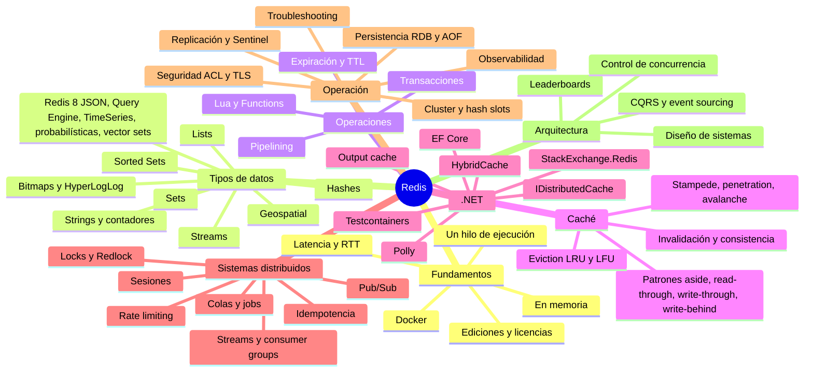
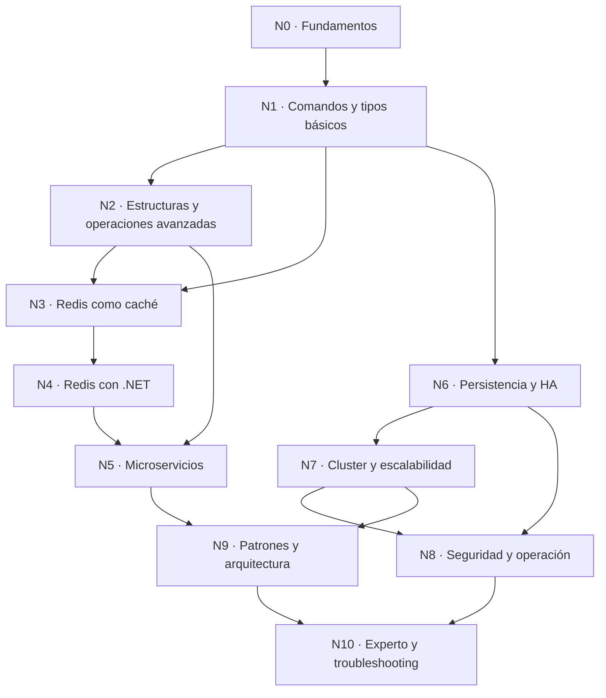
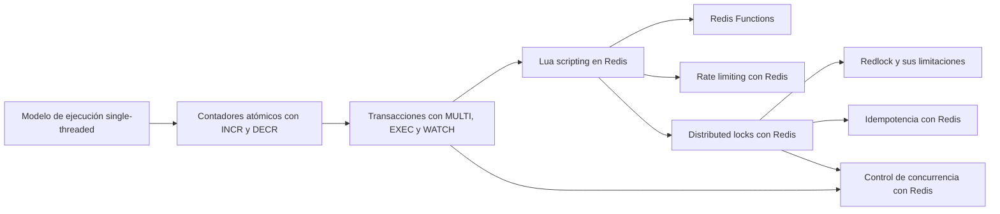
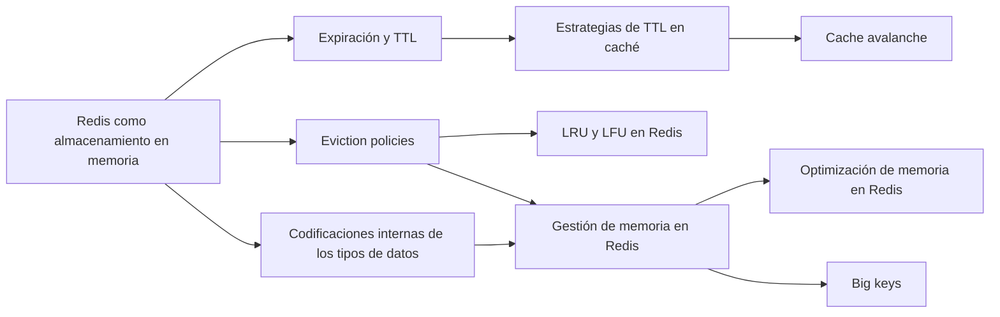
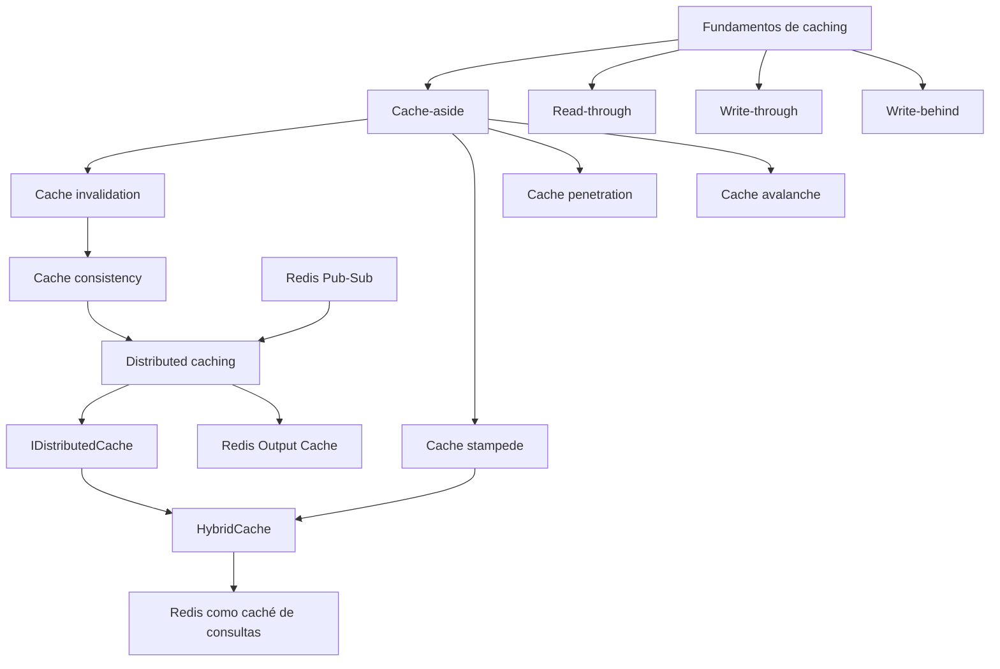
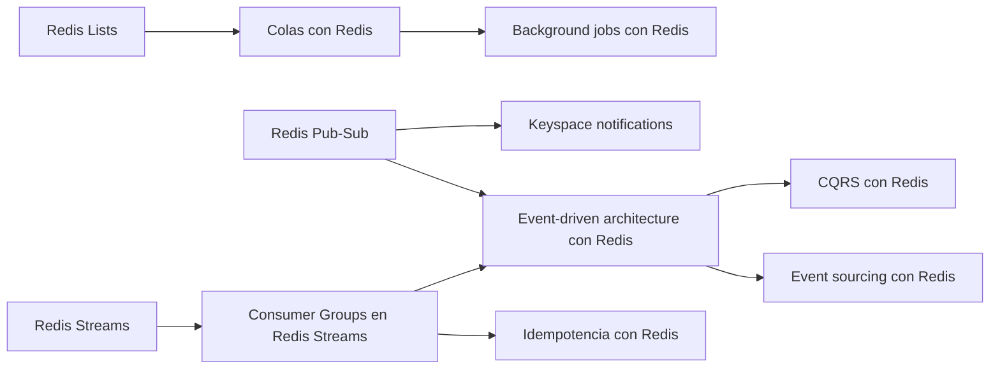
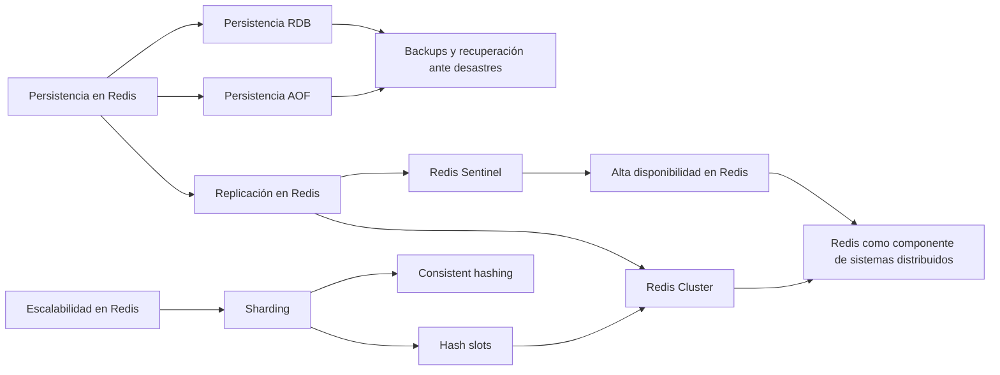
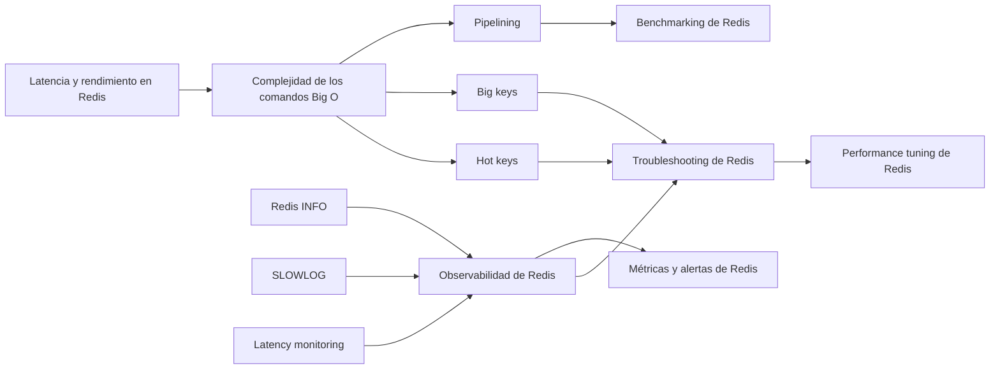
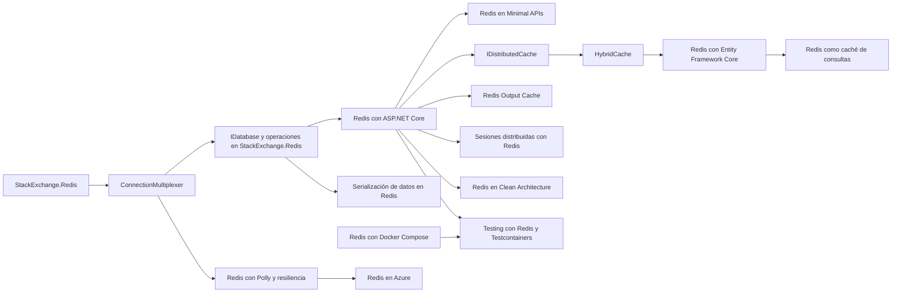

---
tags:
  - redis
  - MOC
  - mapa
aliases:
  - Mapa de conocimientos Redis
  - Dependencias Redis
type: moc
course: redis
created: 2026-11-03
---

# 🧭 02 - Redis - Mapa de conocimientos

> Cómo se relacionan los temas del curso: qué hay que dominar antes de qué, qué hilos conceptuales atraviesan varios niveles y qué rutas cortas existen para objetivos concretos. Los nodos de los diagramas de dependencias son enlaces: haz clic para abrir la nota.

## Contenido
- [[#🌍 Vista de pájaro]]
- [[#🧱 Dependencias entre niveles]]
- [[#🧵 Hilos conceptuales]]
- [[#📋 Prerrequisitos clave]]
- [[#⚡ Ruta rápida para el trabajo]]
- [[#🎤 Ruta para entrevistas]]
- [[#🔗 Puentes con el resto del vault]]

---

## 🌍 Vista de pájaro

---

## 🧱 Dependencias entre niveles

| Pista | Niveles | Para quién |
|---|---|---|
| Núcleo (obligatoria) | 0 → 1 → 2 → 3 → 4 | Todos: sin esto nada de lo demás se sostiene |
| Desarrollo | 5 → 9 | Diseñar servicios: mensajería, locks, rate limiting, concurrencia, arquitectura |
| Operación | 6 → 7 → 8 | Llevar Redis a producción: durabilidad, HA, escala, seguridad, observabilidad |
| Experto | 10 | Requiere ambas pistas |

Técnicamente el Nivel 6 solo depende del 1, así que podrías adelantarlo. El orden numérico es el recomendado porque los proyectos se apoyan unos en otros: el Proyecto 09 endurece el 03 y el Laboratorio 10 rompe el Proyecto 11.

---

## 🧵 Hilos conceptuales

Ideas que empiezan en un nivel y reaparecen, más profundas, en otros. Si una lección avanzada se te atraganta, recorre su hilo hacia atrás.

### 1. Atomicidad y concurrencia

### 2. Memoria, expiración y desalojo

### 3. Caché: de los patrones a .NET

### 4. Mensajería y eventos

### 5. Durabilidad, alta disponibilidad y escala

### 6. Rendimiento y operación

### 7. Redis en .NET

---

## 📋 Prerrequisitos clave

| Antes de… | Asegúrate de dominar… | Por qué |
|---|---|---|
| [[Cache stampede]] | [[Cache-aside]] · [[Expiración y TTL]] · [[Redis Strings]] (`SET NX PX`) | La solución clásica es un mutex corto con `SET NX PX` alrededor de la recarga |
| [[Rate limiting con Redis]] | [[Contadores atómicos con INCR y DECR]] · [[Redis Sorted Sets]] · [[Lua scripting en Redis]] | Cada algoritmo es una combinación atómica de estos bloques |
| [[HybridCache]] | [[IDistributedCache]] · [[Cache stampede]] · [[Distributed caching]] | HybridCache es L1 + L2 con protección contra stampede: hay que entender las tres piezas |
| [[Redis con Entity Framework Core]] | [[Cache invalidation]] · [[Serialización de datos en Redis]] | Los errores típicos son datos obsoletos y entidades mal serializadas |
| [[Consumer Groups en Redis Streams]] | [[Redis Streams]] · [[Idempotencia]] | At-least-once implica duplicados: el consumidor debe ser idempotente |
| [[Redlock y sus limitaciones]] | [[Distributed locks con Redis]] · idea de replicación asíncrona | Un failover puede perder un lock; se adelanta en la lección y se profundiza en [[Replicación en Redis]] |
| [[Persistencia AOF]] | [[Persistencia RDB]] | La reescritura del AOF usa el mismo fork y el AOF lleva un preámbulo RDB |
| [[Redis Sentinel]] | [[Replicación en Redis]] | Sentinel solo orquesta el failover de una replicación que ya existe |
| [[Redis Cluster]] | [[Replicación en Redis]] · [[Sharding]] · [[Hash slots]] | Cada shard es un primario con réplicas, y el reparto es por slots |
| [[Big keys]] y [[Hot keys]] | [[Complejidad de los comandos Big O]] · [[Modelo de ejecución single-threaded]] | El daño viene de bloquear el único hilo de ejecución o un solo shard |
| [[Control de concurrencia con Redis]] | [[Transacciones con MULTI, EXEC y WATCH]] · [[Lua scripting en Redis]] · [[Distributed locks con Redis]] | Es elegir entre esas tres herramientas según la contención |
| [[Event sourcing con Redis]] | [[Consumer Groups en Redis Streams]] · [[Persistencia AOF]] · [[Event Sourcing]] | Sin entender la durabilidad de Redis no se puede evaluar como event store |
| [[Troubleshooting de Redis]] | [[Redis INFO]] · [[SLOWLOG]] · [[Latency monitoring]] · [[Gestión de memoria en Redis]] | El método necesita las herramientas de diagnóstico |

---

## ⚡ Ruta rápida para el trabajo

Para un Senior .NET que necesita usar Redis como caché en producción en 2-3 semanas. Después, vuelve al orden completo.

1. [[Qué es Redis]]
2. [[Modelo de ejecución single-threaded]]
3. [[Instalación de Redis con Docker]]
4. [[Redis Strings]] · [[Expiración y TTL]] · [[Redis Hashes]]
5. [[Complejidad de los comandos Big O]]
6. [[Cache-aside]] · [[Cache invalidation]] · [[Cache stampede]]
7. [[Eviction policies]]
8. [[ConnectionMultiplexer]] · [[HybridCache]]
9. [[Redis con Polly y resiliencia]]
10. [[Distributed locks con Redis]]
11. [[Seguridad en Redis]] · [[Métricas y alertas de Redis]]

## 🎤 Ruta para entrevistas

Para preparar entrevistas de Senior en 3-4 semanas, prioriza los temas que más se preguntan:

1. Fundamentos: [[Qué es Redis]] · [[Modelo de ejecución single-threaded]] · [[Redis vs Memcached]]
2. Tipos y complejidad: los cinco tipos básicos · [[Complejidad de los comandos Big O]] · [[Redis HyperLogLog]]
3. Caché: los cuatro patrones · [[Cache stampede]] · [[Cache penetration]] · [[Cache avalanche]] · [[Cache consistency]] · [[Eviction policies]]
4. Durabilidad y escala: [[Persistencia en Redis]] · [[Replicación en Redis]] · [[Redis Cluster]] · [[Hash slots]]
5. Coordinación: [[Distributed locks con Redis]] · [[Redlock y sus limitaciones]] · [[Rate limiting con Redis]] · [[Idempotencia con Redis]]
6. Diseño: [[Leaderboards con Redis]] · [[Diseño de sistemas con Redis]] · [[Troubleshooting de Redis]]

---

## 🔗 Puentes con el resto del vault

| Tema de Redis | Nota del vault que lo complementa |
|---|---|
| Redis frente a otras bases de datos | [[Bases de Datos SQL vs NoSQL]] · [[ACID en Bases de Datos]] |
| Consistencia de réplicas y Cluster | [[Teorema CAP y BASE]] |
| Entornos de laboratorio | [[Docker]] · [[Docker Compose]] · [[Redes en Docker]] · [[Volúmenes]] |
| Redis en Kubernetes | [[03 - Objetos y workloads]] · [[19 - Kubernetes en producción]] |
| Idempotencia, CQRS, event sourcing, outbox | [[Idempotencia]] · [[CQRS (Command Query Responsibility Segregation)]] · [[Event Sourcing]] · [[Transactional Outbox]] |
| Resiliencia del cliente | [[Circuit Breaker]] · [[Retry con Backoff Exponencial]] · [[Bulkhead]] |
| Mensajería: Streams frente a un broker gestionado | [[00 - Indice y ruta de estudio\|Azure Service Bus]] |
| Arquitectura de la integración en .NET | [[Clean Architecture]] |
| Observabilidad en Azure | [[Azure Monitor]] |

---
⬅️ [[00 - Redis - Índice|Volver al índice de Redis]] · [[01 - Redis - Roadmap|Roadmap]]
