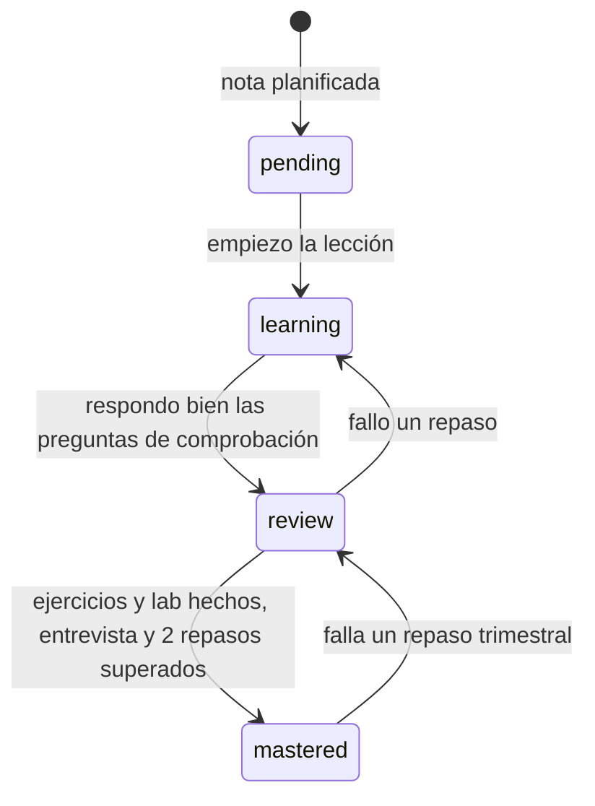

---
tags:
  - redis
  - MOC
  - progreso
aliases:
  - Progreso Redis
  - Tablero Redis
type: moc
course: redis
created: 2026-11-03
---

# 📊 03 - Redis - Progreso

> Tu tablero de seguimiento: estado actual, ciclo de vida de cada lección, escala de dominio, repaso espaciado, tableros automáticos, checklist por nivel, bitácora y registro de exámenes.

## Contenido
- [[#🧭 Estado actual]]
- [[#🔄 Ciclo de vida de una lección]]
- [[#📏 Escala de dominio]]
- [[#📅 Repaso espaciado]]
- [[#📊 Tableros automáticos]]
- [[#✅ Checklist por nivel]]
- [[#📓 Bitácora de estudio]]
- [[#📝 Registro de exámenes]]
- [[#❓ Dudas abiertas]]

---

## 🧭 Estado actual

| Campo | Valor |
|---|---|
| Inicio del curso | 2026-11-03 |
| Nivel actual | 0 — Fundamentos y conceptos esenciales |
| Lección actual | [[Qué es Redis]] (0.1) — pendiente de las preguntas de comprobación |
| Siguiente lección | [[Redis como almacenamiento en memoria]] (0.2) |
| Ritmo objetivo | 5-7 h por semana: 2-3 lecciones y su práctica |

Actualiza esta tabla cuando cambies de lección. El resto del tablero se calcula a partir de las propiedades de cada nota.

---

## 🔄 Ciclo de vida de una lección



| `status` | Significa | Qué tienes que hacer |
|---|---|---|
| `pending` | Planificada, sin empezar | Nada todavía |
| `learning` | La estás estudiando | Leer, ejecutar ejemplos y responder las preguntas de comprobación en el chat |
| `review` | Superaste la comprobación | Ejercicios, laboratorio y repasos espaciados |
| `mastered` | La dominas | Cumples los criterios de dominio de la lección; solo repaso trimestral |

## 📏 Escala de dominio

Propiedad `mastery` de cada lección:

| Valor | Nivel | Evidencia |
|---|---|---|
| 0 | No visto | — |
| 1 | Leído | Reconozco los términos y sé dónde está cada cosa |
| 2 | Comprendido | Lo explico con mis palabras y supero las preguntas de comprobación |
| 3 | Aplicado | Hice los ejercicios y el laboratorio sin mirar las soluciones |
| 4 | Dominado | Respondo las preguntas de entrevista, defiendo los trade-offs y diagnostico fallos; podría enseñarlo |

> [!tip] Sé honesto con la escala
> Un `mastery` inflado solo engaña al tablero. La prueba de fuego del 4: explicar el tema en voz alta, sin notas, en 3 minutos, y responder a un «¿y si…?» inesperado.

## 📅 Repaso espaciado

Cuando una lección pasa a `review`, programa sus repasos en `next_review` y, al hacer cada uno, actualiza `last_review`:

| Repaso | Cuándo, tras el anterior | Qué haces |
|---|---|---|
| 1 | +1 día | Responde de memoria las preguntas de entrevista plegadas |
| 2 | +3 días | Repite un ejercicio 🟡 sin mirar la solución |
| 3 | +7 días | Explica el tema en voz alta en 3 minutos |
| 4 | +21 días | Pídeme «repaso de [tema]» o un mini-examen |
| 5 | +60 días | Un escenario de troubleshooting o de diseño del tema |

Si fallas un repaso, vuelve a `learning` y reinicia el intervalo.

---

## 📊 Tableros automáticos

### Con Bases (nativo, Obsidian 1.9 o posterior)

```base
filters:
  and:
    - file.inFolder("Redis")
    - 'note.type == "lesson"'
    - not:
        - file.inFolder("Redis/Plantillas")
properties:
  note.course_level:
    displayName: Nivel
  note.order:
    displayName: "#"
  note.status:
    displayName: Estado
  note.mastery:
    displayName: Dominio (0-4)
  note.next_review:
    displayName: Próximo repaso
views:
  - type: table
    name: Todas las lecciones
    groupBy:
      property: note.course_level
      direction: ASC
    order:
      - note.order
      - file.name
      - note.status
      - note.mastery
      - note.next_review
    sort:
      - property: note.course_level
        direction: ASC
      - property: note.order
        direction: ASC
  - type: table
    name: Repasos pendientes
    filters:
      and:
        - 'note.next_review <= today()'
    order:
      - file.name
      - note.status
      - note.mastery
      - note.next_review
    sort:
      - property: note.next_review
        direction: ASC
```

> [!note] Si el bloque anterior muestra un error, tu versión de Obsidian no tiene Bases o su sintaxis ha cambiado. Usa la alternativa con Dataview o el checklist manual de más abajo.

> [!example]- Alternativa con Dataview (plugin comunitario)
> ```dataview
> TABLE WITHOUT ID
>   course_level AS "Nivel",
>   order AS "#",
>   file.link AS "Lección",
>   status AS "Estado",
>   mastery AS "Dominio",
>   next_review AS "Próximo repaso"
> FROM "Redis" AND -"Redis/Plantillas"
> WHERE type = "lesson"
> SORT course_level ASC, order ASC
> ```
>
> ```dataview
> TABLE WITHOUT ID
>   file.link AS "Toca repasar",
>   mastery AS "Dominio",
>   next_review AS "Desde"
> FROM "Redis" AND -"Redis/Plantillas"
> WHERE type = "lesson" AND next_review AND next_review <= date(today)
> SORT next_review ASC
> ```
>
> ```dataview
> TABLE WITHOUT ID
>   key AS "Nivel",
>   length(rows) AS "Lecciones creadas",
>   length(filter(rows, (r) => r.status = "review" OR r.status = "mastered")) AS "Superadas",
>   length(filter(rows, (r) => r.status = "mastered")) AS "Dominadas"
> FROM "Redis" AND -"Redis/Plantillas"
> WHERE type = "lesson"
> GROUP BY course_level
> SORT key ASC
> ```

---

## ✅ Checklist por nivel

Marca cada casilla cuando la lección llegue a `mastery ≥ 3`. Un nivel está aprobado cuando están marcadas todas sus lecciones, su entregable y su examen.

### Nivel 0 — Fundamentos y conceptos esenciales
- [ ] 0.1 [[Qué es Redis]]
- [ ] 0.2 [[Redis como almacenamiento en memoria]]
- [ ] 0.3 [[Redis vs SQL Server, PostgreSQL y MongoDB]]
- [ ] 0.4 [[Redis vs Memcached]]
- [ ] 0.5 [[Arquitectura interna de Redis]]
- [ ] 0.6 [[Modelo de ejecución single-threaded]]
- [ ] 0.7 [[Latencia y rendimiento en Redis]]
- [ ] 0.8 [[Ediciones, distribuciones y licencias de Redis]]
- [ ] 0.9 [[Instalación de Redis con Docker]]
- [ ] 🧪 [[Laboratorio 00 - Entorno Redis y .NET]]
- [ ] 📝 Examen del nivel 0

### Nivel 1 — Redis básico y comandos fundamentales
- [ ] 1.1 [[redis-cli y Redis Insight]]
- [ ] 1.2 [[Claves y keyspace en Redis]]
- [ ] 1.3 [[Redis Strings]]
- [ ] 1.4 [[Contadores atómicos con INCR y DECR]]
- [ ] 1.5 [[Expiración y TTL]]
- [ ] 1.6 [[Redis Hashes]]
- [ ] 1.7 [[Redis Lists]]
- [ ] 1.8 [[Redis Sets]]
- [ ] 1.9 [[Redis Sorted Sets]]
- [ ] 1.10 [[Complejidad de los comandos Big O]]
- [ ] 🚀 [[Proyecto 01 - Ranking de usuarios]]
- [ ] 📝 Examen del nivel 1

### Nivel 2 — Estructuras de datos y operaciones avanzadas
- [ ] 2.1 [[Codificaciones internas de los tipos de datos]]
- [ ] 2.2 [[Redis Bitmaps y Bitfields]]
- [ ] 2.3 [[Redis HyperLogLog]]
- [ ] 2.4 [[Redis Geospatial]]
- [ ] 2.5 [[Redis Streams]]
- [ ] 2.6 [[Estructuras probabilísticas en Redis]]
- [ ] 2.7 [[Redis JSON]]
- [ ] 2.8 [[Redis Query Engine]]
- [ ] 2.9 [[Redis TimeSeries]] *(opcional)*
- [ ] 2.10 [[Redis Arrays]] *(opcional)*
- [ ] 2.11 [[Transacciones con MULTI, EXEC y WATCH]]
- [ ] 2.12 [[Pipelining]]
- [ ] 2.13 [[Lua scripting en Redis]]
- [ ] 2.14 [[Redis Functions]]
- [ ] 2.15 [[Modelado de datos en Redis]]
- [ ] 2.16 [[Rate limiting con Redis]]
- [ ] 🚀 [[Proyecto 02 - Sistema de rate limiting]]
- [ ] 📝 Examen del nivel 2

### Nivel 3 — Redis como caché
- [ ] 3.1 [[Fundamentos de caching]]
- [ ] 3.2 [[Cache-aside]]
- [ ] 3.3 [[Read-through]]
- [ ] 3.4 [[Write-through]]
- [ ] 3.5 [[Write-behind]]
- [ ] 3.6 [[Estrategias de TTL en caché]]
- [ ] 3.7 [[Cache invalidation]]
- [ ] 3.8 [[Cache consistency]]
- [ ] 3.9 [[Eviction policies]]
- [ ] 3.10 [[LRU y LFU en Redis]]
- [ ] 3.11 [[Cache stampede]]
- [ ] 3.12 [[Cache penetration]]
- [ ] 3.13 [[Cache avalanche]]
- [ ] 3.14 [[Distributed caching]]
- [ ] 🚀 [[Proyecto 03 - Caché de productos]]
- [ ] 📝 Examen del nivel 3

### Nivel 4 — Redis en aplicaciones backend y .NET
- [ ] 4.1 [[StackExchange.Redis]]
- [ ] 4.2 [[ConnectionMultiplexer]]
- [ ] 4.3 [[IDatabase y operaciones en StackExchange.Redis]]
- [ ] 4.4 [[Redis con ASP.NET Core]]
- [ ] 4.5 [[Redis en Minimal APIs]]
- [ ] 4.6 [[IDistributedCache]]
- [ ] 4.7 [[HybridCache]]
- [ ] 4.8 [[Redis Output Cache]]
- [ ] 4.9 [[Serialización de datos en Redis]]
- [ ] 4.10 [[Redis con Entity Framework Core]]
- [ ] 4.11 [[Redis como caché de consultas]]
- [ ] 4.12 [[Redis en Clean Architecture]]
- [ ] 4.13 [[Redis con Polly y resiliencia]]
- [ ] 4.14 [[Sesiones distribuidas con Redis]]
- [ ] 4.15 [[Redis con Docker Compose]]
- [ ] 4.16 [[Testing con Redis y Testcontainers]]
- [ ] 4.17 [[Redis con Aspire]] *(opcional)*
- [ ] 🚀 [[Proyecto 04 - Caché de consultas]]
- [ ] 🚀 [[Proyecto 05 - Gestión de sesiones]]
- [ ] 📝 Examen del nivel 4

### Nivel 5 — Redis en arquitecturas de microservicios
- [ ] 5.1 [[Redis en microservicios]]
- [ ] 5.2 [[Redis Pub-Sub]]
- [ ] 5.3 [[Keyspace notifications]]
- [ ] 5.4 [[Consumer Groups en Redis Streams]]
- [ ] 5.5 [[Event-driven architecture con Redis]]
- [ ] 5.6 [[Colas con Redis]]
- [ ] 5.7 [[Background jobs con Redis]]
- [ ] 5.8 [[Distributed locks con Redis]]
- [ ] 5.9 [[Redlock y sus limitaciones]]
- [ ] 5.10 [[Idempotencia con Redis]]
- [ ] 🚀 [[Proyecto 06 - Distribución de eventos]]
- [ ] 🚀 [[Proyecto 07 - Sistema de colas]]
- [ ] 🚀 [[Proyecto 08 - Procesamiento de eventos con Redis Streams]]
- [ ] 📝 Examen del nivel 5

### Nivel 6 — Persistencia, replicación y alta disponibilidad
- [ ] 6.1 [[Persistencia en Redis]]
- [ ] 6.2 [[Persistencia RDB]]
- [ ] 6.3 [[Persistencia AOF]]
- [ ] 6.4 [[Backups y recuperación ante desastres]]
- [ ] 6.5 [[Replicación en Redis]]
- [ ] 6.6 [[Redis Sentinel]]
- [ ] 6.7 [[Alta disponibilidad en Redis]]
- [ ] 🧪 [[Laboratorio 06 - Failover con Sentinel y .NET]]
- [ ] 📝 Examen del nivel 6

### Nivel 7 — Redis Cluster, escalabilidad y rendimiento
- [ ] 7.1 [[Escalabilidad en Redis]]
- [ ] 7.2 [[Sharding]]
- [ ] 7.3 [[Consistent hashing]]
- [ ] 7.4 [[Hash slots]]
- [ ] 7.5 [[Redis Cluster]]
- [ ] 7.6 [[Benchmarking de Redis]]
- [ ] 7.7 [[Hot keys]]
- [ ] 7.8 [[Big keys]]
- [ ] 🧪 [[Laboratorio 07 - Redis Cluster local]]
- [ ] 📝 Examen del nivel 7

### Nivel 8 — Seguridad, monitoreo y administración
- [ ] 8.1 [[Seguridad en Redis]]
- [ ] 8.2 [[Redis ACL]]
- [ ] 8.3 [[TLS en Redis]]
- [ ] 8.4 [[Redis INFO]]
- [ ] 8.5 [[MONITOR y sus riesgos]]
- [ ] 8.6 [[SLOWLOG]]
- [ ] 8.7 [[Latency monitoring]]
- [ ] 8.8 [[Gestión de memoria en Redis]]
- [ ] 8.9 [[Observabilidad de Redis]]
- [ ] 8.10 [[Métricas y alertas de Redis]]
- [ ] 8.11 [[Administración de Redis]]
- [ ] 8.12 [[Redis en Kubernetes]] *(opcional)*
- [ ] 8.13 [[Redis en Azure]]
- [ ] 🚀 [[Proyecto 09 - Caching distribuido con observabilidad]]
- [ ] 📝 Examen del nivel 8

### Nivel 9 — Patrones avanzados y arquitectura empresarial
- [ ] 9.1 [[Leaderboards con Redis]]
- [ ] 9.2 [[Control de concurrencia con Redis]]
- [ ] 9.3 [[CQRS con Redis]]
- [ ] 9.4 [[Event sourcing con Redis]]
- [ ] 9.5 [[Redis como componente de sistemas distribuidos]]
- [ ] 9.6 [[Caché semántica y búsqueda vectorial con Redis]] *(opcional)*
- [ ] 9.7 [[Diseño de sistemas con Redis]]
- [ ] 🚀 [[Proyecto 10 - Sistema de reservas con control de concurrencia]]
- [ ] 🚀 [[Proyecto 11 - Arquitectura de microservicios con Redis]]
- [ ] 📝 Examen del nivel 9

### Nivel 10 — Redis experto, troubleshooting y optimización
- [ ] 10.1 [[Troubleshooting de Redis]]
- [ ] 10.2 [[Diagnóstico de Redis]]
- [ ] 10.3 [[Performance tuning de Redis]]
- [ ] 10.4 [[Optimización de memoria en Redis]]
- [ ] 10.5 [[Internals avanzados de Redis]]
- [ ] 10.6 [[Migraciones y upgrades de Redis]]
- [ ] 10.7 [[Escenarios de troubleshooting de Redis]]
- [ ] 🧪 [[Laboratorio 10 - Game days de Redis]]
- [ ] 📝 Examen del nivel 10

---

## 📓 Bitácora de estudio

Una fila por sesión. Lo importante son las dudas y los errores: son lo que repasaremos.

| Fecha | Tema | Qué hice | Dudas o errores | Siguiente paso |
|---|---|---|---|---|
| 2026-11-03 | 0.1 Qué es Redis | Roadmap, mapa y lección 1 creados | — | Leer la lección y responder la pregunta de comprobación en el chat |

## 📝 Registro de exámenes

| Fecha | Nivel o tema | Nota | Fallos clave | Acción |
|---|---|---|---|---|
| | | | | |

## ❓ Dudas abiertas

- [ ] *(anota aquí lo que no te quede claro; lo resolvemos al empezar la siguiente sesión)*

---
⬅️ [[00 - Redis - Índice|Volver al índice de Redis]] · [[01 - Redis - Roadmap|Roadmap]]
