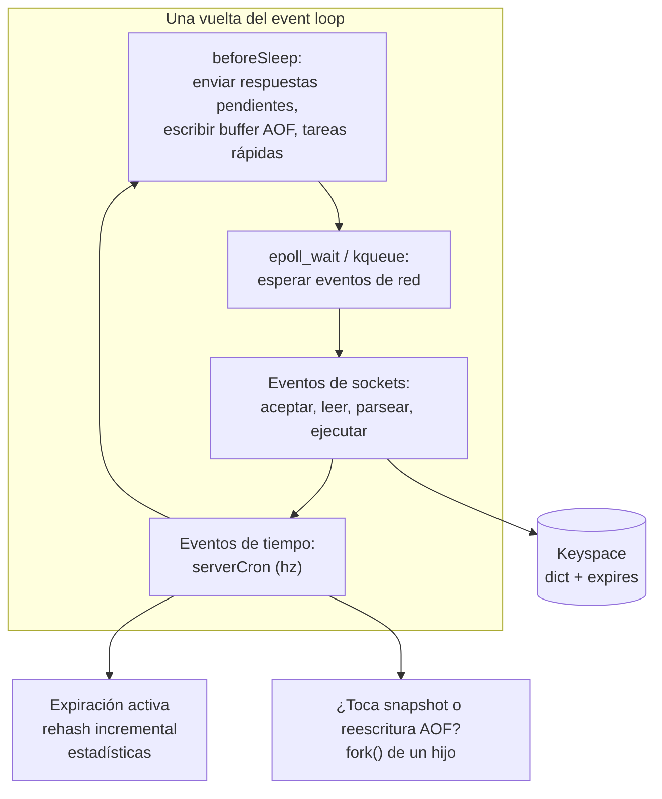

# Arquitectura interna de Redis

> [!abstract] En 30 segundos
> - **Qué es:** el recorrido de un comando por dentro de `redis-server`: event loop, buffers de cliente, tabla de comandos, keyspace, codificaciones, expiración, persistencia y replicación.
> - **Para qué:** entender por qué Redis es rápido, qué lo hace lento y qué significan las métricas que verás en producción.
> - **Recuerda:** un *event loop* atiende todos los sockets; cada comando se ejecuta completo sobre estructuras en RAM; lo demás (disco, réplicas) ocurre a un lado.

> [!info] Lección 0.5 · Nivel 0 — Fundamentos y conceptos esenciales
> ⬅️ [[Redis vs Memcached]] · ➡️ [[Modelo de ejecución single-threaded]] · 🗺️ [[01 - Redis - Roadmap#Nivel 0 — Fundamentos y conceptos esenciales|Roadmap]] · 📊 [[03 - Redis - Progreso|Progreso]]
> 🏷️ Core. `DEBUG` está deshabilitado por defecto desde 7.0 (`enable-debug-command`).

## 📌 Definición

`redis-server` es un único proceso que combina:

- Un **event loop** propio (la librería `ae`) que multiplexa la E/S de red con `epoll` (Linux) o `kqueue` (macOS/BSD).
- Un **keyspace** por base lógica: una tabla hash clave → objeto, más una tabla de expiraciones.
- Las **implementaciones de cada tipo de dato**, con codificaciones compactas y generales.
- Los subsistemas de **persistencia** (RDB, AOF), **replicación**, **Cluster**, **Pub/Sub**, **scripting** y **módulos**.
- **Hilos de fondo** para tareas lentas y, opcionalmente, **I/O threads** para la red.

## 🎯 ¿Qué problema resuelve?

Conocer las piezas internas te permite razonar sobre síntomas reales:

- «La latencia sube cada hora» → ¿coincide con un snapshot RDB (fork)?
- «Un cliente consume 2 GB de memoria» → su buffer de salida está creciendo (suscriptor lento, `MONITOR`, respuesta enorme).
- «El hash ocupa el triple de lo esperado» → pasó de codificación compacta a tabla hash.

## 🧠 Conceptos fundamentales

| Pieza | Qué es | Por qué importa |
|---|---|---|
| **Event loop** | Bucle que espera eventos de sockets y temporizadores y los atiende sin bloquearse | Un hilo puede atender miles de conexiones |
| **Cliente** | Estructura por conexión con *query buffer* (entrada) y *output buffer* (salida) | Los buffers consumen memoria y tienen límites (`client-output-buffer-limit`) |
| **Tabla de comandos** | Diccionario nombre → implementación, aridad, flags y categorías ACL | Validación y permisos antes de ejecutar |
| **Keyspace** | Tabla hash clave → `redisObject`; otra tabla clave → instante de expiración | Acceso O(1) por clave |
| **`redisObject`** | Tipo, codificación, información LRU/LFU, contador de referencias, puntero al valor | Base del desalojo (LRU/LFU) y de `OBJECT ENCODING` |
| **SDS** | *Simple Dynamic String*: string con la longitud delante | Binary-safe y longitud en O(1) |
| **Codificaciones** | `listpack`, `intset`, `quicklist`, `skiplist`, `hashtable`, `int`, `embstr`, `raw` | Memoria frente a CPU según el tamaño |
| **`serverCron`** | Tarea periódica (por defecto `hz 10`, diez veces por segundo) | Expiración activa, rehash, estadísticas, timeouts de clientes, disparo de persistencia |

### Analogía
Una **centralita telefónica** con un único operador: recibe todas las llamadas (event loop), anota cada petición en la ficha del cliente (query buffer), consulta el manual de procedimientos (tabla de comandos), saca el expediente del archivador (keyspace) y deja la respuesta en la bandeja de salida de cada cliente (output buffer). Cada cierto tiempo hace limpieza y archivo (serverCron).
**Dónde se rompe:** el operador puede delegar en ayudantes las tareas de leer y escribir la línea (I/O threads), pero sigue siendo el único que toca los expedientes.

## ⚙️ Funcionamiento interno



**Cómo se guarda cada clave**
1. La clave es un SDS; el valor, un `redisObject` que indica tipo (`string`, `hash`…) y codificación.
2. Un hash pequeño se guarda como `listpack` (una secuencia compacta en un único bloque de memoria). Al superar `hash-max-listpack-entries` o `hash-max-listpack-value`, pasa a `hashtable`. Lo mismo ocurre con sets, sorted sets y listas, cada uno con sus umbrales.
3. La tabla hash del keyspace crece con **rehash incremental**: mantiene dos tablas y migra las entradas poco a poco en cada operación y en `serverCron`, para no congelar el servidor.

**Buffers de cliente**
- El *query buffer* acumula los bytes recibidos hasta tener un comando completo (límite `client-query-buffer-limit`, 1 GB por defecto).
- El *output buffer* acumula respuestas mientras el socket no puede enviarlas. Si un cliente no lee (un suscriptor lento de Pub/Sub, una réplica atrasada), crece hasta el límite de su clase (`normal`, `replica`, `pubsub`) y Redis lo desconecta.

**Persistencia y replicación**
- RDB y la reescritura del AOF usan un proceso hijo creado con `fork()`.
- Las escrituras se añaden al buffer del AOF y al flujo de replicación tras ejecutarse; las réplicas las reciben de forma asíncrona.

## 💻 Ejemplos prácticos

### Sintaxis

| Comando | Qué muestra | Complejidad |
|---|---|---|
| `OBJECT ENCODING clave` | Codificación interna del valor | O(1) |
| `OBJECT IDLETIME clave` | Segundos desde el último acceso (si la política no es LFU) | O(1) |
| `OBJECT FREQ clave` | Contador de frecuencia (solo con política LFU) | O(1) |
| `CLIENT LIST` | Conexiones con sus buffers (`qbuf`, `omem`), comando actual, usuario | O(N) clientes |
| `INFO stats` / `INFO clients` | Comandos procesados, conexiones, clientes bloqueados | O(1) |
| `CONFIG GET hz` | Frecuencia de `serverCron` | O(1) |

### Ver cómo cambia una codificación

```text
127.0.0.1:6379> HSET usuario:1 nombre Ana plan pro
(integer) 2
127.0.0.1:6379> OBJECT ENCODING usuario:1
"listpack"
127.0.0.1:6379> CONFIG GET hash-max-listpack-entries
1) "hash-max-listpack-entries"
2) "128"
127.0.0.1:6379> EVAL "for i=1,200 do redis.call('HSET', KEYS[1], 'campo'..i, i) end return 1" 1 usuario:1
(integer) 1
127.0.0.1:6379> OBJECT ENCODING usuario:1
"hashtable"
127.0.0.1:6379> SET contador 42
OK
127.0.0.1:6379> OBJECT ENCODING contador
"int"
127.0.0.1:6379> SET saludo "hola"
OK
127.0.0.1:6379> OBJECT ENCODING saludo
"embstr"
```

### Ver los buffers de los clientes

```text
127.0.0.1:6379> CLIENT LIST
id=5 addr=172.17.0.1:51234 laddr=172.17.0.2:6379 fd=8 name= age=12 idle=0 flags=N db=0 sub=0 psub=0 ssub=0 multi=-1 qbuf=26 qbuf-free=20448 … omem=0 tot-mem=22426 … cmd=client|list user=default … resp=2 …
```

Fíjate en `omem` (memoria del buffer de salida) y `cmd` (último comando). Un `omem` grande y creciente es la firma de un cliente que no lee sus respuestas.

## 🔧 Implementación en .NET

Inspeccionar clientes desde .NET, por ejemplo para un panel de diagnóstico interno:

```csharp
using StackExchange.Redis;

using var mux = await ConnectionMultiplexer.ConnectAsync("localhost:6379,allowAdmin=true");
IServer server = mux.GetServer(mux.GetEndPoints()[0]);

ClientInfo[] clients = await server.ClientListAsync();
foreach (ClientInfo c in clients.OrderByDescending(c => c.IdleSeconds).Take(10))
{
    Console.WriteLine($"{c.Id,-6} {c.Address,-22} nombre={c.Name,-15} inactivo={c.IdleSeconds}s");
}

// La codificación de una clave, con el comando genérico
RedisResult encoding = await mux.GetDatabase().ExecuteAsync("OBJECT", "ENCODING", "usuario:1");
Console.WriteLine($"usuario:1 → {encoding}");
```

> [!tip] Pon nombre a tus conexiones
> `ConfigurationOptions.ClientName = "orders-api"` hace que tus conexiones aparezcan con nombre en `CLIENT LIST`. En un incidente, saber qué servicio abrió cada conexión ahorra mucho tiempo.

## 🏗️ Casos de uso en arquitectura

Este conocimiento se usa sobre todo para **diagnosticar y dimensionar**:

| Síntoma | Pieza interna implicada |
|---|---|
| Picos de latencia periódicos | `fork` de RDB/AOF; expiración masiva en `serverCron` |
| Memoria que crece sin que crezcan los datos | Buffers de salida de clientes lentos o de réplicas |
| Una clave que ocupa demasiado | Cambio de codificación compacta a general |
| Un comando lento congela a todos | Ejecución en un hilo del event loop |

### Consideraciones de arquitectura
- **Rendimiento:** el diseño sin locks es rápido mientras cada comando sea corto.
- **Memoria:** codificaciones compactas y buffers acotados son decisiones de capacidad.
- **Resiliencia:** los límites de buffer protegen al servidor de clientes problemáticos a costa de desconectarlos.

## ⚠️ Errores y anti-patterns

| Error | Por qué duele | Cómo evitarlo |
|---|---|---|
| Subir los umbrales de `listpack` sin medir | Operaciones O(N) dentro de valores grandes y más CPU | Cambiarlos solo con benchmark |
| Quitar los límites del buffer de salida de Pub/Sub | Un suscriptor lento puede agotar la memoria | Mantener límites y vigilar `omem` |
| Usar `DEBUG` en producción | Puede bloquear o modificar el servidor; deshabilitado por defecto desde 7.0 | Solo en laboratorio |
| Conexiones sin nombre | Diagnóstico a ciegas en incidentes | `ClientName` en cada servicio |

## ✅ Buenas prácticas

1. Conoce las codificaciones de tus estructuras más grandes (`OBJECT ENCODING`).
2. Vigila `CLIENT LIST` (`omem`, `qbuf`) en incidentes de memoria.
3. Deja `hz` en su valor por defecto salvo motivo medido (`dynamic-hz` ya lo ajusta con muchos clientes).
4. Nombra las conexiones de cada servicio.

## 🎤 Preguntas de entrevista

> [!question]- 1. Describe el recorrido de un comando dentro de Redis.
> El event loop detecta datos en el socket, se leen al *query buffer* y se parsean como array RESP; se busca el comando en la tabla de comandos, se valida (ACL, aridad, `maxmemory`) y se ejecuta sobre el keyspace en RAM; las escrituras se propagan al AOF y a las réplicas; la respuesta va al *output buffer* y se envía cuando el socket admite escritura.

> [!question]- 2. ¿Qué es el rehash incremental y por qué existe?
> Al crecer una tabla hash hay que redistribuir todas sus entradas. Hacerlo de golpe congelaría el único hilo de ejecución. Redis mantiene la tabla vieja y la nueva y migra unas pocas entradas en cada operación y en `serverCron` hasta terminar.

> [!question]- 3. ¿Por qué un cliente puede hacer que Redis use mucha memoria sin guardar datos?
> Porque su buffer de salida crece si no lee las respuestas: un suscriptor de Pub/Sub lento, `MONITOR` o una respuesta enorme. Los límites `client-output-buffer-limit` desconectan a ese cliente al superarlos.

> [!question]- 4. ¿Qué es una codificación compacta y qué trade-off tiene?
> Un formato que guarda colecciones pequeñas en un único bloque contiguo (`listpack`, `intset`), muy eficiente en memoria. A cambio, muchas operaciones son O(N) dentro del bloque; por eso Redis cambia a estructuras generales al superar ciertos umbrales.

## 🧪 Ejercicios

### 🟢 Básicos
1. Repite el ejemplo de codificaciones y anota en qué momento cambia el hash de `listpack` a `hashtable`.
2. Busca tu propia conexión en `CLIENT LIST` y explica `qbuf`, `omem` y `cmd`.

### 🟡 Intermedios
3. Abre un `SUBSCRIBE` en una terminal y deja de leer (pausa el proceso con Ctrl+Z). Publica mensajes grandes en bucle desde otra y observa `omem` hasta que Redis lo desconecte.

### 🔴 Reto Senior
4. Explica, a partir de las piezas internas, por qué un `DEL` de un sorted set de 10 millones de elementos puede causar un pico de latencia y cómo lo evitarías.

> [!success]- Soluciones
> **3.** El cliente aparece con `omem` creciente; al superar el límite de la clase `pubsub` (por defecto 32 MB duros, o 8 MB sostenidos durante 60 s) Redis cierra la conexión y lo registra en el log.
> **4.** `DEL` libera los 10 millones de nodos en el hilo principal, que no atiende a nadie mientras tanto. `UNLINK` desvincula la clave en O(1) y libera la memoria en un hilo de fondo (o `lazyfree-lazy-user-del yes` para que `DEL` se comporte así).

### ✔️ Checklist de dominio
- [ ] Dibujo el recorrido de un comando por las piezas internas.
- [ ] Explico qué son `redisObject`, SDS y las codificaciones compactas.
- [ ] Sé qué hace `serverCron` y qué son los buffers de cliente.

## 📝 Resumen

- Un proceso, un event loop, estructuras en RAM: esa es la base de la velocidad.
- Cada valor es un `redisObject` con tipo y codificación; las colecciones pequeñas usan formatos compactos.
- `serverCron` hace el trabajo periódico: expiración activa, rehash, estadísticas, persistencia.
- Los buffers de cliente consumen memoria y tienen límites por clase.
- Persistencia y réplicas trabajan a un lado del camino de la petición.

## 🔗 Referencias

- [Redis serialization protocol](https://redis.io/docs/latest/develop/reference/protocol-spec/)
- [OBJECT ENCODING](https://redis.io/docs/latest/commands/object-encoding/)
- [CLIENT LIST](https://redis.io/docs/latest/commands/client-list/)
- [Diagnosing latency issues](https://redis.io/docs/latest/operate/oss_and_stack/management/optimization/latency/)

## 🔄 Notas relacionadas

- ⬅️ [[Redis vs Memcached]] · ➡️ [[Modelo de ejecución single-threaded]]
- Profundiza: [[Codificaciones internas de los tipos de datos]] · [[Internals avanzados de Redis]] · [[Persistencia RDB]] · [[Gestión de memoria en Redis]]
