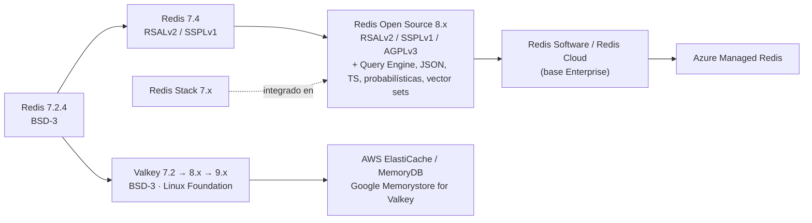

# Ediciones, distribuciones y licencias de Redis

> [!abstract] En 30 segundos
> - **Qué es:** el mapa de productos que hoy se llaman «Redis» o hablan su protocolo: Redis Open Source, Redis Stack, Redis Software, Redis Cloud, servicios gestionados de las nubes y forks como Valkey.
> - **Para qué:** elegir con criterio, saber qué comandos tendrás disponibles y qué implica cada licencia.
> - **Recuerda:** desde Redis 8.0, **Redis Open Source** incluye lo que antes era Redis Stack y se licencia a elegir entre RSALv2, SSPLv1 y AGPLv3. Valkey es el fork con licencia BSD.

> [!info] Lección 0.8 · Nivel 0 — Fundamentos y conceptos esenciales
> ⬅️ [[Latencia y rendimiento en Redis]] · ➡️ [[Instalación de Redis con Docker]] · 🗺️ [[01 - Redis - Roadmap#Nivel 0 — Fundamentos y conceptos esenciales|Roadmap]] · 📊 [[03 - Redis - Progreso|Progreso]]
> 🏷️ Información verificada en noviembre de 2026; las licencias y los servicios cambian: revísalo antes de una decisión de compra.

## 📌 Definición

| Producto | Qué es | Quién lo mantiene |
|---|---|---|
| **Redis Open Source** | El servidor oficial gratuito (antes *Redis Community Edition*). Línea 8.x; 8.10 es la versión de referencia de este curso | Redis Inc. |
| **Redis Stack** | Paquete de Redis 7.x con los módulos JSON, Search, TimeSeries y Bloom. **Redis 8.0 declara obsoletas las versiones anteriores de Redis y de Redis Stack** | Redis Inc. |
| **Redis Software** | Edición comercial autogestionada (antes *Redis Enterprise Software*): multi-tenant, Active-Active, tiering a disco, soporte | Redis Inc. |
| **Redis Cloud** | Servicio gestionado de Redis Inc. sobre AWS, Google Cloud y Azure | Redis Inc. |
| **Azure Managed Redis** | Servicio gestionado de Microsoft basado en Redis Enterprise; sucesor de Azure Cache for Redis | Microsoft |
| **Valkey** | Fork de Redis 7.2.4 creado en 2024 bajo la Linux Foundation, con licencia BSD-3. Línea 9.x (9.0 en octubre de 2025) | Comunidad (Linux Foundation) |
| **AWS ElastiCache / MemoryDB** | Servicios gestionados de AWS; ofrecen motores Valkey y Redis OSS | AWS |
| **Google Memorystore** | Servicios gestionados de Google Cloud (incluido Memorystore for Valkey) | Google |
| **Compatibles con RESP** | Garnet (Microsoft Research, en C#), Dragonfly y otros: aceptan muchos comandos de Redis, pero no son Redis | Varios |

## 🎯 ¿Qué problema resuelve?

Entre 2024 y 2026 el panorama cambió mucho: cambio de licencia, nacimiento de Valkey, fusión de Redis Stack en Redis Open Source, retirada de Azure Cache for Redis. Elegir sin conocerlo provoca sorpresas: comandos que no existen en el servicio contratado, licencias que el departamento legal no acepta o migraciones forzadas.

## 🧠 Conceptos fundamentales

### Cronología de licencias

| Versiones | Licencia |
|---|---|
| Redis ≤ 7.2 | BSD-3-Clause |
| Redis 7.4 – 7.x | RSALv2 o SSPLv1 (a elegir) |
| Redis 8.0 en adelante | RSALv2, SSPLv1 o **AGPLv3** (a elegir) |
| Valkey (todas) | BSD-3-Clause |

- **RSALv2** (Redis Source Available License): permite usar, modificar y distribuir, pero no ofrecer Redis como servicio gestionado a terceros.
- **SSPLv1**: si ofreces el software como servicio, obliga a publicar el código de todo el servicio.
- **AGPLv3** (aprobada por la OSI): si modificas el software y otros lo usan a través de la red, debes ofrecerles el código de tu versión modificada.
- **Para usar Redis como componente interno de tu aplicación**, sin modificarlo ni venderlo como servicio, las tres opciones suelen ser poco restrictivas. Si vas a ofrecerlo como servicio o distribuir versiones modificadas, consúltalo con el equipo legal.

### Qué incluye cada uno

| Capacidad | Redis Open Source 8.x | Redis Stack 7.x | Redis Software / Cloud | Azure Managed Redis | Valkey 9.x |
|---|---|---|---|---|---|
| Tipos básicos, Streams, Pub/Sub, Lua, Functions | ✅ | ✅ | ✅ | ✅ | ✅ |
| JSON, Query Engine, TimeSeries, probabilísticas | ✅ desde 8.0 | ✅ | ✅ | ✅ (con restricciones por nivel) | Módulos propios, compatibles solo en parte |
| Vector sets | ✅ desde 8.0 | ❌ | Según versión | Según versión | ❌ (tiene sus propias opciones) |
| Active-Active (geo-distribuido con CRDT) | ❌ | ❌ | ✅ | ✅ (geo-replicación activa) | ❌ |
| Tiering RAM + NVMe | ❌ | ❌ | ✅ | ✅ (Flash Optimized) | ❌ |
| Soporte comercial | ❌ | ❌ | ✅ | ✅ (Microsoft) | Vía proveedores |

> [!warning] Las versiones no avanzan igual en todas partes
> Un servicio gestionado puede ir varias versiones por detrás de Redis Open Source. Antes de usar un comando reciente (por ejemplo `INCREX` de 8.8 o `DELEX` de 8.4), comprueba qué versión ejecuta tu servicio y si lo soporta: la documentación de cada comando incluye una tabla de compatibilidad con Redis Software y Redis Cloud.

### Azure, en concreto (lo más probable para .NET)
- **Azure Cache for Redis** se retira: niveles Enterprise y Enterprise Flash el 31-03-2027; Basic, Standard y Premium el 30-09-2028. Desde abril de 2026 los clientes nuevos ya no pueden crear cachés Basic/Standard/Premium.
- **Azure Managed Redis** es el sucesor: basado en Redis Enterprise, con cuatro niveles (Memory Optimized 8:1, Balanced 4:1, Compute Optimized 2:1 de memoria por vCPU, y Flash Optimized con RAM + NVMe), redundante por zonas por defecto con alta disponibilidad, autenticación con Microsoft Entra ID y módulos. Detalle en [[Redis en Azure]].

### Analogía
Como Linux: hay un núcleo común (el protocolo y los comandos clásicos), distribuciones con extras y soporte (Redis Software, servicios gestionados) y forks comunitarios (Valkey) que comparten historia pero evolucionan por separado.
**Dónde se rompe:** en Linux las licencias del núcleo no cambiaron; en Redis sí, y eso explica la fragmentación.

## ⚙️ Funcionamiento interno



Todos hablan RESP, así que los clientes (StackExchange.Redis incluido) funcionan con todos. La diferencia está en **qué comandos existen y cómo se comportan** a partir de 7.2.

## 💻 Ejemplos prácticos

Averiguar con qué estás hablando:

```text
127.0.0.1:6379> INFO server
# Server
redis_version:8.10.3
redis_mode:standalone
…
127.0.0.1:6379> INFO modules
127.0.0.1:6379> HELLO 3
1# "server" => "redis"
2# "version" => "8.10.3"
3# "proto" => (integer) 3
…
7# "modules" => …
```

- `HELLO 3` devuelve el nombre del servidor (`redis`, `valkey`…), la versión y los módulos cargados.
- Para saber si un comando existe: `COMMAND INFO INCREX` devuelve vacío si no lo conoce.

```text
127.0.0.1:6379> COMMAND INFO INCREX
1) 1) "increx"
   …
```

## 🔧 Implementación en .NET

Comprobar al arrancar que el servidor tiene lo que la aplicación necesita:

```csharp
using StackExchange.Redis;

using var mux = await ConnectionMultiplexer.ConnectAsync("localhost:6379");
IServer server = mux.GetServer(mux.GetEndPoints()[0]);

Console.WriteLine($"Versión: {server.Version}");          // System.Version, p. ej. 8.10.3
Console.WriteLine($"Tipo de servidor: {server.ServerType}"); // Standalone, Cluster, Sentinel…

// ¿Existe un comando concreto? (COMMAND INFO devuelve un array; vacío o nulo si no existe)
RedisResult info = await mux.GetDatabase().ExecuteAsync("COMMAND", "INFO", "INCREX");
bool hasIncrex = info.Length > 0 && !info[0].IsNull;
Console.WriteLine($"INCREX disponible: {hasIncrex}");

if (server.Version < new Version(8, 4))
    Console.WriteLine("⚠️ Sin SET IF*/DELEX: la liberación de locks usará un script Lua.");
```

Para Azure Managed Redis con Entra ID usarás además el paquete `Microsoft.Azure.StackExchangeRedis` ([[Redis en Azure]]); para comandos de JSON, búsqueda o time series, NRedisStack.

## 🏗️ Casos de uso en arquitectura

| Situación | Elección razonable |
|---|---|
| Laboratorio, desarrollo local, Kubernetes propio | Redis Open Source 8.x (o Valkey si la licencia BSD es requisito) |
| Aplicaciones .NET en Azure | Azure Managed Redis |
| Necesitas Active-Active entre regiones o tiering a disco | Redis Software o Redis Cloud (o Azure Managed Redis) |
| Estás en AWS | ElastiCache o MemoryDB, con motor Valkey o Redis OSS |
| La política de la empresa exige licencias OSI permisivas | Valkey, o Redis 8 bajo AGPLv3 si legal lo acepta |
| Sistema heredado sobre Redis Stack 7.x | Planificar la migración a Redis 8 (ruta de upgrade soportada) |

### Consideraciones de arquitectura

| Dimensión | Qué pensar |
|---|---|
| Portabilidad | Usa comandos comunes en el núcleo de tu aplicación; aísla los específicos de versión |
| Operación | Gestionado = menos trabajo y menos control (versiones, configuración, comandos bloqueados) |
| Coste | Licencia, soporte, RAM y transferencia entre zonas |
| Cumplimiento | Licencia, región de los datos, cifrado, identidad (Entra ID) |

## ⚠️ Errores y anti-patterns

| Error | Por qué duele | Cómo evitarlo |
|---|---|---|
| Desarrollar contra Redis 8.10 en local y desplegar en un servicio con una versión anterior | Comandos que fallan en producción | Fija la misma versión en local y en CI que en producción |
| Asumir que Valkey y Redis son idénticos en todos los comandos | Divergen a partir de 7.2 | Revisa la compatibilidad de cada comando nuevo |
| Empezar un proyecto nuevo sobre Redis Stack o Azure Cache for Redis | Ambos están en retirada u obsoletos | Redis 8 o Azure Managed Redis |
| Ignorar la licencia | Bloqueos legales tardíos | Decisión documentada con legal |

## ✅ Buenas prácticas

1. Registra en un ADR la distribución, la versión y la licencia elegidas.
2. Mantén la misma versión mayor y menor en desarrollo, CI y producción.
3. Comprueba la versión y las capacidades al arrancar la aplicación.
4. Encapsula los comandos específicos de versión detrás de una interfaz con una alternativa.

## 🎤 Preguntas de entrevista

> [!question]- 1. ¿Qué diferencia hay entre Redis Open Source y Redis Stack hoy?
> Desde 8.0, Redis Open Source integra lo que distinguía a Redis Stack: Query Engine, JSON, time series y estructuras probabilísticas, además de vector sets. Redis Stack era el paquete de Redis 7.x con esos módulos; Redis 8 lo declara obsoleto y hay ruta de actualización desde Stack 7.2 y 7.4.

> [!question]- 2. ¿Por qué existe Valkey?
> Porque en 2024 Redis cambió su licencia (desde 7.4) de BSD a RSALv2/SSPLv1, que no son licencias de código abierto aprobadas por la OSI. La Linux Foundation, con apoyo de varios proveedores cloud, creó Valkey a partir de Redis 7.2.4, la última versión BSD. Desde 8.0 Redis añadió AGPLv3 como opción.

> [!question]- 3. Vas a desplegar una aplicación .NET nueva en Azure. ¿Qué servicio de Redis eliges y por qué?
> Azure Managed Redis: es el sucesor de Azure Cache for Redis (que se retira), está basado en Redis Enterprise, es redundante por zonas con alta disponibilidad, soporta Entra ID y módulos. Elegiría el nivel según la relación memoria/CPU de la carga y validaría la versión de Redis que ejecuta antes de usar comandos recientes.

> [!question]- 4. ¿Qué implica la AGPLv3 para una empresa que usa Redis como caché interna?
> Si no modifica Redis ni lo ofrece como servicio a terceros, en la práctica no le impone obligaciones adicionales. Las obligaciones de la AGPL se activan al modificar el software y ponerlo a disposición de usuarios por red. Aun así, la interpretación final es de legal.

## 🧪 Ejercicios

### 🟢 Básicos
1. Ejecuta `HELLO 3` en tu laboratorio y anota servidor, versión y módulos.
2. Resume en una tabla de tres columnas las diferencias entre RSALv2, SSPLv1 y AGPLv3.

### 🟡 Intermedios
3. Levanta `valkey/valkey` y `redis:8.10` en Docker y compara `HELLO 3`, `COMMAND COUNT` y la existencia de `INCREX`.

### 🔴 Reto Senior
4. Escribe un ADR para elegir el Redis de una plataforma .NET multi-equipo en Azure con un requisito de residencia de datos en la UE y otro de recuperación ante la caída de una región.

> [!success]- Soluciones
> **3.** Valkey responde `server => valkey` y no tiene `INCREX` (es un comando de Redis 8.8). `COMMAND COUNT` difiere entre ambos.
> **4.** Opción natural: Azure Managed Redis en una región de la UE con alta disponibilidad y zonas; para la caída de región, geo-replicación activa entre dos regiones de la UE (revisando sus restricciones: mismo SKU y configuración, no combinable con persistencia, módulos limitados) o una estrategia de recalentamiento si Redis es solo caché. Alternativas descartadas: Azure Cache for Redis (en retirada), autogestionado en AKS (más operación).

### ✔️ Checklist de dominio
- [ ] Distingo los productos y quién los mantiene.
- [ ] Explico la cronología de licencias y por qué nació Valkey.
- [ ] Sé comprobar versión, servidor y comandos disponibles.
- [ ] Sé qué servicio elegir en Azure y por qué.

## 📝 Resumen

- Redis Open Source 8.x es el servidor oficial; incluye lo que era Redis Stack.
- Licencias: BSD hasta 7.2; RSALv2/SSPLv1 en 7.4-7.x; RSALv2/SSPLv1/AGPLv3 desde 8.0.
- Valkey es el fork BSD de la Linux Foundation; diverge a partir de 7.2.
- En Azure, Azure Managed Redis sustituye a Azure Cache for Redis.
- Comprueba siempre versión y comandos disponibles del servicio real.

## 🔗 Referencias

- [Licencias de Redis](https://redis.io/legal/licenses/)
- [Redis Open Source 8.0 release notes](https://redis.io/docs/latest/operate/oss_and_stack/stack-with-enterprise/release-notes/redisce/redisos-8.0-release-notes/)
- [Valkey](https://valkey.io/)
- [What is Azure Managed Redis?](https://learn.microsoft.com/azure/redis/overview)
- [Azure Cache for Redis retirement FAQ](https://learn.microsoft.com/azure/azure-cache-for-redis/retirement-faq)

## 🔄 Notas relacionadas

- ⬅️ [[Latencia y rendimiento en Redis]] · ➡️ [[Instalación de Redis con Docker]]
- Más adelante: [[Redis en Azure]] · [[Migraciones y upgrades de Redis]] · [[StackExchange.Redis]]
