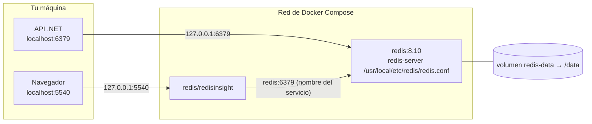

# Instalación de Redis con Docker

> [!abstract] En 30 segundos
> - **Qué es:** levantar Redis con la imagen oficial de Docker, con configuración, persistencia, usuarios ACL y Redis Insight, de forma reproducible.
> - **Para qué:** tener el mismo Redis en tu máquina, en CI y en los laboratorios del curso.
> - **Recuerda:** fija la versión (`redis:8.10`), publica el puerto solo en `127.0.0.1`, monta un volumen para `/data` y no dejes el usuario `default` sin contraseña.

> [!info] Lección 0.9 · Nivel 0 — Fundamentos y conceptos esenciales
> ⬅️ [[Ediciones, distribuciones y licencias de Redis]] · ➡️ [[Laboratorio 00 - Entorno Redis y .NET]] · 🗺️ [[01 - Redis - Roadmap#Nivel 0 — Fundamentos y conceptos esenciales|Roadmap]] · 📊 [[03 - Redis - Progreso|Progreso]]
> 🏷️ Imagen oficial `redis` (Docker Hub). Redis no tiene versión nativa para Windows: en Windows se usa Docker Desktop con WSL 2.

## 📌 Definición

La **imagen oficial** `redis` de Docker Hub empaqueta Redis Open Source en variantes Debian y Alpine, con tags por versión (`8.10.3`, `8.10`, `8`, `latest`, `alpine`…). Al arrancar ejecuta `redis-server`; los datos se guardan en `/data` y puedes pasarle un `redis.conf` propio.

## 🎯 ¿Qué problema resuelve?

- Instalar Redis a mano en Windows no es posible de forma oficial, y en Linux o macOS cada equipo acabaría con versiones distintas.
- Con Docker, el entorno de cada desarrollador, el de CI (Testcontainers) y el de los laboratorios son idénticos y desechables.

## 🧠 Conceptos fundamentales

| Concepto | Detalle |
|---|---|
| **Tags** | Usa una versión concreta (`redis:8.10` o `redis:8.10.3`), nunca `latest` en proyectos: un `docker pull` no debe cambiarte la versión |
| **Variantes** | Debian (por defecto, `bookworm`/`trixie`) o Alpine (más pequeña) |
| **`/data`** | Directorio de trabajo: ahí escribe `dump.rdb` y el AOF; móntalo en un volumen |
| **Configuración** | Argumentos en `command` (`redis-server --appendonly yes`) o un `redis.conf` montado |
| **Modo protegido** | Si tu configuración no dice nada, la imagen lo **desactiva** para que otros contenedores puedan conectarse; por eso nunca expongas el puerto sin contraseña. Si tu `redis.conf` lo activa, se respeta: solo rechaza conexiones remotas mientras el usuario `default` no tenga contraseña |
| **Redis Insight** | Interfaz gráfica oficial (imagen `redis/redisinsight`, puerto 5540) |
| **Componentes de Redis 8** | Query Engine, JSON, time series y probabilísticas: comprueba con `INFO modules` si tu imagen los carga |

### Analogía
Un contenedor es un **equipo de laboratorio sellado**: siempre sale de la misma caja (imagen) con la misma etiqueta (tag). El volumen es el cuaderno donde apuntas los resultados, que sobrevive aunque tires el equipo y saques otro.
**Dónde se rompe:** si no montas el cuaderno (volumen), al borrar el contenedor pierdes los datos.

## ⚙️ Funcionamiento interno



- Dentro de la red de Compose, los contenedores se encuentran por nombre de servicio (`redis:6379`).
- Desde tu máquina llegas por el puerto publicado en `127.0.0.1`.

## 💻 Ejemplos prácticos

### Arranque rápido (solo para probar)

```bash
docker run -d --name redis-lab -p 127.0.0.1:6379:6379 redis:8.10
docker exec -it redis-lab redis-cli PING
```

### Entorno de trabajo con Docker Compose

`redis.conf` (en la misma carpeta que el `docker-compose.yml`):

```conf
# Red: dentro del contenedor escucha en todas las interfaces; el aislamiento lo da Docker
bind 0.0.0.0
port 6379
protected-mode yes

# Persistencia: AOF cada segundo + snapshot RDB por defecto
appendonly yes
appendfsync everysec

# Memoria: límite y política de caché para el laboratorio
maxmemory 256mb
maxmemory-policy allkeys-lfu

# Usuarios ACL: sin usuario anónimo.
# "resetpass" quita al usuario default su estado "nopass": si lo conservara, el modo
# protegido rechazaría (DENIED) las conexiones que llegan desde fuera del contenedor.
user default off resetpass -@all
user admin on >cambia-esta-clave ~* &* +@all
user app on >cambia-esta-clave-app ~app:* &app:* +@all -@dangerous
user healthcheck on >healthcheck -@all +ping
```

`docker-compose.yml`:

```yaml
services:
  redis:
    image: redis:8.10
    container_name: redis
    command: ["redis-server", "/usr/local/etc/redis/redis.conf"]
    ports:
      - "127.0.0.1:6379:6379"
    volumes:
      - redis-data:/data
      - ./redis.conf:/usr/local/etc/redis/redis.conf:ro
    healthcheck:
      test: ["CMD", "redis-cli", "--user", "healthcheck", "--pass", "healthcheck", "--no-auth-warning", "ping"]
      interval: 5s
      timeout: 3s
      retries: 5
    restart: unless-stopped

  redisinsight:
    image: redis/redisinsight:latest
    container_name: redisinsight
    ports:
      - "127.0.0.1:5540:5540"
    volumes:
      - redisinsight-data:/data
    depends_on:
      redis:
        condition: service_healthy

volumes:
  redis-data:
  redisinsight-data:
```

```bash
docker compose up -d
docker compose ps                     # redis debe aparecer como "healthy"
docker exec -it redis redis-cli --user admin --pass cambia-esta-clave --no-auth-warning
```

Dentro de `redis-cli`, comprueba que todo es como esperas:

```text
127.0.0.1:6379> INFO server
127.0.0.1:6379> INFO modules
127.0.0.1:6379> CONFIG GET maxmemory-policy
1) "maxmemory-policy"
2) "allkeys-lfu"
127.0.0.1:6379> ACL LIST
```

Abre Redis Insight en `http://localhost:5540` y añade la base de datos con host `redis`, puerto `6379`, usuario `admin`.

> [!info] ¿Y los componentes de Redis 8?
> Si `INFO modules` sale vacío y necesitas JSON, búsqueda o time series, revisa la documentación de la imagen: la distribución de Redis 8 incluye un `redis-full.conf` que carga todos los componentes. Lo veremos al llegar a [[Redis JSON]] y [[Redis Query Engine]].

### Comandos útiles del día a día

| Tarea | Comando |
|---|---|
| Ver logs | `docker compose logs -f redis` |
| Abrir una consola | `docker exec -it redis redis-cli --user admin --pass … --no-auth-warning` |
| Reiniciar conservando datos | `docker compose restart redis` |
| Borrarlo todo, datos incluidos | `docker compose down -v` |
| Cambiar de versión | Editar el tag, `docker compose pull` y `up -d` |

## 🔧 Implementación en .NET

Cadena de conexión para el usuario `app` del laboratorio, en `appsettings.Development.json` (en producción, en un gestor de secretos):

```json
{
  "ConnectionStrings": {
    "Redis": "localhost:6379,user=app,password=cambia-esta-clave-app,abortConnect=false,name=mi-api"
  }
}
```

```csharp
using StackExchange.Redis;

var mux = await ConnectionMultiplexer.ConnectAsync(
    builder.Configuration.GetConnectionString("Redis")!);

IDatabase db = mux.GetDatabase();
await db.StringSetAsync("app:saludo", "hola", TimeSpan.FromMinutes(1)); // ✅ permitido: ~app:*
// await db.StringSetAsync("otra:clave", "x");  // ❌ NOPERM: el usuario app solo puede usar app:*
```

`user=` y `password=` envían `AUTH usuario contraseña` al conectar; `name=` pone nombre a la conexión en `CLIENT LIST`.

Para tests de integración, en lugar de Compose usarás Testcontainers ([[Testing con Redis y Testcontainers]]).

## 🏗️ Casos de uso en arquitectura

| Entorno | Cómo ejecutar Redis |
|---|---|
| Desarrollo local | Docker Compose como el de esta lección |
| Tests de integración | Testcontainers: un contenedor efímero por suite |
| Laboratorios de HA y Cluster | Compose con varios contenedores ([[Laboratorio 06 - Failover con Sentinel y .NET]], [[Laboratorio 07 - Redis Cluster local]]) |
| Producción | Servicio gestionado, o Kubernetes con un operador y almacenamiento persistente ([[Redis en Kubernetes]]) |

### Cuándo NO usar este Compose
- En producción tal cual: falta TLS, gestión de secretos, alta disponibilidad, monitorización y copias de seguridad.

## ⚠️ Errores y anti-patterns

| Error | Por qué duele | Cómo evitarlo |
|---|---|---|
| `-p 6379:6379` sin contraseña | Cualquiera en tu red controla Redis (la imagen desactiva el modo protegido) | `127.0.0.1:` y ACL |
| `redis:latest` | La versión cambia sin avisar | Tag con versión |
| Sin volumen en `/data` | Al recrear el contenedor pierdes los datos | Volumen con nombre |
| Contraseñas en el repositorio | Filtración de credenciales | `.env` fuera del control de versiones o secretos |
| Desarrollar con una versión distinta a la de producción | Comandos que no existen al desplegar | Misma versión en todas partes |

## ✅ Buenas prácticas

1. Versión fijada y la misma que en producción.
2. Puerto publicado solo en `127.0.0.1`.
3. Usuario `default` desactivado y usuarios ACL por rol.
4. Volumen para `/data` y `redis.conf` versionado (sin secretos).
5. Healthcheck con un usuario que solo pueda hacer `PING`.

## 🎤 Preguntas de entrevista

> [!question]- 1. ¿Por qué es peligroso `docker run -p 6379:6379 redis`?
> Porque la imagen oficial desactiva el modo protegido y no configura contraseña: el puerto queda abierto en todas las interfaces de la máquina, y cualquiera que lo alcance puede leer, borrar o reconfigurar Redis. Hay que publicar solo en `127.0.0.1` y configurar ACL.

> [!question]- 2. ¿Cómo garantizas que desarrollo, CI y producción usan el mismo Redis?
> Fijando la misma versión de imagen en Compose y Testcontainers que la que ejecuta producción (o la del servicio gestionado), y comprobando la versión al arrancar la aplicación.

> [!question]- 3. ¿Qué pasa con los datos si borras el contenedor?
> Si `/data` no está en un volumen, se pierden. Con un volumen con nombre, el nuevo contenedor recarga el AOF o el RDB al arrancar.

## 🧪 Ejercicios

### 🟢 Básicos
1. Levanta el Compose de la lección y conéctate con los usuarios `admin` y `app`.
2. Comprueba que `app` no puede escribir fuera de `app:*` y que `default` está desactivado.

### 🟡 Intermedios
3. Escribe datos, haz `docker compose down` (sin `-v`) y `up -d`: ¿siguen ahí? Repite con `-v`.
4. Añade un servicio con la API de la lección [[Qué es Redis]] al mismo Compose, conectándose por el nombre `redis`.

### 🔴 Reto Senior
5. Prepara el Compose para que la contraseña de `app` salga de un fichero `.env` no versionado y documenta en un README cómo arrancarlo desde cero.

> [!success]- Soluciones
> **2.** `SET otra:clave x` con el usuario `app` devuelve `NOPERM`; conectar sin usuario devuelve un error de autenticación.
> **3.** Con `down` los datos sobreviven (el volumen persiste); con `down -v` se borra el volumen y se pierden.
> **5.** Una opción: `redis.conf` sin las líneas `user` y un fichero ACL (`aclfile /data/users.acl`) generado al arrancar; o pasar la contraseña por variable de entorno al `command` con `--user app on >${REDIS_APP_PASSWORD} …`, teniendo en cuenta que aparecerá en `docker inspect`. En producción, secretos del orquestador.

### ✔️ Checklist de dominio
- [ ] Levanto Redis y Redis Insight con Compose, con volumen, configuración y ACL.
- [ ] Sé por qué publicar en `127.0.0.1` y fijar la versión.
- [ ] Me conecto desde .NET con usuario y contraseña.

## 📝 Resumen

- Imagen oficial `redis`, con versión fijada.
- `/data` en un volumen; `redis.conf` montado.
- La imagen desactiva el modo protegido: publica en `127.0.0.1` y usa ACL.
- Redis Insight para explorar; `INFO modules` para comprobar componentes.
- Mismo Redis en local, CI y producción.

## 🔗 Referencias

- [Imagen oficial de Redis en Docker Hub](https://hub.docker.com/_/redis)
- [Redis Insight](https://redis.io/docs/latest/develop/tools/insight/)
- [ACL](https://redis.io/docs/latest/operate/oss_and_stack/management/security/acl/)

## 🔄 Notas relacionadas

- ⬅️ [[Ediciones, distribuciones y licencias de Redis]] · ➡️ [[Laboratorio 00 - Entorno Redis y .NET]]
- En el vault: [[Docker]] · [[Docker Compose]] · [[Volúmenes]] · [[Redes en Docker]]
- Más adelante: [[Redis con Docker Compose]] · [[Redis ACL]] · [[Testing con Redis y Testcontainers]]
