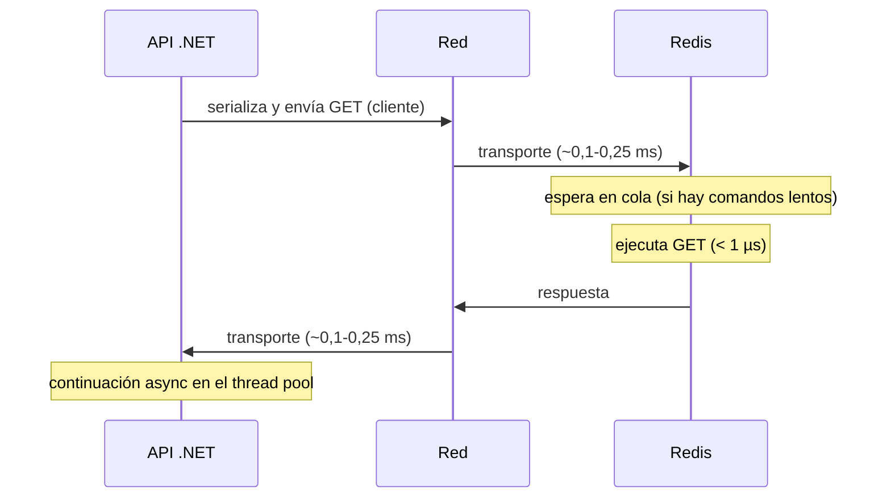

# Latencia y rendimiento en Redis

> [!abstract] En 30 segundos
> - **Qué es:** la latencia es el tiempo de ida y vuelta de un comando visto por el cliente; el rendimiento (*throughput*), cuántas operaciones por segundo se sostienen.
> - **Para qué:** saber medir, poner objetivos realistas (p99) y encontrar dónde se va el tiempo: cliente, red, cola o servidor.
> - **Recuerda:** dentro de Redis un comando simple cuesta menos de 1 µs; casi toda la latencia que ves es **red y cola**. Mide percentiles, no medias.

> [!info] Lección 0.7 · Nivel 0 — Fundamentos y conceptos esenciales
> ⬅️ [[Modelo de ejecución single-threaded]] · ➡️ [[Ediciones, distribuciones y licencias de Redis]] · 🗺️ [[01 - Redis - Roadmap#Nivel 0 — Fundamentos y conceptos esenciales|Roadmap]] · 📊 [[03 - Redis - Progreso|Progreso]]
> 🏷️ Core · `INFO latencystats` y `LATENCY HISTOGRAM` ≥7.0 · `redis-cli --latency-percentiles` ≥8.10.

## 📌 Definición

- **Latencia:** tiempo desde que el cliente envía un comando hasta que recibe la respuesta. Incluye el trabajo del cliente, la red (ida y vuelta), la espera en cola en el servidor y la ejecución.
- **Throughput:** operaciones completadas por segundo.
- **Percentiles:** p50 es la mediana; p99 es el valor por debajo del cual queda el 99 % de las peticiones. Las medias esconden los picos; los percentiles altos los muestran.

## 🎯 ¿Qué problema resuelve?

«Redis va lento» es la queja más común y casi nunca es Redis. Sin un modelo de dónde se va el tiempo, se cambian parámetros a ciegas. Con él, en minutos separas un problema de red, de un thread pool saturado en .NET, de un comando O(N) o de un fork.

**Ejemplo:** una API hace 30 lecturas secuenciales a Redis por petición. Con un round-trip de 0,4 ms, son 12 ms solo en esperas de red, aunque cada comando tarde 1 µs en el servidor. Agruparlas en un `MGET` deja la cuenta en ~0,4 ms.

## 🧠 Conceptos fundamentales

| Componente de la latencia | Orden de magnitud | Cómo se reduce |
|---|---|---|
| Ejecución en el servidor (comando simple) | < 1 µs | Comandos O(1)/O(log N), valores pequeños |
| Cola en el servidor | 0 si no hay comandos lentos; segundos si los hay | Evitar comandos lentos, fragmentar |
| Red, misma zona | ~100-500 µs | Misma región y zona; menos round-trips |
| Red, entre regiones | 30-150 ms | No cruzar regiones en el camino caliente |
| Cliente (.NET) | De µs a segundos si el thread pool está saturado | Async de verdad, conexión compartida |
| Persistencia | Picos en fork o fsync | Configuración y margen de memoria |

**Ideas clave**
1. **Latencia intrínseca:** el sistema operativo o el hipervisor ya imponen un suelo. `redis-cli --intrinsic-latency` lo mide (se ejecuta en el servidor, no en el cliente).
2. **Round-trips:** cada comando independiente paga un viaje de ida y vuelta. Variádicos (`MGET`, `HSET` múltiple), pipelining y scripts reducen viajes.
3. **Latencia de cola:** cuando el servidor está ocupado con un comando lento, los demás esperan. En un sistema de un hilo, la cola se nota en todos.
4. **Throughput frente a latencia:** el pipelining aumenta mucho el throughput, pero un lote grande aumenta la latencia del último comando del lote.
5. **Percentiles altos:** con 100 llamadas a Redis por página, el p99 de Redis se convierte en algo que ve casi cada usuario. Los p99 y p999 importan.

### Analogía
Pedir un café en una barra: el barista tarda 10 segundos en prepararlo (ejecución), pero tú tardas 3 minutos en llegar desde la oficina (red) y quizá esperas a que atienda a quien pidió 30 cafés (cola). Ir 30 veces por 30 cafés es lo que hace un cliente sin pipelining.
**Dónde se rompe:** en Redis «ir y volver» cuesta microsegundos, pero se repite miles de veces por segundo.

## ⚙️ Funcionamiento interno



Herramientas del propio Redis:

| Herramienta | Mide | Dónde se ejecuta |
|---|---|---|
| `redis-cli --latency` / `--latency-history` | Round-trip de `PING` visto por un cliente | Cliente |
| `redis-cli --latency-dist` | Distribución de la latencia | Cliente |
| `redis-cli --intrinsic-latency 100` | Suelo de latencia del sistema durante 100 s | **Servidor** |
| `INFO latencystats` | Percentiles por comando en el servidor (p50, p99, p99.9) | Servidor |
| `LATENCY HISTOGRAM [comando…]` | Histograma por comando | Servidor |
| `SLOWLOG GET` | Comandos que superaron un umbral de ejecución | Servidor |
| `LATENCY DOCTOR` | Diagnóstico de eventos de latencia (si está activo `latency-monitor-threshold`) | Servidor |

> [!important] `SLOWLOG` solo mide la ejecución
> No incluye red ni cola. Si los clientes ven 200 ms y `SLOWLOG` está vacío, busca en la red, en la cola (otro comando lento) o en el cliente.

## 💻 Ejemplos prácticos

```bash
# Round-trip desde el propio contenedor (sin red real): el mejor caso posible
docker exec -it redis-lab redis-cli --latency

# Histórico cada 15 segundos (útil para ver patrones periódicos)
docker exec -it redis-lab redis-cli --latency-history -i 15

# Suelo de latencia del sistema donde corre Redis
docker exec -it redis-lab redis-cli --intrinsic-latency 30

# Percentiles por comando, medidos dentro del servidor
docker exec -it redis-lab redis-cli INFO latencystats
```

Salida típica de `INFO latencystats` (formato):

```text
latency_percentiles_usec_get:p50=1.003,p99=2.007,p99.9=6.015
latency_percentiles_usec_set:p50=1.003,p99=3.007,p99.9=8.031
```

Compara esos microsegundos con los milisegundos que ve tu aplicación: la diferencia es red, cola y cliente.

**Benchmark rápido de throughput:**

```bash
docker exec -it redis-lab redis-benchmark -q -n 200000 -c 50 -t get,set
docker exec -it redis-lab redis-benchmark -q -n 200000 -c 50 -t get,set -P 32
```

Con pipelining (`-P 32`) el throughput se multiplica, porque se reducen los round-trips y las llamadas al sistema.

## 🔧 Implementación en .NET

Medir la latencia que de verdad ve tu aplicación y reducir round-trips:

```csharp
using System.Diagnostics;
using StackExchange.Redis;

IDatabase db = redis.GetDatabase();
RedisKey[] keys = Enumerable.Range(1, 50).Select(i => (RedisKey)$"producto:{i}").ToArray();

// ❌ 50 round-trips secuenciales
var sw = Stopwatch.StartNew();
foreach (RedisKey key in keys)
    await db.StringGetAsync(key);
Console.WriteLine($"Secuencial: {sw.Elapsed.TotalMilliseconds:F1} ms");

// ✅ Un solo round-trip con MGET
sw.Restart();
RedisValue[] values = await db.StringGetAsync(keys);
Console.WriteLine($"MGET: {sw.Elapsed.TotalMilliseconds:F1} ms");

// ✅ También: lanzar todas las tareas y esperarlas juntas (pipelining implícito del multiplexer)
sw.Restart();
await Task.WhenAll(keys.Select(k => db.StringGetAsync(k)));
Console.WriteLine($"Task.WhenAll: {sw.Elapsed.TotalMilliseconds:F1} ms");
```

> [!warning] El thread pool también es latencia
> Si tu código bloquea hilos (`.Result`, `.Wait()`, código síncrono sobre asíncrono), las continuaciones de StackExchange.Redis esperan un hilo libre y aparecen timeouts «de Redis» que en realidad son de tu aplicación. Lo verás en [[ConnectionMultiplexer]].

## 🏗️ Casos de uso en arquitectura

### Presupuesto de latencia
Si tu API debe responder en 50 ms p99 y hace 3 llamadas a Redis, cada una con p99 de 1 ms, el presupuesto aguanta. Si hace 80 llamadas secuenciales, no: rediseña el acceso.

### Consideraciones de arquitectura

| Dimensión | Qué pensar |
|---|---|
| Ubicación | Redis en la misma región y zona que sus clientes |
| Diseño de acceso | Pocas llamadas por petición; datos agrupados por patrón de acceso |
| Objetivos | SLO en p99/p999, no en medias |
| Observabilidad | Latencia del cliente (OpenTelemetry) + latencia del servidor (`latencystats`) para separar causas |

## ⚠️ Errores y anti-patterns

| Error | Por qué duele | Cómo evitarlo |
|---|---|---|
| Mirar solo la media | Los picos que sufren los usuarios desaparecen | p50, p99, p999 |
| Benchmark en la misma máquina y extrapolarlo | Sin red real, los números son optimistas | Medir desde donde corre la aplicación |
| Culpar a Redis sin mirar el cliente | Thread pool saturado, GC, código síncrono | Telemetría del cliente |
| Muchas llamadas secuenciales | La red se multiplica | `MGET`, hashes, pipelining |
| Redis en otra región | 30-150 ms por llamada | Misma región y zona |

## ✅ Buenas prácticas

1. Mide en el cliente y en el servidor, y compara.
2. Define objetivos en percentiles altos.
3. Reduce round-trips antes de tocar la configuración de Redis.
4. Conoce tu latencia intrínseca: es el suelo.
5. Vigila `SLOWLOG` y `latencystats` de forma continua.

## 🎤 Preguntas de entrevista

> [!question]- 1. ¿De qué se compone la latencia que ve un cliente de Redis?
> Trabajo en el cliente (serialización, thread pool), red de ida y vuelta, espera en cola en el servidor y ejecución. En un caso sano, la ejecución es de microsegundos y la red domina; en un caso enfermo, la cola (comandos lentos) o el cliente (thread pool) dominan.

> [!question]- 2. `SLOWLOG` está vacío pero los clientes ven 300 ms. ¿Qué miras?
> La red (round-trip, ancho de banda, valores grandes), la cola (otro cliente con comandos lentos que sí estarían en el slowlog, o un fork reciente: `latest_fork_usec`), y el cliente (thread pool saturado, GC, conexión saturada). `SLOWLOG` solo cuenta el tiempo de ejecución.

> [!question]- 3. ¿Por qué importan tanto los percentiles altos?
> Porque una petición de usuario suele hacer muchas llamadas a Redis: si cada una tiene un 1 % de probabilidad de ser lenta, con 100 llamadas casi todas las peticiones sufren alguna. El p99 de Redis se convierte en la experiencia típica.

> [!question]- 4. ¿Pipelining mejora la latencia o el throughput?
> Sobre todo el throughput y la latencia total de un conjunto de comandos (menos round-trips). La latencia de cada comando individual dentro de un lote grande puede empeorar, porque espera a que se procese el lote.

## 🧪 Ejercicios

### 🟢 Básicos
1. Mide con `--latency` desde dentro del contenedor y desde tu máquina (`redis-cli -h 127.0.0.1`). Explica la diferencia.
2. Lee `INFO latencystats` y localiza el p99 de `GET`.

### 🟡 Intermedios
3. Ejecuta el código .NET con 50 claves y compara las tres estrategias.
4. Con el script del laboratorio de [[Modelo de ejecución single-threaded]] en marcha, observa cómo cambian `--latency` y `INFO latencystats`.

### 🔴 Reto Senior
5. Diseña un dashboard que permita saber en menos de 5 minutos si un aumento de latencia viene de la red, del servidor o de la aplicación. ¿Qué métricas pones y de dónde salen?

> [!success]- Soluciones
> **1.** Desde tu máquina, el tráfico atraviesa la red virtual de Docker: el round-trip es mayor que dentro del contenedor.
> **5.** Latencia del cliente por operación (OpenTelemetry en .NET), latencia del servidor por comando (`latencystats`, `SLOWLOG`), operaciones por segundo, CPU del proceso Redis, `latest_fork_usec`, conexiones y `blocked_clients`, y métricas del thread pool .NET. Si sube el cliente y no el servidor → red o aplicación; si sube el servidor → comandos lentos o fork.

### ✔️ Checklist de dominio
- [ ] Descompongo la latencia en cliente, red, cola y ejecución.
- [ ] Sé medir cada parte con las herramientas de Redis y de .NET.
- [ ] Sé por qué importan los percentiles altos.

## 📝 Resumen

- Ejecutar un comando cuesta microsegundos; la red y la cola cuestan milisegundos.
- Mide percentiles altos, en cliente y servidor.
- Reduce round-trips antes de tunear Redis.
- `SLOWLOG` no ve la red ni la cola.
- El cliente .NET (thread pool) es una fuente frecuente de latencia «de Redis».

## 🔗 Referencias

- [Diagnosing latency issues](https://redis.io/docs/latest/operate/oss_and_stack/management/optimization/latency/)
- [Latency monitoring](https://redis.io/docs/latest/operate/oss_and_stack/management/optimization/latency-monitor/)
- [Pipelining](https://redis.io/docs/latest/develop/using-commands/pipelining/)
- [INFO](https://redis.io/docs/latest/commands/info/)

## 🔄 Notas relacionadas

- ⬅️ [[Modelo de ejecución single-threaded]] · ➡️ [[Ediciones, distribuciones y licencias de Redis]]
- Profundiza: [[Pipelining]] · [[Benchmarking de Redis]] · [[Latency monitoring]] · [[SLOWLOG]] · [[Troubleshooting de Redis]]
