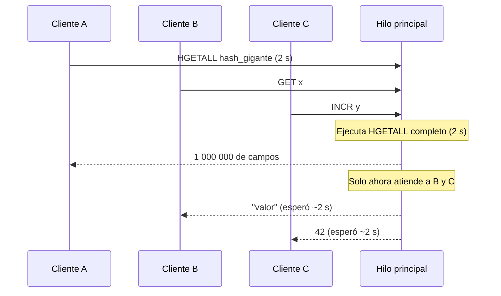

# Modelo de ejecución single-threaded

> [!abstract] En 30 segundos
> - **Qué es:** Redis ejecuta los comandos **uno detrás de otro en un único hilo**, aunque use otros hilos para la red, el disco y la liberación de memoria.
> - **Para qué:** cada comando es atómico sin locks, y el servidor es simple y predecible.
> - **Recuerda:** el precio es que **un comando lento congela a todos los clientes**. La regla de oro: comandos cortos.

> [!info] Lección 0.6 · Nivel 0 — Fundamentos y conceptos esenciales
> ⬅️ [[Arquitectura interna de Redis]] · ➡️ [[Latencia y rendimiento en Redis]] · 🗺️ [[01 - Redis - Roadmap#Nivel 0 — Fundamentos y conceptos esenciales|Roadmap]] · 📊 [[03 - Redis - Progreso|Progreso]]
> 🏷️ Core · I/O threads ≥6.0, reimplementados en 8.0 · `UNLINK` y lazy free ≥4.0 · `busy-reply-threshold` ≥7.0 (antes `lua-time-limit`).

## 📌 Definición

La documentación oficial describe Redis como un diseño **mayormente** de un hilo: un único hilo atiende todas las peticiones mediante multiplexación de E/S y **ejecuta los comandos de forma secuencial**. «Mayormente» porque existen:

- **Hilos de fondo** para operaciones lentas de disco y para liberar memoria.
- **I/O threads** opcionales (≥6.0) que leen, parsean y escriben sockets en paralelo.
- **Procesos hijos** (`fork`) para generar snapshots y reescribir el AOF.

Ninguno de ellos ejecuta comandos sobre los datos: esa parte es siempre secuencial.

## 🎯 ¿Qué problema resuelve?

En un servidor multihilo que comparte datos, cada estructura necesita locks. Los locks añaden contención, cambios de contexto y errores sutiles (deadlocks, condiciones de carrera). Redis evita todo eso: como solo un hilo toca los datos, **un comando nunca ve un estado a medias de otro**. Por eso `INCR`, `LPUSH` o `ZADD` son seguros con miles de clientes concurrentes sin que tengas que hacer nada.

## 🧠 Conceptos fundamentales

1. **Ejecución secuencial = atomicidad por comando.** Cada comando se ejecuta completo antes del siguiente.
2. **No hay reparto de tiempo.** Un comando de 2 segundos bloquea 2 segundos a todos los clientes. No hay prioridades ni preempción.
3. **Por qué es rápido igualmente:** los datos están en RAM, la mayoría de comandos son O(1) u O(log N), no hay locks y la E/S de red no bloquea. El cuello de botella suele ser la red o la memoria, no la CPU.
4. **Qué bloquea:**
   - Comandos O(N) sobre colecciones grandes: `KEYS`, `SMEMBERS`, `HGETALL`, `LRANGE 0 -1`, `SORT`, `SUNION`.
   - Borrar valores enormes con `DEL` (liberar millones de nodos).
   - Scripts Lua o Functions largos.
   - Expiración masiva de muchas claves en el mismo instante.
   - El propio `fork()` en instancias con mucha memoria.
5. **Cómo escala la CPU:** no añadiendo hilos de ejecución, sino **más instancias**: varios procesos por máquina o, mejor, shards de [[Redis Cluster]].
6. **I/O threads:** con mucho tráfico, el coste de leer y escribir sockets puede dominar. `io-threads N` reparte ese trabajo; la ejecución sigue siendo secuencial, así que no cambia la atomicidad.

### Analogía
Una **caja de supermercado con un único cajero muy rápido**: atiende a cada cliente de principio a fin, y nadie se cuela. Los reponedores (hilos de fondo) y los empleados que vacían los carros en la cinta (I/O threads) aceleran el proceso, pero cobrar lo hace solo el cajero. Si un cliente llega con 3 000 artículos (`KEYS *`), toda la cola espera.
**Dónde se rompe:** el cajero de Redis no se cansa ni se equivoca, y puedes abrir más cajas (shards), cada una con su parte de los productos.

## ⚙️ Funcionamiento interno



| Hilo o proceso | Hace | ¿Toca los datos? |
|---|---|---|
| Hilo principal | Ejecuta comandos, expiración, `serverCron` | Sí |
| I/O threads | Leer, parsear y escribir sockets | No |
| Hilos de fondo (*bio*) | `fsync` del AOF, cerrar ficheros, liberar memoria (lazy free) | Solo para liberar lo ya desvinculado |
| Hijo de `fork` | Escribir RDB o reescribir AOF desde una «foto» de la memoria | Lee su copia |

**Lazy free:** `UNLINK`, `FLUSHALL ASYNC` y las opciones `lazyfree-lazy-*` desvinculan la clave en O(1) en el hilo principal y liberan la memoria en un hilo de fondo.

**Scripts largos:** si un script supera `busy-reply-threshold` (5 s por defecto), Redis sigue ejecutándolo, pero empieza a responder `BUSY` al resto de clientes; solo admite `SCRIPT KILL` (si el script no ha escrito) o `SHUTDOWN NOSAVE`.

## 💻 Ejemplos prácticos

### Laboratorio: ver el bloqueo con tus propios ojos

Terminal 1, un script que ocupa el hilo principal unos segundos (ajusta el número hasta que tarde 3-4 s):

```text
127.0.0.1:6379> EVAL "local i = 0 while i < 300000000 do i = i + 1 end return i" 0
```

Terminal 2, mientras tanto:

```bash
docker exec -it redis-lab redis-cli --latency
```

Verás que la latencia máxima salta a varios segundos: ningún cliente recibe respuesta mientras el script se ejecuta. Si superas el umbral `busy-reply-threshold`, la segunda terminal recibirá `BUSY Redis is busy running a script`.

### `DEL` frente a `UNLINK`

Con una colección grande ya cargada (el ejercicio 3 explica cómo crearla):

```text
127.0.0.1:6379> UNLINK coleccion:gigante
(integer) 1
```

`UNLINK` devuelve al instante; la memoria se libera en segundo plano. Un `DEL` sobre la misma colección se notaría como un pico en `--latency`.

### Activar I/O threads (configuración)

```text
# redis.conf — solo compensa con mucho tráfico y varios núcleos libres
io-threads 4
```

Mide antes y después con [[Benchmarking de Redis]]: con poca carga, los I/O threads no aportan nada.

## 🔧 Implementación en .NET

`async` en .NET **no** hace que Redis ejecute en paralelo: tus peticiones se encolan en el servidor igual. Además, StackExchange.Redis multiplexa muchas peticiones sobre **una conexión**, así que una respuesta enorme retrasa a las que van detrás en el mismo socket (*head-of-line blocking*).

```csharp
using StackExchange.Redis;

IDatabase db = redis.GetDatabase();

// ❌ Trae 1 millón de campos en una respuesta: bloquea Redis y la conexión compartida
HashEntry[] todo = await db.HashGetAllAsync("hash_gigante");

// ✅ Itera por páginas con HSCAN: cada llamada es corta para el servidor
await foreach (HashEntry entry in db.HashScanAsync("hash_gigante", pattern: "*", pageSize: 500))
{
    // procesar entry.Name / entry.Value
}

// ✅ Borrar sin bloquear el hilo principal
await db.KeyDeleteAsync("coleccion:gigante", CommandFlags.FireAndForget); // DEL (bloqueante en el servidor)
await db.ExecuteAsync("UNLINK", "coleccion:gigante");                     // UNLINK (no bloqueante)
```

> [!warning] Cuidado con el ejemplo de `FireAndForget`
> `FireAndForget` solo evita que *tu* código espere la respuesta: el `DEL` sigue bloqueando el servidor. Para colecciones grandes usa `UNLINK`.

## 🏗️ Casos de uso en arquitectura

### Lo que el modelo te regala
- Contadores, locks, rate limiting y colas correctos sin locks en la aplicación.
- Comportamiento predecible y fácil de razonar.

### Lo que el modelo te exige
- Diseñar con comandos cortos y colecciones acotadas.
- Paginar con la familia `SCAN`.
- Escalar CPU con más instancias o shards.

### Consideraciones de arquitectura

| Dimensión | Qué pensar |
|---|---|
| Rendimiento | Una instancia usa un núcleo para ejecutar; I/O threads ayudan con mucha red |
| Concurrencia | Atomicidad por comando; para varios pasos, transacciones o scripts |
| Escalabilidad | Más núcleos = más instancias o shards |
| Resiliencia | Un cliente con comandos lentos degrada a todos: limita qué puede ejecutar cada usuario con ACL |

## ⚠️ Errores y anti-patterns

| Error | Por qué duele | Cómo evitarlo |
|---|---|---|
| `KEYS *` en producción | Recorre todo el keyspace bloqueando el servidor | `SCAN`; bloquea `KEYS` con ACL (`-@dangerous`) |
| `HGETALL`/`SMEMBERS` sobre colecciones gigantes | Bloqueo y respuestas enormes | `HSCAN`/`SSCAN` y colecciones acotadas |
| Scripts Lua con bucles largos | Bloqueo total, respuestas `BUSY` | Scripts cortos y acotados |
| Creer que más hilos de cliente dan más paralelismo en Redis | El servidor sigue ejecutando en serie | Escalar con shards |
| `DEL` de big keys | Pico de latencia al liberar memoria | `UNLINK` o `lazyfree-lazy-user-del yes` |

## ✅ Buenas prácticas

1. Revisa la complejidad de cada comando nuevo que uses ([[Complejidad de los comandos Big O]]).
2. Acota el tamaño de las colecciones o trocéalas.
3. Usa `UNLINK` para borrar valores grandes.
4. Restringe comandos peligrosos con ACL.
5. Vigila `SLOWLOG` desde el primer día.

## 🎤 Preguntas de entrevista

> [!question]- 1. Si Redis tiene un solo hilo, ¿cómo atiende miles de clientes?
> Con multiplexación de E/S: un event loop con `epoll`/`kqueue` vigila todos los sockets y solo trabaja con los que tienen datos listos, sin bloquearse esperando. Cada comando se ejecuta muy rápido, así que el hilo atiende a todos en secuencia. Desde 6.0, los I/O threads paralelizan la lectura y escritura de sockets.

> [!question]- 2. ¿Los I/O threads rompen la atomicidad?
> No. Solo hacen la E/S de red y el parseo; la ejecución de los comandos sobre los datos sigue en el hilo principal, de forma secuencial.

> [!question]- 3. ¿Cómo aprovecharías una máquina de 32 núcleos con Redis?
> Varias instancias por máquina o, mejor, un Redis Cluster con varios shards (cada uno usa un núcleo para ejecutar), más I/O threads si la red es el cuello de botella. Dejando núcleos libres para los procesos hijos de persistencia.

> [!question]- 4. ¿Qué comandos o situaciones bloquean Redis?
> Comandos O(N) sobre colecciones grandes (`KEYS`, `HGETALL`, `SMEMBERS`, `SORT`…), `DEL` de valores enormes, scripts largos, expiración masiva simultánea y el `fork()` en instancias muy grandes.

## 🧪 Ejercicios

### 🟢 Básicos
1. Haz el laboratorio del script y anota la latencia máxima que mide `--latency`.
2. Explica por qué `INCR` no necesita locks.

### 🟡 Intermedios
3. Crea un set de 2 millones de elementos (con un script por lotes) y compara el impacto en latencia de `SMEMBERS` frente a `SSCAN` con `COUNT 1000`.
4. Compara `DEL` y `UNLINK` sobre ese set midiendo con `--latency` en otra terminal.

### 🔴 Reto Senior
5. Un servicio ejecuta cada minuto un `KEYS session:*` para limpiar sesiones y cada minuto hay un pico de timeouts en las APIs. Explica la causa y propone dos soluciones mejores.

> [!success]- Soluciones
> **3-4.** `SMEMBERS` y `DEL` producen un pico visible; `SSCAN` y `UNLINK` no.
> **5.** `KEYS` recorre todo el keyspace en el hilo principal y bloquea al resto. Soluciones: dejar que las sesiones caduquen solas con TTL (sin limpieza), o, si de verdad hay que recorrerlas, `SCAN` con `MATCH` y `COUNT` desde un job, borrando con `UNLINK`.

### ✔️ Checklist de dominio
- [ ] Explico qué hace cada hilo o proceso de Redis.
- [ ] Sé qué bloquea el servidor y cómo evitarlo.
- [ ] Explico cómo se escala la CPU en Redis.

## 📝 Resumen

- Un hilo ejecuta todos los comandos en serie: atomicidad sin locks.
- Un comando lento bloquea a todos: diseña con comandos cortos.
- Hilos de fondo, I/O threads y procesos hijos ayudan, pero no ejecutan comandos.
- `UNLINK` y la familia `SCAN` son tus aliados.
- Más CPU = más instancias o shards.

## 🔗 Referencias

- [Diagnosing latency issues: single threaded nature of Redis](https://redis.io/docs/latest/operate/oss_and_stack/management/optimization/latency/)
- [UNLINK](https://redis.io/docs/latest/commands/unlink/)
- [Redis Open Source 8.0 release notes](https://redis.io/docs/latest/operate/oss_and_stack/stack-with-enterprise/release-notes/redisce/redisos-8.0-release-notes/): nueva implementación de I/O threads

## 🔄 Notas relacionadas

- ⬅️ [[Arquitectura interna de Redis]] · ➡️ [[Latencia y rendimiento en Redis]]
- Profundiza: [[Complejidad de los comandos Big O]] · [[Big keys]] · [[Lua scripting en Redis]] · [[SLOWLOG]] · [[Escalabilidad en Redis]]
