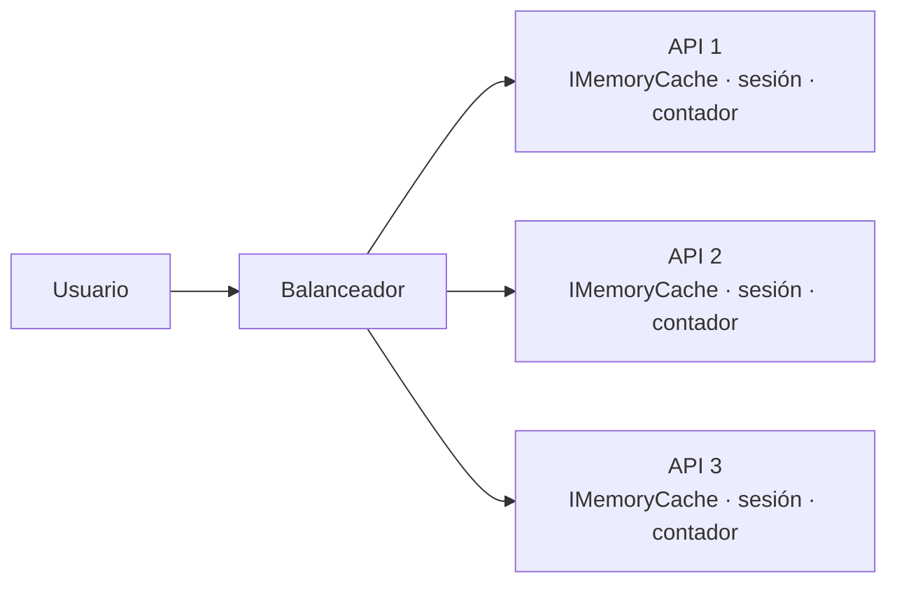
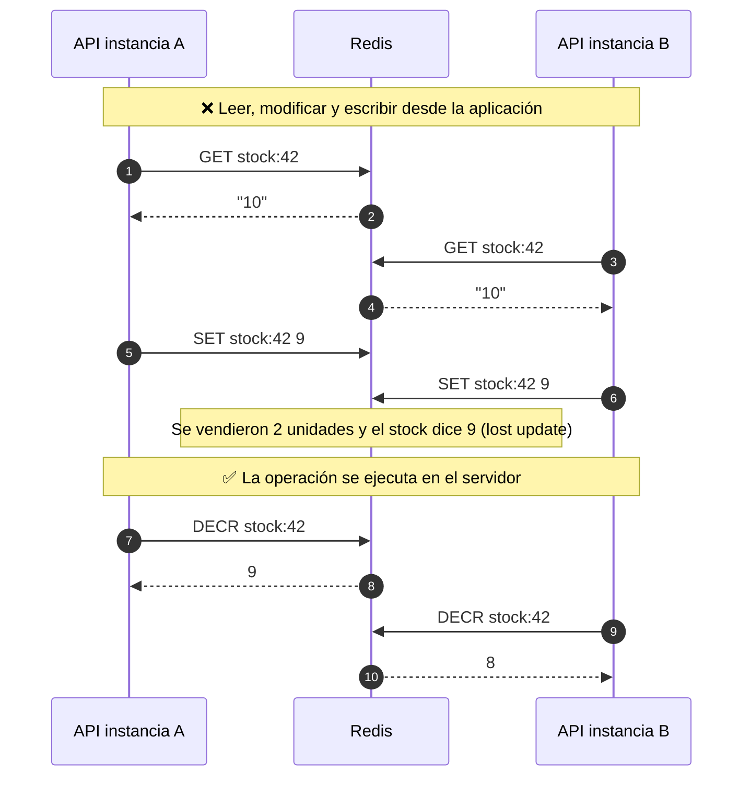
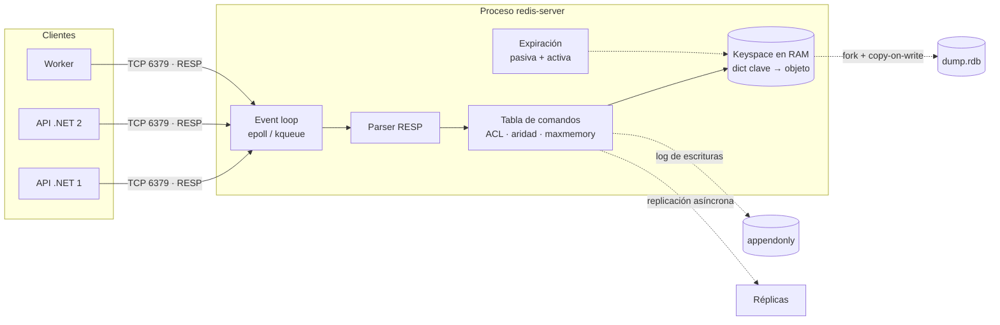
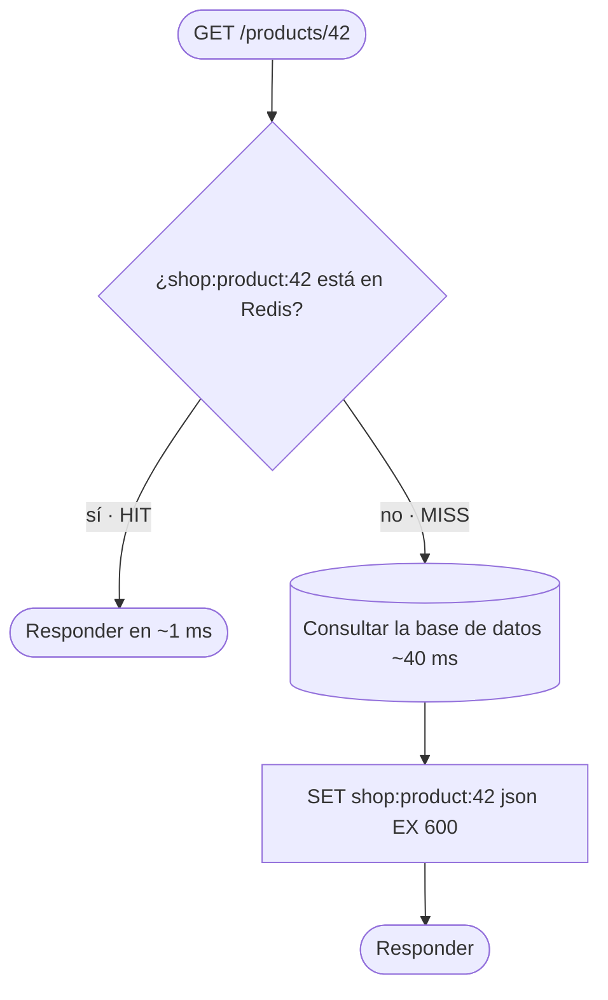
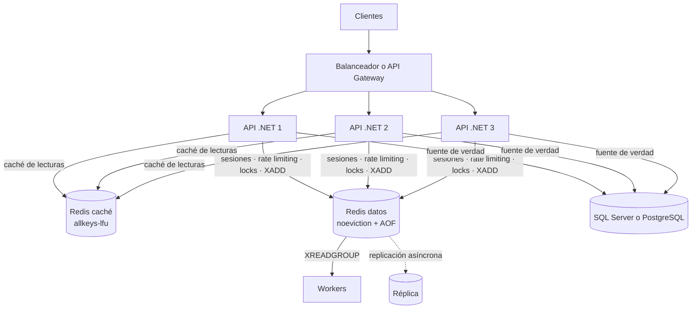

# Qué es Redis

> [!abstract] En 30 segundos
> - **Qué es:** un **servidor de estructuras de datos en memoria**. Tus aplicaciones se conectan por red y le piden operaciones **atómicas** sobre strings, hashes, listas, sets, sorted sets, streams y más, con latencias típicas por debajo del milisegundo.
> - **Por qué se usa:** para quitar carga a la base de datos (caché), **compartir estado** entre instancias (sesiones, contadores, rate limiting, locks) y resolver problemas de **tiempo real** (rankings, colas, eventos).
> - **Recuerda:** la RAM es rápida, pero cara y volátil. Redis complementa a tu base de datos; solo la sustituye si entiendes y aceptas sus garantías de durabilidad y consistencia.

> [!info] Lección 0.1 · Nivel 0 — Fundamentos y conceptos esenciales
> ⬅️ [[01 - Redis - Roadmap#Nivel 0 — Fundamentos y conceptos esenciales|Roadmap]] · ➡️ Siguiente: [[Redis como almacenamiento en memoria]] · 📊 [[03 - Redis - Progreso|Progreso]]
> 🏷️ Referencia: **Redis Open Source 8.10** y **StackExchange.Redis 3.x** (noviembre de 2026). Lo que depende de versión o distribución va marcado con 🏷️.

## Contenido
- [[#📌 Definición]]
- [[#🎯 ¿Qué problema resuelve?]]
- [[#🧠 Conceptos fundamentales]]
- [[#⚙️ Funcionamiento interno]]
- [[#💻 Ejemplos prácticos]]
- [[#🔧 Implementación en .NET]]
- [[#🏗️ Casos de uso en arquitectura]]
- [[#⚠️ Errores y anti-patterns]]
- [[#✅ Buenas prácticas]]
- [[#🎤 Preguntas de entrevista]]
- [[#🧪 Ejercicios]]
- [[#📝 Resumen]]
- [[#🔗 Referencias]]
- [[#🔄 Notas relacionadas]]

---

## 📌 Definición

**Redis** (*REmote DIctionary Server*) es un **almacén de datos en memoria que funciona como servidor**. Tus aplicaciones se conectan por TCP (puerto **6379** por defecto) y le envían comandos como `SET`, `GET`, `INCR` o `ZADD` usando un protocolo sencillo llamado **RESP**. La documentación oficial lo presenta como un *data structure server*, y esa es la clave para entenderlo.

Tres ideas lo definen:

1. **En memoria.** Todo el conjunto de datos vive en RAM. El disco solo se usa, si lo configuras, para persistir (snapshots RDB o log AOF). Por eso un comando simple se ejecuta en menos de un microsegundo dentro del servidor.
2. **Estructuras de datos, no blobs.** Cada clave apunta a un **tipo con operaciones propias**. En lugar de leer un valor, modificarlo en tu aplicación y volver a escribirlo, le pides a Redis «incrementa este contador», «suma 150 puntos a este jugador y dime su posición» o «dame los 10 primeros».
3. **Los comandos se ejecutan en un solo hilo.** Se ejecutan uno detrás de otro, así que **cada comando es atómico** sin necesidad de locks. Sobre esa propiedad se construyen contadores, locks, rate limiting y muchos otros patrones.

### Qué NO es

| Idea equivocada | Realidad |
|---|---|
| «Es una base de datos relacional más rápida» | No hay SQL, joins ni esquemas, y `MULTI`/`EXEC` no tiene rollback. El Query Engine de Redis 8 añade índices secundarios y búsqueda, pero no es un motor relacional. |
| «Es solo una caché» | También se usa como almacén de datos efímeros, broker ligero y motor de rankings, colas o rate limiting. |
| «Es durable por defecto» | La durabilidad depende de la persistencia y la replicación que configures. Con replicación asíncrona, un failover puede perder escrituras ya confirmadas. |
| «Escala sin límite» | En Redis Open Source el dataset debe caber en RAM, y la RAM cuesta mucho más por GB que el disco. |

### Un poco de historia (útil en entrevistas)

| Versión · año | Hito |
|---|---|
| 2009 | Salvatore Sanfilippo (*antirez*) crea Redis para escalar su herramienta de analítica web en tiempo real |
| 2.6 · 2012 | Lua scripting |
| 2.8 · 2013 | Redis Sentinel (alta disponibilidad) y `SCAN` |
| 3.0 · 2015 | Redis Cluster (sharding nativo) |
| 4.0 · 2017 | Módulos y liberación de memoria en segundo plano (`UNLINK`) |
| 5.0 · 2018 | Streams |
| 6.0 · 2020 | ACL, TLS, RESP3, I/O threads y client-side caching |
| 7.0 · 2022 | Redis Functions, Pub/Sub fragmentado y AOF multiparte |
| 7.4 · 2024 | Cambio de licencia a RSALv2/SSPLv1; la Linux Foundation crea el fork **Valkey** a partir de Redis 7.2.4 |
| 8.0 · mayo 2025 | Se añade **AGPLv3** como opción; *Redis Community Edition* pasa a llamarse **Redis Open Source** e integra Query Engine, JSON, time series, estructuras probabilísticas y **vector sets** |
| 8.10 · julio 2026 | Versión de referencia de este curso |

---

## 🎯 ¿Qué problema resuelve?

### 1. La base de datos se convierte en el cuello de botella de las lecturas

Escenario: la página de producto de un e-commerce. Cada petición ejecuta una consulta con joins que tarda **40 ms**, y en el pico llegan **2000 peticiones/s**. La CPU de la base de datos roza el 90 %, pero casi todas las lecturas piden los mismos productos (la regla 80/20 de siempre).

Con Redis delante y un **hit ratio del 95 %**:

- A la base de datos llegan `2000 × 5 % = 100` peticiones/s en lugar de 2000: **20 veces menos carga**.
- El 95 % de las respuestas tarda alrededor de 1 ms en lugar de 40 ms.
- La base de datos recupera margen para las escrituras y las consultas que no se pueden cachear.

### 2. Estado compartido entre instancias

En cuanto escalas horizontalmente, lo que guardas en la memoria de cada proceso deja de ser fiable:



| Necesidad | Solo en la memoria del proceso | Con un Redis compartido |
|---|---|---|
| Sesión de usuario | El login hecho en la API 1 no existe en la API 2 | Todas las instancias leen la misma sesión |
| Rate limit de 100 req/min | Con 3 instancias el límite real es de unas 300 | Un único contador atómico para todas |
| Caché | Cada instancia tiene su copia, con datos distintos según cuándo la cargó | Una sola copia, coherente entre instancias |
| «Solo un worker procesa esto» | Imposible entre procesos | Lock con `SET … NX PX` y un token |

> [!tip] La caché en memoria no es mala
> La combinación **L1 en memoria + L2 en Redis** es el diseño habitual en .NET moderno con [[HybridCache]]. Lo verás en el Nivel 4.

### 3. Concurrencia sin condiciones de carrera

Dos instancias venden la última unidad... o eso creen:



### 4. Datos efímeros y tiempo real

- Códigos OTP, tokens, reservas temporales: necesitan **caducar solos**, y Redis tiene TTL nativo por clave.
- Rankings que cambian cada segundo, presencia «en línea», contadores de visitas, colas de trabajo: millones de actualizaciones pequeñas que en una base de datos relacional generarían contención de locks y escrituras a disco.

### Los números que lo explican

| Operación | Orden de magnitud (orientativo) |
|---|---|
| Ejecutar `GET` o `SET` dentro de Redis | < 1 µs |
| Acceso a memoria RAM | ~100 ns |
| Lectura aleatoria en un SSD NVMe | ~10-100 µs |
| Round-trip de red en el mismo datacenter (1 Gbit/s) | ~100-500 µs |
| Consulta SQL indexada sencilla, con red | ~1-5 ms |
| Consulta SQL con joins y agregaciones | 10-500+ ms |
| Round-trip entre regiones cloud | 30-150 ms |

> [!important] La conclusión que más se olvida
> Dentro de Redis el comando cuesta menos de un microsegundo; **lo que pagas es la red**. La documentación oficial cifra el round-trip típico en una red de 1 Gbit/s en unos 200 µs. 50 `GET` secuenciales son 50 round-trips (10-25 ms); un solo `MGET` de 50 claves es **uno**. Redis es rápido, pero un diseño que hace muchos viajes de ida y vuelta no lo es. Lo verás en [[Pipelining]] y en [[Latencia y rendimiento en Redis]].

---

## 🧠 Conceptos fundamentales

### 1. Clave → estructura de datos

Redis es, en esencia, un diccionario gigante. La clave es siempre un string (binario); el valor es una estructura con sus propios comandos:

| Tipo | Qué guarda | Ejemplo de uso | Comandos típicos | 🏷️ |
|---|---|---|---|---|
| String | Bytes: texto, número, JSON o binario (máx. 512 MB) | Caché, contadores, flags | `SET`, `GET`, `INCR` | Core |
| Hash | Mapa campo → valor | Un usuario, un carrito | `HSET`, `HGET`, `HGETALL` | Core · TTL por campo ≥7.4 |
| List | Secuencia ordenada por inserción | Colas, últimos N eventos | `LPUSH`, `BRPOP`, `LRANGE` | Core |
| Set | Elementos únicos sin orden | Etiquetas, usuarios en línea, deduplicación | `SADD`, `SISMEMBER`, `SINTER` | Core |
| Sorted Set | Elementos únicos ordenados por un score | Rankings, colas con prioridad, ventanas de tiempo | `ZADD`, `ZRANGE`, `ZRANK` | Core |
| Stream | Log append-only con consumer groups | Eventos, mensajería con confirmación | `XADD`, `XREADGROUP`, `XACK` | Core · ≥5.0 |
| Bitmap / Bitfield | Bits sobre un string | Flags por usuario, retención diaria | `SETBIT`, `BITCOUNT`, `BITFIELD` | Core |
| HyperLogLog | Cardinalidad aproximada en ~12 KB | Visitantes únicos | `PFADD`, `PFCOUNT` | Core |
| Geospatial | Coordenadas (sobre un sorted set) | «Tiendas a menos de 5 km» | `GEOADD`, `GEOSEARCH` | Core |
| JSON | Documentos JSON consultables | Perfiles, catálogos | `JSON.SET`, `JSON.GET` | R8 (antes Redis Stack) |
| Probabilísticas | Bloom, Cuckoo, Count-min sketch, Top-K, t-digest | «¿Ya existe este email?», productos más vistos | `BF.ADD`, `TOPK.ADD` | R8 (antes Redis Stack) |
| Time series | Series temporales | Métricas, IoT | `TS.ADD`, `TS.RANGE` | R8 (antes Redis Stack) |
| Vector set | Vectores para búsqueda por similitud (HNSW) | Búsqueda semántica, recomendaciones | `VADD`, `VSIM` | ≥8.0 |
| Array | Secuencia dispersa indexada por posición | El tipo más nuevo; lo verás en el Nivel 2 | — | ≥8.8 |

> [!tip] Elige la estructura por el **patrón de acceso**, no por la forma del dato
> Tu nota [[Comandos Redis - Opción 3 (Híbrida)]] ya lo hace: cada equipo es un Hash (`team:1`) y cada división es un Set que funciona como índice secundario. Así puedes leer un equipo por clave y listar una división sin recorrer todo.

### 2. Atomicidad: lleva la operación al dato

En el diagrama del problema 3, `DECR` hace la lectura, la resta y la escritura como **un único paso indivisible** en el servidor, así que ninguna otra operación puede colarse en medio. Esta es la razón de que en Redis se prefiera `INCR`, `HINCRBY` o `ZINCRBY` a «leer, calcular y escribir» desde la aplicación.

Un solo comando no basta cuando la lógica tiene condiciones, por ejemplo «decrementa solo si el stock es mayor que 0». Para eso existen las transacciones con `WATCH` y los scripts Lua o Functions, que verás en el Nivel 2.

### 3. Un hilo para ejecutar los comandos

Redis ejecuta los comandos con **un hilo principal** que atiende a todos los clientes mediante un *event loop*: no espera a ningún socket y solo trabaja con los que tienen datos listos. Cada comando se ejecuta completo antes de empezar el siguiente.

- ✅ **Consecuencia buena:** atomicidad gratis y cero contención por locks.
- ❌ **Consecuencia mala:** un comando lento (`KEYS *` sobre millones de claves, `HGETALL` de un hash enorme, `DEL` de una colección gigante, un script Lua largo) **congela a todos los clientes** mientras dura.

La documentación oficial lo describe como un diseño *mayormente* de un hilo, porque hay hilos de fondo para la E/S de disco y otras tareas (detalle en [[#⚙️ Funcionamiento interno]] y en [[Modelo de ejecución single-threaded]]).

### 4. Memoria primero, disco opcional

| Configuración | Si el proceso se cae, pierdes… | Coste |
|---|---|---|
| Sin persistencia | Todo | Ninguno |
| RDB (snapshot periódico) | Lo escrito desde el último snapshot (minutos) | Un fork con copy-on-write en cada snapshot |
| AOF con `appendfsync everysec` | Hasta ~1 segundo de escrituras | Escritura continua en disco; el compromiso habitual |
| AOF con `appendfsync always` | Prácticamente nada | Mucho más lento |
| + replicación asíncrona | En un failover, lo que el primario confirmó y aún no había llegado a la réplica | Más nodos |

### 5. Expiración (TTL) nativa

`SET otp:usuario:42 839201 EX 300` crea una clave que caduca a los 5 minutos. Redis elimina las claves caducadas de dos formas: **pasiva**, cuando alguien accede a una clave ya vencida, y **activa**, con un proceso que unas 10 veces por segundo muestrea claves con TTL y borra las vencidas. Detalle en [[Expiración y TTL]].

### 6. Cliente-servidor con RESP

```text
Comando:    SET saludo hola
En la red:  *3\r\n$3\r\nSET\r\n$6\r\nsaludo\r\n$4\r\nhola\r\n
Respuesta:  +OK\r\n
```

El cliente envía un array (`*3`) de tres *bulk strings* (`$longitud` seguido de los datos). Como la longitud va por delante, el servidor no busca delimitadores ni escapa caracteres: los valores son **binary-safe** y el protocolo se procesa casi tan rápido como uno binario. RESP3 (🏷️ ≥6.0, se negocia con `HELLO 3`) añade tipos como mapas, booleanos y mensajes *push*. StackExchange.Redis 3.x usa RESP3 por defecto.

### 7. Un rol por instancia

Antes de configurar nada, decide **para qué** es cada instancia, porque eso fija la política de memoria, la persistencia y la alta disponibilidad:

| Rol | Política de memoria | Persistencia | Si se pierde un dato… |
|---|---|---|---|
| Caché | `allkeys-lru` o `allkeys-lfu` | Opcional | Se recalcula desde la fuente |
| Sesiones, locks, colas, rate limiting | `noeviction` | AOF + réplicas | Usuarios desconectados, trabajos perdidos, exclusión mutua rota |
| Almacén principal de datos efímeros | `noeviction` | AOF + RDB + réplicas | Pérdida de datos de negocio |

> [!warning] Mezclar roles en una misma instancia es un error clásico
> Si la caché llena la memoria y la política es `allkeys-lru`, Redis puede desalojar **sesiones, locks o mensajes de una cola** para hacer sitio. Separa los roles en instancias distintas. Las bases lógicas (`SELECT 0`…`15`) comparten memoria y política, así que no sirven para separarlos.

### 8. Ediciones y distribuciones 🏷️

«Redis» ya no es un único producto. Conviene distinguirlos desde el primer día:

| Distribución | Qué es | Licencia | JSON, búsqueda, vectores… | Estado (nov. 2026) | Cuándo elegirla |
|---|---|---|---|---|---|
| **Redis Open Source** | El servidor oficial gratuito (antes *Redis Community Edition*) | 8.x: a elegir entre RSALv2, SSPLv1 y AGPLv3 · 7.4-7.x: RSALv2 o SSPLv1 · ≤7.2: BSD-3 | Incluidos desde 8.0 | Línea 8.x; 8.10 publicada en julio de 2026 | Autogestionado, laboratorios, Kubernetes |
| **Redis Stack** | Paquete de Redis 7.x con los módulos JSON, Search, TimeSeries y Bloom | La de su versión de Redis | Sí, era su razón de ser | Redis 8.0 declara obsoletas las versiones anteriores de Redis y de Redis Stack | Solo sistemas heredados |
| **Redis Software** | Versión comercial autogestionada (antes *Redis Enterprise Software*) | Comercial | Sí | Activa | On-premises con soporte y funciones Enterprise |
| **Redis Cloud** | Servicio gestionado de Redis Inc. sobre AWS, Google Cloud y Azure | Servicio | Sí | Activo | Gestionado multi-cloud con funciones Enterprise como Active-Active |
| **Azure Managed Redis** | Servicio gestionado de Microsoft basado en Redis Enterprise | Servicio | Sí | Sucesor de Azure Cache for Redis, que se retira (Enterprise: 31-03-2027; Basic, Standard y Premium: 30-09-2028) | Aplicaciones .NET en Azure |
| **Valkey** | Fork de Redis 7.2.4 de la Linux Foundation | BSD-3 | Módulos propios, compatibles solo en parte | Línea 9.x (9.0 en octubre de 2025) | Necesitas licencia BSD; base de AWS ElastiCache y MemoryDB y de Google Memorystore for Valkey |

> [!note] Licencias en la práctica
> Las tres licencias de Redis 8 permiten usarlo como componente interno de tu aplicación. Las restricciones aparecen sobre todo al ofrecer Redis como servicio a terceros o al distribuir versiones modificadas; si es tu caso, consúltalo con el equipo legal. Existen además implementaciones que hablan RESP, como **Garnet** (Microsoft Research, escrita en C#) o **Dragonfly**: aceptan muchos comandos de Redis, pero no son Redis, así que verifica cada comando y cada garantía.

### Analogía: la mesa de trabajo de un chef

| En la cocina | En Redis |
|---|---|
| La mesa de trabajo, con lo que más se usa al alcance de la mano | La RAM: acceso inmediato |
| La despensa, grande, ordenada y lejos | La base de datos en disco: capacidad y durabilidad |
| Recipientes especializados: bandeja de cubiertos, boles, tabla de cortar | Las estructuras de datos, cada una optimizada para un uso |
| Un único chef que prepara las comandas de una en una, muy rápido | El hilo principal: cada comando es atómico |
| Si alguien pide 500 cebollas picadas, toda la cocina espera | Un comando O(N) sobre una colección grande bloquea a todos |
| Etiquetas con fecha de caducidad en cada recipiente | TTL |
| La mesa es pequeña: si se llena, retiras lo que menos se usa | `maxmemory` y política de desalojo (LRU, LFU) |
| Al cerrar, lo que queda en la mesa se tira salvo que lo guardes | Volatilidad: persistencia opcional |

**Dónde se rompe la analogía:** puedes poner varias cocinas, cada una con su mesa y una parte de los ingredientes (eso es Redis Cluster), y mesas copia en otras cocinas que se actualizan con un pequeño retraso (réplicas asíncronas). Y el chef de Redis no se cansa: su límite es la red y el tamaño de cada comanda.

---

## ⚙️ Funcionamiento interno

### Vista de componentes



### La vida de un comando

1. El cliente envía el comando como un array RESP por una conexión TCP que ya tenía abierta.
2. El *event loop* detecta que ese socket tiene datos. Usa multiplexación de E/S (`epoll` en Linux, `kqueue` en macOS/BSD), así que un solo hilo vigila miles de conexiones sin bloquearse.
3. Se leen los bytes y se parsean en argumentos. Con `io-threads` activado, la lectura, el parseo y la escritura de sockets se reparten entre varios hilos (🏷️ ≥6.0, reimplementado en 8.0).
4. Se busca el comando en la tabla de comandos y se valida: autenticación y ACL, número de argumentos y, si es una escritura con `maxmemory` alcanzado, se desalojan claves o se rechaza con un error `OOM`.
5. Se **ejecuta** sobre la estructura en memoria. Encontrar la clave es O(1) en la tabla hash principal; un comando simple tarda menos de un microsegundo.
6. Efectos secundarios: si fue una escritura, se añade al buffer del AOF y al flujo de replicación, y se emiten notificaciones si están configuradas.
7. La respuesta va al buffer de salida del cliente y se envía cuando el socket puede escribir.

### Cómo guarda los datos

- **Keyspace:** una gran tabla hash que asocia cada clave con un objeto (`redisObject`) que registra tipo, codificación interna, información para LRU/LFU, un contador de referencias y un puntero al valor. Las claves con TTL figuran además en un diccionario de expiraciones.
- **Codificaciones adaptativas:** las estructuras pequeñas usan formatos compactos (`listpack`, `intset`) y se convierten en estructuras generales (`hashtable`, `skiplist`, `quicklist`) al crecer. Ahorran memoria a cambio de algo de CPU. Lo verás con `OBJECT ENCODING` en [[Codificaciones internas de los tipos de datos]].
- **Rehash incremental:** cuando la tabla hash crece, Redis migra las entradas poco a poco, en cada operación y en tareas periódicas, para no congelar el servidor con una reorganización completa.

### «Mayormente» un solo hilo

| Hilo o proceso | Qué hace | 🏷️ |
|---|---|---|
| Hilo principal | Ejecuta todos los comandos, uno detrás de otro, sobre el *event loop* | Core |
| Hilos de fondo | fsync del AOF, cierre de ficheros, liberación de memoria diferida (`UNLINK`, `FLUSHALL ASYNC`) | Core |
| I/O threads (opcional, `io-threads`) | Leen, parsean y escriben sockets en paralelo; **la ejecución sigue siendo secuencial** | ≥6.0 · reimplementados en 8.0 |
| Procesos hijos (`fork`) | Generan el snapshot RDB y reescriben el AOF usando *copy-on-write* | Core |
| Hilos de componentes | Algunos componentes, como el Query Engine, tienen sus propios *workers* para las consultas | R8 |

> [!warning] Consecuencia operativa del fork
> Mientras el proceso hijo escribe el snapshot, cada página de memoria que el primario modifica se duplica (*copy-on-write*). Con mucha escritura, el consumo de RAM puede crecer de forma notable durante el guardado: deja margen y no dimensiones `maxmemory` al 100 % de la máquina. Lo verás en [[Persistencia RDB]] y en [[Gestión de memoria en Redis]].

---

## 💻 Ejemplos prácticos

### Sintaxis de los comandos de esta lección

| Comando | Sintaxis | Qué hace | Complejidad |
|---|---|---|---|
| `PING` | `PING [mensaje]` | Comprueba la conexión | O(1) |
| `SET` | `SET clave valor [NX o XX] [GET] [EX s, PX ms, EXAT, PXAT o KEEPTTL]` | Guarda un string; `EX` fija un TTL y `NX` solo escribe si la clave no existe | O(1) |
| `GET` | `GET clave` | Lee un string; devuelve `(nil)` si no existe | O(1) |
| `INCR` | `INCR clave` | Suma 1 de forma atómica; si la clave no existe, parte de 0 | O(1) |
| `TTL` | `TTL clave` | Segundos restantes; `-1` sin expiración, `-2` si la clave no existe | O(1) |
| `HSET` | `HSET clave campo valor [campo valor …]` | Asigna campos de un hash y devuelve cuántos son nuevos | O(1) por campo |
| `HGETALL` | `HGETALL clave` | Todos los campos y valores del hash | O(N) |
| `TYPE` | `TYPE clave` | Tipo de dato de la clave | O(1) |
| `ZADD` | `ZADD clave [NX o XX] [GT o LT] [CH] [INCR] score miembro [score miembro …]` | Añade o actualiza miembros con su score | O(log N) por miembro |
| `ZRANGE` | `ZRANGE clave inicio fin [BYSCORE o BYLEX] [REV] [LIMIT offset count] [WITHSCORES]` | Rango ordenado; `REV` va de mayor a menor | O(log N + M) |
| `DBSIZE` | `DBSIZE` | Número de claves de la base actual | O(1) |
| `INFO` | `INFO [sección]` | Estado y métricas del servidor | O(1) |
| `MEMORY USAGE` | `MEMORY USAGE clave` | Bytes que ocupa una clave, incluido su overhead | O(N) muestras |

### 🧪 Laboratorio 0.1 — Primer contacto (15 minutos)

Requisito: Docker Desktop en marcha.

```bash
# 1) Arranca Redis 8.10 publicando el puerto SOLO en tu máquina
docker run -d --name redis-lab -p 127.0.0.1:6379:6379 redis:8.10

# 2) Abre redis-cli dentro del contenedor
docker exec -it redis-lab redis-cli
```

> [!warning] ¿Por qué `127.0.0.1:` delante del puerto?
> La imagen oficial desactiva el modo protegido para que otros contenedores puedan conectarse, y no configura contraseña. Si publicas `-p 6379:6379`, cualquiera que alcance ese puerto (tu red local, una Wi-Fi pública) tiene control total: leer, borrar o reconfigurar. Para este laboratorio basta con exponerlo solo a tu máquina; la autenticación con ACL llega en el [[Laboratorio 00 - Entorno Redis y .NET]].

Escribe estos comandos (el número del `TTL` variará según los segundos que tardes):

```text
127.0.0.1:6379> PING
PONG
127.0.0.1:6379> SET saludo "hola redis"
OK
127.0.0.1:6379> GET saludo
"hola redis"
127.0.0.1:6379> GET no-existe
(nil)
127.0.0.1:6379> INCR visitas:home
(integer) 1
127.0.0.1:6379> INCR visitas:home
(integer) 2
127.0.0.1:6379> SET otp:usuario:42 "839201" EX 300
OK
127.0.0.1:6379> TTL otp:usuario:42
(integer) 297
127.0.0.1:6379> TTL saludo
(integer) -1
127.0.0.1:6379> HSET usuario:42 nombre "Ana" plan "pro"
(integer) 2
127.0.0.1:6379> HGETALL usuario:42
1) "nombre"
2) "Ana"
3) "plan"
4) "pro"
127.0.0.1:6379> TYPE usuario:42
hash
127.0.0.1:6379> GET usuario:42
(error) WRONGTYPE Operation against a key holding the wrong kind of value
127.0.0.1:6379> ZADD ranking:2026-11 150 ana 90 luis 210 marta
(integer) 3
127.0.0.1:6379> ZRANGE ranking:2026-11 0 2 REV WITHSCORES
1) "marta"
2) "210"
3) "ana"
4) "150"
5) "luis"
6) "90"
127.0.0.1:6379> DBSIZE
(integer) 5
```

| Paso | Qué observar |
|---|---|
| `GET no-existe` → `(nil)` | Leer una clave que no existe no es un error |
| `INCR` sobre una clave nueva | La crea con 0 y suma 1, de forma atómica |
| `TTL` → `297` y `-1` | Segundos restantes; `-1` significa «sin expiración» (y `-2`, «no existe») |
| `GET usuario:42` → `WRONGTYPE` | Cada clave tiene un tipo y los comandos son específicos de cada tipo |
| `ZRANGE … REV WITHSCORES` | El ranking sale ordenado de mayor a menor sin que ordenes nada |

Ahora explora el servidor:

```text
127.0.0.1:6379> INFO server
127.0.0.1:6379> INFO modules
127.0.0.1:6379> MEMORY USAGE usuario:42
```

- En `INFO server` busca `redis_version`, `redis_mode` y `multiplexing_api`: este último te dice qué mecanismo usa el *event loop* (en Docker sobre Linux, `epoll`).
- En `INFO modules` mira si aparecen módulos de búsqueda, JSON, time series o Bloom. Si aparecen, tu imagen trae cargados los componentes de Redis 8; si la sección sale vacía, no los tiene cargados. Lo aclararemos en [[Instalación de Redis con Docker]].

Por último, mide la latencia y el efecto del pipelining desde tu terminal:

```bash
# Latencia de ida y vuelta vista por un cliente (Ctrl+C para parar)
docker exec -it redis-lab redis-cli --latency

# 100 000 SET y GET, primero sin pipelining y después con 16 comandos por round-trip
docker exec -it redis-lab redis-benchmark -q -n 100000 -t set,get
docker exec -it redis-lab redis-benchmark -q -n 100000 -t set,get -P 16

# Limpieza al terminar
docker rm -f redis-lab
```

### De lo simple a lo real

**1. Contador de visitas.** Atómico aunque lo incrementen 50 instancias a la vez:

```text
INCR articulo:123:visitas
```

**2. Código OTP de 5 minutos.** `NX` evita sobrescribir un código ya emitido; la clave caduca sola:

```text
SET otp:usuario:42 839201 EX 300 NX
```

**3. Rate limiting básico.** Un contador por IP y minuto:

```text
INCR ratelimit:ip:203.0.113.7:202611031015
EXPIRE ratelimit:ip:203.0.113.7:202611031015 60 NX
```

Si `INCR` devuelve más de 100, respondes `429 Too Many Requests`. `EXPIRE … NX` (🏷️ ≥7.0) solo fija el TTL si la clave aún no lo tiene. Ojo: son dos comandos y no son atómicos entre sí. En [[Rate limiting con Redis]] lo harás con Lua o con `INCREX` (🏷️ ≥8.8).

**4. Ranking en tiempo real.**

```text
ZINCRBY ranking:2026-11 25 luis
ZRANGE ranking:2026-11 0 9 REV WITHSCORES
ZREVRANK ranking:2026-11 luis
```

`ZINCRBY` suma puntos, `ZRANGE … REV` da el top 10 y `ZREVRANK` la posición de un jugador (empezando en 0). Con 10 millones de jugadores sigue siendo O(log N).

**5. Caché de producto (cache-aside).** El patrón más usado, que implementarás en .NET más abajo:



**6. Tu propio modelo.** En [[Comandos Redis - Opción 3 (Híbrida)]] guardas cada equipo de la NFL como un Hash y cada división como un Set de IDs. Es *modelado por patrón de acceso*: con `HGETALL team:1` lees un equipo y con `SMEMBERS` sobre el Set de una división obtienes sus equipos sin recorrer las 32 claves.

---

## 🔧 Implementación en .NET

**StackExchange.Redis** es el cliente .NET de referencia. Lo creó el equipo de Stack Overflow para su propio uso intensivo de Redis, y es la base de `IDistributedCache` para Redis, de `HybridCache` con Redis y de **NRedisStack** (el cliente de Redis Inc. para los comandos de JSON, búsqueda, time series y probabilísticas).

> [!info] 🏷️ StackExchange.Redis 3.x
> La versión 3.0 rehízo el núcleo de E/S manteniendo la API pública de 2.x, y usa RESP3 por defecto. En 3.x, `StringSetAsync(clave, valor, TimeSpan)` recibe el TTL a través del nuevo tipo `Expiration`, que tiene conversión implícita desde `TimeSpan` pero **no** desde `TimeSpan?`: si tu TTL es anulable, conviértelo antes de pasarlo.

### Paso 1 — Primer contacto desde una consola

```bash
dotnet new console -n RedisHola
cd RedisHola
dotnet add package StackExchange.Redis
```

```csharp
using StackExchange.Redis;

// UN ConnectionMultiplexer por aplicación: es thread-safe, multiplexa todas las
// peticiones sobre pocas conexiones y es caro de crear.
using var redis = await ConnectionMultiplexer.ConnectAsync("localhost:6379");
IDatabase db = redis.GetDatabase();

// String con TTL de 5 minutos
await db.StringSetAsync("saludo", "hola desde .NET", TimeSpan.FromMinutes(5));
string? saludo = await db.StringGetAsync("saludo");
Console.WriteLine(saludo);                              // hola desde .NET

// Contador atómico: correcto aunque 100 instancias lo incrementen a la vez
long visitas = await db.StringIncrementAsync("visitas:home");
Console.WriteLine($"Visitas: {visitas}");

// TTL restante (null si la clave no tiene expiración o no existe)
TimeSpan? ttl = await db.KeyTimeToLiveAsync("saludo");
Console.WriteLine($"Caduca en: {ttl}");

// Round-trip medido por el cliente: aquí ves el coste real de la red
TimeSpan rtt = await db.PingAsync();
Console.WriteLine($"PING: {rtt.TotalMilliseconds:F3} ms");
```

### Paso 2 — Minimal API con cache-aside (adelanto del Nivel 3)

```bash
dotnet new web -n ProductsApi
cd ProductsApi
dotnet add package StackExchange.Redis
```

`appsettings.json`:

```json
{
  "ConnectionStrings": {
    "Redis": "localhost:6379,abortConnect=false"
  }
}
```

`abortConnect=false` permite que la aplicación arranque aunque Redis no esté disponible todavía; el multiplexer reintenta en segundo plano.

`Program.cs`:

```csharp
using System.Diagnostics;
using System.Text.Json;
using StackExchange.Redis;

var builder = WebApplication.CreateBuilder(args);

// ✅ Singleton: un único ConnectionMultiplexer compartido por toda la aplicación
builder.Services.AddSingleton<IConnectionMultiplexer>(_ =>
    ConnectionMultiplexer.Connect(builder.Configuration.GetConnectionString("Redis")!));

var app = builder.Build();
var json = new JsonSerializerOptions(JsonSerializerDefaults.Web);

app.MapGet("/products/{id:int}", async (int id, IConnectionMultiplexer redis, HttpContext http) =>
{
    IDatabase db = redis.GetDatabase();      // barato: no abre conexiones
    string key = $"shop:product:{id}";       // convención aplicación:entidad:id
    var sw = Stopwatch.StartNew();

    // 1) ¿Está en caché?
    RedisValue cached = await db.StringGetAsync(key);
    if (cached.HasValue)
    {
        http.Response.Headers["X-Cache"] = "HIT";
        http.Response.Headers["X-Elapsed-ms"] = sw.Elapsed.TotalMilliseconds.ToString("F2");
        return Results.Content(cached.ToString(), "application/json");
    }

    // 2) Cache miss: ir a la fuente de verdad (simulada con 200 ms de latencia)
    Product product = await SlowDatabase.GetProductAsync(id);
    string payload = JsonSerializer.Serialize(product, json);

    // 3) Guardar con TTL para las siguientes peticiones
    await db.StringSetAsync(key, payload, TimeSpan.FromMinutes(10));

    http.Response.Headers["X-Cache"] = "MISS";
    http.Response.Headers["X-Elapsed-ms"] = sw.Elapsed.TotalMilliseconds.ToString("F2");
    return Results.Content(payload, "application/json");
});

app.Run();

record Product(int Id, string Name, decimal Price);

static class SlowDatabase
{
    public static async Task<Product> GetProductAsync(int id)
    {
        await Task.Delay(200);                  // simula una consulta costosa
        return new Product(id, $"Producto {id}", 19.99m);
    }
}
```

Pruébalo con el puerto que muestre `dotnet run` (en Windows, usa `curl.exe`):

```bash
curl -i http://localhost:5000/products/1
curl -i http://localhost:5000/products/1
```

La primera respuesta trae `X-Cache: MISS` y unos 200 ms; la segunda, `X-Cache: HIT` y alrededor de un milisegundo.

> [!bug] Este código tiene al menos 4 problemas de producción
> Funciona en el laboratorio, pero no está listo para producción. Encontrarlos es el ejercicio 6; no mires la solución hasta intentarlo.

### Qué usarás en .NET según el caso (Nivel 4)

| Opción | Cuándo |
|---|---|
| `IConnectionMultiplexer` (StackExchange.Redis) | Acceso completo a todas las estructuras y comandos |
| `IDistributedCache` con `AddStackExchangeRedisCache` | Caché clave → bytes sencilla e intercambiable (Redis, SQL Server…) |
| `HybridCache` (`Microsoft.Extensions.Caching.Hybrid`) | Caché L1 en memoria + L2 en Redis, con protección contra stampede y tags; la opción moderna para caché de aplicación |
| Output caching con Redis | Cachear respuestas HTTP completas (ASP.NET Core 8+) |
| NRedisStack | Comandos de JSON, búsqueda, time series y probabilísticas, sobre StackExchange.Redis |

---

## 🏗️ Casos de uso en arquitectura



Fíjate en que hay **dos instancias con roles distintos**: la caché puede desalojar claves y la de datos no.

### Cuándo usarlo

| Caso de uso | Estructura | Por qué Redis | Alternativa |
|---|---|---|---|
| Caché de lecturas | String o Hash + TTL | Latencia por debajo del milisegundo, TTL nativo, compartida | `IMemoryCache` (una instancia), CDN (contenido público) |
| Sesiones distribuidas | String o Hash + TTL | Compartidas entre instancias y caducan solas | Cookies o JWT sin estado, base de datos |
| Rate limiting | `INCR`, Sorted Set, Lua | Contadores atómicos globales | Limitador en memoria (por instancia), API Gateway |
| Leaderboards | Sorted Set | Ranking O(log N) siempre ordenado | `ORDER BY` en SQL, caro con escrituras frecuentes |
| Locks distribuidos | `SET NX PX` + token | Simple y rápido | etcd o ZooKeeper (más garantías), locks de BD (`sp_getapplock`, `pg_advisory_lock`) |
| Colas ligeras y eventos | List o Stream | Baja latencia, consumer groups | RabbitMQ, Azure Service Bus, Kafka |
| Notificaciones en tiempo real | Pub/Sub | Difusión instantánea; backplane de SignalR | Azure SignalR Service, Azure Web PubSub |
| Analítica en tiempo real | `INCR`, HyperLogLog, Bitmaps | Contadores y cardinalidades con muy poca memoria | Base analítica, Application Insights |
| Geolocalización | Geospatial | Búsquedas por radio en memoria | PostGIS |
| Búsqueda, JSON y vectores | Query Engine, JSON, vector sets (🏷️ R8) | Baja latencia junto al resto de los datos | Elasticsearch, pgvector, Azure AI Search |

### Cuándo NO usarlo

- El dataset es mucho mayor que la RAM que puedes pagar.
- Necesitas consultas ad hoc, joins o reporting: usa una base relacional o analítica.
- Necesitas transacciones ACID con rollback entre varias entidades.
- Mensajería con retención larga, replay masivo u orden estricto a gran escala: Kafka o Event Hubs. Enrutamiento complejo y colas de mensajes fallidos gestionadas: RabbitMQ o Azure Service Bus.
- Datos críticos como única copia, sin persistencia ni réplicas configuradas.
- El cuello de botella no son las lecturas repetidas: cachear añade invalidación y consistencia que tendrás que pagar.
- Para tapar una consulta mal indexada: arregla primero la consulta.
- Como base de datos compartida entre microservicios.

### Consideraciones de arquitectura

| Dimensión | Qué tienes que pensar |
|---|---|
| Rendimiento | El round-trip domina: misma región y zona que la aplicación, menos viajes (`MGET`, hashes, pipelining) y valores pequeños |
| Concurrencia | Cada comando es atómico; la lógica de varios pasos necesita `WATCH`, Lua o Functions; un comando lento bloquea a todos |
| Escalabilidad | Primero vertical (una instancia rinde mucho); réplicas para lecturas, aceptando datos ligeramente atrasados; Cluster para fragmentar, con restricciones en operaciones multi-clave |
| Resiliencia | Decide qué pasa si Redis falla, según el rol: la caché se degrada a la fuente, mientras que sesiones y locks fallan de forma explícita. Prepara el arranque con la caché vacía (avalancha sobre la BD) |
| Consistencia | Caché y base de datos son eventualmente consistentes; la replicación es asíncrona; Redis Cluster no garantiza consistencia fuerte (ver [[Teorema CAP y BASE]]) |
| Coste | Pagas RAM, más el margen para el fork de la persistencia y la fragmentación: dimensiona y vigila |
| Seguridad | Red privada, ACL, TLS y parches al día; nunca expuesto a Internet |

---

## ⚠️ Errores y anti-patterns

| Error | Por qué duele | Cómo evitarlo |
|---|---|---|
| Exponer Redis sin autenticación (por ejemplo `-p 6379:6379` en una máquina con IP pública) | Cualquiera puede leer, borrar o cifrar tus datos; hay campañas automatizadas que buscan instancias abiertas | Red privada, ACL, TLS, `bind` y modo protegido; nunca expuesto a Internet |
| Usar Redis como única copia de datos críticos sin persistencia ni réplicas | Un reinicio o un failover se lleva los datos | Define el rol; configura AOF, RDB y réplicas, o guarda esos datos en una base de datos |
| Mezclar caché y datos críticos en la misma instancia con política de desalojo | Redis puede desalojar sesiones, locks o mensajes de una cola al llenarse | Una instancia por rol; `noeviction` donde no se puede perder nada |
| `KEYS *` en producción | Es O(N) sobre todo el keyspace y bloquea el servidor | `SCAN` con cursor |
| Crear un `ConnectionMultiplexer` por petición | Agota sockets, añade latencia y provoca timeouts | Un singleton por proceso |
| Datos de caché sin TTL | Memoria llena y datos obsoletos para siempre | TTL siempre, con jitter |
| Valores de varios MB o colecciones de millones de elementos | Bloqueos, red saturada, réplicas y migraciones lentas | Trocear, paginar, comprimir; detectarlos con `redis-cli --bigkeys` |
| Muchos round-trips por petición | La red multiplica la latencia | `MGET`/`MSET`, hashes, pipelining |
| Leer, calcular y escribir desde la aplicación | Condiciones de carrera (lost update) | `INCR`/`HINCRBY`, `WATCH`, Lua o Functions |
| Usar Redis como base de datos compartida entre microservicios | Acoplamiento oculto: un cambio de formato rompe a otro equipo | Cada servicio es dueño de sus claves o de su instancia; integración por APIs o eventos |
| Cachear sin medir | No sabes si ayuda; puede empeorar la latencia o servir datos obsoletos | Hit ratio, latencias p95/p99 y carga de la BD antes y después |
| No actualizar | Entre 2025 y 2026 se corrigieron varios CVE críticos; por ejemplo, CVE-2025-49844 permitía ejecución remota de código mediante un script Lua | Parchea con regularidad; restringe `EVAL` y `FUNCTION` con ACL a quien de verdad lo necesite |

## ✅ Buenas prácticas

1. **Decide el rol de cada instancia** (caché, almacén de datos efímeros, broker) antes de configurar nada: determina la persistencia, el desalojo y la alta disponibilidad.
2. **Convención de nombres de clave** `aplicación:entidad:id[:subrecurso]`, por ejemplo `shop:product:42` o `auth:session:9f1c`: en minúsculas, separadas por `:`, cortas pero legibles.
3. **TTL en todo dato de caché**, con jitter (±10-20 %) para que no caduquen todos a la vez.
4. **Elige la estructura por el patrón de acceso**; prefiere comandos O(1) u O(log N) e itera colecciones grandes con `SCAN`, `HSCAN`, `SSCAN` y `ZSCAN`.
5. **Minimiza los round-trips:** `MGET`, hashes, pipelining.
6. **En .NET:** un `ConnectionMultiplexer` por proceso, API asíncrona, `abortConnect=false` y timeouts explícitos.
7. **Diseña para el fallo:** decide qué hace tu aplicación si Redis no responde en 50 ms.
8. **Seguridad por defecto:** red privada, ACL de mínimo privilegio, TLS fuera de localhost.
9. **Observa desde el primer día:** latencia p99, hit ratio, memoria usada, claves desalojadas y conexiones.
10. **Fija versiones** (tag concreto de la imagen Docker) y conoce tu distribución y su licencia.

---

## 🎤 Preguntas de entrevista

Intenta responder en voz alta antes de desplegar cada respuesta.

> [!question]- 1. (Junior) ¿Qué es Redis y por qué es tan rápido?
> Un servidor de estructuras de datos en memoria al que te conectas por red. Es rápido por cuatro motivos: (1) los datos están en RAM; (2) las estructuras están optimizadas y la mayoría de los comandos son O(1) u O(log N); (3) ejecuta los comandos en un solo hilo con un *event loop* no bloqueante, sin locks ni cambios de contexto; (4) RESP es trivial de parsear.
> **Matiz senior:** el comando tarda menos de un microsegundo, pero la latencia que ve el cliente la domina el round-trip de red, así que el diseño del acceso (`MGET`, pipelining, valores pequeños) importa tanto como Redis.

> [!question]- 2. (Mid) Si Redis ejecuta los comandos en un solo hilo, ¿cómo atiende a miles de clientes? ¿Qué implica?
> Con multiplexación de E/S (`epoll`/`kqueue`): un único *event loop* vigila miles de sockets y solo trabaja con los que tienen datos listos. Cada comando se ejecuta completo antes del siguiente.
> Implicaciones: (1) cada comando es atómico; (2) un comando lento bloquea a todos (`KEYS`, `HGETALL` o `SMEMBERS` de colecciones enormes, `DEL` de una big key en lugar de `UNLINK`, scripts Lua largos); (3) una instancia usa un núcleo para ejecutar comandos, así que para escalar CPU se fragmenta con Cluster. Desde 6.0, los I/O threads paralelizan la lectura y escritura de sockets, y hay hilos de fondo y procesos hijos para la persistencia, pero la ejecución sigue siendo secuencial.

> [!question]- 3. (Mid) ¿Puede Redis perder datos? ¿En qué escenarios?
> Sí: (1) sin persistencia, un reinicio lo borra todo; (2) con RDB pierdes lo escrito desde el último snapshot; (3) con AOF `everysec`, hasta un segundo; (4) la replicación es asíncrona, así que en un failover se pierden escrituras que el primario confirmó y no llegaron a la réplica (`WAIT` reduce la ventana, pero no da consistencia fuerte); (5) con `maxmemory` y una política de desalojo, Redis borra claves por diseño; (6) las claves con TTL desaparecen.
> Por eso se define el rol de cada instancia y, para lo que no puede perderse, se usa `noeviction`, AOF y réplicas… o una base de datos.

> [!question]- 4. (Mid) ¿Por qué `INCR` es seguro ante concurrencia y `GET` + `SET` no?
> `INCR` lee, suma y escribe dentro de un único comando que el hilo principal ejecuta sin interrupción. Con `GET` + `SET` la lógica se reparte entre la aplicación y dos round-trips, y dos clientes pueden leer el mismo valor y escribir el mismo resultado (*lost update*).
> Para lógica de varios pasos: `WATCH` + `MULTI`/`EXEC` (optimista, reintenta si la clave cambió) o un script Lua o una Function (atómicos en el servidor).

> [!question]- 5. (Senior) Tienes 8 instancias de una API tras un balanceador. ¿Por qué no basta con `IMemoryCache`? ¿Lo descartarías?
> Con `IMemoryCache` cada instancia tiene su copia: datos distintos según la instancia que responda, 8 calentamientos y hasta 8 veces la carga sobre la base de datos tras cada expiración, y memoria duplicada. Tampoco sirve para estado que debe ser global (sesiones, rate limits, locks).
> No lo descartaría: lo habitual es **L1 en memoria con TTL corto + L2 en Redis**, que es lo que hace `HybridCache`, más invalidación entre instancias (Pub/Sub) o un TTL corto en L1 para acotar la desincronización.

> [!question]- 6. (Senior) ¿Cuándo NO usarías Redis?
> Cuando el dataset no cabe en el presupuesto de RAM; cuando necesitas consultas ad hoc, joins o reporting; transacciones ACID con rollback entre entidades; mensajería con retención larga, replay masivo o garantías fuertes (Kafka, Service Bus); como única copia de datos críticos sin entender su durabilidad; cuando el cuello de botella no son las lecturas repetidas; para tapar una consulta mal indexada; o como base de datos compartida entre microservicios.

> [!question]- 7. (Senior) Redis Open Source, Redis Stack, Redis Cloud, Valkey: ¿qué son y cómo eliges?
> **Redis Open Source** es el servidor oficial gratuito: la línea 8.x, con tri-licencia RSALv2/SSPLv1/AGPLv3, incluye desde 8.0 JSON, Query Engine, time series, probabilísticas y vector sets. **Redis Stack** era el paquete de Redis 7.x con esos módulos, y Redis 8 lo deja obsoleto. **Redis Software** y **Redis Cloud** son las ofertas comerciales (autogestionada y gestionada), con funciones Enterprise como Active-Active. **Valkey** es el fork con licencia BSD de la Linux Foundation, base de servicios como ElastiCache o Memorystore.
> Elijo por: licencia aceptable para mi caso, funciones necesarias (módulos, Active-Active), modelo operativo (gestionado o no) y nube. En Azure, Azure Managed Redis, porque Azure Cache for Redis se está retirando.

> [!question]- 8. (Staff) «Redis va lento» en producción. ¿Qué revisas y en qué orden?
> Primero, **dónde se mide**: latencia en el cliente o en el servidor.
> 1. Cliente .NET: timeouts y su mensaje, thread pool saturado (código síncrono sobre asíncrono), multiplexer saturado, valores grandes.
> 2. Red: round-trip, ancho de banda, misma zona.
> 3. Servidor: `SLOWLOG` y `LATENCY DOCTOR` para comandos lentos, `INFO commandstats`, big keys y comandos O(N).
> 4. Memoria: swap, fragmentación, desalojos continuos.
> 5. Persistencia: `latest_fork_usec`, fsync del AOF, transparent huge pages.
> 6. CPU del hilo principal al 100 %: hot keys o una carga que pide fragmentar.
> 7. Entorno: latencia intrínseca de la VM, vecinos ruidosos.
> Lo practicarás a fondo en el Nivel 10.

---

## 🧪 Ejercicios

### 🟢 Básicos

1. Completa el **Laboratorio 0.1**. Anota la versión (`redis_version`), el valor de `multiplexing_api`, los módulos que aparecen en `INFO modules` y la latencia media que da `--latency`.
2. Explica con tus palabras, en un máximo de 5 líneas, qué significa «servidor de estructuras de datos». Incluye un ejemplo de algo que con un String sería torpe y con otra estructura es natural.
3. Elige la estructura de datos para cada caso y justifícala en una línea:
   - a) Usuarios únicos diarios de una web con 50 millones de visitas, aceptando un pequeño error.
   - b) Top 100 de jugadores de un torneo, actualizado en tiempo real.
   - c) Carrito de compra de un usuario (producto → cantidad).
   - d) Últimas 50 notificaciones de un usuario.
   - e) Etiquetas de cada artículo y «artículos que tienen las etiquetas X e Y».
   - f) Código de verificación válido durante 5 minutos.
   - g) Eventos de pedidos que procesan varios workers, con reintentos y confirmación.

> [!success]- Solución del ejercicio 3
> - a) **HyperLogLog** (`PFADD`/`PFCOUNT`): unos 12 KB por día con un error estándar del 0,81 %. Un Set con millones de IDs ocuparía cientos de MB.
> - b) **Sorted Set**: `ZINCRBY` al puntuar y `ZRANGE … 0 99 REV WITHSCORES` para el top.
> - c) **Hash**: producto → cantidad; `HINCRBY` para cambiar cantidades y `HGETALL` para pintar el carrito.
> - d) **List**: `LPUSH` + `LTRIM … 0 49` para quedarte siempre con las 50 últimas.
> - e) **Set** por etiqueta (`tag:redis`, `tag:dotnet`) con los IDs de los artículos; `SINTER` para los que tienen ambas.
> - f) **String** con `SET … EX 300`.
> - g) **Stream** con consumer group: `XADD`, `XREADGROUP`, `XACK` y reclamación de mensajes pendientes.

### 🟡 Intermedios

4. Compara `redis-benchmark -t get` sin pipelining y con `-P 16`. ¿Por cuánto se multiplica el throughput? Explícalo con la tabla de «Los números que lo explican». ¿Por qué un benchmark dentro del mismo contenedor da números optimistas?
5. Levanta la Minimal API, pide dos veces el mismo producto y compara `X-Cache` y `X-Elapsed-ms`. Después detén Redis (`docker stop redis-lab`) y repite. ¿Qué ocurre? ¿Es aceptable para una caché?

> [!success]- Solución de los ejercicios 4 y 5
> **4.** El throughput suele multiplicarse varias veces. Sin pipelining, cada petición espera su round-trip antes de enviar la siguiente; con `-P 16`, el cliente envía 16 comandos por viaje y Redis los procesa con muchas menos llamadas al sistema. Dentro del mismo contenedor no hay red real (el round-trip es mínimo) y cliente y servidor compiten por la misma CPU, así que los números no representan producción. Con una red real, la diferencia a favor del pipelining suele ser aún mayor.
>
> **5.** Con Redis detenido, la llamada a `StringGetAsync` lanza una excepción de StackExchange.Redis (de conexión o de timeout, según el momento) y el endpoint responde 500, aunque la «base de datos» funciona; además, puede tardar hasta el timeout configurado. No es aceptable: **una caché debe ser opcional**. Hay que capturar el fallo con un timeout corto, ir a la fuente y usar un circuit breaker para no pagar el timeout en cada petición. Lo harás en [[Redis con Polly y resiliencia]].

### 🔴 Reto Senior

6. Encuentra **al menos 4 problemas de producción** en el endpoint cache-aside del Paso 2. Para cada uno indica el síntoma en producción, cómo lo detectarías (qué métrica) y una idea de solución.
7. **Mini-diseño:** una aplicación de reservas de pistas de pádel con 10 000 usuarios al día y 3 instancias. Decide qué guardarías en Redis y qué no, con qué estructura y con qué TTL, y qué pasa si Redis cae. Máximo una página. No hay una solución única: tráela al chat y la evaluamos juntos.

> [!success]- Solución del ejercicio 6 (ábrela solo después de intentarlo)
> 1. **Cache stampede:** cuando caduca un producto muy visitado, todas las peticiones concurrentes fallan a la vez y golpean la base de datos. *Métrica:* picos de consultas a la BD coincidiendo con expiraciones. *Solución:* mutex o single-flight, expiración anticipada, `HybridCache`. → [[Cache stampede]]
> 2. **Sin resiliencia:** si Redis cae o va lento, el endpoint devuelve 500 aunque la base de datos funcione. *Métrica:* errores 5xx y excepciones de Redis. *Solución:* timeout corto, fallback a la fuente y circuit breaker. → [[Redis con Polly y resiliencia]]
> 3. **Sin invalidación:** si cambia el precio, los usuarios ven el precio viejo hasta 10 minutos. *Métrica:* quejas de negocio, diferencias entre BD y caché. *Solución:* borrar la clave al actualizar o invalidar por eventos. → [[Cache invalidation]]
> 4. **TTL fijo sin jitter:** si se cargan muchas claves a la vez (despliegue, precalentamiento), caducan a la vez y provocan una avalancha. *Métrica:* picos periódicos en la BD. *Solución:* TTL con jitter. → [[Cache avalanche]]
> 5. **Productos inexistentes:** un ID que no existe va siempre a la base de datos (*cache penetration*). *Solución:* caché negativa con TTL corto o un Bloom filter. → [[Cache penetration]]
> 6. **Esquema sin versión:** si cambias el record `Product`, las entradas antiguas pueden no deserializarse bien. *Solución:* versión en la clave (`shop:product:v2:42`) o deserialización tolerante. → [[Serialización de datos en Redis]]

### ✔️ Checklist de dominio

- [ ] Explico qué es Redis en 2 minutos, sin mirar notas.
- [ ] Doy 3 casos en los que usarlo y 3 en los que no, con su motivo.
- [ ] Explico por qué `INCR` es atómico y `GET` + `SET` no.
- [ ] Explico qué se pierde en un reinicio con cada configuración de persistencia.
- [ ] Distingo Redis Open Source, Redis Stack, Redis Cloud, Azure Managed Redis y Valkey.
- [ ] Completé el Laboratorio 0.1 y el ejercicio 6.

Cuando marques todo: `status: review`, `mastery: 3` y programa los repasos según [[03 - Redis - Progreso#📅 Repaso espaciado]].

---

## 📝 Resumen

- Redis es un **servidor de estructuras de datos en memoria**, accesible por red, con comandos **atómicos**.
- Se usa para **reducir la carga y la latencia de lectura** (caché), **compartir estado** entre instancias (sesiones, rate limiting, locks) y resolver problemas de **tiempo real** (rankings, colas, eventos).
- Es rápido por la RAM, por sus estructuras eficientes, por ejecutar en un solo hilo sin locks y por su protocolo sencillo; aun así, **la latencia real la domina la red**.
- Un solo hilo de ejecución da **atomicidad gratis**, pero **un comando lento bloquea a todos**.
- La durabilidad es **configurable y nunca absoluta**: sin persistencia, RDB, AOF y réplicas asíncronas.
- **Un rol por instancia:** caché con desalojo frente a datos que no se pueden perder (`noeviction`, persistencia, réplicas).
- Elige la estructura por **patrón de acceso** y evita leer, calcular y escribir desde la aplicación.
- No es una base relacional ni un broker de retención larga, y **el dataset debe caber en RAM**.
- Ediciones: **Redis Open Source 8.x** (tri-licencia, incluye lo que era Redis Stack), **Redis Software** y **Redis Cloud** (comerciales), **Azure Managed Redis** en Azure y **Valkey** (BSD).
- En .NET: **un `ConnectionMultiplexer` singleton** y, para caché, `HybridCache` o `IDistributedCache`.

## 🔗 Referencias

- [Redis data types](https://redis.io/docs/latest/develop/data-types/): los tipos de datos de Redis Open Source.
- [Redis serialization protocol specification](https://redis.io/docs/latest/develop/reference/protocol-spec/): RESP2 y RESP3.
- [Diagnosing latency issues](https://redis.io/docs/latest/operate/oss_and_stack/management/optimization/latency/): modelo de hilos, latencia de red, fork y expiración.
- [Redis Open Source 8.0 release notes](https://redis.io/docs/latest/operate/oss_and_stack/stack-with-enterprise/release-notes/redisce/redisos-8.0-release-notes/): integración de Redis Stack, licencias y nuevos I/O threads.
- [Redis Open Source 8.10 release notes](https://redis.io/docs/latest/operate/oss_and_stack/stack-with-enterprise/release-notes/redisce/redisos-8.10-release-notes/): versión de referencia del curso.
- [Licencias de Redis](https://redis.io/legal/licenses/)
- [Imagen oficial de Redis en Docker Hub](https://hub.docker.com/_/redis): tags y advertencia sobre el modo protegido.
- [StackExchange.Redis en GitHub](https://github.com/StackExchange/StackExchange.Redis) y [su documentación](https://seredis.dev/)
- [HybridCache en ASP.NET Core](https://learn.microsoft.com/aspnet/core/performance/caching/hybrid)
- [Azure Cache for Redis retirement FAQ](https://learn.microsoft.com/azure/azure-cache-for-redis/retirement-faq)
- [Valkey](https://valkey.io/)
- Martin Kleppmann, *Designing Data-Intensive Applications* (O'Reilly): capítulos de replicación y particionado.

## 🔄 Notas relacionadas

- ➡️ **Siguiente:** [[Redis como almacenamiento en memoria]]
- **Profundiza:** [[Arquitectura interna de Redis]] · [[Modelo de ejecución single-threaded]] · [[Latencia y rendimiento en Redis]] · [[Ediciones, distribuciones y licencias de Redis]] · [[Instalación de Redis con Docker]]
- **Compara:** [[Redis vs SQL Server, PostgreSQL y MongoDB]] · [[Redis vs Memcached]]
- **Adelantos:** [[Cache-aside]] · [[Pipelining]] · [[Persistencia en Redis]] · [[StackExchange.Redis]] · [[HybridCache]]
- **En el vault:** [[Bases de Datos SQL vs NoSQL]] · [[Teorema CAP y BASE]] · [[Docker]] · [[Comandos Redis - Opción 3 (Híbrida)]]
- **Curso:** [[00 - Redis - Índice]] · [[01 - Redis - Roadmap]] · [[02 - Redis - Mapa de conocimientos]] · [[03 - Redis - Progreso]]
