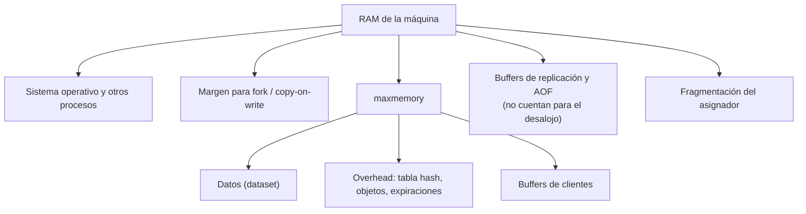

# Redis como almacenamiento en memoria

> [!abstract] En 30 segundos
> - **Qué es:** Redis guarda **todo el dataset en RAM**; el disco solo sirve para persistir copias (RDB o AOF) en segundo plano.
> - **Para qué:** leer y escribir sin tocar el disco en el camino de la petición: microsegundos en lugar de milisegundos.
> - **Recuerda:** la memoria es el recurso escaso. Configura `maxmemory`, vigila la fragmentación, evita el swap y deja margen para el `fork`.

> [!info] Lección 0.2 · Nivel 0 — Fundamentos y conceptos esenciales
> ⬅️ [[Qué es Redis]] · ➡️ [[Redis vs SQL Server, PostgreSQL y MongoDB]] · 🗺️ [[01 - Redis - Roadmap#Nivel 0 — Fundamentos y conceptos esenciales|Roadmap]] · 📊 [[03 - Redis - Progreso|Progreso]]
> 🏷️ Core. Excepción: las ofertas comerciales con datos en NVMe (Redis Software/Cloud con tiering, Flash Optimized en Azure Managed Redis) son **Ent**.

## 📌 Definición

Una base de datos **en memoria** mantiene la copia principal de los datos en RAM. En Redis, cada lectura y cada escritura se resuelven sobre estructuras en memoria; el disco solo interviene para guardar copias (snapshots RDB o el log AOF), casi siempre en segundo plano.

Compáralo con una base de datos en disco como SQL Server o PostgreSQL: su fuente de verdad es el disco y la memoria (el *buffer pool*) es una optimización. Si una página no está en memoria, hay que leerla del disco, y cada `COMMIT` espera a que el log de transacciones llegue al disco.

**Qué NO significa «en memoria»:**
- No significa «sin disco»: con persistencia, los datos sobreviven a un reinicio (se recargan desde RDB o AOF al arrancar).
- No significa «capacidad ilimitada»: en Redis Open Source, todo lo que guardas tiene que caber en la RAM de la máquina.
- No significa «gratis»: la RAM cuesta un orden de magnitud más por GB que un SSD.

## 🎯 ¿Qué problema resuelve?

El camino de una lectura en una base de datos relacional incluye parseo, plan de ejecución, locks, búsqueda en el buffer pool y, en un fallo de caché, una lectura de disco. El de una escritura incluye además el log de transacciones con `fsync`. En discos cloud, ese `fsync` puede costar varios milisegundos.

En Redis el camino es: buscar la clave en una tabla hash en RAM y operar sobre la estructura. Por eso un `GET` se ejecuta en menos de un microsegundo dentro del servidor y la latencia que ves la marca la red.

**Ejemplo:** 2 GB de datos «calientes» (sesiones, carritos, contadores) que reciben 100 000 operaciones por segundo. En una base de datos en disco, esa carga compite con las consultas de negocio por CPU, locks y E/S. En Redis cabe holgada en una instancia de 4-8 GB de RAM y deja a la base de datos para lo que necesita durabilidad y consultas complejas.

## 🧠 Conceptos fundamentales

1. **El dataset completo vive en RAM**, más un *overhead* por clave: la entrada en la tabla hash, el objeto que describe el valor, la propia clave… Con valores pequeños, el overhead puede pesar más que el dato.
2. **La memoria es el recurso que se agota primero.** En Redis rara vez se acaba la CPU antes que la RAM; por eso el modelado de datos, los TTL y la política de desalojo son decisiones de capacidad.
3. **`maxmemory` y la política de desalojo.** Por defecto `maxmemory` es `0` (sin límite en sistemas de 64 bits): Redis crece hasta que el sistema operativo lo mata o empieza a hacer swap. Con un límite, al llegar a él Redis desaloja claves o rechaza escrituras con un error `OOM`, según la política ([[Eviction policies]]).
4. **Fragmentación.** El asignador de memoria (jemalloc en Linux) reserva bloques de tamaños fijos; con el tiempo, la memoria que el proceso ocupa en el sistema (RSS) puede ser bastante mayor que la que Redis cree usar.
5. **El `fork` necesita margen.** Para el snapshot RDB, la reescritura del AOF o la sincronización completa de una réplica, Redis crea un proceso hijo. Con *copy-on-write*, cada página que el primario modifica mientras el hijo trabaja se duplica: con mucha escritura, el consumo puede crecer de forma notable.
6. **El swap es un desastre.** Si el sistema operativo saca páginas de Redis a disco, un acceso a esas claves pasa de microsegundos a milisegundos, y bloquea el único hilo de ejecución.

### Analogía

Trabajar con los expedientes **abiertos sobre la mesa** frente a guardarlos en el **archivo del sótano**: sobre la mesa todo está a mano (RAM), pero la mesa es pequeña y cara; el sótano es enorme y barato, pero cada consulta exige bajar. Hacer fotocopias de la mesa al final del día es la persistencia.
**Dónde se rompe:** en la mesa no hay «fragmentación», y en Redis sí: los huecos entre expedientes también ocupan sitio.

## ⚙️ Funcionamiento interno



Métricas clave de `INFO memory`:

| Campo | Qué mide |
|---|---|
| `used_memory` | Memoria que Redis ha pedido al asignador |
| `used_memory_rss` | Memoria que el sistema operativo ve asignada al proceso |
| `used_memory_dataset` / `used_memory_overhead` | Reparto entre datos y estructuras internas |
| `used_memory_peak` | Máximo histórico |
| `mem_fragmentation_ratio` | `used_memory_rss / used_memory`. Por encima de ~1,5 hay fragmentación preocupante; **por debajo de 1 suele indicar swap** |
| `maxmemory`, `maxmemory_policy` | Límite y política de desalojo |

Para decidir si desaloja, Redis compara `used_memory` con `maxmemory`, descontando los buffers de réplicas y del AOF. Por eso esos buffers pueden llevar el proceso por encima de `maxmemory`.

## 💻 Ejemplos prácticos

### Sintaxis

| Comando | Qué hace | Complejidad |
|---|---|---|
| `INFO memory` | Métricas de memoria | O(1) |
| `MEMORY USAGE clave [SAMPLES n]` | Bytes que ocupa una clave, overhead incluido | O(N) muestras |
| `MEMORY STATS` | Desglose detallado del uso de memoria | O(1) |
| `MEMORY DOCTOR` | Diagnóstico en texto de problemas de memoria | O(1) |
| `CONFIG SET maxmemory 100mb` | Cambia el límite en caliente | O(1) |

### Laboratorio: cuánto ocupa de verdad un dato

```bash
# 1) Un millón de claves con valores de 100 bytes
docker exec -it redis-lab redis-benchmark -t set -n 1000000 -r 1000000 -d 100 -q

# 2) Mide
docker exec -it redis-lab redis-cli INFO memory
docker exec -it redis-lab redis-cli DBSIZE
```

Calcula `used_memory_dataset / DBSIZE`: verás que cada clave ocupa bastante más de 100 bytes. Repite con `FLUSHALL` y `-d 10`: el overhead relativo se dispara. Es la razón de que muchas claves diminutas sean caras y de que agrupar en hashes ahorre memoria ([[Codificaciones internas de los tipos de datos]]).

Ahora limita la memoria y provoca el error:

```text
127.0.0.1:6379> CONFIG SET maxmemory 50mb
OK
127.0.0.1:6379> CONFIG SET maxmemory-policy noeviction
OK
127.0.0.1:6379> SET otra-clave valor
(error) OOM command not allowed when used memory > 'maxmemory'.
127.0.0.1:6379> GET key:000000000001
"xxx…"
```

Con `noeviction`, las lecturas siguen funcionando y las escrituras que pueden aumentar la memoria se rechazan.

## 🔧 Implementación en .NET

Vigilar la memoria desde la aplicación o desde un health check:

```csharp
using StackExchange.Redis;

using var mux = await ConnectionMultiplexer.ConnectAsync("localhost:6379");
IServer server = mux.GetServer(mux.GetEndPoints()[0]);

// INFO memory llega agrupado por secciones: lo aplanamos a un diccionario
Dictionary<string, string> info = (await server.InfoAsync("memory"))
    .SelectMany(section => section)
    .ToDictionary(kv => kv.Key, kv => kv.Value);

long used = long.Parse(info["used_memory"]);
long rss = long.Parse(info["used_memory_rss"]);
long max = long.Parse(info["maxmemory"]);

double fragmentation = (double)rss / used;
Console.WriteLine($"Usada: {used / 1024 / 1024} MB · RSS: {rss / 1024 / 1024} MB · Fragmentación: {fragmentation:F2}");

if (max == 0)
    Console.WriteLine("⚠️ maxmemory no está configurado: Redis puede crecer hasta que el SO lo mate.");
else if (used > max * 0.9)
    Console.WriteLine("⚠️ Por encima del 90 % de maxmemory: revisa desalojos y TTL.");

// Memoria de una clave concreta (no hay método dedicado: comando genérico)
RedisResult bytes = await mux.GetDatabase().ExecuteAsync("MEMORY", "USAGE", "key:000000000001");
Console.WriteLine($"key:000000000001 ocupa {(long)bytes} bytes");
```

En producción no harás esto a mano: lo exportarás como métricas ([[Observabilidad de Redis]]).

## 🏗️ Casos de uso en arquitectura

### Cuándo encaja bien
- Datos calientes y acotados: sesiones, carritos, contadores, rankings, rate limits, cachés.
- Datos efímeros que caducan solos (OTP, tokens, reservas temporales).
- Estructuras que se recalculan desde una fuente de verdad.

### Cuándo NO
- Datasets que crecen sin límite (logs históricos, eventos de años): el coste en RAM se dispara.
- Datos fríos que casi nunca se leen: pagar RAM por ellos no tiene sentido.
- Cuando necesitas más capacidad que RAM y no quieres una oferta comercial con tiering.

### Consideraciones de arquitectura

| Dimensión | Qué pensar |
|---|---|
| Capacidad | Dataset estimado × overhead × fragmentación + buffers + margen de fork + crecimiento |
| Coste | La RAM es la partida principal; TTL y modelado compacto son ahorro directo |
| Resiliencia | Sin persistencia, un reinicio vacía Redis: planifica el «arranque en frío» de cachés |
| Rendimiento | Evita el swap a toda costa; desactiva transparent huge pages; `vm.overcommit_memory = 1` en Linux |

## ⚠️ Errores y anti-patterns

| Error | Por qué duele | Cómo evitarlo |
|---|---|---|
| No configurar `maxmemory` | El proceso crece hasta que el SO lo mata (y pierdes todo lo no persistido) | Fíjalo siempre, con margen |
| `maxmemory` igual a la RAM de la máquina | No queda sitio para el fork, el SO ni la fragmentación | Deja margen; los servicios gestionados reservan una parte (Azure Managed Redis, en torno al 20 %) |
| Swap activado | Latencias de milisegundos que bloquean el único hilo | Sin swap o con `vm.swappiness` bajo, y alerta si `mem_fragmentation_ratio < 1` |
| Millones de claves diminutas | El overhead supera al dato | Agrupar en hashes con codificación compacta |
| Pensar que «tiene persistencia» = «cabe más» | La persistencia es una copia; el dataset sigue en RAM | Dimensiona por RAM |

## ✅ Buenas prácticas

1. Configura `maxmemory` y una política coherente con el rol de la instancia.
2. Dimensiona con datos reales: carga una muestra y mide con `INFO memory` y `MEMORY USAGE`.
3. Deja margen para el fork si usas persistencia o réplicas.
4. Pon TTL a todo lo que pueda caducar.
5. Vigila `used_memory`, `mem_fragmentation_ratio`, `evicted_keys` y `latest_fork_usec`.
6. En Linux: `vm.overcommit_memory = 1`, transparent huge pages desactivadas y sin swap.

## 🎤 Preguntas de entrevista

> [!question]- 1. ¿Qué pasa cuando Redis se queda sin memoria?
> Depende de la configuración. Con `maxmemory 0` (por defecto) no hay límite: crece hasta que el sistema operativo lo mata o empieza a hacer swap. Con `maxmemory` y `noeviction`, las escrituras que añaden memoria fallan con `OOM command not allowed` y las lecturas siguen. Con una política `allkeys-*` o `volatile-*`, Redis desaloja claves según esa política para hacer sitio.

> [!question]- 2. ¿Por qué `used_memory_rss` puede ser mucho mayor que `used_memory`?
> Por fragmentación del asignador (bloques de tamaño fijo, huecos tras borrar datos), memoria liberada que el asignador no devuelve al sistema y procesos hijos de persistencia. Una ratio RSS/used mayor que ~1,5 merece atención (defragmentación activa); una ratio menor que 1 suele indicar que parte de la memoria está en swap.

> [!question]- 3. ¿Cómo dimensionarías una instancia de Redis?
> Estimo el dataset midiendo una muestra real (`MEMORY USAGE`, `INFO memory`), aplico el overhead observado, sumo buffers de clientes y replicación, un margen para fragmentación y otro para el fork si hay persistencia o réplicas, y una previsión de crecimiento. `maxmemory` queda por debajo de la RAM total con ese margen.

> [!question]- 4. ¿Por qué Redis puede necesitar mucha más memoria justo al guardar un snapshot?
> Porque el snapshot lo escribe un proceso hijo creado con `fork`, que comparte páginas con el padre mediante copy-on-write. Cada página que el padre modifica durante el guardado se duplica. Con muchas escrituras, en el peor caso el consumo puede acercarse al doble.

## 🧪 Ejercicios

### 🟢 Básicos
1. Ejecuta el laboratorio con `-d 100` y con `-d 10` y calcula los bytes por clave en cada caso.
2. Explica con tus palabras qué significa `mem_fragmentation_ratio = 0,8`.

### 🟡 Intermedios
3. Configura `maxmemory 50mb` con `allkeys-lru` y repite la carga del laboratorio. ¿Qué pasa con `DBSIZE` y con `evicted_keys` en `INFO stats`?
4. Escribe un health check de ASP.NET Core que marque Redis como `Degraded` si supera el 90 % de `maxmemory`.

### 🔴 Reto Senior
5. Te piden una instancia para 40 millones de sesiones de 1 KB con TTL de 30 minutos, persistencia AOF y una réplica. Estima la RAM necesaria y justifica cada margen.

> [!success]- Pistas y soluciones
> **2.** Redis cree usar más memoria de la que el sistema le tiene asignada en RAM: parte está en swap. Es una alerta de latencia.
> **3.** `DBSIZE` deja de crecer en un punto y `evicted_keys` aumenta: Redis desaloja claves para mantenerse bajo el límite.
> **5.** Datos ≈ 40 M × (1 KB + overhead por clave, que mides en el laboratorio) ≈ 45-50 GB. Suma buffers, fragmentación (por ejemplo +10-20 %) y margen de fork por la reescritura del AOF. La réplica necesita lo mismo en otra máquina. Una instancia de este tamaño, además, invita a fragmentar con [[Redis Cluster]] para acortar los forks y los failovers.

### ✔️ Checklist de dominio
- [ ] Explico qué significa «en memoria» y qué no significa.
- [ ] Interpreto `used_memory`, `used_memory_rss` y `mem_fragmentation_ratio`.
- [ ] Sé qué pasa al llegar a `maxmemory` con cada tipo de política.
- [ ] Sé por qué el fork y el swap son riesgos de memoria y de latencia.

## 📝 Resumen

- Redis guarda todo el dataset en RAM; el disco es solo para copias.
- Cada clave tiene un overhead fijo: con valores pequeños, domina.
- `maxmemory` es obligatorio en producción; la política decide qué pasa al llegar al límite.
- RSS > used = fragmentación; RSS < used = swap.
- El fork de la persistencia puede disparar la memoria: deja margen.
- Dimensiona midiendo datos reales, no a ojo.

## 🔗 Referencias

- [INFO](https://redis.io/docs/latest/commands/info/)
- [MEMORY USAGE](https://redis.io/docs/latest/commands/memory-usage/)
- [Memory optimization](https://redis.io/docs/latest/operate/oss_and_stack/management/optimization/memory-optimization/)
- [Diagnosing latency issues](https://redis.io/docs/latest/operate/oss_and_stack/management/optimization/latency/): fork, swap y transparent huge pages

## 🔄 Notas relacionadas

- ⬅️ [[Qué es Redis]] · ➡️ [[Redis vs SQL Server, PostgreSQL y MongoDB]]
- Profundiza: [[Gestión de memoria en Redis]] · [[Eviction policies]] · [[Optimización de memoria en Redis]] · [[Persistencia RDB]]
- Curso: [[00 - Redis - Índice]] · [[03 - Redis - Progreso]]
