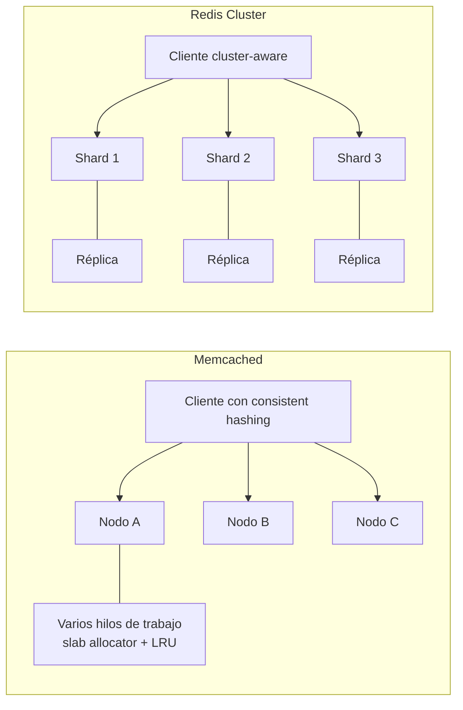

# Redis vs Memcached

> [!abstract] En 30 segundos
> - **Qué es:** Memcached es una caché distribuida en memoria, multihilo y de clave-valor simple; Redis es un servidor de estructuras de datos con persistencia, replicación y mucho más.
> - **Para qué:** elegir con criterio la caché de una plataforma y responder una pregunta clásica de entrevista.
> - **Recuerda:** Memcached solo hace caché, y la hace bien. Redis hace caché y casi todo lo que la rodea (contadores, locks, colas, rankings).

> [!info] Lección 0.4 · Nivel 0 — Fundamentos y conceptos esenciales
> ⬅️ [[Redis vs SQL Server, PostgreSQL y MongoDB]] · ➡️ [[Arquitectura interna de Redis]] · 🗺️ [[01 - Redis - Roadmap#Nivel 0 — Fundamentos y conceptos esenciales|Roadmap]] · 📊 [[03 - Redis - Progreso|Progreso]]
> 🏷️ Comparativa conceptual; Redis ≥6.0 tiene I/O threads, reimplementados en 8.0.

## 📌 Definición

**Memcached** (2003) es un servidor de caché en memoria: guarda pares clave → bytes con un TTL, los expulsa por LRU cuando falta memoria y nada más. No tiene tipos de datos, persistencia ni replicación; el reparto entre nodos lo hace el **cliente** (normalmente con [[Consistent hashing]]).

**Redis** ofrece estructuras de datos con operaciones atómicas, persistencia opcional, replicación, Sentinel, Cluster, Pub/Sub, Streams y scripting.

## 🎯 ¿Qué problema resuelve?

Elegir mal la caché de una plataforma sale caro: migrar de una a otra afecta a todos los servicios. La comparación también aparece en entrevistas como prueba de que entiendes los trade-offs, no solo de que conoces Redis.

## 🧠 Conceptos fundamentales

| Criterio | Memcached | Redis |
|---|---|---|
| Modelo de datos | Clave → bytes | Strings, hashes, lists, sets, sorted sets, streams, bitmaps, HyperLogLog, geo (+ JSON, búsqueda, vectores en R8) |
| Tamaño máximo de valor | 1 MB por defecto (configurable) | 512 MB por string |
| Hilos | **Multihilo** para atender peticiones | Un hilo ejecuta los comandos; I/O threads opcionales para la red (≥6.0) |
| Persistencia | No | RDB y AOF |
| Replicación y HA | No nativas | Réplicas, Sentinel, Cluster |
| Reparto entre nodos | En el cliente | Redis Cluster en el servidor (o en el cliente) |
| Atomicidad | Operaciones simples, `incr`/`decr`, CAS con token | Cualquier comando; transacciones, Lua, Functions |
| Desalojo | LRU por clases de tamaño (*slab allocator*) | Políticas configurables: LRU, LFU, aleatoria, TTL… |
| Funciones extra | Ninguna | Pub/Sub, Streams, scripting, keyspace notifications, client-side caching |

### Matices
- El **multihilo** de Memcached le permite usar todos los núcleos de una máquina con una sola instancia. Con Redis lo habitual es una instancia por núcleo o un Cluster, aunque los I/O threads acortan la distancia en cargas de caché simples.
- El *slab allocator* de Memcached evita fragmentación, pero puede desperdiciar memoria si cambia la distribución de tamaños de los valores (el problema de la «calcificación» de slabs, que versiones modernas mitigan reasignando memoria entre clases).
- Las versiones modernas de Memcached incluyen *extstore* para mover valores a almacenamiento flash, y un protocolo «meta» con más control sobre la caché.

### Analogía
Memcached es una **taquilla de consigna**: dejas una bolsa con un número y la recoges luego; rápido, simple y sin preguntas. Redis es un **almacén con empleados**: además de guardar, ordena, cuenta, clasifica y avisa.
**Dónde se rompe:** la consigna de Memcached tiene muchos empleados atendiendo a la vez (multihilo); el almacén de Redis tiene uno solo para ejecutar operaciones, pero muy rápido.

## ⚙️ Funcionamiento interno



- En Memcached, si cae un nodo, su parte de la caché desaparece y el cliente reparte esas claves entre los demás (más *misses* hasta recalentar).
- En Redis Cluster, si cae un primario, su réplica lo sustituye y los datos siguen ahí (salvo lo que no llegó a replicarse).

## 💻 Ejemplos prácticos

La misma operación en los dos protocolos de texto:

```text
# Memcached (protocolo de texto clásico)
set saludo 0 300 4
hola
STORED
get saludo
VALUE saludo 0 4
hola
END

# Redis
SET saludo hola EX 300
OK
GET saludo
"hola"
```

Lo que Memcached **no** puede hacer en una sola operación y Redis sí:

```text
HINCRBY carrito:42 producto:7 1          # incrementar un campo dentro de un objeto
ZADD ranking 150 ana                     # mantener un ranking ordenado
LPUSH notificaciones:42 "pedido enviado" # cola o histórico
SET lock:pedido:9 token NX PX 30000      # lock con caducidad
```

En Memcached, cada uno de estos casos exige leer el valor, modificarlo en la aplicación y escribirlo con CAS, con reintentos si otro cliente se adelantó.

## 🔧 Implementación en .NET

Con Redis tienes un cliente principal ([[StackExchange.Redis]]) y abstracciones de ASP.NET Core (`IDistributedCache`, `HybridCache`). Para Memcached hay clientes de la comunidad, como EnyimMemcachedCore, pero ninguna integración oficial de Microsoft para `IDistributedCache`. En la práctica, en el ecosistema .NET la elección por defecto es Redis.

```csharp
using Microsoft.Extensions.Caching.Distributed;

// Con IDistributedCache el código de la aplicación no depende del motor:
public sealed class PriceCache(IDistributedCache cache)
{
    public Task SetAsync(string sku, decimal price, CancellationToken ct) =>
        cache.SetStringAsync($"price:{sku}", price.ToString(System.Globalization.CultureInfo.InvariantCulture),
            new DistributedCacheEntryOptions { AbsoluteExpirationRelativeToNow = TimeSpan.FromMinutes(5) }, ct);
}
// Program.cs: builder.Services.AddStackExchangeRedisCache(o => o.Configuration = "localhost:6379");
```

## 🏗️ Casos de uso en arquitectura

### Cuándo Memcached todavía tiene sentido
- Caché pura de objetos serializados, sin necesidad de estructuras, persistencia ni HA, y con una instancia por máquina que aproveche todos los núcleos.
- Plataformas que ya lo operan a gran escala con su ecosistema (proxies como mcrouter, extstore).

### Cuándo elegir Redis
- Casi siempre en .NET y en microservicios: además de caché necesitarás contadores, locks, rate limiting, sesiones o colas, y una sola pieza bien operada es mejor que dos.
- Cuando la caché no puede perderse al caer un nodo (réplicas) o debe sobrevivir a reinicios.

### Consideraciones de arquitectura

| Dimensión | Memcached | Redis |
|---|---|---|
| Rendimiento por nodo | Escala con los núcleos | Un núcleo para comandos; escala con shards o I/O threads |
| Resiliencia | Sin réplicas: caída = pérdida de esa porción | Réplicas y failover |
| Operación | Muy simple | Más opciones, más que configurar |
| Funcionalidad | Solo caché | Caché y coordinación |

## ⚠️ Errores y anti-patterns

| Error | Por qué duele | Cómo evitarlo |
|---|---|---|
| Elegir Memcached «porque es más rápido» sin medir | Para la mayoría de cargas la diferencia es irrelevante y pierdes funcionalidad | Benchmark con tu carga real |
| Implementar contadores o locks sobre Memcached con CAS y reintentos | Código complejo y contención | Redis con comandos atómicos |
| Tener Memcached para caché y Redis para todo lo demás sin necesidad | Dos piezas que operar y asegurar | Consolidar en Redis salvo razón medida |

## ✅ Buenas prácticas

1. Decide por **funcionalidad y operación**, no por benchmarks sintéticos.
2. Si eliges Redis solo como caché, configúralo como caché: política `allkeys-*`, sin persistencia o con RDB, y TTL siempre.
3. Mantén el acceso detrás de una abstracción (`IDistributedCache`, `HybridCache` o una interfaz propia) para poder cambiar de motor.

## 🎤 Preguntas de entrevista

> [!question]- 1. ¿Redis o Memcached? ¿Por qué?
> Redis en la mayoría de casos: estructuras de datos con operaciones atómicas, persistencia, replicación y Cluster, más Pub/Sub, Streams y scripting. Memcached tiene sentido como caché pura multihilo y muy simple de operar, cuando no necesitas nada más y quieres aprovechar todos los núcleos con una instancia.

> [!question]- 2. Memcached es multihilo y Redis no. ¿No es entonces Memcached más rápido?
> Por núcleo no, y la latencia de ambos la domina la red. Memcached puede dar más throughput por máquina con una sola instancia. Redis lo compensa con varias instancias o shards por máquina y con I/O threads, que paralelizan la red manteniendo la ejecución en un hilo (y con ella la atomicidad).

> [!question]- 3. ¿Qué pasa si cae un nodo en cada caso?
> En Memcached, su porción de la caché se pierde y el cliente redistribuye esas claves: más misses y carga en la BD hasta recalentar. En Redis con réplicas, el failover promueve una réplica y los datos siguen disponibles, salvo las últimas escrituras no replicadas.

## 🧪 Ejercicios

### 🟢 Básicos
1. Lista tres operaciones que Redis hace de forma atómica y que en Memcached exigirían leer, modificar y escribir con CAS.
2. Explica qué es el reparto en cliente con consistent hashing.

### 🟡 Intermedios
3. Levanta `memcached` y `redis` en Docker y compara latencia y throughput con una carga de `GET`/`SET` de 1 KB. Documenta la metodología.

### 🔴 Reto Senior
4. Tu empresa tiene 40 nodos de Memcached y quiere añadir rate limiting y locks distribuidos. ¿Añades Redis, migras la caché o ambas cosas? Plantea un plan de migración sin downtime.

> [!success]- Soluciones
> **1.** `HINCRBY` en un hash, `ZINCRBY` en un ranking, `SET … NX PX` para un lock (también `LPUSH` + `LTRIM` para un histórico acotado).
> **4.** Una opción razonable: introducir Redis para rate limiting y locks (nuevo valor), y migrar la caché por fases detrás de una abstracción, con doble escritura temporal o recalentamiento progresivo por servicio, midiendo hit ratio y latencia antes de apagar cada nodo de Memcached.

### ✔️ Checklist de dominio
- [ ] Comparo modelo de datos, hilos, persistencia, HA y reparto entre nodos.
- [ ] Sé cuándo Memcached sigue siendo razonable.
- [ ] Explico qué pasa al caer un nodo en cada sistema.

## 📝 Resumen

- Memcached: caché clave → bytes, multihilo, sin persistencia ni replicación, reparto en el cliente.
- Redis: estructuras de datos atómicas, persistencia, réplicas, Cluster y funciones de coordinación.
- La diferencia de rendimiento rara vez decide; deciden la funcionalidad y la operación.
- En .NET y microservicios, Redis es la elección por defecto.

## 🔗 Referencias

- [Memcached](https://memcached.org/)
- [Redis data types](https://redis.io/docs/latest/develop/data-types/)
- [Diagnosing latency issues](https://redis.io/docs/latest/operate/oss_and_stack/management/optimization/latency/)

## 🔄 Notas relacionadas

- ⬅️ [[Redis vs SQL Server, PostgreSQL y MongoDB]] · ➡️ [[Arquitectura interna de Redis]]
- Más adelante: [[Consistent hashing]] · [[Redis Cluster]] · [[Fundamentos de caching]] · [[IDistributedCache]]
