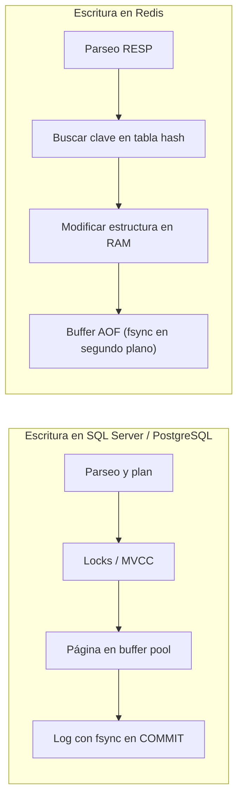

# Redis vs SQL Server, PostgreSQL y MongoDB

> [!abstract] En 30 segundos
> - **Qué es:** una comparación entre un almacén de estructuras en memoria (Redis) y bases de datos de propósito general: relacionales (SQL Server, PostgreSQL) y documental (MongoDB).
> - **Para qué:** decidir qué guardar en cada sitio y combinarlos (*persistencia políglota*) en lugar de elegir uno para todo.
> - **Recuerda:** Redis rara vez sustituye a tu base de datos principal; la acompaña en los caminos calientes.

> [!info] Lección 0.3 · Nivel 0 — Fundamentos y conceptos esenciales
> ⬅️ [[Redis como almacenamiento en memoria]] · ➡️ [[Redis vs Memcached]] · 🗺️ [[01 - Redis - Roadmap#Nivel 0 — Fundamentos y conceptos esenciales|Roadmap]] · 📊 [[03 - Redis - Progreso|Progreso]]
> 🏷️ Comparativa conceptual; no depende de versión.

## 📌 Definición

| | Modelo | Fuente de verdad | Pensado para |
|---|---|---|---|
| **SQL Server** | Relacional (tablas, T-SQL) | Disco + log de transacciones | OLTP empresarial, integridad, consultas complejas |
| **PostgreSQL** | Relacional + JSONB y extensiones | Disco + WAL | OLTP, consultas complejas, extensibilidad (PostGIS, pgvector…) |
| **MongoDB** | Documental (BSON) | Disco (motor WiredTiger) + journal | Esquemas flexibles, documentos anidados, escalado por sharding |
| **Redis** | Clave → estructura de datos | **RAM** (disco opcional) | Latencia mínima, estado compartido, contadores, rankings, colas, caché |

La diferencia de fondo no es «SQL frente a NoSQL»: es **dónde vive la copia principal** y **qué garantías ofrece cada motor**. Las tres primeras son bases de datos de propósito general y durables por diseño; Redis es un motor especializado en velocidad cuya durabilidad configuras tú.

## 🎯 ¿Qué problema resuelve?

Evitar dos errores opuestos que se ven en proyectos reales:

1. **Usar Redis como base de datos principal** de datos críticos sin entender su durabilidad ni su modelo de consulta: un día necesitas «todos los pedidos de marzo con importe > 100» y no hay forma razonable de hacerlo.
2. **Usar solo la base relacional para todo**, incluidos contadores de alta frecuencia, rankings en tiempo real o sesiones: se llena de contención de locks y de escrituras pequeñas que no necesitan sus garantías.

## 🧠 Conceptos fundamentales

| Criterio | SQL Server / PostgreSQL | MongoDB | Redis |
|---|---|---|---|
| Consultas | SQL completo: joins, agregaciones, ventanas | MQL y pipeline de agregación | Por clave y por estructura; búsqueda e índices secundarios con el Query Engine (🏷️ R8) |
| Índices | B-tree, hash, GiST, columnstore… | Secundarios, compuestos, TTL, texto, geo | Implícito en cada estructura (hash por clave, skiplist en sorted sets); índices manuales o Query Engine |
| Transacciones | ACID completas con rollback | ACID multi-documento (desde 4.0) | `MULTI`/`EXEC` atómico **sin rollback**; scripts Lua y Functions atómicos |
| Durabilidad por defecto | Sí: log con `fsync` en cada commit | Sí: journal | **No**: depende de RDB/AOF y réplicas |
| Concurrencia | MVCC y locks | Locks a nivel de documento | Un hilo ejecuta los comandos: sin locks, cada comando es atómico |
| Escalado | Vertical y réplicas de lectura; fragmentación con herramientas o productos aparte | Réplica sets y sharding nativo | Vertical, réplicas y Redis Cluster |
| Latencia típica | Milisegundos | Milisegundos | Submilisegundo |
| Capacidad | Disco (TB) | Disco (TB) | RAM (GB), salvo ofertas comerciales con tiering |
| Expiración automática | No nativa (jobs) | Índices TTL (borrado periódico, no instantáneo) | TTL nativo por clave |

### Matices que demuestran criterio

- **PostgreSQL tiene `UNLOGGED TABLE`** (sin WAL: más rápidas, se vacían tras una caída) y `LISTEN/NOTIFY` (notificaciones). No convierten a PostgreSQL en Redis, pero cubren casos sencillos sin añadir otra pieza.
- **SQL Server tiene In-Memory OLTP** (tablas optimizadas para memoria), útil para cargas OLTP intensas dentro del mismo motor.
- **MongoDB tiene índices TTL**, pero el borrado lo hace un proceso periódico, no en el instante exacto; Redis expira cada clave de forma individual.
- **Redis 8 incluye un Query Engine** con índices secundarios y búsqueda sobre hashes y JSON, pero sigue sin joins ni un planificador relacional.

### Analogía

La base relacional es el **archivo central de la empresa**: todo registrado, con reglas estrictas y auditoría. MongoDB es un archivo de **carpetas flexibles**, cada una con su propio formato. Redis es la **pizarra de la sala de operaciones**: lo que todo el mundo necesita ver ahora, actualizado al segundo.
**Dónde se rompe:** la pizarra de Redis puede guardarse en disco y sobrevivir a la noche, si la configuras para ello.

## ⚙️ Funcionamiento interno



La diferencia de latencia no es magia: Redis se salta el planificador, los locks y la espera al disco. A cambio, renuncia a consultas arbitrarias y a la durabilidad garantizada en cada escritura.

## 💻 Ejemplos prácticos

**El mismo requisito en dos motores:** «top 10 productos más vendidos hoy, actualizado en tiempo real».

En SQL (una consulta que recorre las ventas del día en cada petición):

```sql
SELECT TOP (10) ProductId, SUM(Quantity) AS Units
FROM Sales
WHERE SoldAt >= CAST(GETDATE() AS date)
GROUP BY ProductId
ORDER BY Units DESC;
```

En Redis (el ranking se mantiene al escribir, y leerlo es O(log N + 10)):

```text
ZINCRBY ventas:2026-11-03 2 producto:42
ZINCRBY ventas:2026-11-03 1 producto:7
ZRANGE ventas:2026-11-03 0 9 REV WITHSCORES
EXPIRE ventas:2026-11-03 172800 NX
```

La venta se registra **en ambos**: en SQL como fuente de verdad (con todas sus columnas) y en Redis como vista materializada para el ranking. Es el patrón más habitual de combinación.

## 🔧 Implementación en .NET

Persistencia políglota en un caso de uso: la venta se guarda en SQL con EF Core y el ranking se actualiza en Redis.

```csharp
using StackExchange.Redis;

public sealed class RegisterSale(ShopDbContext db, IConnectionMultiplexer redis)
{
    public async Task ExecuteAsync(int productId, int quantity, CancellationToken ct)
    {
        // 1) Fuente de verdad: la venta completa, con transacción ACID
        db.Sales.Add(new Sale { ProductId = productId, Quantity = quantity, SoldAt = DateTime.UtcNow });
        await db.SaveChangesAsync(ct);

        // 2) Vista en tiempo real: ranking del día en Redis
        string key = $"ventas:{DateTime.UtcNow:yyyy-MM-dd}";
        IDatabase cache = redis.GetDatabase();
        await cache.SortedSetIncrementAsync(key, $"producto:{productId}", quantity);
        await cache.KeyExpireAsync(key, TimeSpan.FromDays(2), ExpireWhen.HasNoExpiry);
    }
}
```

> [!warning] Escribir en dos sitios no es atómico
> Si el proceso cae entre los pasos 1 y 2, el ranking queda desactualizado. Para un ranking suele ser aceptable (se puede reconstruir desde SQL). Si no lo es, necesitas [[Transactional Outbox]] o un flujo de eventos ([[Event-driven architecture con Redis]]).

## 🏗️ Casos de uso en arquitectura

| Necesidad | Mejor opción | Por qué |
|---|---|---|
| Pedidos, facturas, inventario contable | SQL Server / PostgreSQL | ACID, integridad referencial, auditoría, consultas |
| Catálogo con atributos muy variables | MongoDB o PostgreSQL con JSONB | Esquema flexible |
| Sesiones, carritos, tokens con caducidad | Redis | TTL nativo, compartido entre instancias, latencia |
| Contadores y rankings en tiempo real | Redis | Operaciones atómicas O(1)/O(log N) |
| Caché de lecturas caras | Redis delante de cualquiera de los otros | Descarga la BD |
| Reporting y analítica | Base relacional o analítica | Joins y agregaciones |

### Cuándo NO usar Redis en lugar de la base de datos
- Datos que son la verdad del negocio y no puedes perder ni una escritura confirmada.
- Consultas ad hoc o cambiantes que no conoces de antemano.
- Datos que crecen sin límite.

### Consideraciones de arquitectura

| Dimensión | Qué pensar |
|---|---|
| Consistencia | Dos almacenes = consistencia eventual entre ellos; decide quién manda y cómo se reconstruye el otro |
| Operación | Cada motor más es otra pieza que monitorizar, asegurar, actualizar y respaldar |
| Coste | RAM frente a disco; licencias (SQL Server) frente a open source |
| Equipo | Lo que el equipo sabe operar bien también es un criterio |

## ⚠️ Errores y anti-patterns

| Error | Por qué duele | Cómo evitarlo |
|---|---|---|
| Migrar «todo a Redis porque es más rápido» | Pierdes consultas, integridad y durabilidad garantizada | Redis para caminos calientes; la BD como fuente de verdad |
| Rankings y contadores calculados con `GROUP BY` en cada petición | Carga creciente y contención en la BD | Mantener la vista en Redis al escribir |
| Modelar en Redis como si fueran tablas con joins | Muchas lecturas por petición y lógica de join en la app | Desnormalizar por patrón de acceso ([[Modelado de datos en Redis]]) |
| Escribir en BD y Redis sin plan para el fallo parcial | Datos divergentes sin forma de repararlos | Outbox, eventos o reconstrucción periódica |

## ✅ Buenas prácticas

1. Decide **quién es la fuente de verdad** de cada dato.
2. Usa Redis para lo que se lee mucho, cambia rápido o caduca solo.
3. Diseña la reconstrucción de lo que vive en Redis desde la fuente de verdad.
4. No añadas Redis si PostgreSQL o SQL Server ya cubren el caso sin esfuerzo: cada pieza más es coste operativo.
5. Documenta la decisión en un ADR con las alternativas descartadas.

## 🎤 Preguntas de entrevista

> [!question]- 1. ¿Por qué no usar solo PostgreSQL con buenos índices?
> Para muchas aplicaciones, basta. Redis aporta valor cuando hay lecturas muy repetidas que cargan la BD, estado que deben compartir muchas instancias con latencia mínima, contadores o rankings con escrituras muy frecuentes, o datos que caducan solos. Si nada de eso aparece, añadir Redis es complejidad sin retorno.

> [!question]- 2. ¿Puede Redis ser la fuente de verdad de un sistema?
> Puede, para datos efímeros o reconstruibles, o cuando se configura con AOF, réplicas y se aceptan sus garantías (la replicación es asíncrona y un failover puede perder escrituras confirmadas). Para datos financieros o críticos, prefiero una base de datos durable como fuente de verdad y Redis como acelerador.

> [!question]- 3. MongoDB tiene índices TTL. ¿Qué diferencia hay con el TTL de Redis?
> En MongoDB, un proceso en segundo plano borra periódicamente los documentos caducados, así que pueden sobrevivir un tiempo tras su caducidad. En Redis, una clave caducada nunca se devuelve: se elimina al accederla (expiración pasiva) y un proceso periódico limpia el resto (expiración activa).

> [!question]- 4. ¿Qué problema introduce escribir en SQL y en Redis en la misma operación?
> Que no es atómico: un fallo entre ambas escrituras deja los almacenes divergentes. Se mitiga con el patrón outbox, con eventos y consumidores idempotentes, o aceptando la divergencia y reconstruyendo desde la fuente de verdad.

## 🧪 Ejercicios

### 🟢 Básicos
1. Para cada dato, elige motor y justifica: factura, sesión web, contador de «me gusta», ficha de producto con 200 atributos opcionales, código OTP.
2. Explica por qué una escritura en SQL Server espera al disco y una en Redis normalmente no.

### 🟡 Intermedios
3. Implementa el ranking diario del ejemplo en Redis y compara su latencia con la consulta SQL sobre 1 millón de ventas.
4. Diseña cómo reconstruirías el ranking de Redis desde SQL si se pierde.

### 🔴 Reto Senior
5. Un equipo propone sustituir PostgreSQL por Redis «para ganar rendimiento» en un servicio de pedidos. Escribe la respuesta que darías en la revisión de arquitectura: riesgos, alternativas y cuándo sí lo aceptarías.

> [!success]- Soluciones
> **1.** Factura → SQL. Sesión → Redis. Contador de «me gusta» → Redis (con volcado periódico a SQL si es dato de negocio). Ficha de 200 atributos → MongoDB o JSONB en PostgreSQL. OTP → Redis con TTL.
> **4.** Una consulta `GROUP BY` sobre las ventas del día que reescribe el sorted set (por ejemplo, en una clave temporal que luego se renombra con `RENAME` para que el cambio sea atómico).
> **5.** Riesgos: durabilidad (replicación asíncrona, pérdida en failover), consultas (informes, búsquedas), integridad, coste de RAM, capacidad. Alternativas: caché delante, réplicas de lectura, índices, CQRS con modelos de lectura en Redis. Lo aceptaría para datos reconstruibles o efímeros, o si las métricas demuestran que la BD es el cuello de botella y el equipo acepta las garantías de Redis.

### ✔️ Checklist de dominio
- [ ] Comparo los cuatro motores en modelo, consultas, transacciones, durabilidad y escalado.
- [ ] Sé explicar cuándo combinarlos y quién es la fuente de verdad.
- [ ] Conozco las alternativas «dentro» de la BD (UNLOGGED, In-Memory OLTP, índices TTL).

## 📝 Resumen

- SQL Server, PostgreSQL y MongoDB son durables por diseño; Redis prioriza latencia y su durabilidad es configurable.
- Redis no tiene joins ni planificador; el Query Engine de Redis 8 añade búsqueda, no un motor relacional.
- El patrón habitual: BD como fuente de verdad y Redis como vista caliente, caché o estado compartido.
- Escribir en dos almacenes exige un plan para el fallo parcial.
- No añadas Redis si la BD ya resuelve el caso: cada pieza cuesta operarla.

## 🔗 Referencias

- [Redis data types](https://redis.io/docs/latest/develop/data-types/)
- [PostgreSQL: CREATE TABLE (UNLOGGED)](https://www.postgresql.org/docs/current/sql-createtable.html)
- [SQL Server In-Memory OLTP](https://learn.microsoft.com/sql/relational-databases/in-memory-oltp/overview-and-usage-scenarios)
- [MongoDB TTL indexes](https://www.mongodb.com/docs/manual/core/index-ttl/)

## 🔄 Notas relacionadas

- ⬅️ [[Redis como almacenamiento en memoria]] · ➡️ [[Redis vs Memcached]]
- En el vault: [[Bases de Datos SQL vs NoSQL]] · [[ACID en Bases de Datos]] · [[Teorema CAP y BASE]] · [[CQRS (Command Query Responsibility Segregation)]]
- Más adelante: [[Modelado de datos en Redis]] · [[CQRS con Redis]] · [[Redis como componente de sistemas distribuidos]]
