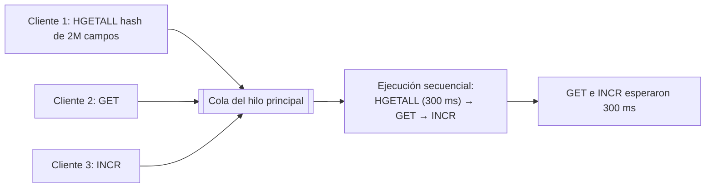

# Complejidad de los comandos Big O

> [!abstract] En 30 segundos
> - **Qué es:** la complejidad algorítmica de cada comando, que la documentación oficial publica en cada página (O(1), O(log N), O(N)…).
> - **Para qué:** predecir qué comandos pueden bloquear el único hilo de ejecución cuando los datos crezcan.
> - **Recuerda:** con un hilo, el coste de un comando lo pagan **todos** los clientes. Antes de usar un comando nuevo, mira su complejidad y qué es «N» en ese comando.

> [!info] Lección 1.10 · Nivel 1 — Redis básico y comandos fundamentales
> ⬅️ [[Redis Sorted Sets]] · ➡️ [[Proyecto 01 - Ranking de usuarios]] · 🗺️ [[01 - Redis - Roadmap#Nivel 1 — Redis básico y comandos fundamentales|Roadmap]] · 📊 [[03 - Redis - Progreso|Progreso]]
> 🏷️ Core · categorías ACL `@fast`/`@slow`/`@dangerous` ≥6.0 · `COMMAND DOCS` ≥7.0.

## 📌 Definición

La **notación Big O** describe cómo crece el coste de una operación con el tamaño de los datos. En Redis importa más que en otros sistemas porque un comando lento no solo es lento para quien lo lanza: bloquea al servidor entero ([[Modelo de ejecución single-threaded]]).

| Complejidad | Significado | Ejemplos |
|---|---|---|
| O(1) | Constante, no depende del tamaño | `GET`, `SET`, `HGET`, `SISMEMBER`, `LPUSH`, `INCR`, `SCARD` |
| O(log N) | Crece muy despacio | `ZADD`, `ZRANK`, `ZINCRBY`, `ZREM` |
| O(log N + M) | Logaritmo más los M elementos devueltos | `ZRANGE`, `ZRANGEBYSCORE` |
| O(N) | Proporcional al tamaño | `HGETALL`, `SMEMBERS`, `LRANGE 0 -1`, `KEYS`, `DEL` de una colección |
| O(N·M) | Producto de tamaños | `SINTER` (peor caso) |
| O(N log N) | Ordenar | `SORT` |

## 🎯 ¿Qué problema resuelve?

El código funciona en desarrollo con 100 elementos y se convierte en un incidente en producción con 10 millones. `HGETALL` de un hash de 50 campos es instantáneo; el mismo comando sobre un hash que ha crecido a 2 millones de campos bloquea Redis cientos de milisegundos en cada llamada. Leer la complejidad a tiempo evita diseñar sobre comandos que no escalan.

## 🧠 Conceptos fundamentales

1. **Qué es «N»:** depende del comando. En `HGETALL`, el número de campos; en `KEYS`, el número de claves de la base; en `ZRANGE`, N es el tamaño del zset y M los devueltos; en `DEL`, el número de elementos del valor que se borra.
2. **Comandos peligrosos en producción:**

| Comando | Riesgo | Alternativa |
|---|---|---|
| `KEYS patrón` | O(N) sobre todo el keyspace | `SCAN` |
| `SMEMBERS`, `HGETALL`, `HKEYS`, `HVALS` | O(N) sobre la colección | `SSCAN`, `HSCAN`, `HMGET` selectivo |
| `LRANGE k 0 -1`, `ZRANGE k 0 -1` | O(N) | Rangos acotados, paginación |
| `SORT` | O(N + M log M) | Datos ya ordenados (sorted set) |
| `SINTER`/`SUNION`/`SDIFF` de sets grandes | O(N·M) / O(N) | Sets pequeños, `SINTERCARD … LIMIT`, precálculo |
| `DEL` de colecciones enormes | O(N) al liberar | `UNLINK` |
| `FLUSHALL`/`FLUSHDB` | O(N) | `ASYNC` |
| `LREM`, `LINDEX`, `LINSERT`, `LSET` en listas largas | O(N) | Otra estructura |
| Scripts Lua con bucles largos | Todo el script es atómico y bloqueante | Scripts cortos |

3. **Categorías ACL:** Redis clasifica cada comando en `@fast` (O(1) u O(log N)) o `@slow`, y marca como `@dangerous` los que pueden afectar al servidor. `ACL CAT slow` y `ACL CAT dangerous` los listan; puedes prohibirlos a los usuarios de aplicación (`-@dangerous`).
4. **Acotar N es una decisión de diseño:** colecciones por periodo, `LTRIM`, `ZREMRANGEBYRANK`, troceado por buckets, TTL.
5. **El tamaño de la respuesta también cuenta:** aunque un comando sea O(log N + M), devolver M = 100 000 elementos satura la red y el buffer de salida.

### Analogía
Pedir en una biblioteca «el libro con signatura X» (O(1)) frente a «todos los libros publicados en 1998» (O(N)): la segunda petición tiene a la bibliotecaria ocupada mucho más tiempo, y en Redis hay **una sola** bibliotecaria.
**Dónde se rompe:** la bibliotecaria de Redis no puede atender a nadie más mientras busca; una humana te diría «vuelva en un rato» y atendería al siguiente.

## ⚙️ Funcionamiento interno



- `SLOWLOG` registra los comandos cuya **ejecución** supera `slowlog-log-slower-than` (10 000 µs por defecto): es la forma de descubrir comandos O(N) en producción.
- `INFO commandstats` muestra, por comando, llamadas y microsegundos totales y por llamada.

## 💻 Ejemplos prácticos

```text
127.0.0.1:6379> COMMAND DOCS HGETALL
1) "hgetall"
2)  1) "summary"
    2) "Returns all fields and values in a hash."
    3) "since"
    4) "2.0.0"
    5) "group"
    6) "hash"
    7) "complexity"
    8) "O(N) where N is the size of the hash."
…
127.0.0.1:6379> ACL CAT dangerous
 1) "flushdb"
 2) "keys"
 …
127.0.0.1:6379> CONFIG SET slowlog-log-slower-than 1000
OK
127.0.0.1:6379> SLOWLOG GET 5
127.0.0.1:6379> INFO commandstats
cmdstat_hgetall:calls=12,usec=45210,usec_per_call=3767.50,…
cmdstat_get:calls=91822,usec=74301,usec_per_call=0.81,…
```

`usec_per_call` de `hgetall` frente a `get`: el primero es miles de veces más caro por llamada.

**Paginar en lugar de traerlo todo:**

```text
ZRANGE ranking 0 49 REV WITHSCORES          # página 1
ZRANGE ranking 50 99 REV WITHSCORES         # página 2
HSCAN usuario:42:preferencias 0 COUNT 100
```

## 🔧 Implementación en .NET

```csharp
using StackExchange.Redis;

IDatabase db = mux.GetDatabase();

// ❌ O(N) sobre toda la colección en una sola llamada
RedisValue[] allFollowers = await db.SetMembersAsync("seguidores:user:42");

// ✅ Cuenta en O(1) si solo necesitas el número
long count = await db.SetLengthAsync("seguidores:user:42");

// ✅ Paginación de un ranking: 50 por página, O(log N + 50)
static Task<SortedSetEntry[]> PageAsync(IDatabase db, string key, int page, int pageSize = 50) =>
    db.SortedSetRangeByRankWithScoresAsync(key, page * pageSize, page * pageSize + pageSize - 1, Order.Descending);

// ✅ Recorrido por lotes de una colección grande
await foreach (RedisValue member in db.SetScanAsync("seguidores:user:42", pageSize: 1000))
{
    // procesar en streaming
}
```

> [!tip] Revisión de código
> Añade a tu checklist de PR: «¿algún comando nuevo de Redis es O(N)? ¿Qué es N y cuánto puede crecer?».

## 🏗️ Casos de uso en arquitectura

| Decisión | Aplicación de la complejidad |
|---|---|
| Elegir estructura | Ranking → zset (O(log N)) en lugar de lista ordenada a mano |
| Tamaño de colecciones | Límite superior explícito: por periodo, por bucket, por usuario |
| Comandos permitidos | ACL que prohíbe `@dangerous` a los usuarios de aplicación |
| Operaciones masivas | Jobs con `SCAN` por lotes, idealmente contra réplicas |

### Consideraciones de arquitectura
- **Rendimiento:** la latencia p99 de todos depende del comando más lento de cualquiera.
- **Escalabilidad:** un O(N) que hoy tarda 1 ms tardará 1 s con 1 000 veces más datos.
- **Resiliencia:** limita por ACL lo que cada servicio puede ejecutar.

## ⚠️ Errores y anti-patterns

| Error | Por qué duele | Cómo evitarlo |
|---|---|---|
| Probar solo con datos pequeños | Los O(N) no se notan hasta producción | Pruebas de carga con volúmenes realistas |
| No mirar la complejidad en la documentación | Sorpresas en producción | Checklist de PR |
| Colecciones sin límite de crecimiento | Un O(N) se vuelve inaceptable | Acotar por diseño |
| Permitir `KEYS`/`FLUSHALL` a las aplicaciones | Un error humano o un bug tumba el servicio | ACL `-@dangerous` |

## ✅ Buenas prácticas

1. Consulta la complejidad de cada comando nuevo (`COMMAND DOCS` o la web).
2. Diseña colecciones acotadas.
3. Pagina y usa la familia `SCAN`.
4. Configura `SLOWLOG` y revísalo periódicamente.
5. Restringe comandos peligrosos con ACL.

## 🎤 Preguntas de entrevista

> [!question]- 1. ¿Por qué la complejidad de los comandos importa más en Redis que en otras bases de datos?
> Porque Redis ejecuta los comandos en un único hilo: un comando O(N) sobre una colección grande bloquea a todos los clientes mientras dura, no solo al que lo lanzó.

> [!question]- 2. ¿Qué comandos prohibirías en producción y cómo?
> `KEYS`, `FLUSHALL`/`FLUSHDB`, `DEBUG`, `CONFIG`, `SHUTDOWN` y similares a los usuarios de aplicación, con ACL (`-@dangerous`, `-@admin`). Para los O(N) sobre colecciones (`HGETALL`, `SMEMBERS`), más que prohibirlos, diseño colecciones acotadas y uso la familia `SCAN`.

> [!question]- 3. ¿Cómo descubres comandos lentos en un sistema en producción?
> `SLOWLOG GET` (umbral `slowlog-log-slower-than`), `INFO commandstats` (`usec_per_call`), `LATENCY` y la telemetría del cliente. El slowlog muestra el comando con sus argumentos, el tiempo y el cliente.

## 🧪 Ejercicios

### 🟢 Básicos
1. Busca con `COMMAND DOCS` la complejidad de `LINDEX`, `ZADD`, `SINTER` y `SORT` y explica qué es N en cada uno.
2. Lista los comandos de `ACL CAT dangerous`.

### 🟡 Intermedios
3. Crea un hash de 1 millón de campos y compara en `INFO commandstats` el coste por llamada de `HGETALL`, `HGET` y un recorrido completo con `HSCAN`.
4. Configura `slowlog-log-slower-than 1000` y provoca entradas en el slowlog.

### 🔴 Reto Senior
5. Revisa este diseño: «guardamos todos los pedidos del día en una lista y cada minuto un job hace `LRANGE 0 -1` para calcular estadísticas». Propón uno que escale a 10 millones de pedidos al día.

> [!success]- Soluciones
> **3.** `HGETALL` aparece con un `usec_per_call` enorme frente a `HGET`; el `HSCAN` total cuesta parecido pero repartido en muchas llamadas cortas que no bloquean.
> **5.** Calcular las estadísticas de forma incremental al escribir cada pedido (`INCRBY` por métrica, `HINCRBY` por categoría, HyperLogLog para clientes únicos, zset para los productos más vendidos), cada estructura por día con TTL. Si de verdad hay que recorrer los pedidos, Streams y un consumer group que procese en streaming.

### ✔️ Checklist de dominio
- [ ] Leo la complejidad de un comando y sé qué es N.
- [ ] Conozco los comandos peligrosos y sus alternativas.
- [ ] Sé detectar comandos lentos en producción.
- [ ] Diseño colecciones acotadas.

## 📝 Resumen

- Con un hilo, el coste de un comando lo pagan todos.
- O(1) y O(log N) son seguros; O(N) solo con N acotado.
- `SCAN`, paginación, `UNLINK` y `ASYNC` son las alternativas seguras.
- `SLOWLOG` e `INFO commandstats` revelan los comandos caros.
- ACL para prohibir los peligrosos.

## 🔗 Referencias

- [Commands](https://redis.io/docs/latest/commands/) (cada página indica su complejidad)
- [SLOWLOG](https://redis.io/docs/latest/commands/slowlog/)
- [ACL CAT](https://redis.io/docs/latest/commands/acl-cat/)

## 🔄 Notas relacionadas

- ⬅️ [[Redis Sorted Sets]] · ➡️ [[Proyecto 01 - Ranking de usuarios]]
- Relacionadas: [[Modelo de ejecución single-threaded]] · [[Big keys]] · [[SLOWLOG]] · [[Redis ACL]]
