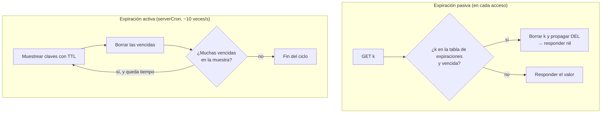

# Expiración y TTL

> [!abstract] En 30 segundos
> - **Qué es:** cualquier clave puede tener un tiempo de vida (TTL); al vencer, Redis la trata como inexistente y la borra.
> - **Para qué:** cachés que se renuevan solas, sesiones, tokens, ventanas de rate limiting, datos efímeros sin jobs de limpieza.
> - **Recuerda:** la expiración es **pasiva** (al acceder) y **activa** (muestreo periódico). `SET` sin opciones borra el TTL; `INCR`, `HSET` o `LPUSH` lo conservan.

> [!info] Lección 1.5 · Nivel 1 — Redis básico y comandos fundamentales
> ⬅️ [[Contadores atómicos con INCR y DECR]] · ➡️ [[Redis Hashes]] · 🗺️ [[01 - Redis - Roadmap#Nivel 1 — Redis básico y comandos fundamentales|Roadmap]] · 📊 [[03 - Redis - Progreso|Progreso]]
> 🏷️ Core · opciones `NX/XX/GT/LT` y `EXPIRETIME` ≥7.0 · TTL por campo de hash ≥7.4.

## 📌 Definición

El **TTL** (*time to live*) es el tiempo que le queda a una clave antes de expirar. Redis guarda internamente el **instante absoluto** de expiración (en milisegundos Unix); `TTL` y `PTTL` calculan cuánto falta.

| Comando | Qué hace |
|---|---|
| `EXPIRE k s [NX/XX/GT/LT]` / `PEXPIRE k ms …` | TTL relativo en segundos / milisegundos |
| `EXPIREAT k unix-s` / `PEXPIREAT k unix-ms` | Expira en un instante concreto |
| `TTL k` / `PTTL k` | Tiempo restante; `-1` = sin expiración; `-2` = no existe |
| `EXPIRETIME k` / `PEXPIRETIME k` (≥7.0) | Instante Unix de expiración |
| `PERSIST k` | Quita la expiración |
| `SET k v EX/PX/EXAT/PXAT/KEEPTTL` | Escribe y fija (o conserva) el TTL |
| `GETEX k EX…/PERSIST` | Lee y cambia el TTL |

Opciones condicionales (≥7.0): `NX` solo si no tiene TTL, `XX` solo si ya tiene, `GT` solo si el nuevo es mayor, `LT` solo si es menor.

## 🎯 ¿Qué problema resuelve?

En una base de datos relacional, los datos temporales necesitan un job que los borre (y que falla, se olvida o bloquea tablas). En Redis basta con decir «esto vive 15 minutos»: los tokens caducan, las sesiones inactivas desaparecen y la caché se renueva sola. Además, el TTL acota la memoria: lo que nadie usa, se va.

## 🧠 Conceptos fundamentales

### Qué conserva y qué borra el TTL

| Operación | Efecto en el TTL |
|---|---|
| `SET` sin opciones de expiración | **Lo borra** |
| `SET … KEEPTTL` | Lo conserva |
| `INCR`, `APPEND`, `HSET`, `LPUSH`, `ZADD`, `SADD`… | Lo conservan (modifican el valor, no lo sustituyen) |
| `RENAME a b` | `b` hereda el TTL de `a` |
| `DEL` + volver a crear | La nueva clave no tiene TTL |
| `PERSIST` | Lo borra |
| `EXPIRE` con un valor ≤ 0 | Borra la clave |

### Cómo expira Redis las claves
1. **Pasiva:** al acceder a una clave, Redis comprueba si ha vencido; si es así, la borra y responde como si no existiera. Una clave caducada nunca se devuelve.
2. **Activa:** unas 10 veces por segundo (`hz`), un ciclo muestrea claves con TTL y borra las vencidas; si encuentra muchas, repite. Así se limpian las claves que nadie vuelve a leer. `active-expire-effort` (1-10) ajusta cuánto esfuerzo dedica.

### Réplicas y persistencia
- Las réplicas **no expiran claves por su cuenta**: esperan el `DEL` del primario. Aun así, nunca devuelven en lecturas una clave que ya ha vencido.
- En el AOF y en la replicación, una expiración se propaga como `DEL` (o `UNLINK`), y los TTL relativos se guardan como instantes absolutos.
- Como el TTL es un instante absoluto, **depende del reloj** del servidor: saltos de reloj grandes afectan a las expiraciones.

### Expiración masiva
Si millones de claves vencen en el mismo segundo (por ejemplo, todas cargadas a la vez con el mismo TTL), el ciclo activo puede consumir mucho tiempo y aumentar la latencia, y en una caché provoca una avalancha de *misses* ([[Cache avalanche]]). Solución: **jitter**, un componente aleatorio en el TTL.

### Analogía
Las claves con TTL son **yogures con fecha de caducidad**: cuando alguien abre la nevera y ve uno caducado, lo tira (pasiva); además, cada cierto tiempo alguien revisa unos cuantos al azar y tira los vencidos (activa). Nunca te sirven un yogur caducado.
**Dónde se rompe:** en Redis, «cambiar el yogur por otro» con `SET` quita la fecha, salvo que uses `KEEPTTL`.

## ⚙️ Funcionamiento interno



- Las claves con TTL están en una tabla aparte (`expires`), clave → instante.
- `INFO keyspace` muestra por base cuántas claves hay, cuántas tienen expiración y el TTL medio: `db0:keys=1000,expires=950,avg_ttl=…`.
- `INFO stats` → `expired_keys` cuenta las expiradas.

## 💻 Ejemplos prácticos

```text
127.0.0.1:6379> SET otp:42 839201 EX 300
OK
127.0.0.1:6379> TTL otp:42
(integer) 298
127.0.0.1:6379> PTTL otp:42
(integer) 297412
127.0.0.1:6379> EXPIRETIME otp:42
(integer) 1793664300
127.0.0.1:6379> SET otp:42 111111
OK
127.0.0.1:6379> TTL otp:42
(integer) -1                       # ¡el SET sin EX borró el TTL!
127.0.0.1:6379> EXPIRE otp:42 300
(integer) 1
127.0.0.1:6379> SET otp:42 222222 KEEPTTL
OK
127.0.0.1:6379> TTL otp:42
(integer) 291                      # KEEPTTL lo conservó
127.0.0.1:6379> EXPIRE otp:42 10 GT
(integer) 0                        # 10 no es mayor que el TTL actual: no cambia
127.0.0.1:6379> PERSIST otp:42
(integer) 1
127.0.0.1:6379> TTL no-existe
(integer) -2
```

**TTL con jitter** (en la aplicación):

```text
TTL base = 600 s  →  TTL real = 600 + aleatorio(0..120) s
```

## 🔧 Implementación en .NET

```csharp
using StackExchange.Redis;

IDatabase db = mux.GetDatabase();

// TTL al escribir
await db.StringSetAsync("otp:42", "839201", TimeSpan.FromMinutes(5));

// TTL condicional (≥7.0): solo si la clave aún no tiene expiración
await db.KeyExpireAsync("visitas:2026-11-03", TimeSpan.FromDays(2), ExpireWhen.HasNoExpiry);

// Alargar solo si el nuevo TTL es mayor
await db.KeyExpireAsync("session:9f1c", TimeSpan.FromMinutes(30), ExpireWhen.GreaterThanCurrentExpiry);

// Consultar y quitar
TimeSpan? remaining = await db.KeyTimeToLiveAsync("otp:42");   // null si no tiene TTL o no existe
await db.KeyPersistAsync("otp:42");

// TTL con jitter para evitar expiraciones masivas simultáneas
static TimeSpan WithJitter(TimeSpan baseTtl, double maxFraction = 0.2) =>
    baseTtl + TimeSpan.FromMilliseconds(Random.Shared.NextDouble() * baseTtl.TotalMilliseconds * maxFraction);

await db.StringSetAsync("shop:product:42", "{…}", WithJitter(TimeSpan.FromMinutes(10)));
```

## 🏗️ Casos de uso en arquitectura

| Caso | TTL típico | Detalle |
|---|---|---|
| Caché de lecturas | Minutos a horas, con jitter | Según volatilidad del dato y tolerancia a datos obsoletos |
| Sesión web | 20-30 min deslizante | `GETEX … EX` o `EXPIRE` en cada acceso |
| OTP / tokens | 5-15 min fijo | `SET … EX NX` + `GETDEL` |
| Ventana de rate limiting | Duración de la ventana | `EXPIRE … NX` o `INCREX … ENX` |
| Lock distribuido | Algo más que la operación protegida | Con token y renovación ([[Distributed locks con Redis]]) |
| Idempotencia | Horas o días | Lo que dure la ventana de reintentos del cliente |

### Cuándo NO confiar en el TTL
- Como temporizador preciso de negocio («ejecuta X cuando caduque»): las notificaciones de expiración llegan cuando la clave se borra de verdad, que puede ser más tarde ([[Keyspace notifications]]).
- Para datos que deben borrarse por motivos legales en un instante exacto: el borrado es eventual (aunque nunca se devuelvan tras vencer).

### Consideraciones de arquitectura
- **Memoria:** el TTL es tu primera herramienta de capacidad.
- **Rendimiento:** evita que millones de claves venzan a la vez.
- **Consistencia:** el TTL acota cuánto tiempo puede servirse un dato obsoleto.

## ⚠️ Errores y anti-patterns

| Error | Por qué duele | Cómo evitarlo |
|---|---|---|
| Actualizar con `SET` y perder el TTL | Claves que no caducan nunca | `KEEPTTL` o volver a poner `EX` |
| Mismo TTL para millones de claves cargadas a la vez | Avalancha de misses y picos de latencia | Jitter |
| Claves de caché sin TTL | Memoria llena y datos obsoletos | TTL obligatorio |
| Usar la expiración como cron de negocio | Retrasos e incertidumbre | Sorted set con timestamps + worker ([[Colas con Redis]]) |
| TTL «para siempre» en datos efímeros por miedo a perderlos | Crecimiento sin límite | Decidir la vida útil real |

## ✅ Buenas prácticas

1. Toda clave de caché o efímera lleva TTL.
2. Jitter en TTL de cargas masivas.
3. `KEEPTTL` al actualizar valores que deben conservar su caducidad.
4. Opciones `NX`/`GT`/`LT` para evitar carreras al fijar TTL.
5. Vigila `expired_keys` y `INFO keyspace` (claves con y sin expiración).

## 🎤 Preguntas de entrevista

> [!question]- 1. ¿Cómo expira Redis las claves?
> De dos formas: pasiva, comprobando la expiración al acceder a una clave (nunca devuelve una clave vencida), y activa, con un ciclo periódico que muestrea claves con TTL, borra las vencidas y repite si encuentra muchas, para liberar las que nadie vuelve a leer.

> [!question]- 2. ¿Qué operaciones borran el TTL de una clave?
> `SET` sin opciones de expiración (o sin `KEEPTTL`), `GETSET`, `PERSIST` y borrar y volver a crear la clave. Las operaciones que modifican el valor sin sustituirlo (`INCR`, `HSET`, `LPUSH`…) lo conservan, y `RENAME` lo transfiere.

> [!question]- 3. ¿Por qué añadir jitter al TTL?
> Para que las claves cargadas a la vez no caduquen a la vez: evita picos de trabajo de expiración y, sobre todo, avalanchas de misses que golpean la base de datos.

> [!question]- 4. ¿Expiran las claves en las réplicas?
> La réplica no las borra por su cuenta: espera el `DEL` que propaga el primario. Pero no devuelve en lecturas claves ya vencidas.

## 🧪 Ejercicios

### 🟢 Básicos
1. Reproduce la sesión de ejemplo y explica cada respuesta de `TTL`.
2. Comprueba que `INCR` y `HSET` conservan el TTL.

### 🟡 Intermedios
3. Carga 1 millón de claves con el mismo TTL de 60 s y observa `--latency` y `expired_keys` cuando vencen. Repite con jitter.
4. Implementa en .NET una sesión con expiración deslizante de 30 minutos.

### 🔴 Reto Senior
5. Un cliente quiere enviar un recordatorio exactamente 24 h después de que un carrito quede abandonado. Explica por qué no usarías la expiración de la clave del carrito como disparador y diseña la alternativa.

> [!success]- Soluciones
> **3.** Sin jitter verás un pico de trabajo y de latencia al vencer todas; con jitter, la expiración se reparte.
> **5.** La notificación de expiración se emite cuando la clave se borra de verdad, lo que puede ocurrir más tarde (expiración activa por muestreo), y Pub/Sub no garantiza la entrega. Mejor: un sorted set `recordatorios` con score = instante de envío, y un worker que consulte `ZRANGE recordatorios -inf <ahora> BYSCORE` y procese de forma idempotente.

### ✔️ Checklist de dominio
- [ ] Domino `EXPIRE`, `TTL`, `PERSIST`, `KEEPTTL` y las opciones `NX/XX/GT/LT`.
- [ ] Explico la expiración pasiva y activa.
- [ ] Sé qué operaciones conservan o borran el TTL.
- [ ] Aplico jitter y sé por qué.

## 📝 Resumen

- TTL = instante absoluto de expiración; `TTL` -1 sin expiración, -2 no existe.
- Expiración pasiva (al acceder) + activa (muestreo periódico).
- `SET` sin opciones borra el TTL; `KEEPTTL` lo conserva.
- Jitter para evitar expiraciones masivas.
- No uses la expiración como temporizador preciso de negocio.

## 🔗 Referencias

- [EXPIRE](https://redis.io/docs/latest/commands/expire/)
- [TTL](https://redis.io/docs/latest/commands/ttl/)
- [Diagnosing latency issues: latency generated by expires](https://redis.io/docs/latest/operate/oss_and_stack/management/optimization/latency/)

## 🔄 Notas relacionadas

- ⬅️ [[Contadores atómicos con INCR y DECR]] · ➡️ [[Redis Hashes]]
- Más adelante: [[Estrategias de TTL en caché]] · [[Cache avalanche]] · [[Keyspace notifications]] · [[Eviction policies]]
