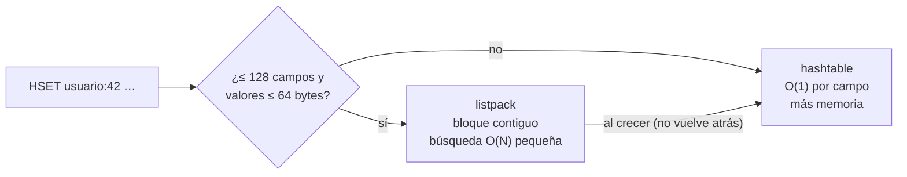

# Redis Hashes

> [!abstract] En 30 segundos
> - **Qué es:** un mapa campo → valor guardado bajo una clave, como un diccionario o un objeto plano.
> - **Para qué:** representar entidades (usuario, carrito, configuración) y leer o modificar campos sueltos de forma atómica.
> - **Recuerda:** los hashes pequeños usan una codificación compacta muy eficiente. `HGETALL` es O(N): no lo uses con hashes enormes. Desde 7.4, cada campo puede tener su propio TTL.

> [!info] Lección 1.6 · Nivel 1 — Redis básico y comandos fundamentales
> ⬅️ [[Expiración y TTL]] · ➡️ [[Redis Lists]] · 🗺️ [[01 - Redis - Roadmap#Nivel 1 — Redis básico y comandos fundamentales|Roadmap]] · 📊 [[03 - Redis - Progreso|Progreso]]
> 🏷️ Core · TTL por campo (`HEXPIRE`…) ≥7.4 · `HGETEX`/`HSETEX`/`HGETDEL` ≥8.0 · hashes compactos y `HIMPORT` ≥8.10.

## 📌 Definición

Un **hash** asocia a una clave un conjunto de pares **campo → valor**, donde campos y valores son strings. No admite anidamiento (un valor no puede ser otro hash). Es el tipo natural para objetos planos:

```text
usuario:42  →  { nombre: "Ana", email: "ana@ejemplo.com", plan: "pro", logins: "17" }
```

## 🎯 ¿Qué problema resuelve?

Con un string JSON, cambiar un campo exige leer el objeto entero, modificarlo en la aplicación y reescribirlo (y competir con otros escritores). Con un hash:
- `HSET usuario:42 plan premium` cambia un campo sin tocar el resto.
- `HINCRBY carrito:42 producto:7 1` incrementa atómicamente.
- `HMGET usuario:42 nombre plan` lee solo lo necesario.
Además, los hashes pequeños ocupan muy poca memoria.

## 🧠 Conceptos fundamentales

| Comando | Qué hace | Complejidad |
|---|---|---|
| `HSET k c1 v1 [c2 v2 …]` | Asigna campos; devuelve cuántos son nuevos | O(1) por campo |
| `HGET k c` / `HMGET k c1 c2 …` | Lee uno o varios campos | O(1) / O(N) |
| `HGETALL k` | Todos los campos y valores | O(N) |
| `HKEYS k` / `HVALS k` / `HLEN k` | Campos / valores / número de campos | O(N) / O(N) / O(1) |
| `HDEL k c …` / `HEXISTS k c` | Borra / comprueba un campo | O(1) por campo |
| `HINCRBY k c n` / `HINCRBYFLOAT` | Incremento atómico de un campo | O(1) |
| `HSETNX k c v` | Asigna solo si el campo no existe | O(1) |
| `HSTRLEN k c` | Longitud de un valor | O(1) |
| `HRANDFIELD k [n [WITHVALUES]]` (≥6.2) | Campos aleatorios | O(N) |
| `HSCAN k cursor [MATCH] [COUNT]` | Recorre por lotes | O(1) por llamada |

**TTL por campo** (🏷️ ≥7.4): `HEXPIRE k s [NX/XX/GT/LT] FIELDS n c1 …`, `HPEXPIRE`, `HEXPIREAT`, `HTTL`, `HPTTL`, `HEXPIRETIME`, `HPERSIST`.
**Combinados** (🏷️ ≥8.0): `HGETEX` (leer y cambiar el TTL de campos), `HSETEX` (escribir campos con TTL), `HGETDEL` (leer y borrar campos).

`HMSET` está obsoleto: `HSET` acepta varios campos desde 4.0.

### Codificación y memoria
- Hasta `hash-max-listpack-entries` campos (128 por defecto) y valores de hasta `hash-max-listpack-value` bytes (64), el hash se guarda como **listpack**: un bloque contiguo, muy compacto.
- Al superar cualquiera de los dos umbrales pasa a **hashtable**, con más memoria por campo pero acceso O(1) a cualquier tamaño.
- Truco clásico de memoria: agrupar muchos objetos diminutos en hashes pequeños («buckets») en lugar de millones de claves sueltas.
- Redis 8.10 añade **hashes compactos**: las claves que comparten el mismo conjunto de campos guardan los nombres una sola vez (y `HIMPORT` para insertarlos en bloque).

### Analogía
Un hash es una **ficha de cliente** con apartados: puedes corregir el teléfono sin reescribir la ficha entera, o sumar una compra al contador de compras. Un string JSON sería una fotocopia de la ficha: para cambiar un dato hay que hacer otra fotocopia completa.
**Dónde se rompe:** la ficha no admite subfichas (no hay anidamiento); para eso, [[Redis JSON]].

## ⚙️ Funcionamiento interno



- La conversión es en un solo sentido: un hash que pasó a `hashtable` no vuelve a `listpack` aunque encoja.
- Con TTL por campo, Redis guarda metadatos de expiración por campo y los expira de forma activa y pasiva, igual que con las claves.

## 💻 Ejemplos prácticos

```text
127.0.0.1:6379> HSET usuario:42 nombre Ana email ana@ejemplo.com plan pro logins 17
(integer) 4
127.0.0.1:6379> HGET usuario:42 plan
"pro"
127.0.0.1:6379> HMGET usuario:42 nombre plan inexistente
1) "Ana"
2) "pro"
3) (nil)
127.0.0.1:6379> HINCRBY usuario:42 logins 1
(integer) 18
127.0.0.1:6379> HSET usuario:42 plan premium
(integer) 0                     # 0 campos nuevos: solo actualizó uno existente
127.0.0.1:6379> OBJECT ENCODING usuario:42
"listpack"
```

**Carrito de compra:**

```text
HINCRBY carrito:user:42 producto:7 1
HINCRBY carrito:user:42 producto:9 2
HINCRBY carrito:user:42 producto:7 -1
HGETALL carrito:user:42
EXPIRE carrito:user:42 604800        # 7 días
```

**TTL por campo** (🏷️ ≥7.4): códigos de verificación de un usuario, cada uno con su caducidad:

```text
127.0.0.1:6379> HSET verificaciones:user:42 email 482913 telefono 117004
(integer) 2
127.0.0.1:6379> HEXPIRE verificaciones:user:42 300 FIELDS 1 email
1) (integer) 1
127.0.0.1:6379> HTTL verificaciones:user:42 FIELDS 2 email telefono
1) (integer) 297
2) (integer) -1
```

## 🔧 Implementación en .NET

```csharp
using StackExchange.Redis;

IDatabase db = mux.GetDatabase();

// Objeto → HashEntry[]
var user = new User(42, "Ana", "ana@ejemplo.com", "pro");
await db.HashSetAsync($"usuario:{user.Id}", new HashEntry[]
{
    new("nombre", user.Name),
    new("email", user.Email),
    new("plan", user.Plan),
});

// Leer un campo y varios
RedisValue plan = await db.HashGetAsync("usuario:42", "plan");
RedisValue[] some = await db.HashGetAsync("usuario:42", new RedisValue[] { "nombre", "plan" });

// HGETALL → diccionario (solo para hashes acotados)
Dictionary<string, string> all = (await db.HashGetAllAsync("usuario:42"))
    .ToDictionary(e => e.Name.ToString(), e => e.Value.ToString());

// Incremento atómico de un campo (carrito)
long units = await db.HashIncrementAsync("carrito:user:42", "producto:7", 1);

// Hashes grandes: recorrer por lotes
await foreach (HashEntry entry in db.HashScanAsync("hash:grande", pageSize: 500))
{
    // …
}

record User(int Id, string Name, string Email, string Plan);
```

## 🏗️ Casos de uso en arquitectura

### Cuándo usarlo
- Entidades planas con actualizaciones parciales: perfiles, configuración, estado de un pedido.
- Carritos y contadores agrupados (`HINCRBY` por producto).
- Agrupar muchos valores pequeños para ahorrar memoria.
- Datos con caducidad por elemento dentro de un mismo objeto (TTL por campo, ≥7.4).

### Cuándo NO usarlo
- Objetos anidados o listas dentro de objetos: [[Redis JSON]].
- Necesidad de buscar por valores de campos («usuarios con plan pro»): índices manuales con sets o el [[Redis Query Engine]].
- Hashes de millones de campos que se leen enteros: trocéalos.

### Consideraciones de arquitectura

| Dimensión | Qué pensar |
|---|---|
| Memoria | Mantén los hashes dentro de los umbrales de listpack cuando sea posible |
| Rendimiento | `HMGET` de los campos necesarios en lugar de `HGETALL` |
| Concurrencia | Cada comando es atómico; cambiar varios campos con lógica condicional requiere `WATCH` o Lua |
| Cluster | Un hash vive entero en un shard: un hash enorme y muy usado es una big key o una hot key |

## ⚠️ Errores y anti-patterns

| Error | Por qué duele | Cómo evitarlo |
|---|---|---|
| `HGETALL` sobre hashes de cientos de miles de campos | Bloqueo y respuestas enormes | `HSCAN` o trocear |
| Un hash gigante para «todos los usuarios» | Big key, imposible de expirar por usuario (antes de 7.4) | Un hash por entidad |
| Guardar JSON dentro de un campo y modificarlo desde la app | Vuelves al problema del string JSON | Campos planos o Redis JSON |
| Suponer que los valores tienen tipo | Todo es string: `"17"` | Convertir en la aplicación |

## ✅ Buenas prácticas

1. Un hash por entidad, con TTL si es efímera.
2. `HMGET` selectivo; `HGETALL` solo en hashes pequeños.
3. `HINCRBY` para contadores dentro de un objeto.
4. Vigila la codificación (`OBJECT ENCODING`) de los hashes más numerosos.
5. TTL por campo solo si tu versión (≥7.4) y tu servicio gestionado lo soportan.

## 🎤 Preguntas de entrevista

> [!question]- 1. ¿Hash o string con JSON para guardar un usuario?
> Hash si actualizo campos sueltos, necesito incrementos atómicos por campo o leo solo algunos campos; además, si es pequeño ocupa muy poco (listpack). String JSON si siempre leo y escribo el objeto completo o tiene estructura anidada (o Redis JSON si además quiero consultas y actualizaciones parciales sobre el anidamiento).

> [!question]- 2. ¿Por qué los hashes pequeños ahorran memoria?
> Porque se codifican como listpack: un único bloque contiguo sin punteros ni estructuras por campo. Agrupar muchos valores pequeños en hashes en lugar de en claves sueltas reduce mucho el overhead por elemento.

> [!question]- 3. ¿Cómo implementarías un carrito de la compra en Redis?
> Un hash `carrito:user:{id}` con campo = producto y valor = cantidad; `HINCRBY` para añadir o quitar unidades, `HDEL` cuando la cantidad llega a 0 (o un script que lo haga atómicamente), `HGETALL` para mostrarlo (es pequeño) y un TTL de días que se renueva con la actividad.

## 🧪 Ejercicios

### 🟢 Básicos
1. Modela un perfil de usuario como hash y actualiza un campo sin tocar el resto.
2. Comprueba con `OBJECT ENCODING` el cambio a `hashtable` al superar 128 campos.

### 🟡 Intermedios
3. Compara la memoria de 100 000 usuarios guardados como strings JSON y como hashes (`MEMORY USAGE` de una muestra y `INFO memory`).
4. Implementa el carrito en .NET con `HINCRBY` y borra el campo cuando la cantidad llega a 0 sin condiciones de carrera.

### 🔴 Reto Senior
5. Tienes 50 millones de pares `dispositivo → última conexión` (valores de 10 bytes). Diseña un modelo que minimice la memoria usando hashes como buckets y explica el cálculo de la clave y del campo.

> [!success]- Soluciones
> **4.** Un script Lua: `local n = redis.call('HINCRBY', KEYS[1], ARGV[1], ARGV[2]) if n <= 0 then redis.call('HDEL', KEYS[1], ARGV[1]) end return n`.
> **5.** Bucket = `id / 100` (por ejemplo `disp:12345` para los IDs 1234500-1234599) y campo = `id % 100`: hashes de 100 campos que quedan dentro de los umbrales de listpack. El overhead por clave se reparte entre 100 elementos.

### ✔️ Checklist de dominio
- [ ] Uso `HSET`, `HMGET`, `HINCRBY`, `HSCAN` y sé cuándo evitar `HGETALL`.
- [ ] Explico listpack frente a hashtable.
- [ ] Sé cuándo usar hash, string JSON o Redis JSON.
- [ ] Conozco el TTL por campo y su versión mínima.

## 📝 Resumen

- Hash = mapa campo → valor bajo una clave, sin anidamiento.
- Actualizaciones parciales y `HINCRBY` atómico.
- Pequeños = listpack (muy compactos); grandes = hashtable.
- `HGETALL` es O(N): `HMGET` o `HSCAN` para hashes grandes.
- TTL por campo desde 7.4; `HGETEX`/`HSETEX`/`HGETDEL` desde 8.0.

## 🔗 Referencias

- [Redis hashes](https://redis.io/docs/latest/develop/data-types/hashes/)
- [HSET](https://redis.io/docs/latest/commands/hset/)
- [HEXPIRE](https://redis.io/docs/latest/commands/hexpire/)
- [Memory optimization](https://redis.io/docs/latest/operate/oss_and_stack/management/optimization/memory-optimization/)

## 🔄 Notas relacionadas

- ⬅️ [[Expiración y TTL]] · ➡️ [[Redis Lists]]
- Relacionadas: [[Redis Strings]] · [[Redis JSON]] · [[Codificaciones internas de los tipos de datos]] · [[Modelado de datos en Redis]]
