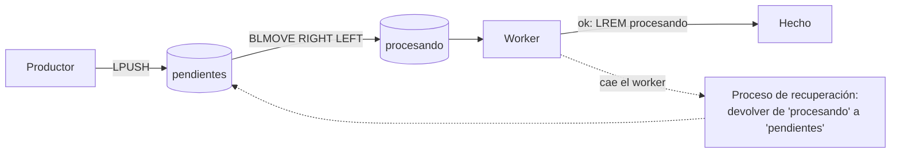

# Redis Lists

> [!abstract] En 30 segundos
> - **Qué es:** una secuencia de strings ordenada por inserción, con operaciones O(1) en ambos extremos.
> - **Para qué:** colas de trabajo, pilas, «últimos N elementos», buffers acotados.
> - **Recuerda:** empujar y sacar por los extremos es O(1); acceder por índice al medio es O(N). Para colas fiables, mueve el elemento a una lista de «en proceso» con `LMOVE`/`BLMOVE`.

> [!info] Lección 1.7 · Nivel 1 — Redis básico y comandos fundamentales
> ⬅️ [[Redis Hashes]] · ➡️ [[Redis Sets]] · 🗺️ [[01 - Redis - Roadmap#Nivel 1 — Redis básico y comandos fundamentales|Roadmap]] · 📊 [[03 - Redis - Progreso|Progreso]]
> 🏷️ Core · `LPOP`/`RPOP` con count y `LMOVE`/`BLMOVE` ≥6.2 · `LMPOP`/`BLMPOP` ≥7.0 · `LMOVEM`/`BLMOVEM` ≥8.10.

## 📌 Definición

Una **lista** de Redis es una secuencia de strings en el orden en que se insertaron. Se añade y se saca por la izquierda (`L…`, la cabeza) o por la derecha (`R…`, la cola). Puede contener duplicados y hasta más de 4 000 millones de elementos, aunque conviene acotarlas.

## 🎯 ¿Qué problema resuelve?

- Necesitas una **cola** entre productores y consumidores sin montar un broker.
- Necesitas los **últimos N** eventos de algo (notificaciones, productos vistos, logs recientes) sin que crezcan sin límite.
- Necesitas **bloquear** a un consumidor hasta que llegue trabajo, sin sondear.

## 🧠 Conceptos fundamentales

| Comando | Qué hace | Complejidad |
|---|---|---|
| `LPUSH`/`RPUSH k v …` | Añade por la cabeza / la cola | O(1) por elemento |
| `LPUSHX`/`RPUSHX` | Igual, solo si la lista existe | O(1) |
| `LPOP`/`RPOP k [n]` | Saca por la cabeza / la cola (n elementos ≥6.2) | O(n) |
| `LRANGE k ini fin` | Rango por índices (`0 -1` = toda) | O(S+N) |
| `LLEN k` | Longitud | O(1) |
| `LTRIM k ini fin` | Recorta la lista al rango | O(N) eliminados |
| `LINDEX k i` / `LSET k i v` | Leer / escribir por índice | O(N) |
| `LINSERT k BEFORE/AFTER pivote v` | Insertar junto a un elemento | O(N) |
| `LREM k n v` | Borrar apariciones de un valor | O(N+M) |
| `LPOS k v` | Posición de un valor | O(N) |
| `LMOVE origen destino LEFT/RIGHT LEFT/RIGHT` | Mover atómicamente entre listas | O(1) |
| `BLPOP`/`BRPOP k … timeout` | Sacar, **bloqueando** hasta que haya elementos | O(N) claves |
| `BLMOVE … timeout` | `LMOVE` bloqueante | O(1) |
| `LMPOP`/`BLMPOP` (≥7.0) | Sacar de la primera lista no vacía de varias | O(N+M) |
| `LMOVEM`/`BLMOVEM` (≥8.10) | Mover varios elementos entre listas | — |

`RPOPLPUSH` y `BRPOPLPUSH` están obsoletos: usa `LMOVE`/`BLMOVE`.

### Patrones clásicos

| Patrón | Comandos |
|---|---|
| Cola FIFO | `LPUSH` para producir, `RPOP`/`BRPOP` para consumir |
| Pila LIFO | `LPUSH` + `LPOP` |
| Últimos N | `LPUSH` + `LTRIM k 0 N-1` |
| Cola fiable | `BLMOVE pendientes procesando RIGHT LEFT` → procesar → `LREM procesando 1 elemento` |

### Analogía
Una lista es una **fila de personas con dos puertas**: puedes hacer entrar gente por delante o por detrás y sacarla por cualquiera de los extremos al instante. Encontrar a «la persona número 5000» exige contar desde un extremo.
**Dónde se rompe:** la cola fiable es como hacer pasar a cada persona a una sala de espera intermedia hasta que la atiendan, para no perderla si el empleado se va.

## ⚙️ Funcionamiento interno

- Listas pequeñas: codificación **listpack** (bloque contiguo).
- Listas grandes: **quicklist**, una lista doblemente enlazada de listpacks. `list-max-listpack-size` (por defecto `-2`, nodos de hasta 8 KB) controla el tamaño de cada nodo y `list-compress-depth` permite comprimir los nodos interiores.
- Por eso los extremos son O(1) y el medio es O(N).
- Los comandos bloqueantes no bloquean el servidor: el cliente queda en espera y Redis lo despierta cuando alguien hace `PUSH` en esa lista (o vence el timeout).



## 💻 Ejemplos prácticos

```text
127.0.0.1:6379> LPUSH notificaciones:user:42 "pedido 1001 enviado"
(integer) 1
127.0.0.1:6379> LPUSH notificaciones:user:42 "nuevo mensaje" "pago recibido"
(integer) 3
127.0.0.1:6379> LTRIM notificaciones:user:42 0 49
OK
127.0.0.1:6379> LRANGE notificaciones:user:42 0 9
1) "pago recibido"
2) "nuevo mensaje"
3) "pedido 1001 enviado"
```

**Cola con consumidor bloqueante** (dos terminales):

```text
# Terminal 1 (consumidor): espera hasta 30 s a que llegue trabajo
127.0.0.1:6379> BLMOVE jobs:pending jobs:processing RIGHT LEFT 30

# Terminal 2 (productor)
127.0.0.1:6379> LPUSH jobs:pending '{"id":1,"tipo":"email"}'
(integer) 1

# Terminal 1 recibe al instante:
"{\"id\":1,\"tipo\":\"email\"}"

# Al terminar el trabajo, el consumidor lo quita de "processing"
127.0.0.1:6379> LREM jobs:processing 1 '{"id":1,"tipo":"email"}'
(integer) 1
```

## 🔧 Implementación en .NET

```csharp
using StackExchange.Redis;

IDatabase db = mux.GetDatabase();

// Últimos 50 elementos
await db.ListLeftPushAsync("notificaciones:user:42", "pedido 1001 enviado");
await db.ListTrimAsync("notificaciones:user:42", 0, 49);
RedisValue[] latest = await db.ListRangeAsync("notificaciones:user:42", 0, 9);

// Cola fiable: mover de "pending" a "processing" (LMOVE, no bloqueante)
RedisValue job = await db.ListMoveAsync("jobs:pending", "jobs:processing", ListSide.Right, ListSide.Left);
if (job.HasValue)
{
    // … procesar …
    await db.ListRemoveAsync("jobs:processing", job, count: 1);
}
```

> [!warning] StackExchange.Redis no expone los comandos bloqueantes
> El cliente multiplexa muchas peticiones por una conexión; un `BLPOP` la bloquearía para todos. Por eso no ofrece `BLPOP`/`BLMOVE`. Las alternativas: sondear con `ListMoveAsync` y una espera corta cuando la cola está vacía, avisar a los workers con Pub/Sub cuando llega trabajo, o usar [[Redis Streams]] con consumer groups. Lo verás en [[Colas con Redis]].

## 🏗️ Casos de uso en arquitectura

### Cuándo usarlo
- Colas sencillas de trabajos con pocos consumidores.
- Históricos acotados: últimos productos vistos, últimos eventos.
- Buffers de escritura (*write-behind*) con un tamaño máximo.

### Cuándo NO usarlo
- Mensajería con varios grupos de consumidores, confirmaciones y reprocesado: [[Redis Streams]] y [[Consumer Groups en Redis Streams]].
- Necesitas acceso por posición o búsqueda frecuente en el medio: O(N).
- Necesitas orden por prioridad o por fecha de ejecución: [[Redis Sorted Sets]].
- Necesitas garantías de un broker (DLQ gestionada, reintentos, retención larga): RabbitMQ, Azure Service Bus, Kafka.

### Consideraciones de arquitectura

| Dimensión | Qué pensar |
|---|---|
| Fiabilidad | `RPOP` simple pierde el mensaje si el worker cae; usa el patrón de lista «processing» y un recuperador |
| Memoria | Acota con `LTRIM`; una cola que crece sin consumo llena la memoria |
| Durabilidad | Una cola en Redis necesita persistencia (AOF) y `noeviction` |
| Escalabilidad | Una lista vive en un solo shard: colas muy calientes se reparten en varias listas |

## ⚠️ Errores y anti-patterns

| Error | Por qué duele | Cómo evitarlo |
|---|---|---|
| `RPOP` sin lista de procesamiento | Mensajes perdidos si el worker cae | `LMOVE` a «processing» |
| Listas que crecen sin límite | Memoria agotada | `LTRIM`, alertas sobre `LLEN` |
| `LRANGE 0 -1` sobre listas grandes | O(N), bloqueo | Paginar o acotar |
| Cola en una instancia de caché con `allkeys-lru` | Redis puede desalojar la cola | Instancia separada con `noeviction` |
| `LINDEX`/`LSET` en el medio de listas grandes | O(N) | Otra estructura |

## ✅ Buenas prácticas

1. Listas acotadas (`LTRIM`) o consumidas a buen ritmo, con alerta de longitud.
2. Cola fiable con lista de procesamiento y recuperación de huérfanos.
3. Mensajes idempotentes: pueden procesarse dos veces tras una recuperación.
4. Para casos complejos, Streams o un broker.

## 🎤 Preguntas de entrevista

> [!question]- 1. ¿Cómo implementarías una cola fiable con listas?
> El productor hace `LPUSH` en `pending`; el worker hace `LMOVE pending processing RIGHT LEFT` (o `BLMOVE`), procesa y al terminar hace `LREM processing 1 elemento`. Un proceso de recuperación devuelve a `pending` los elementos que llevan demasiado tiempo en `processing` (worker caído). Los consumidores deben ser idempotentes.

> [!question]- 2. ¿Por qué `LINDEX` es O(N) y `LPUSH` O(1)?
> Porque la lista grande es una lista enlazada de bloques: los extremos están a mano, pero para llegar a una posición intermedia hay que recorrer nodos.

> [!question]- 3. ¿Listas o Streams para una cola?
> Listas para colas simples con un tipo de consumidor. Streams cuando hay varios grupos de consumidores, necesitas confirmaciones (ACK), ver mensajes pendientes, reclamar los de consumidores caídos o releer el histórico.

## 🧪 Ejercicios

### 🟢 Básicos
1. Implementa «últimos 10 productos vistos» con `LPUSH` + `LTRIM` sin duplicados consecutivos.
2. Prueba `BLMOVE` en dos terminales.

### 🟡 Intermedios
3. Implementa en .NET un worker que consuma con `ListMoveAsync`, procese y haga `ListRemoveAsync`, con espera progresiva cuando la cola esté vacía.
4. Escribe el proceso de recuperación que devuelve a `pending` los trabajos atascados en `processing`.

### 🔴 Reto Senior
5. Tu cola de listas procesa 5 000 trabajos/s y empiezan a aparecer duplicados tras reinicios de workers. Explica por qué es inevitable con este diseño y cómo lo harías robusto.

> [!success]- Soluciones
> **1.** Antes del `LPUSH`, `LREM lista 0 producto` (quita apariciones previas) o aceptar duplicados; luego `LTRIM 0 9`. Para que sea atómico, un script Lua.
> **4.** Para saber cuánto lleva cada trabajo en `processing`, guarda un sorted set paralelo con score = instante de inicio, o incluye el instante en el propio mensaje.
> **5.** Si un worker procesa el trabajo y cae antes del `LREM`, el recuperador lo devuelve a la cola: entrega *at-least-once*. La solución no es evitar los duplicados sino tolerarlos: consumidores idempotentes (clave de idempotencia por trabajo con `SET NX`) o migrar a Streams con consumer groups.

### ✔️ Checklist de dominio
- [ ] Conozco los comandos de extremos, rango, recorte y movimiento.
- [ ] Implemento una cola fiable con lista de procesamiento.
- [ ] Sé por qué StackExchange.Redis no ofrece comandos bloqueantes.
- [ ] Sé cuándo pasar a Streams o a un broker.

## 📝 Resumen

- Lista = secuencia por orden de inserción; extremos O(1), medio O(N).
- `LPUSH` + `LTRIM` para históricos acotados.
- Cola fiable: `LMOVE`/`BLMOVE` a una lista de procesamiento + recuperación.
- StackExchange.Redis no usa comandos bloqueantes: sondeo, Pub/Sub o Streams.
- Para mensajería seria: Streams o un broker.

## 🔗 Referencias

- [Redis lists](https://redis.io/docs/latest/develop/data-types/lists/)
- [LMOVE](https://redis.io/docs/latest/commands/lmove/)
- [BLMOVE](https://redis.io/docs/latest/commands/blmove/)

## 🔄 Notas relacionadas

- ⬅️ [[Redis Hashes]] · ➡️ [[Redis Sets]]
- Más adelante: [[Colas con Redis]] · [[Redis Streams]] · [[Background jobs con Redis]] · [[Write-behind]]
