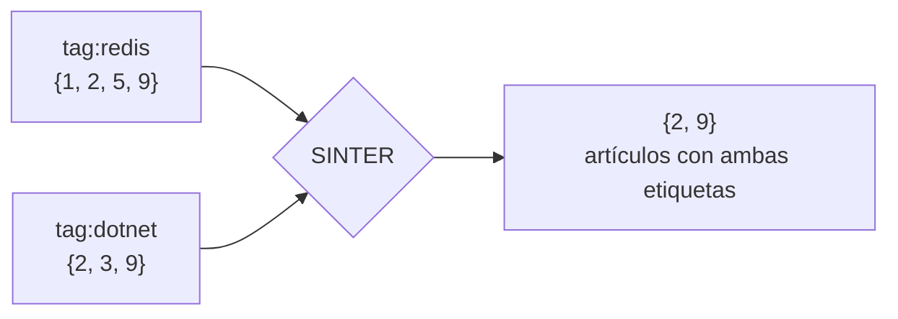

# Redis Sets

> [!abstract] En 30 segundos
> - **Qué es:** una colección de strings **únicos y sin orden**, con pertenencia en O(1) y operaciones de conjuntos (intersección, unión, diferencia).
> - **Para qué:** etiquetas, relaciones (seguidores), deduplicación, usuarios en línea, índices secundarios manuales, sorteos.
> - **Recuerda:** `SISMEMBER` es O(1), pero `SMEMBERS` y las intersecciones de sets grandes son O(N): itera con `SSCAN` y usa `SINTERCARD` cuando solo necesitas contar.

> [!info] Lección 1.8 · Nivel 1 — Redis básico y comandos fundamentales
> ⬅️ [[Redis Lists]] · ➡️ [[Redis Sorted Sets]] · 🗺️ [[01 - Redis - Roadmap#Nivel 1 — Redis básico y comandos fundamentales|Roadmap]] · 📊 [[03 - Redis - Progreso|Progreso]]
> 🏷️ Core · `SMISMEMBER` ≥6.2 · `SINTERCARD` ≥7.0 · codificación listpack para sets pequeños ≥7.2 · `SUNIONCARD`/`SDIFFCARD` ≥8.10.

## 📌 Definición

Un **set** guarda elementos únicos (strings) sin orden definido. Añadir un elemento que ya existe no hace nada. Su fuerza está en tres operaciones: comprobar si algo pertenece (O(1)), combinar conjuntos y sacar elementos aleatorios.

## 🎯 ¿Qué problema resuelve?

- «¿Este usuario ya votó?» sin consultar una tabla.
- «Artículos que tienen las etiquetas `redis` **y** `dotnet`».
- «Amigos en común entre Ana y Luis».
- «¿Cuántos usuarios distintos visitaron hoy?» (exacto, si caben en memoria).
- Tu propio ejemplo: en [[Comandos Redis - Opción 3 (Híbrida)]] cada división de la NFL es un set con los IDs de sus equipos: un **índice secundario manual**.

## 🧠 Conceptos fundamentales

| Comando | Qué hace | Complejidad |
|---|---|---|
| `SADD k m …` / `SREM k m …` | Añade / quita miembros (devuelve cuántos cambiaron) | O(1) por miembro |
| `SISMEMBER k m` / `SMISMEMBER k m1 m2 …` | ¿Pertenece? (uno / varios) | O(1) por miembro |
| `SCARD k` | Número de miembros | O(1) |
| `SMEMBERS k` | Todos los miembros | O(N) |
| `SSCAN k cursor [MATCH] [COUNT]` | Recorrer por lotes | O(1) por llamada |
| `SRANDMEMBER k [n]` | Miembros aleatorios sin sacarlos | O(n) |
| `SPOP k [n]` | Sacar miembros aleatorios | O(n) |
| `SMOVE origen destino m` | Mover atómicamente | O(1) |
| `SINTER`/`SUNION`/`SDIFF k1 k2 …` | Intersección / unión / diferencia | O(N·M) peor caso / O(N) / O(N) |
| `SINTERSTORE`/`SUNIONSTORE`/`SDIFFSTORE dest …` | Igual, guardando el resultado | Igual |
| `SINTERCARD n k1 … [LIMIT l]` (≥7.0) | Solo el tamaño de la intersección | O(N·M) peor caso |
| `SUNIONCARD`/`SDIFFCARD` (≥8.10) | Solo el tamaño de la unión / diferencia | O(N) |

### Codificaciones
- **intset**: todos los miembros son enteros y hay hasta `set-max-intset-entries` (512): array ordenado de enteros, muy compacto.
- **listpack** (≥7.2): sets pequeños no enteros (`set-max-listpack-entries` 128, `set-max-listpack-value` 64).
- **hashtable**: el resto.

### Analogía
Un set es la **lista de invitados de una fiesta en la puerta**: cada nombre aparece una sola vez, el portero comprueba al instante si estás (O(1)) y puede cruzar la lista con la de otra fiesta para ver quién va a las dos.
**Dónde se rompe:** la lista no tiene orden de llegada; si lo necesitas, [[Redis Sorted Sets]].

## ⚙️ Funcionamiento interno

- La pertenencia en `hashtable` es una búsqueda en tabla hash: O(1).
- `SINTER` ordena los sets por tamaño y recorre el **más pequeño**, comprobando cada elemento en los demás: por eso conviene que al menos uno sea pequeño.
- Las operaciones `*STORE` crean una clave nueva: cuidado con la memoria y con el tiempo de cálculo si los sets son grandes.



## 💻 Ejemplos prácticos

```text
127.0.0.1:6379> SADD tag:redis articulo:1 articulo:2 articulo:5 articulo:9
(integer) 4
127.0.0.1:6379> SADD tag:dotnet articulo:2 articulo:3 articulo:9
(integer) 3
127.0.0.1:6379> SINTER tag:redis tag:dotnet
1) "articulo:2"
2) "articulo:9"
127.0.0.1:6379> SINTERCARD 2 tag:redis tag:dotnet
(integer) 2
127.0.0.1:6379> SISMEMBER votos:encuesta:7 user:42
(integer) 0
127.0.0.1:6379> SADD votos:encuesta:7 user:42
(integer) 1
127.0.0.1:6379> SADD votos:encuesta:7 user:42
(integer) 0                          # ya había votado: SADD devuelve 0
127.0.0.1:6379> SPOP sorteo:premios 3
1) "user:17"
2) "user:903"
3) "user:5"
```

**Usuarios en línea con ventanas por minuto** (sets con TTL, unión para «últimos 5 minutos»):

```text
SADD online:202611031015 user:42
EXPIRE online:202611031015 600
SUNION online:202611031011 online:202611031012 online:202611031013 online:202611031014 online:202611031015
```

## 🔧 Implementación en .NET

```csharp
using StackExchange.Redis;

IDatabase db = mux.GetDatabase();

// Voto único: SADD devuelve true solo la primera vez
bool firstVote = await db.SetAddAsync("votos:encuesta:7", "user:42");
if (!firstVote)
    Console.WriteLine("Ya habías votado");

// Pertenencia de varios miembros en un round-trip (SMISMEMBER)
bool[] flags = await db.SetContainsAsync("votos:encuesta:7", new RedisValue[] { "user:1", "user:42" });

// Intersección de etiquetas
RedisValue[] both = await db.SetCombineAsync(SetOperation.Intersect,
    new RedisKey[] { "tag:redis", "tag:dotnet" });

// Recorrer un set grande por lotes
await foreach (RedisValue member in db.SetScanAsync("seguidores:user:42", pageSize: 1000))
{
    // …
}

// Sorteo: sacar 3 ganadores
RedisValue[] winners = await db.SetPopAsync("sorteo:premios", 3);
```

## 🏗️ Casos de uso en arquitectura

| Caso | Diseño |
|---|---|
| Etiquetas y filtros combinados | Un set por etiqueta con los IDs; `SINTER`/`SUNION` para filtrar |
| Relaciones sociales | `seguidores:{id}` y `siguiendo:{id}`; amigos comunes con `SINTER` |
| Deduplicación de eventos | `SADD procesados:{día} idEvento`: 0 = ya procesado |
| Permisos o roles | `roles:user:{id}`; `SISMEMBER` para comprobar |
| Índice secundario manual | `division:AFC:EAST` → IDs de equipos |
| Sorteos y muestreo | `SPOP` / `SRANDMEMBER` |

### Cuándo NO usarlo
- Contar únicos a gran escala cuando basta una aproximación: [[Redis HyperLogLog]] ocupa ~12 KB frente a cientos de MB.
- Necesitas orden o rangos: [[Redis Sorted Sets]].
- Pertenencia probabilística sobre miles de millones de elementos: Bloom filter ([[Estructuras probabilísticas en Redis]]).

### Consideraciones de arquitectura

| Dimensión | Qué pensar |
|---|---|
| Rendimiento | Intersecciones con un set pequeño delante; `SINTERCARD … LIMIT` si solo necesitas saber si hay al menos N |
| Memoria | Sets de enteros pequeños = intset, muy compactos |
| Cluster | Operaciones multi-set exigen que todas las claves estén en el mismo slot ([[Hash slots]]) |
| Consistencia | Un índice manual hay que mantenerlo al escribir: mejor en la misma transacción o script |

## ⚠️ Errores y anti-patterns

| Error | Por qué duele | Cómo evitarlo |
|---|---|---|
| `SMEMBERS` sobre sets de millones | Bloqueo, respuesta enorme | `SSCAN`, `SCARD`, `SRANDMEMBER` |
| `SINTERSTORE` entre sets enormes en caliente | Bloqueo y memoria | Precalcular, acotar o usar el Query Engine |
| Contar únicos con un set gigante | Memoria desproporcionada | HyperLogLog si vale la aproximación |
| Índice manual que no se actualiza con el dato | Resultados incorrectos | Actualizar ambos con `MULTI` o Lua |

## ✅ Buenas prácticas

1. Usa el valor de retorno de `SADD`/`SREM` para detectar duplicados.
2. Itera con `SSCAN`; cuenta con `SCARD`/`SINTERCARD`.
3. Mantén pequeños o acotados los sets que intervienen en intersecciones frecuentes.
4. Actualiza dato e índice de forma atómica.

## 🎤 Preguntas de entrevista

> [!question]- 1. ¿Cómo evitarías que un usuario vote dos veces?
> `SADD votos:{encuesta} {usuario}`: devuelve 1 la primera vez y 0 si ya existía, de forma atómica. Si además hay que registrar el voto, un script Lua o `MULTI` que haga `SADD` y, solo si devolvió 1, incremente el contador.

> [!question]- 2. ¿Por qué el orden de los sets importa en `SINTER`?
> Redis recorre el set más pequeño y comprueba cada elemento en los demás; si todos son grandes, el coste es O(N·M). Diseña para que haya un set pequeño (por ejemplo, filtrar primero por el criterio más selectivo).

> [!question]- 3. Set o HyperLogLog para contar visitantes únicos diarios?
> Set si necesito el número exacto o la lista de visitantes y caben en memoria. HyperLogLog si basta una aproximación (error estándar de 0,81 %) con memoria fija de unos 12 KB por día.

## 🧪 Ejercicios

### 🟢 Básicos
1. Crea sets de etiquetas para 10 artículos y obtén los que tienen dos etiquetas concretas.
2. Implementa «voto único» con `SADD` y comprueba el valor de retorno.

### 🟡 Intermedios
3. Implementa «usuarios en línea en los últimos 5 minutos» con sets por minuto y `SUNION`.
4. Compara memoria y tiempo de `SCARD` de un set de 1 millón de IDs con un HyperLogLog de los mismos IDs.

### 🔴 Reto Senior
5. Diseña un filtro de catálogo («marca X, color rojo, talla M, precio < 50») con sets de Redis. ¿Dónde deja de escalar este diseño y qué usarías entonces?

> [!success]- Soluciones
> **3.** Una clave por minuto con TTL de 10 minutos y `SUNION` de las 5 últimas (o `SUNIONCARD` en ≥8.10 si solo necesitas el número).
> **5.** Un set por valor de cada atributo (`f:marca:X`, `f:color:rojo`, `f:talla:M`) y un sorted set por precio; intersección de sets + `ZRANGE … BYSCORE` filtrado. Deja de escalar con muchos atributos, combinaciones, ordenaciones y paginación: el mantenimiento manual de índices y las intersecciones grandes se vuelven caras. Entonces, el [[Redis Query Engine]] o un motor de búsqueda.

### ✔️ Checklist de dominio
- [ ] Uso pertenencia, operaciones de conjuntos y aleatorios.
- [ ] Sé cuándo `SMEMBERS` y `SINTER` son peligrosos.
- [ ] Distingo cuándo usar set, sorted set, HyperLogLog o Bloom filter.

## 📝 Resumen

- Set = miembros únicos sin orden; pertenencia O(1).
- Intersección, unión y diferencia en el servidor (con coste O(N)).
- `SADD`/`SREM` devuelven si hubo cambio: deduplicación gratis.
- `SSCAN`, `SCARD`, `SINTERCARD` para no traer conjuntos enteros.
- Para contar únicos a gran escala, HyperLogLog.

## 🔗 Referencias

- [Redis sets](https://redis.io/docs/latest/develop/data-types/sets/)
- [SINTERCARD](https://redis.io/docs/latest/commands/sintercard/)
- [SSCAN](https://redis.io/docs/latest/commands/sscan/)

## 🔄 Notas relacionadas

- ⬅️ [[Redis Lists]] · ➡️ [[Redis Sorted Sets]]
- Relacionadas: [[Redis HyperLogLog]] · [[Estructuras probabilísticas en Redis]] · [[Modelado de datos en Redis]] · [[Comandos Redis - Opción 3 (Híbrida)]]
