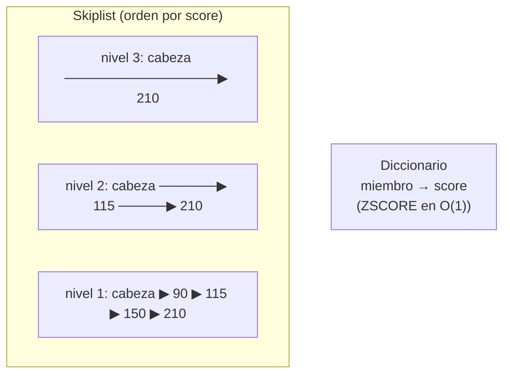

# Redis Sorted Sets

> [!abstract] En 30 segundos
> - **Qué es:** un set de miembros únicos, cada uno con un **score** numérico, **siempre ordenado** por score.
> - **Para qué:** rankings, colas con prioridad o con fecha de ejecución, ventanas temporales, índices por número, autocompletado.
> - **Recuerda:** insertar, actualizar y buscar la posición son O(log N); leer un rango de M elementos es O(log N + M). `ZRANGE` unificado (≥6.2) sustituye a `ZRANGEBYSCORE` y `ZREVRANGE`.

> [!info] Lección 1.9 · Nivel 1 — Redis básico y comandos fundamentales
> ⬅️ [[Redis Sets]] · ➡️ [[Complejidad de los comandos Big O]] · 🗺️ [[01 - Redis - Roadmap#Nivel 1 — Redis básico y comandos fundamentales|Roadmap]] · 📊 [[03 - Redis - Progreso|Progreso]]
> 🏷️ Core · `ZRANGE … BYSCORE/BYLEX/REV/LIMIT`, `ZADD GT/LT` ≥6.2 · `ZMPOP`, `ZINTERCARD` ≥7.0 · `ZRANK … WITHSCORE` ≥7.2 · agregador `COUNT` en `ZUNION`/`ZINTER` ≥8.8.

## 📌 Definición

Un **sorted set** (o *zset*) asocia a cada miembro único un **score** (número de coma flotante de doble precisión). Redis mantiene los miembros ordenados por score; a igualdad de score, por orden lexicográfico del miembro. Permite consultar por posición (rank), por rango de scores o por rango lexicográfico.

## 🎯 ¿Qué problema resuelve?

Un ranking en una base de datos relacional suele ser un `ORDER BY … LIMIT` sobre una tabla que cambia constantemente: cada consulta ordena y cada escritura actualiza índices. En Redis el orden se mantiene en cada escritura, así que «top 10», «posición del jugador» o «quién está justo por encima de mí» son operaciones logarítmicas aunque haya millones de miembros.

## 🧠 Conceptos fundamentales

| Comando | Qué hace | Complejidad |
|---|---|---|
| `ZADD k [NX/XX] [GT/LT] [CH] [INCR] score m …` | Añade o actualiza | O(log N) por miembro |
| `ZINCRBY k inc m` | Suma al score | O(log N) |
| `ZSCORE k m` / `ZMSCORE k m1 m2 …` | Score de uno / varios | O(1) / O(N) |
| `ZRANK k m` / `ZREVRANK k m` `[WITHSCORE]` | Posición (desde 0) ascendente / descendente | O(log N) |
| `ZRANGE k ini fin [BYSCORE/BYLEX] [REV] [LIMIT off n] [WITHSCORES]` | Rango por posición, score o lexicográfico | O(log N + M) |
| `ZRANGESTORE dest k …` (≥6.2) | Igual, guardando el resultado | O(log N + M) |
| `ZCOUNT k min max` / `ZLEXCOUNT` | Cuántos en un rango de scores / lexicográfico | O(log N) |
| `ZCARD k` | Número de miembros | O(1) |
| `ZREM k m …` / `ZREMRANGEBYSCORE` / `ZREMRANGEBYRANK` | Borrar miembros o rangos | O(log N + M) |
| `ZPOPMIN`/`ZPOPMAX k [n]` y bloqueantes `BZPOPMIN`/`BZPOPMAX` | Sacar los de menor / mayor score | O(log N · n) |
| `ZMPOP` / `BZMPOP` (≥7.0) | Sacar de la primera de varias claves no vacía | O(K) + O(M log N) |
| `ZUNION`/`ZINTER`/`ZDIFF` (+`STORE`) | Combinar con `WEIGHTS` y `AGGREGATE SUM/MIN/MAX` (`COUNT` ≥8.8) | O(N) + O(M log M) |
| `ZRANDMEMBER k [n [WITHSCORES]]` | Miembros aleatorios | O(n) |
| `ZSCAN` | Recorrer por lotes | O(1) por llamada |

**Rangos de score:** `-inf` y `+inf`; un paréntesis delante indica exclusivo: `(100` = mayor que 100.
**Precisión:** los scores son `double`: los enteros son exactos hasta 2^53.

### Opciones de `ZADD`
- `NX`: solo añadir nuevos; `XX`: solo actualizar existentes.
- `GT`/`LT` (≥6.2): actualizar solo si el nuevo score es mayor / menor (ideal para «récord personal»).
- `CH`: devolver cuántos cambiaron (no solo los añadidos).
- `INCR`: se comporta como `ZINCRBY`.

### Analogía
Un sorted set es la **clasificación de una liga** colgada en la pared que se reordena sola cada vez que alguien suma puntos: ver el top 10, la posición de tu equipo o los equipos entre el 5.º y el 8.º es inmediato.
**Dónde se rompe:** en la liga hay desempates por goles; en Redis, a igualdad de score, se desempata por orden alfabético del miembro (si necesitas otro criterio, codifícalo en el score).

## ⚙️ Funcionamiento interno

- Pequeños: **listpack** (`zset-max-listpack-entries` 128, `zset-max-listpack-value` 64).
- Grandes: **skiplist + diccionario**. El diccionario da el score de un miembro en O(1); la skiplist (lista enlazada con «carriles rápidos» probabilísticos) mantiene el orden y permite buscar posiciones y rangos en O(log N).



## 💻 Ejemplos prácticos

```text
127.0.0.1:6379> ZADD ranking:2026-11 150 ana 90 luis 210 marta
(integer) 3
127.0.0.1:6379> ZINCRBY ranking:2026-11 25 luis
"115"
127.0.0.1:6379> ZRANGE ranking:2026-11 0 9 REV WITHSCORES
1) "marta"
2) "210"
3) "ana"
4) "150"
5) "luis"
6) "115"
127.0.0.1:6379> ZREVRANK ranking:2026-11 luis WITHSCORE
1) (integer) 2
2) "115"
127.0.0.1:6379> ZRANGE ranking:2026-11 100 200 BYSCORE
1) "luis"
2) "ana"
127.0.0.1:6379> ZADD record:juego:7 GT 300 ana
(integer) 1
127.0.0.1:6379> ZADD record:juego:7 GT 250 ana
(integer) 0                       # 250 no mejora el récord: no cambia
```

**Cola de tareas programadas** (score = instante de ejecución en segundos Unix):

```text
ZADD tareas:programadas 1793665000 "enviar-recordatorio:carrito:42"
ZRANGE tareas:programadas -inf 1793664900 BYSCORE LIMIT 0 100   # las que ya tocan
ZREM tareas:programadas "enviar-recordatorio:carrito:42"           # al reclamarla
```

**Ventana deslizante** (score = timestamp, para rate limiting o métricas):

```text
ZADD peticiones:user:42 1793664000123 req-uuid-1
ZREMRANGEBYSCORE peticiones:user:42 -inf 1793663940123     # quitar lo de hace más de 60 s
ZCARD peticiones:user:42
```

## 🔧 Implementación en .NET

```csharp
using StackExchange.Redis;

IDatabase db = mux.GetDatabase();
const string board = "ranking:2026-11";

await db.SortedSetAddAsync(board, new SortedSetEntry[] { new("ana", 150), new("luis", 90), new("marta", 210) });
double luis = await db.SortedSetIncrementAsync(board, "luis", 25);

// Top 10 con scores, de mayor a menor
SortedSetEntry[] top = await db.SortedSetRangeByRankWithScoresAsync(board, 0, 9, Order.Descending);
foreach (var (entry, i) in top.Select((e, i) => (e, i)))
    Console.WriteLine($"{i + 1}. {entry.Element} — {entry.Score}");

// Posición de un jugador (0 = primero) en orden descendente
long? rank = await db.SortedSetRankAsync(board, "luis", Order.Descending);

// Vecinos: los dos por encima y por debajo
if (rank is long r)
{
    SortedSetEntry[] around = await db.SortedSetRangeByRankWithScoresAsync(
        board, Math.Max(0, r - 2), r + 2, Order.Descending);
}

// Tareas que ya deben ejecutarse (score ≤ ahora), de 100 en 100
double now = DateTimeOffset.UtcNow.ToUnixTimeSeconds();
RedisValue[] due = await db.SortedSetRangeByScoreAsync("tareas:programadas",
    double.NegativeInfinity, now, Exclude.None, Order.Ascending, skip: 0, take: 100);
```

## 🏗️ Casos de uso en arquitectura

| Caso | Diseño |
|---|---|
| Leaderboards | Score = puntos; un zset por periodo con TTL ([[Leaderboards con Redis]]) |
| Colas con prioridad | Score = prioridad; `ZPOPMIN` |
| Tareas programadas / colas diferidas | Score = instante de ejecución |
| Rate limiting de ventana deslizante | Score = timestamp de cada petición |
| Índice secundario numérico | `productos:por-precio` → score = precio, miembro = id |
| Autocompletado | Todos con score 0 y `ZRANGE … BYLEX [pre "[pre\xff"` |
| «Más vistos» de un periodo | `ZINCRBY` por evento y `ZUNIONSTORE` para agregar periodos |

### Cuándo NO usarlo
- Necesitas varios criterios de orden combinados y filtros: [[Redis Query Engine]].
- Solo necesitas «top-K aproximado» sobre un flujo enorme: Top-K ([[Estructuras probabilísticas en Redis]]).

### Consideraciones de arquitectura

| Dimensión | Qué pensar |
|---|---|
| Escalabilidad | Un zset vive en un shard: un ranking global de cientos de millones puede ser una big key |
| Memoria | Skiplist + diccionario: bastante más que un hash por elemento |
| Empates | Codifica el desempate en el score si importa (p. ej. puntos + fracción por antigüedad) |
| Precisión | Scores `double`: cuidado con identificadores o timestamps de más de 2^53 |

## ⚠️ Errores y anti-patterns

| Error | Por qué duele | Cómo evitarlo |
|---|---|---|
| `ZRANGE k 0 -1` sobre millones | O(N), bloqueo | Paginar con rangos o `LIMIT` |
| Usar `ZREVRANGE`/`ZRANGEBYSCORE` en código nuevo | Obsoletos desde 6.2 | `ZRANGE … REV/BYSCORE` |
| Guardar IDs de 64 bits como score | Pérdida de precisión por encima de 2^53 | IDs como miembro, no como score |
| Ranking «para siempre» sin particionar | Crece sin límite | Un zset por periodo con TTL; `ZREMRANGEBYRANK` para acotar |
| Desempates no deseados por orden alfabético | Resultados injustos o inestables | Codificar el desempate en el score |

## ✅ Buenas prácticas

1. Usa la sintaxis unificada de `ZRANGE`.
2. Acota tamaño (por periodo, `ZREMRANGEBYRANK`) y pagina.
3. `GT`/`LT` para récords; `CH` cuando necesites saber qué cambió.
4. Diseña explícitamente los empates.

## 🎤 Preguntas de entrevista

> [!question]- 1. ¿Cómo implementarías un leaderboard de millones de jugadores?
> Un sorted set con score = puntos: `ZINCRBY` al puntuar, `ZRANGE … REV WITHSCORES` para el top, `ZREVRANK` para la posición y un rango alrededor para los vecinos. Todo O(log N). Para periodos, un zset por día o semana con TTL y `ZUNIONSTORE` para agregarlos. Si un ranking global es demasiado grande para un shard, se fragmenta por región o liga.

> [!question]- 2. ¿Qué estructura usa internamente y por qué?
> Una skiplist para mantener el orden y buscar rangos y posiciones en O(log N), más un diccionario miembro → score para leer el score en O(1). Los zsets pequeños usan listpack.

> [!question]- 3. ¿Cómo harías una cola de tareas programadas?
> Sorted set con score = instante de ejecución. Un worker consulta `ZRANGE … -inf ahora BYSCORE LIMIT 0 N` y reclama cada tarea con `ZREM` (si devuelve 1, es suya), o hace las dos cosas de forma atómica en un script Lua.

## 🧪 Ejercicios

### 🟢 Básicos
1. Crea un ranking con 10 jugadores y obtén top 3, posición de uno y sus vecinos.
2. Usa `ZADD … GT` para guardar récords personales.

### 🟡 Intermedios
3. Implementa rankings diarios con TTL y un ranking semanal con `ZUNIONSTORE` de los 7 días.
4. Implementa la cola de tareas programadas en .NET con reclamación segura mediante `ZREM`.

### 🔴 Reto Senior
5. En tu juego, a igualdad de puntos gana quien llegó antes. Diseña el score para que el orden sea correcto sin perder precisión.

> [!success]- Soluciones
> **3.** `ZUNIONSTORE ranking:semana:45 7 ranking:2026-11-03 … ranking:2026-11-09` (suma por defecto) y TTL a la clave semanal.
> **5.** Score = puntos × 10^k + (constante − instante en segundos dentro de un rango acotado), cuidando de no superar 2^53. Por ejemplo, puntos en la parte entera y el instante invertido normalizado en la parte decimal, aceptando una resolución limitada. Si la precisión no alcanza, guarda el desempate en otra estructura y resuélvelo al leer los empatados.

### ✔️ Checklist de dominio
- [ ] Uso `ZADD` con sus opciones, `ZINCRBY`, `ZRANGE` unificado y `ZRANK`.
- [ ] Explico skiplist + diccionario y la complejidad de cada operación.
- [ ] Aplico zsets a rankings, colas diferidas y ventanas deslizantes.
- [ ] Sé tratar empates y límites de precisión.

## 📝 Resumen

- Zset = miembros únicos ordenados por score `double`.
- O(log N) para insertar, actualizar y buscar posición; O(log N + M) para rangos.
- `ZRANGE` unificado (≥6.2) cubre posición, score, lexicográfico y orden inverso.
- Rankings, colas diferidas, ventanas deslizantes e índices numéricos.
- Acota, pagina y diseña los empates.

## 🔗 Referencias

- [Redis sorted sets](https://redis.io/docs/latest/develop/data-types/sorted-sets/)
- [ZADD](https://redis.io/docs/latest/commands/zadd/)
- [ZRANGE](https://redis.io/docs/latest/commands/zrange/)

## 🔄 Notas relacionadas

- ⬅️ [[Redis Sets]] · ➡️ [[Complejidad de los comandos Big O]]
- Más adelante: [[Leaderboards con Redis]] · [[Rate limiting con Redis]] · [[Colas con Redis]] · [[Proyecto 01 - Ranking de usuarios]]
