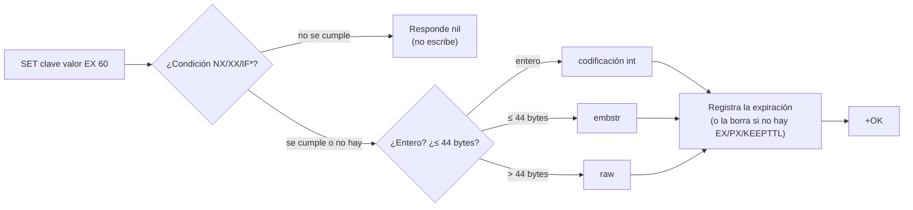

# Redis Strings

> [!abstract] En 30 segundos
> - **Qué es:** el tipo más básico: una secuencia de bytes de hasta 512 MB asociada a una clave. Puede ser texto, un número, JSON o binario.
> - **Para qué:** caché de objetos serializados, flags, tokens, contadores, locks simples.
> - **Recuerda:** `SET` es una navaja suiza (`NX`, `XX`, `GET`, `EX`/`PX`, `KEEPTTL` y, desde 8.4, condiciones `IFEQ`…). Usa `MGET`/`MSET` para ahorrar round-trips.

> [!info] Lección 1.3 · Nivel 1 — Redis básico y comandos fundamentales
> ⬅️ [[Claves y keyspace en Redis]] · ➡️ [[Contadores atómicos con INCR y DECR]] · 🗺️ [[01 - Redis - Roadmap#Nivel 1 — Redis básico y comandos fundamentales|Roadmap]] · 📊 [[03 - Redis - Progreso|Progreso]]
> 🏷️ Core · `GETEX`/`GETDEL` ≥6.2 · `LCS` ≥7.0 · `SET IFEQ/IFNE/IFDEQ/IFDNE`, `DIGEST`, `DELEX`, `MSETEX` ≥8.4.

## 📌 Definición

Un **string** de Redis es un valor binario con su longitud: no tiene codificación de caracteres impuesta ni termina en un carácter nulo, así que puede guardar una imagen, un JSON o el número `42`. El tamaño máximo es de 512 MB, aunque en la práctica conviene que sean pequeños (KB, no MB).

## 🎯 ¿Qué problema resuelve?

Es el bloque básico de la caché: guardar el resultado serializado de una consulta cara bajo una clave, con un TTL, y leerlo en un round-trip. También sirve para estado simple compartido: un flag de mantenimiento, un token de recuperación de contraseña, la última versión de un catálogo.

## 🧠 Conceptos fundamentales

### Las opciones de `SET`

```text
SET clave valor [NX | XX | IFEQ v | IFNE v | IFDEQ digest | IFDNE digest] [GET]
                [EX segundos | PX milisegundos | EXAT unix-s | PXAT unix-ms | KEEPTTL]
```

| Opción | Significado | Uso típico |
|---|---|---|
| `NX` | Solo si **no** existe | Locks, idempotencia, «primero que llega» |
| `XX` | Solo si **ya** existe | Actualizar sin crear |
| `GET` | Devuelve el valor anterior | Intercambio atómico (sustituye a `GETSET`) |
| `EX` / `PX` | TTL en segundos / milisegundos | Caché, tokens |
| `EXAT` / `PXAT` | Caduca en un instante Unix | «Válido hasta medianoche» |
| `KEEPTTL` | Conserva el TTL actual | Actualizar un valor sin alargar su vida |
| `IFEQ v` / `IFNE v` (🏷️ ≥8.4) | Solo si el valor actual es / no es `v` | Compare-and-set |
| `IFDEQ d` / `IFDNE d` (🏷️ ≥8.4) | Igual, comparando el *digest* XXH3 que devuelve `DIGEST` | Compare-and-set de valores grandes |

> [!warning] `SET` borra el TTL anterior
> Un `SET` sin `EX`/`PX`/`KEEPTTL` deja la clave **sin expiración**, aunque antes la tuviera. Es un error frecuente al «actualizar» valores de caché.

### Otros comandos

| Comando | Qué hace | Complejidad |
|---|---|---|
| `GET k` | Lee | O(1) |
| `MGET k1 k2 …` | Lee varias en un round-trip | O(N) |
| `MSET k1 v1 k2 v2 …` | Escribe varias de forma atómica (sin TTL) | O(N) |
| `MSETNX …` | Escribe todas solo si no existe ninguna | O(N) |
| `MSETEX n k1 v1 … [NX/XX] [EX…]` (🏷️ ≥8.4) | Escribe varias de forma atómica **con TTL compartido** | O(N) |
| `GETEX k [EX… / PERSIST]` (≥6.2) | Lee y cambia el TTL (expiración deslizante) | O(1) |
| `GETDEL k` (≥6.2) | Lee y borra (consumir un token una sola vez) | O(1) |
| `APPEND k v` | Añade al final | O(1) amortizado |
| `STRLEN k` | Longitud en bytes | O(1) |
| `GETRANGE k ini fin` / `SETRANGE k off v` | Subcadena / sobrescribir a partir de un offset | O(N) |
| `LCS k1 k2` (≥7.0) | Subsecuencia común más larga | O(N·M) |
| `DIGEST k` (≥8.4) | Hash XXH3 del valor, en hexadecimal | O(N) |

`SETNX`, `SETEX`, `PSETEX` y `GETSET` siguen funcionando, pero las opciones de `SET` los sustituyen y la documentación advierte que podrían retirarse.

### Codificaciones internas
- `int`: el valor es un entero de 64 bits → se guarda como número.
- `embstr`: strings de hasta 44 bytes, en un único bloque de memoria con su objeto.
- `raw`: strings más largos, en un bloque aparte.

### Analogía
Un string es una **caja con etiqueta**: Redis no mira qué hay dentro, solo te deja meter, sacar, sustituir o poner fecha de caducidad. Las opciones de `SET` son las reglas de la consigna: «solo si la taquilla está vacía» (`NX`), «solo si ya tenía algo» (`XX`), «dame lo que había» (`GET`).
**Dónde se rompe:** si dentro hay un número, Redis sí sabe operar con él (`INCR`): [[Contadores atómicos con INCR y DECR]].

## ⚙️ Funcionamiento interno



## 💻 Ejemplos prácticos

```text
127.0.0.1:6379> SET shop:product:42 '{"id":42,"name":"Teclado","price":49.9}' EX 600
OK
127.0.0.1:6379> GET shop:product:42
"{\"id\":42,\"name\":\"Teclado\",\"price\":49.9}"
127.0.0.1:6379> MSET flag:checkout on flag:recommendations off
OK
127.0.0.1:6379> MGET flag:checkout flag:recommendations flag:no-existe
1) "on"
2) "off"
3) (nil)
127.0.0.1:6379> SET reset:token:abc123 user:42 EX 900 NX
OK
127.0.0.1:6379> GETDEL reset:token:abc123
"user:42"
127.0.0.1:6379> GETDEL reset:token:abc123
(nil)
127.0.0.1:6379> SET session:9f1c "datos" EX 1800
OK
127.0.0.1:6379> GETEX session:9f1c EX 1800
"datos"
```

- El token de recuperación se consume una sola vez con `GETDEL`: un segundo intento devuelve `nil`.
- `GETEX … EX 1800` implementa una **sesión con expiración deslizante** en un solo comando.

**Compare-and-set (🏷️ ≥8.4):**

```text
127.0.0.1:6379> SET config:version v1
OK
127.0.0.1:6379> SET config:version v2 IFEQ v1
OK
127.0.0.1:6379> SET config:version v3 IFEQ v1
(nil)
```

El tercer `SET` no escribe porque el valor ya no era `v1`: dos procesos que intentan actualizar desde la misma versión no se pisan.

## 🔧 Implementación en .NET

```csharp
using System.Text.Json;
using StackExchange.Redis;

IDatabase db = mux.GetDatabase();
var json = new JsonSerializerOptions(JsonSerializerDefaults.Web);

// Guardar un objeto serializado con TTL
var product = new Product(42, "Teclado", 49.9m);
await db.StringSetAsync("shop:product:42", JsonSerializer.Serialize(product, json), TimeSpan.FromMinutes(10));

// Leer y deserializar
RedisValue raw = await db.StringGetAsync("shop:product:42");
Product? cached = raw.HasValue ? JsonSerializer.Deserialize<Product>(raw.ToString(), json) : null;

// Solo si no existe (NX), con TTL: token de un solo uso
bool created = await db.StringSetAsync("reset:token:abc123", "user:42", TimeSpan.FromMinutes(15), When.NotExists);

// GETDEL: consumir el token
RedisValue owner = await db.StringGetDeleteAsync("reset:token:abc123");

// GETEX: leer renovando el TTL (expiración deslizante)
RedisValue session = await db.StringGetSetExpiryAsync("session:9f1c", TimeSpan.FromMinutes(30));

// MGET y MSET: un round-trip para varias claves
RedisValue[] flags = await db.StringGetAsync(new RedisKey[] { "flag:checkout", "flag:recommendations" });
await db.StringSetAsync(new KeyValuePair<RedisKey, RedisValue>[]
{
    new("flag:checkout", "on"),
    new("flag:recommendations", "off"),
});

record Product(int Id, string Name, decimal Price);
```

> [!info] 🏷️ StackExchange.Redis 3.x
> En 3.x el TTL de `StringSetAsync` se pasa como `Expiration` (conversión implícita desde `TimeSpan`, no desde `TimeSpan?`). Las condiciones de Redis 8.4 (`IFEQ`…) aparecen en las versiones recientes del cliente; si tu versión no las expone, usa `ExecuteAsync("SET", …, "IFEQ", valorEsperado)`.

## 🏗️ Casos de uso en arquitectura

### Cuándo usarlo
- Caché de objetos que se leen y escriben enteros.
- Tokens y códigos de un solo uso (`SET NX EX` + `GETDEL`).
- Flags y configuración simple.
- Locks simples con `SET NX PX` ([[Distributed locks con Redis]]).

### Cuándo NO usarlo
- Objetos de los que cambias campos sueltos a menudo: un [[Redis Hashes|hash]] evita reescribir todo el JSON.
- Documentos que necesitas consultar por campos internos: [[Redis JSON]] o el [[Redis Query Engine]].
- Valores de varios MB: troceados o fuera de Redis.

### Consideraciones de arquitectura

| Dimensión | Qué pensar |
|---|---|
| Rendimiento | Valores pequeños; `MGET` frente a N `GET` |
| Concurrencia | Leer-modificar-escribir un JSON desde la app no es atómico: hash con `HINCRBY`, `SET … IFEQ` (8.4) o scripts |
| Memoria | Comprime o usa formatos binarios si los objetos son grandes ([[Serialización de datos en Redis]]) |
| Evolución | Versión en la clave cuando cambie el formato serializado |

## ⚠️ Errores y anti-patterns

| Error | Por qué duele | Cómo evitarlo |
|---|---|---|
| `SET` sin TTL sobre una clave de caché | La clave deja de caducar | `EX` siempre, o `KEEPTTL` al actualizar |
| `GET` + modificar JSON + `SET` concurrente | *Lost update* | Hashes, `IFEQ`, Lua |
| Valores de varios MB | Bloqueo, red saturada | Trocear, comprimir, paginar |
| N `GET` secuenciales | N round-trips | `MGET` |
| `MSET` esperando que ponga TTL | `MSET` no admite TTL | `MSETEX` (8.4) o pipeline de `SET … EX` |

## ✅ Buenas prácticas

1. TTL en todo valor de caché.
2. Valores pequeños y formato estable con versión.
3. `MGET`/`MSET` para varias claves.
4. `SET NX EX` + `GETDEL` para tokens de un solo uso.
5. Compare-and-set (`IFEQ`) cuando la versión de Redis lo permita.

## 🎤 Preguntas de entrevista

> [!question]- 1. ¿Cómo implementarías un token de recuperación de contraseña de un solo uso?
> `SET reset:token:<aleatorio> <userId> EX 900 NX` al emitirlo y `GETDEL` al canjearlo: el primer canje obtiene el usuario y borra el token en el mismo comando, y un segundo intento recibe `nil`.

> [!question]- 2. ¿Qué pasa con el TTL si haces `SET` sobre una clave que ya tenía expiración?
> Se pierde: `SET` sin `EX`/`PX`/`EXAT`/`PXAT` deja la clave sin expiración. Para conservarla, `KEEPTTL`.

> [!question]- 3. ¿String con JSON o Hash para un objeto?
> String si el objeto se lee y escribe entero y es pequeño. Hash si actualizas campos sueltos, necesitas incrementos atómicos por campo o quieres leer solo algunos campos. Si necesitas anidamiento y consultas, Redis JSON.

> [!question]- 4. ¿Qué aporta `SET … IFEQ` en Redis 8.4?
> Compare-and-set atómico en un solo comando: solo escribe si el valor actual es el esperado. Antes había que usar `WATCH`/`MULTI` o un script Lua.

## 🧪 Ejercicios

### 🟢 Básicos
1. Guarda tres flags con `MSET` y léelos con `MGET`.
2. Demuestra con `TTL` que un `SET` sin `EX` elimina la expiración y que `KEEPTTL` la conserva.

### 🟡 Intermedios
3. Implementa el token de un solo uso en .NET y lanza 20 canjes concurrentes del mismo token: solo uno debe tener éxito.
4. Implementa una sesión con expiración deslizante usando `GETEX`.

### 🔴 Reto Senior
5. Dos instancias actualizan la misma configuración JSON leyendo, modificando y escribiendo. Diseña una solución sin pérdida de actualizaciones para Redis 7.4 y otra para Redis 8.4.

> [!success]- Soluciones
> **3.** `StringGetDeleteAsync` es atómico: un solo canje obtiene el valor; los demás reciben `RedisValue.Null`.
> **5.** En 7.4: `WATCH` + `GET` + `MULTI`/`SET`/`EXEC` con reintento, o un script Lua que compare y escriba. En 8.4: guardar una versión y escribir con `SET … IFEQ versión_anterior` (o comparar el `DIGEST` con `IFDEQ`), reintentando si devuelve `nil`.

### ✔️ Checklist de dominio
- [ ] Explico todas las opciones de `SET`.
- [ ] Uso `MGET`/`MSET`, `GETEX`, `GETDEL` en su caso.
- [ ] Sé por qué `SET` puede borrar un TTL.
- [ ] Sé elegir entre string, hash y JSON.

## 📝 Resumen

- String = bytes con longitud, hasta 512 MB (mejor pequeños).
- `SET` cubre crear, condicionar (`NX`/`XX`/`IF*`), intercambiar (`GET`) y caducar.
- `SET` sin opciones de expiración borra el TTL.
- `MGET`/`MSET`/`MSETEX` ahorran round-trips.
- `GETEX` para expiración deslizante; `GETDEL` para consumir una vez.

## 🔗 Referencias

- [Redis strings](https://redis.io/docs/latest/develop/data-types/strings/)
- [SET](https://redis.io/docs/latest/commands/set/)
- [MSETEX](https://redis.io/docs/latest/commands/msetex/)
- [GETEX](https://redis.io/docs/latest/commands/getex/)

## 🔄 Notas relacionadas

- ⬅️ [[Claves y keyspace en Redis]] · ➡️ [[Contadores atómicos con INCR y DECR]]
- Relacionadas: [[Redis Hashes]] · [[Redis JSON]] · [[Expiración y TTL]] · [[Serialización de datos en Redis]] · [[Cache-aside]]
