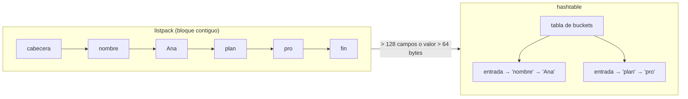

# Codificaciones internas de los tipos de datos

> [!abstract] En 30 segundos
> - **Qué es:** cada tipo de dato tiene varias representaciones internas; Redis usa una **compacta** mientras la colección es pequeña y cambia a una **general** cuando crece.
> - **Para qué:** entender por qué dos datos «iguales» ocupan memorias muy distintas y diseñar estructuras que aprovechen la codificación compacta.
> - **Recuerda:** compacta = poca memoria y operaciones O(N) dentro de un bloque pequeño; general = más memoria y O(1)/O(log N). La conversión solo va en un sentido.

> [!info] Lección 2.1 · Nivel 2 — Estructuras de datos y operaciones avanzadas
> ⬅️ [[Proyecto 01 - Ranking de usuarios]] · ➡️ [[Redis Bitmaps y Bitfields]] · 🗺️ [[01 - Redis - Roadmap#Nivel 2 — Estructuras de datos y operaciones avanzadas|Roadmap]] · 📊 [[03 - Redis - Progreso|Progreso]]
> 🏷️ Core · nombres `*-listpack-*` ≥7.0 (antes `ziplist`, que se mantienen como alias) · listpack para listas y sets pequeños ≥7.2 · menos memoria en hashes y zsets grandes ≥8.6 · hashes compactos con plantillas ≥8.10.

## 📌 Definición

Una **codificación** (*encoding*) es la forma concreta en que Redis guarda un valor en memoria. `OBJECT ENCODING clave` la muestra.

| Tipo | Codificación compacta | Codificación general | Umbrales (por defecto) |
|---|---|---|---|
| String | `int` (entero de 64 bits), `embstr` (≤ 44 bytes) | `raw` | — |
| List | `listpack` (lista pequeña) | `quicklist` (lista enlazada de listpacks) | `list-max-listpack-size -2` (nodos de hasta 8 KB) |
| Set | `intset` (solo enteros), `listpack` | `hashtable` | `set-max-intset-entries 512`, `set-max-listpack-entries 128`, `set-max-listpack-value 64` |
| Hash | `listpack` | `hashtable` | `hash-max-listpack-entries 128`, `hash-max-listpack-value 64` |
| Sorted set | `listpack` | `skiplist` (+ diccionario) | `zset-max-listpack-entries 128`, `zset-max-listpack-value 64` |
| Stream | Árbol radix de listpacks | — | `stream-node-max-bytes 4096`, `stream-node-max-entries 100` |
| HyperLogLog | Representación *sparse* | *dense* (~12 KB) | `hll-sparse-max-bytes 3000` |

Un **listpack** es un bloque contiguo de memoria con los elementos uno detrás de otro, sin punteros entre ellos.

## 🎯 ¿Qué problema resuelve?

En una tabla hash, cada elemento necesita una entrada con punteros, su propia reserva de memoria y espacio para la tabla. Para colecciones pequeñas, ese overhead puede multiplicar por varias veces el tamaño de los datos. Las codificaciones compactas eliminan ese coste mientras recorrer el bloque entero sea barato.

**Ejemplo real:** un millón de usuarios con 10 campos cortos cada uno. Como hashes en `listpack` ocupan una fracción de lo que ocuparían como `hashtable`. Si un campo crece por encima de 64 bytes, todo ese hash cambia a `hashtable` y su memoria se dispara.

## 🧠 Conceptos fundamentales

1. **Trade-off memoria/CPU:** en un listpack, buscar un campo es recorrer el bloque (O(N)), pero con N ≤ 128 eso cabe en caché de CPU y es rapidísimo. Más allá, la búsqueda lineal empieza a costar.
2. **Conversión en un solo sentido:** al superar un umbral, la estructura pasa a la codificación general y **no vuelve** aunque encoja.
3. **Basta un elemento:** un único valor largo (> 64 bytes) o un único miembro no entero (en un intset) provoca la conversión de toda la colección.
4. **Los umbrales se configuran:** subirlos ahorra memoria a costa de CPU; bajarlos, lo contrario. Cámbialos solo con medidas.
5. **Truco de buckets:** agrupar muchos valores pequeños en hashes pequeños (`bucket = id / 100`, `campo = id % 100`) en lugar de millones de claves sueltas.
6. **Mejoras recientes:** Redis 8.6 redujo la memoria de hashes en `hashtable` y de zsets en `skiplist`; Redis 8.10 añadió **hashes compactos**: las claves con el mismo conjunto de campos comparten una «plantilla» con los nombres de campo (métricas `hash_templates` y `used_memory_hash_templates`).

### Analogía
Guardar papeles: con cinco documentos, una **carpeta de fundas** (listpack) es perfecta y ocupa poco, aunque tengas que hojearlas para encontrar uno. Con 5 000, necesitas un **archivador con índice** (hashtable): ocupa más, pero encuentras cualquier documento al instante. Y nunca vuelves a la carpeta aunque saques papeles del archivador.
**Dónde se rompe:** en la carpeta real puedes meter un documento gordo sin cambiar de sistema; en Redis, un solo valor grande obliga a pasar todo al archivador.

## ⚙️ Funcionamiento interno



- **quicklist:** lista doblemente enlazada cuyos nodos son listpacks; equilibra memoria y coste de inserción. `list-compress-depth` comprime con LZF los nodos interiores (los extremos quedan sin comprimir).
- **intset:** array ordenado de enteros (búsqueda binaria), con tamaño de entero adaptativo (16, 32 o 64 bits).
- **skiplist + diccionario:** el diccionario da `ZSCORE` en O(1); la skiplist mantiene el orden.

## 💻 Ejemplos prácticos

```text
127.0.0.1:6379> SADD numeros 1 2 3
(integer) 3
127.0.0.1:6379> OBJECT ENCODING numeros
"intset"
127.0.0.1:6379> SADD numeros hola
(integer) 1
127.0.0.1:6379> OBJECT ENCODING numeros
"listpack"
127.0.0.1:6379> HSET h campo "valor corto"
(integer) 1
127.0.0.1:6379> OBJECT ENCODING h
"listpack"
127.0.0.1:6379> HSET h largo "un valor de más de sesenta y cuatro bytes que obliga a cambiar la codificación del hash"
(integer) 1
127.0.0.1:6379> OBJECT ENCODING h
"hashtable"
127.0.0.1:6379> HDEL h largo
(integer) 1
127.0.0.1:6379> OBJECT ENCODING h
"hashtable"                     # no vuelve a listpack
```

### Laboratorio: medir el ahorro de los buckets

```text
# A) 100 000 claves sueltas
EVAL "for i=1,100000 do redis.call('SET', 'disp:'..i, '1793664000') end return 1" 0
INFO memory          # anota used_memory
FLUSHALL

# B) Los mismos datos en hashes de 100 campos
EVAL "for i=1,100000 do redis.call('HSET', 'disp:b:'..math.floor(i/100), i%100, '1793664000') end return 1" 0
INFO memory          # compara used_memory
```

Verás que la variante B ocupa varias veces menos memoria.

## 🔧 Implementación en .NET

El modelado con buckets, encapsulado para que el resto de la aplicación no lo note:

```csharp
using StackExchange.Redis;

public sealed class DeviceLastSeenStore(IConnectionMultiplexer redis)
{
    private const int BucketSize = 100;     // ≤ hash-max-listpack-entries (128)
    private readonly IDatabase _db = redis.GetDatabase();

    private static (RedisKey Key, RedisValue Field) Locate(long deviceId) =>
        ($"disp:b:{deviceId / BucketSize}", deviceId % BucketSize);

    public Task SetAsync(long deviceId, DateTimeOffset seen)
    {
        var (key, field) = Locate(deviceId);
        return _db.HashSetAsync(key, field, seen.ToUnixTimeSeconds());
    }

    public async Task<DateTimeOffset?> GetAsync(long deviceId)
    {
        var (key, field) = Locate(deviceId);
        RedisValue value = await _db.HashGetAsync(key, field);
        return value.HasValue ? DateTimeOffset.FromUnixTimeSeconds((long)value) : null;
    }
}
```

## 🏗️ Casos de uso en arquitectura

| Decisión | Aplicación |
|---|---|
| Millones de objetos diminutos | Buckets en hashes pequeños |
| Entidades como hashes | Mantener campos y valores cortos (≤ 64 bytes) |
| Sets de IDs numéricos | Aprovechar `intset` (≤ 512 enteros) |
| Muchas claves con los mismos campos | Hashes compactos (≥8.10) |

### Cuándo NO forzarlo
- Si la estructura será grande de todas formas, no compensa diseñar para la codificación compacta.
- No subas los umbrales a miles: las operaciones O(N) sobre el bloque empiezan a notarse en latencia.

### Consideraciones de arquitectura
- **Memoria:** es la palanca principal de coste en Redis.
- **Rendimiento:** compacto no es «gratis» en CPU; mide antes de tocar umbrales.
- **Evolución:** un cambio de esquema que alarga un campo puede multiplicar la memoria de todas las entidades.

## ⚠️ Errores y anti-patterns

| Error | Por qué duele | Cómo evitarlo |
|---|---|---|
| Añadir un campo largo (una descripción) a hashes que eran compactos | Toda la flota de hashes pasa a `hashtable` | Guardar los valores largos aparte |
| Millones de claves sueltas de pocos bytes | El overhead por clave domina | Buckets |
| Subir `hash-max-listpack-entries` a 10 000 | Latencia por operaciones lineales | Valores moderados y medidos |
| Esperar que una estructura vuelva a ser compacta al encoger | No ocurre | Recrearla si hace falta |

## ✅ Buenas prácticas

1. Revisa `OBJECT ENCODING` de tus estructuras más numerosas.
2. Mide memoria con datos reales (`MEMORY USAGE`, `INFO memory`).
3. Usa buckets para objetos diminutos y masivos.
4. Valores cortos en hashes, sets y zsets que quieras mantener compactos.

## 🎤 Preguntas de entrevista

> [!question]- 1. ¿Por qué un hash de 10 campos ocupa tan poco en Redis?
> Porque se guarda como listpack: un bloque contiguo sin punteros ni entradas de tabla hash. Mientras tenga pocos campos cortos (por defecto ≤ 128 campos y ≤ 64 bytes por valor), Redis acepta búsquedas lineales a cambio de ahorrar mucha memoria.

> [!question]- 2. ¿Qué pasa si un solo valor del hash supera 64 bytes?
> Todo el hash se convierte a `hashtable` y, aunque se borre ese valor, no vuelve a listpack. Si eso ocurre en millones de hashes, la memoria se multiplica.

> [!question]- 3. ¿Cómo reducirías la memoria de 100 millones de pares clave → valor pequeños?
> Agrupándolos en hashes pequeños (buckets) que queden dentro de los umbrales de listpack; acortando claves; usando enteros (codificación `int`) en lugar de strings largos.

## 🧪 Ejercicios

### 🟢 Básicos
1. Provoca la conversión `intset` → `listpack` → `hashtable` de un set.
2. Comprueba la codificación `embstr` frente a `raw` con strings de 44 y 45 bytes.

### 🟡 Intermedios
3. Haz el laboratorio de buckets y calcula los bytes por elemento de cada variante.
4. Cambia `hash-max-listpack-entries` a 512 y mide memoria y latencia de `HGET` en hashes de 500 campos.

### 🔴 Reto Senior
5. Tras un despliegue, la memoria de Redis pasa de 8 GB a 22 GB sin más datos. El cambio añadió un campo `bio` al perfil de usuario. Explica qué ocurrió y cómo lo arreglarías sin downtime.

> [!success]- Soluciones
> **2.** Hasta 44 bytes, `embstr`; con 45, `raw`.
> **5.** El campo `bio` supera 64 bytes en muchos perfiles y convierte esos hashes a `hashtable`. Solución: mover `bio` a una clave aparte (`user:{id}:bio`) y recrear los hashes afectados para que vuelvan a listpack (por ejemplo, reescribiéndolos en un job con `HGETALL` + `DEL` + `HSET` sin el campo, en una clave temporal y `RENAME`).

### ✔️ Checklist de dominio
- [ ] Conozco las codificaciones de cada tipo y sus umbrales.
- [ ] Explico el trade-off memoria/CPU.
- [ ] Sé aplicar buckets y medir el ahorro.
- [ ] Sé que la conversión no tiene vuelta atrás.

## 📝 Resumen

- Compacta (listpack, intset, embstr, int) mientras es pequeña; general (hashtable, skiplist, quicklist, raw) al crecer.
- Un solo elemento grande o no entero basta para convertir toda la colección.
- La conversión no tiene vuelta atrás.
- Buckets y valores cortos son las palancas de memoria más efectivas.
- Redis 8.6 y 8.10 reducen la memoria de hashes y zsets grandes y añaden hashes compactos.

## 🔗 Referencias

- [Memory optimization](https://redis.io/docs/latest/operate/oss_and_stack/management/optimization/memory-optimization/)
- [OBJECT ENCODING](https://redis.io/docs/latest/commands/object-encoding/)
- [Redis Open Source 8.10 release notes](https://redis.io/docs/latest/operate/oss_and_stack/stack-with-enterprise/release-notes/redisce/redisos-8.10-release-notes/): hashes compactos

## 🔄 Notas relacionadas

- ⬅️ [[Proyecto 01 - Ranking de usuarios]] · ➡️ [[Redis Bitmaps y Bitfields]]
- Relacionadas: [[Arquitectura interna de Redis]] · [[Redis Hashes]] · [[Optimización de memoria en Redis]] · [[Big keys]]
