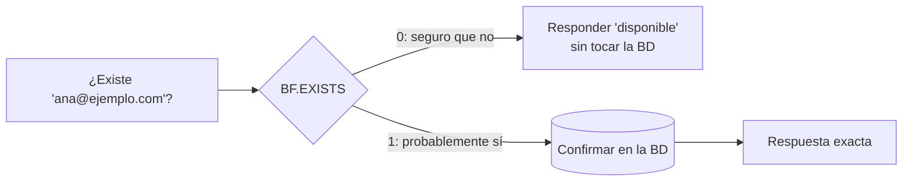

# Estructuras probabilísticas en Redis

> [!abstract] En 30 segundos
> - **Qué es:** estructuras que responden preguntas sobre datos masivos con **memoria pequeña y fija**, a cambio de un error acotado: Bloom y Cuckoo (pertenencia), Count-min sketch (frecuencia), Top-K (los más frecuentes), t-digest (percentiles) y HyperLogLog (cardinalidad).
> - **Para qué:** «¿ya existe este email?», protección contra *cache penetration*, productos más vistos, latencia p99 de un flujo.
> - **Recuerda:** un Bloom filter puede dar **falsos positivos, nunca falsos negativos**. Desde Redis 8 vienen incluidas en Redis Open Source (antes, módulo RedisBloom / Redis Stack).

> [!info] Lección 2.6 · Nivel 2 — Estructuras de datos y operaciones avanzadas
> ⬅️ [[Redis Streams]] · ➡️ [[Redis JSON]] · 🗺️ [[01 - Redis - Roadmap#Nivel 2 — Estructuras de datos y operaciones avanzadas|Roadmap]] · 📊 [[03 - Redis - Progreso|Progreso]]
> 🏷️ **R8**: incluidas en Redis Open Source 8+; en 7.x requerían Redis Stack o RedisBloom. HyperLogLog es core. En Azure Managed Redis, el nivel Flash Optimized no admite RedisBloom. **Valkey≠**: tiene su propio módulo Bloom; verifica la compatibilidad de cada comando.

## 📌 Definición

| Estructura | Pregunta que responde | Error | Comandos principales |
|---|---|---|---|
| **Bloom filter** | ¿He visto este elemento? | Falsos positivos (tasa configurable); sin falsos negativos | `BF.RESERVE`, `BF.ADD`, `BF.MADD`, `BF.EXISTS`, `BF.MEXISTS`, `BF.INSERT`, `BF.INFO` |
| **Cuckoo filter** | Igual, y además permite **borrar** | Falsos positivos | `CF.RESERVE`, `CF.ADD`, `CF.ADDNX`, `CF.EXISTS`, `CF.DEL`, `CF.COUNT` |
| **Count-min sketch** | ¿Cuántas veces he visto X? | Sobreestima, nunca subestima | `CMS.INITBYDIM`, `CMS.INITBYPROB`, `CMS.INCRBY`, `CMS.QUERY`, `CMS.MERGE` |
| **Top-K** | ¿Cuáles son los K más frecuentes? | Aproximado | `TOPK.RESERVE`, `TOPK.ADD`, `TOPK.INCRBY`, `TOPK.LIST`, `TOPK.QUERY` |
| **t-digest** | ¿Cuál es el percentil p? (mediana, p99…) | Muy preciso en los extremos | `TDIGEST.CREATE`, `TDIGEST.ADD`, `TDIGEST.QUANTILE`, `TDIGEST.CDF`, `TDIGEST.MIN`, `TDIGEST.MAX`, `TDIGEST.MERGE` |
| **HyperLogLog** | ¿Cuántos distintos? | ~0,81 % | `PFADD`, `PFCOUNT`, `PFMERGE` ([[Redis HyperLogLog]]) |

## 🎯 ¿Qué problema resuelve?

Cuando los datos son enormes, las estructuras exactas no caben o son caras:
- Comprobar si un nombre de usuario existe entre 500 millones: un set ocuparía decenas de GB; un Bloom filter con un 1 % de falsos positivos, unos 600 MB, y uno con un 0,1 % algo menos de 900 MB.
- Saber los 100 productos más vistos de un flujo de mil millones de eventos sin guardar un contador por producto.
- Calcular la latencia p99 de millones de peticiones sin guardar todas las medidas.

## 🧠 Conceptos fundamentales

### Bloom filter
- Un array de bits y `k` funciones hash. `ADD` enciende `k` bits; `EXISTS` comprueba que estén todos encendidos.
- Si alguno está apagado → **seguro que no existe**. Si todos están encendidos → **probablemente existe** (otros elementos pueden haberlos encendido).
- `BF.RESERVE k tasa_error capacidad [EXPANSION n] [NONSCALING]`: con `tasa_error 0.01` y capacidad prevista. Si se supera la capacidad, por defecto añade sub-filtros (escala), con algo más de memoria y error.
- **No se puede borrar** un elemento (apagaría bits de otros).

### Cuckoo filter
- Guarda «huellas» de los elementos en buckets; permite `CF.DEL` y contar apariciones aproximadas. Algo más de memoria por elemento que Bloom en tasas de error altas, menos en tasas muy bajas.

### Count-min sketch
- Una matriz de contadores (ancho × profundidad); cada elemento incrementa un contador por fila; la estimación es el mínimo. Sobreestima por colisiones.

### Top-K
- Mantiene los K elementos más frecuentes con un algoritmo de tipo *HeavyKeeper*: `TOPK.ADD` devuelve el elemento expulsado del top si lo hubo.

### t-digest
- Agrupa los valores en centroides, con más resolución en los extremos: percentiles altos (p99, p99.9) muy precisos con poca memoria. Se pueden fusionar (`TDIGEST.MERGE`) para agregar instancias.

### Analogía
Un Bloom filter es el **portero con mala memoria pero sin olvidos**: si te dice «no estás en la lista», es seguro; si dice «creo que sí», a veces se confunde con alguien que se te parece. Por eso le pides confirmación a la base de datos solo cuando dice «sí».
**Dónde se rompe:** un portero real puede tachar a alguien de la lista; un Bloom filter no puede borrar (para eso, Cuckoo).

## ⚙️ Funcionamiento interno



- Todas estas estructuras se guardan como tipos propios de Redis, con persistencia y replicación normales.
- Sus comandos pertenecen a categorías ACL propias (`@bloom`, `@cuckoo`, `@cms`, `@topk`, `@tdigest`) y, desde Redis 8, también a `@read`/`@write`.

## 💻 Ejemplos prácticos

```text
127.0.0.1:6379> BF.RESERVE emails 0.001 1000000
OK
127.0.0.1:6379> BF.ADD emails ana@ejemplo.com
(integer) 1
127.0.0.1:6379> BF.EXISTS emails ana@ejemplo.com
(integer) 1
127.0.0.1:6379> BF.EXISTS emails luis@ejemplo.com
(integer) 0                        # seguro que no existe
127.0.0.1:6379> TOPK.RESERVE productos:top 10
OK
127.0.0.1:6379> TOPK.ADD productos:top p:7 p:7 p:9 p:7 p:3
1) (nil)
2) (nil)
3) (nil)
4) (nil)
5) (nil)
127.0.0.1:6379> TOPK.LIST productos:top WITHCOUNT
1) "p:7"
2) (integer) 3
…
127.0.0.1:6379> CMS.INITBYPROB busquedas 0.001 0.01
OK
127.0.0.1:6379> CMS.INCRBY busquedas teclado 1 raton 1 teclado 1
1) (integer) 1
2) (integer) 1
3) (integer) 2
127.0.0.1:6379> TDIGEST.CREATE latencias
OK
127.0.0.1:6379> TDIGEST.ADD latencias 12 15 11 220 14 13 16
OK
127.0.0.1:6379> TDIGEST.QUANTILE latencias 0.5 0.99
1) "14"
2) "220"
```

## 🔧 Implementación en .NET

Con **NRedisStack** (cliente de Redis Inc. sobre StackExchange.Redis):

```csharp
using NRedisStack;
using NRedisStack.RedisStackCommands;
using StackExchange.Redis;

IDatabase db = mux.GetDatabase();
var bloom = db.BF();

// Reservar: 0,1 % de falsos positivos para 1 millón de elementos (una vez, al desplegar)
if (!await db.KeyExistsAsync("emails"))
    await bloom.ReserveAsync("emails", 0.001, 1_000_000);

await bloom.AddAsync("emails", "ana@ejemplo.com");

// Comprobación previa barata antes de ir a la base de datos
static async Task<bool> EmailTakenAsync(IDatabase db, Func<string, Task<bool>> dbCheck, string email)
{
    if (!await db.BF().ExistsAsync("emails", email))
        return false;                    // seguro que no existe: sin consulta a la BD
    return await dbCheck(email);         // "probablemente sí": confirmar
}
```

Sin NRedisStack, cualquier comando funciona con `db.ExecuteAsync("TOPK.ADD", "productos:top", "p:7")`.

## 🏗️ Casos de uso en arquitectura

| Caso | Estructura |
|---|---|
| Comprobación de disponibilidad (usuario, email) antes de la BD | Bloom filter |
| Protección contra [[Cache penetration]] (IDs que no existen) | Bloom filter con todos los IDs válidos |
| Deduplicación de URLs en un crawler o de eventos | Bloom o Cuckoo (si hay que borrar) |
| Productos o búsquedas más populares en tiempo real | Top-K |
| Frecuencia aproximada por elemento (detección de abuso) | Count-min sketch |
| Percentiles de latencia o de importes | t-digest |

### Cuándo NO usarlo
- Necesitas exactitud (dinero, permisos, unicidad garantizada): estructura exacta o restricción en la BD.
- Volúmenes pequeños: un set o un hash es más simple y exacto.
- Un Bloom filter no sustituye la restricción `UNIQUE` de la base de datos: solo evita consultas.

### Consideraciones de arquitectura

| Dimensión | Qué pensar |
|---|---|
| Dimensionado | Capacidad y tasa de error al crear; superar la capacidad degrada el error o la memoria |
| Consistencia | Un Bloom de IDs válidos debe actualizarse al crear entidades (y no admite borrados) |
| Reconstrucción | Planifica cómo regenerarlo desde la fuente de verdad |
| Portabilidad | Comandos de Redis 8 / Redis Stack: comprueba tu servicio gestionado |

## ⚠️ Errores y anti-patterns

| Error | Por qué duele | Cómo evitarlo |
|---|---|---|
| Tratar el «sí» del Bloom como verdad | Rechazas usuarios o datos válidos | Confirmar en la fuente |
| Crear el filtro implícitamente con `BF.ADD` sin dimensionar | Parámetros por defecto inadecuados | `BF.RESERVE` explícito |
| Usar Bloom cuando necesitas borrar | Imposible | Cuckoo filter |
| Asumir que estos comandos existen en cualquier Redis | Fallan en 7.x sin Stack o en algunos servicios | Verificar versión y módulos |

## ✅ Buenas prácticas

1. Dimensiona con la capacidad realista y la tasa de error aceptable.
2. Usa siempre la estructura probabilística como **filtro previo**, no como verdad.
3. Documenta el error esperado.
4. Ten un proceso de reconstrucción desde la fuente.

## 🎤 Preguntas de entrevista

> [!question]- 1. ¿Qué garantiza y qué no garantiza un Bloom filter?
> Garantiza que si dice «no está», no está (sin falsos negativos). Si dice «está», puede equivocarse con una probabilidad configurable (falsos positivos). No permite borrar ni listar elementos.

> [!question]- 2. ¿Cómo protegerías la base de datos de peticiones masivas a IDs que no existen?
> Con un Bloom filter de todos los IDs válidos: si el filtro dice que no existe, respondo 404 sin consultar ni cachear nada; si dice que existe, sigo el flujo normal. Combinado con caché negativa de TTL corto para los falsos positivos.

> [!question]- 3. ¿Cómo calcularías la latencia p99 de un servicio a partir de millones de medidas?
> Con un t-digest: `TDIGEST.ADD` por medida (o por lotes) y `TDIGEST.QUANTILE … 0.99`. Ocupa poco, es preciso en los extremos y se puede fusionar entre instancias o periodos.

## 🧪 Ejercicios

### 🟢 Básicos
1. Crea un Bloom filter, añade 10 emails y comprueba existentes e inexistentes.
2. Usa Top-K para encontrar los 3 productos más vistos de una secuencia.

### 🟡 Intermedios
3. Añade 1 millón de elementos a un Bloom con capacidad 100 000 y observa `BF.INFO` (sub-filtros, memoria).
4. Mide la tasa real de falsos positivos de un Bloom con `0.01` probando 100 000 elementos que no añadiste.

### 🔴 Reto Senior
5. Diseña la comprobación de «nombre de usuario disponible» para 300 millones de usuarios con picos de 50 000 comprobaciones por segundo. Incluye qué pasa al registrar y al borrar usuarios.

> [!success]- Soluciones
> **4.** Debería salir alrededor del 1 %.
> **5.** Bloom filter dimensionado para la capacidad prevista con margen; `BF.EXISTS` → «no» responde disponible sin BD; «sí» confirma en la BD (índice único). Al registrar: `BF.ADD` tras confirmar en la BD. Al borrar: el Bloom no admite borrados; o se acepta que el nombre «parezca ocupado» (y se confirma en la BD, que dirá libre), o se usa Cuckoo filter con `CF.DEL`, o se reconstruye periódicamente. La unicidad real la garantiza siempre la restricción `UNIQUE` de la BD.

### ✔️ Checklist de dominio
- [ ] Sé qué pregunta responde cada estructura y su tipo de error.
- [ ] Dimensiono un Bloom filter y entiendo los falsos positivos.
- [ ] Sé cuándo usar Cuckoo en lugar de Bloom.
- [ ] Sé en qué versiones y servicios están disponibles.

## 📝 Resumen

- Bloom/Cuckoo: pertenencia con falsos positivos; Cuckoo permite borrar.
- Count-min sketch: frecuencias (sobreestima); Top-K: los más frecuentes; t-digest: percentiles.
- Memoria pequeña y fija a cambio de error acotado.
- Úsalas como filtro previo, nunca como verdad.
- Incluidas en Redis 8 (antes Redis Stack).

## 🔗 Referencias

- [Probabilistic data types](https://redis.io/docs/latest/develop/data-types/probabilistic/bloom-filter/)
- [Redis Open Source 8.0 release notes](https://redis.io/docs/latest/operate/oss_and_stack/stack-with-enterprise/release-notes/redisce/redisos-8.0-release-notes/)
- [NRedisStack (.NET)](https://redis.io/docs/latest/develop/clients/dotnet/)

## 🔄 Notas relacionadas

- ⬅️ [[Redis Streams]] · ➡️ [[Redis JSON]]
- Relacionadas: [[Redis HyperLogLog]] · [[Cache penetration]] · [[Redis Sets]] · [[Hot keys]]
