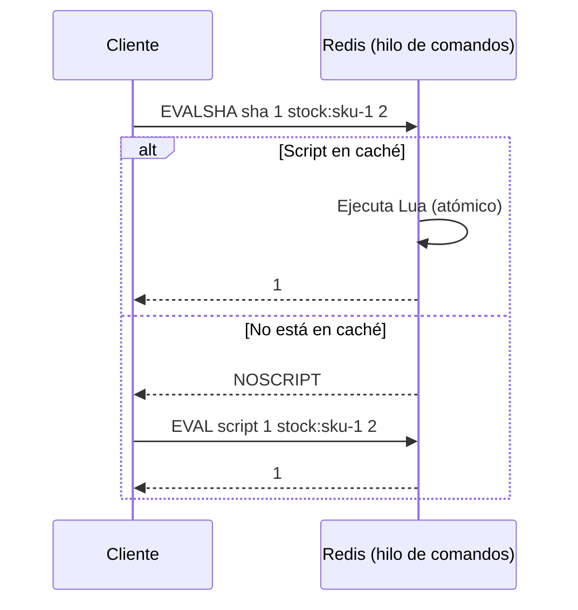

# Lua scripting en Redis

> [!abstract] En 30 segundos
> - **Qué es:** ejecutar un script Lua **dentro del servidor**, de forma atómica, con `EVAL`/`EVALSHA`.
> - **Para qué:** operaciones «leer-decidir-escribir» que no caben en un solo comando ni en `MULTI`/`EXEC` (porque dependen de lo que lees).
> - **Recuerda:** el script bloquea Redis mientras corre: debe ser corto y O(1) o casi. Declara **todas las claves en `KEYS`** (imprescindible en Cluster).

> [!info] Lección 2.13 · Nivel 2 — Estructuras de datos y operaciones avanzadas
> ⬅️ [[Pipelining]] · ➡️ [[Redis Functions]] · 🗺️ [[01 - Redis - Roadmap#Nivel 2 — Estructuras de datos y operaciones avanzadas|Roadmap]] · 📊 [[03 - Redis - Progreso|Progreso]]
> 🏷️ Core · `EVAL_RO`/`EVALSHA_RO` y *flags* de script con *shebang* ≥7.0 · Valkey compatible · algunos servicios gestionados restringen scripts: compruébalo.

## 📌 Definición

Redis embebe un intérprete **Lua 5.1**. Un script recibe `KEYS` y `ARGV`, llama a comandos con `redis.call()` y devuelve un valor. Mientras el script se ejecuta, **ningún otro comando se atiende**: es atómico por construcción, igual que cualquier comando.

| Comando | Qué hace |
|---|---|
| `EVAL script numkeys key… arg…` | Ejecuta el script enviándolo completo |
| `EVALSHA sha1 numkeys key… arg…` | Ejecuta un script ya cacheado por su SHA1 |
| `SCRIPT LOAD script` | Carga en la caché y devuelve el SHA1 |
| `SCRIPT EXISTS sha1…` / `SCRIPT FLUSH` | Consulta / vacía la caché |
| `EVAL_RO` / `EVALSHA_RO` | Variantes de solo lectura (se pueden enviar a réplicas) |
| `SCRIPT KILL` | Detiene un script de solo lectura que se pasa de tiempo |

## 🎯 ¿Qué problema resuelve?

Un patrón muy común es «lee, decide y escribe»: reservar stock solo si hay, liberar un bloqueo solo si es tuyo, limitar peticiones. Hecho desde el cliente con varios comandos, otro cliente puede colarse entre medias (condición de carrera). `WATCH` lo arregla con reintentos; un script lo resuelve en **un round-trip y sin reintentos**.

## 🧠 Conceptos fundamentales

1. **`KEYS` y `ARGV`:** las claves que toca el script van siempre en `KEYS`; los valores, en `ARGV`. Es lo que permite a Cluster enrutar el script al nodo correcto (todas las claves deben estar en el mismo slot).
2. **`redis.call` vs `redis.pcall`:** `call` propaga el error y aborta el script; `pcall` devuelve el error como tabla para que lo gestiones.
3. **Conversión de tipos (la gran trampa):**

| Redis → Lua | Lua → Redis |
|---|---|
| Integer → number | number → **integer** (se trunca el decimal) |
| Bulk string → string | string → bulk string |
| Nil bulk → `false` | `false` → nil |
| Array → table | table → array (se corta en el primer `nil`) |
| `OK` → table `{ok=…}` | `true` → 1 |

4. **Caché de scripts:** el servidor guarda cada script por SHA1. No se persiste ni sobrevive a un reinicio o *failover*: el cliente debe poder volver a enviar el script (`NOSCRIPT`).
5. **Tiempo máximo:** pasado `busy-reply-threshold` (5 s por defecto; alias antiguo `lua-time-limit`), Redis empieza a responder `BUSY` a los demás clientes. Solo aceptará `SCRIPT KILL` (si el script no ha escrito) o `SHUTDOWN NOSAVE`.
6. **Replicación por efectos:** a réplicas y AOF se envían los comandos de escritura que el script ejecutó, no el script; por eso se permiten funciones no deterministas como `TIME`.
7. **Flags (≥7.0):** el script puede comenzar con `#!lua flags=no-writes,allow-stale` para declarar su comportamiento.

### Analogía
Un script es dar al **cajero** una hoja de instrucciones: «mira el saldo; si hay, resta; si no, rechaza». Mientras la sigue, nadie más pasa por su ventanilla.
**Dónde se rompe:** si la hoja es larga, la cola entera espera: un script lento paraliza a todos.

## ⚙️ Funcionamiento interno



- Los scripts corren en el hilo principal de comandos, igual que `MULTI`/`EXEC`.
- No se pueden usar librerías arbitrarias: solo `cjson`, `cmsgpack`, `struct`, `bit`, y las funciones `redis.*`.
- Los scripts no pueden usar comandos bloqueantes de forma bloqueante ni `SUBSCRIBE`.

## 💻 Ejemplos prácticos

```lua
-- 1. Liberar un bloqueo solo si es mío (compara y borra)
if redis.call('GET', KEYS[1]) == ARGV[1] then
  return redis.call('DEL', KEYS[1])
else
  return 0
end
```

```lua
-- 2. Contador de ventana fija: INCR + PEXPIRE atómicos
local current = redis.call('INCR', KEYS[1])
if current == 1 then
  redis.call('PEXPIRE', KEYS[1], ARGV[1])
end
return current
```

```lua
-- 3. Reservar stock solo si hay suficiente
local stock = tonumber(redis.call('GET', KEYS[1]) or '0')
local qty = tonumber(ARGV[1])
if stock >= qty then
  redis.call('DECRBY', KEYS[1], qty)
  return 1
end
return 0
```

```text
127.0.0.1:6379> SET stock:sku-1 5
OK
127.0.0.1:6379> EVAL "local s=tonumber(redis.call('GET',KEYS[1]) or '0') if s>=tonumber(ARGV[1]) then redis.call('DECRBY',KEYS[1],ARGV[1]) return 1 end return 0" 1 stock:sku-1 2
(integer) 1
127.0.0.1:6379> GET stock:sku-1
"3"
```

> [!tip] ¿Aún necesitas Lua para liberar un bloqueo?
> Desde Redis 8.4, `DELEX clave IFEQ valor` hace el «compara y borra» del ejemplo 1 con un comando nativo, y `SET … IFEQ` hace el «compara y reemplaza». En versiones anteriores o en Valkey, sigue haciendo falta Lua. Y `INCREX` (≥8.8) cubre el contador con expiración del ejemplo 2. Ver [[Distributed locks con Redis]] y [[Rate limiting con Redis]].

## 🔧 Implementación en .NET

```csharp
using StackExchange.Redis;

IDatabase db = mux.GetDatabase();

// LuaScript.Prepare traduce los parámetros @nombre a KEYS/ARGV:
// los de tipo RedisKey van a KEYS; el resto, a ARGV.
LuaScript reservar = LuaScript.Prepare("""
    local stock = tonumber(redis.call('GET', @clave) or '0')
    if stock >= tonumber(@cantidad) then
        redis.call('DECRBY', @clave, @cantidad)
        return 1
    end
    return 0
    """);

RedisResult r = await db.ScriptEvaluateAsync(
    reservar, new { clave = (RedisKey)"stock:sku-1", cantidad = 2 });

bool reservado = (int)r == 1;

// Script de solo lectura, ejecutable también en réplicas
RedisResult ro = await db.ScriptEvaluateReadOnlyAsync(
    "return redis.call('GET', KEYS[1])",
    new RedisKey[] { "stock:sku-1" });
```

> [!note] Cómo viaja el script
> `LuaScript` se envía con `EVAL`. Si quieres `EVALSHA`, carga el script en el servidor (`Load`/`LoadAsync` sobre un `IServer`) y usa el `LoadedLuaScript` resultante. La documentación de StackExchange.Redis explica ambos caminos.

## 🏗️ Casos de uso en arquitectura

| Caso | Script |
|---|---|
| Reserva de stock / inventario | Comprobar y descontar |
| Rate limiting con ventanas o *token bucket* | Contador + TTL, o estado multi-campo en un hash |
| Liberar un lock (versiones sin `DELEX`) | Comparar el token y borrar |
| Operaciones compuestas sobre varias estructuras de una misma entidad (con *hash tag*) | Todo en un round-trip |

### Cuándo NO usarlo
- Lógica de negocio compleja: acaba siendo código difícil de probar, desplegar y depurar dentro de la base de datos.
- Operaciones O(N) grandes: bloquean a todos los clientes.
- Claves que no puedes declarar en `KEYS` o que están en slots distintos.

### Consideraciones de arquitectura

| Dimensión | Qué pensar |
|---|---|
| Versionado | El script vive en tu código; el servidor solo lo cachea. Con [[Redis Functions]] vive en el servidor |
| Cluster | Todas las claves en el mismo slot; usa `{hash tags}` |
| Gestionados | Revisa restricciones del proveedor |
| Pruebas | Pruébalos contra un Redis real ([[Testing con Redis y Testcontainers]]) |

## ⚠️ Errores y anti-patterns

| Error | Por qué duele | Cómo evitarlo |
|---|---|---|
| Construir nombres de clave dentro del script | Rompe Cluster y la replicación de claves declaradas | Pasarlas todas en `KEYS` |
| Devolver decimales con `return 0.5` | Se trunca a `0` | Devolver `tostring(x)` |
| Scripts con bucles largos | Bloquean el servidor y provocan `BUSY` | Mantenerlos O(1) o pequeños |
| Asumir que la caché de scripts persiste | `NOSCRIPT` tras un reinicio o failover | Fallback a `EVAL` o Functions |
| Comprobar `nil` con `== nil` | `redis.call` devuelve `false` para nil | `== false` o `or 'valor'` |

## ✅ Buenas prácticas

1. Scripts cortos, deterministas en intención y sin acceso a claves no declaradas.
2. `KEYS` y `ARGV` siempre; nada de claves calculadas.
3. Preferir `EVAL_RO` para lecturas.
4. Mide con `SLOWLOG` y vigila los scripts largos.
5. Si el comando nativo existe (`DELEX`, `INCREX`, `SET IFEQ`), úsalo en vez de Lua.

## 🎤 Preguntas de entrevista

> [!question]- 1. ¿Por qué un script es atómico y qué coste tiene?
> Corre en el hilo de comandos y ningún otro comando se atiende hasta que termina. El coste: un script lento bloquea a todos los clientes.

> [!question]- 2. ¿Por qué hay que pasar las claves en `KEYS`?
> Para que Cluster sepa a qué nodo enrutar y verifique que todas están en el mismo slot, y para que la replicación y las herramientas sepan qué claves toca.

> [!question]- 3. ¿Qué pasa con la caché de scripts al reiniciar?
> Se pierde. El cliente recibe `NOSCRIPT` y debe reenviar con `EVAL`; por eso las librerías hacen el fallback.

> [!question]- 4. ¿Qué devuelve Lua `return 3.7` al cliente?
> El entero `3`: Lua convierte los números a entero de Redis. Si necesitas decimales, devuelve una cadena.

## 🧪 Ejercicios

### 🟢 Básicos
1. Ejecuta con `redis-cli` el ejemplo de reserva de stock con distintas cantidades.
2. Calcula el SHA1 con `SCRIPT LOAD` y ejecútalo con `EVALSHA`.

### 🟡 Intermedios
3. Escribe un script que haga `HINCRBY` de un campo solo si el hash existe, y devuelva `-1` si no existe.
4. Implementa en .NET un `LuaScript` con parámetros con nombre y pruébalo concurrentemente con 100 tareas: el stock nunca debe quedar negativo.

### 🔴 Reto Senior
5. Un script recorre un set de 2 millones de miembros y provoca errores `BUSY` en producción. Diagnóstica y rediseña.

> [!success]- Soluciones
> **5.** Un script O(N) sobre 2 M de elementos bloquea el servidor segundos. Mueve el recorrido al cliente con `SSCAN` por lotes, o cambia el modelo para que la operación sea O(1) (contadores mantenidos de forma incremental). Detecta el problema con `SLOWLOG` y `LATENCY`.

### ✔️ Checklist de dominio
- [ ] Escribo scripts con `KEYS`/`ARGV` y gestiono errores con `pcall`.
- [ ] Conozco las reglas de conversión de tipos.
- [ ] Sé cuándo un comando nativo sustituye al script.

## 📝 Resumen

- Lua en el servidor = atomicidad en un round-trip para «leer-decidir-escribir».
- `KEYS`/`ARGV`, scripts cortos, cuidado con la conversión de tipos.
- La caché de scripts es volátil; Functions la sustituye con persistencia.
- Antes de escribir Lua, comprueba si hay un comando nativo.

## 🔗 Referencias

- [Scripting con Lua](https://redis.io/docs/latest/develop/programmability/eval-intro/)
- [EVAL](https://redis.io/docs/latest/commands/eval/)
- [StackExchange.Redis: Scripting](https://stackexchange.github.io/StackExchange.Redis/Scripting)

## 🔄 Notas relacionadas

- ⬅️ [[Pipelining]] · ➡️ [[Redis Functions]]
- Relacionadas: [[Transacciones con MULTI, EXEC y WATCH]] · [[Distributed locks con Redis]] · [[Rate limiting con Redis]] · [[Modelo de ejecución single-threaded]]
