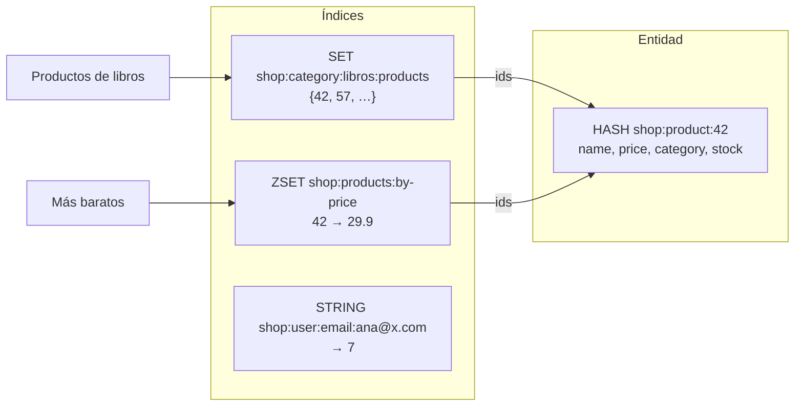

# Modelado de datos en Redis

> [!abstract] En 30 segundos
> - **Qué es:** decidir qué estructura, qué claves y qué índices usar a partir de **las consultas que necesitas**, no de las entidades.
> - **Para qué:** que cada lectura y escritura sea O(1) u O(log N), con memoria acotada y sin hot keys ni big keys.
> - **Recuerda:** en Redis no hay `JOIN` ni consultas ad hoc. **Primero las preguntas, luego las estructuras**; los índices secundarios los mantienes tú (o los delegas en [[Redis Query Engine]]).

> [!info] Lección 2.15 · Nivel 2 — Estructuras de datos y operaciones avanzadas
> ⬅️ [[Redis Functions]] · ➡️ [[Rate limiting con Redis]] · 🗺️ [[01 - Redis - Roadmap#Nivel 2 — Estructuras de datos y operaciones avanzadas|Roadmap]] · 📊 [[03 - Redis - Progreso|Progreso]]
> 🏷️ Core · las partes de JSON y Query Engine son **R8** (Redis 8+ o Stack).

## 📌 Definición

El **modelado de datos en Redis** es el diseño de:

1. **Convención de claves** (espacio de nombres, identificadores, versiones).
2. **Estructura** de cada clave (string, hash, list, set, sorted set, stream, JSON…).
3. **Índices secundarios** para las consultas que no son «por clave primaria».
4. **Ciclo de vida** (TTL, retención, eviction) y **colocación** (hash tags en Cluster).

## 🎯 ¿Qué problema resuelve?

En un modelo relacional normalizas y luego consultas de cualquier forma. En Redis solo puedes acceder por clave, así que un modelo mal pensado acaba en `KEYS *`, recorridos O(N) o varias lecturas encadenadas. Un buen modelo hace que las 5-10 consultas críticas de tu sistema se resuelvan con 1-3 comandos de coste bajo.

## 🧠 Conceptos fundamentales

### Método en 5 pasos

1. **Lista las consultas** (lecturas y escrituras) con su frecuencia, latencia objetivo y volumen.
2. **Elige la estructura** que responde cada una con el menor coste.
3. **Diseña las claves**: `app:entidad:id[:atributo]`.
4. **Añade índices** donde haga falta, y decide cómo se mantienen consistentes.
5. **Define ciclo de vida y tamaño:** TTL, cuántos elementos máximo, cómo se purga.

### Guía de decisión

| Necesidad | Estructura |
|---|---|
| Valor opaco, caché de una respuesta, contador | String |
| Entidad con campos que se leen o modifican por separado | Hash |
| Entidad anidada o con consultas sobre sus campos | JSON (+ Query Engine) |
| Cola simple, últimos N elementos | List (`LPUSH` + `LTRIM`) |
| Pertenencia, unicidad, relaciones sin orden | Set |
| Ranking, ordenar por un número, rangos por puntuación o tiempo | Sorted Set |
| Log de eventos con consumidores | Stream |
| Cardinalidad aproximada | HyperLogLog |
| Flags densos por ID entero | Bitmap |

### Convención de claves
- Prefijo por aplicación y entidad, separador `:` y **identificadores al final**: `shop:product:42`.
- Claves **cortas pero legibles**: la clave se guarda en memoria con cada valor.
- Nada de datos personales en el nombre de la clave (aparecen en logs, `MONITOR`, métricas).
- Versiona cuando el formato del valor cambie: `shop:v2:product:42`.

### Índices secundarios manuales

| Consulta | Índice |
|---|---|
| Buscar por un campo único (email → usuario) | String `shop:user:email:{email}` → id |
| Relaciones 1-N (productos de una categoría) | Set `shop:category:{c}:products` |
| Ordenar o filtrar por número (precio, fecha) | Sorted Set `shop:products:by-price` |
| Rango de fechas | Sorted Set con timestamp como score |

**El coste:** cada escritura debe actualizar la entidad y todos sus índices. Hazlo en una transacción, un script o un pipeline, y asume que un fallo a medias puede dejar un índice desfasado.

### Analogía
Un **archivador de oficina** sin buscador: solo puedes abrir una carpeta si conoces su etiqueta. Para encontrar por varios criterios, mantienes tarjeteros adicionales (índices) que apuntan a las carpetas.
**Dónde se rompe:** cada vez que archivas una carpeta nueva, debes actualizar todos los tarjeteros.

## ⚙️ Funcionamiento interno



- Redis no sabe que `shop:category:libros:products` es un índice de `shop:product:42`: la relación la mantiene tu código.
- Cada estructura grande es **una sola clave**, y en Cluster vive en un solo shard: las claves enormes son el principal riesgo de reparto desigual ([[Big keys]], [[Hot keys]]).

## 💻 Ejemplos prácticos

```text
127.0.0.1:6379> HSET shop:product:42 name "Clean Architecture" price 29.9 category libros stock 12
(integer) 4
127.0.0.1:6379> SADD shop:category:libros:products 42
(integer) 1
127.0.0.1:6379> ZADD shop:products:by-price 29.9 42
(integer) 1
127.0.0.1:6379> ZRANGEBYSCORE shop:products:by-price 0 30 LIMIT 0 10
1) "42"
127.0.0.1:6379> SET shop:user:email:ana@example.com 7 NX
OK
127.0.0.1:6379> SET shop:user:email:ana@example.com 8 NX
(nil)
```

El último `SET … NX` devuelve `nil`: el email ya está registrado (unicidad sin base de datos relacional).

### Relación con la colocación en Cluster
Para operar atómicamente sobre varias claves relacionadas en Cluster, agrúpalas con un *hash tag*: `{cart:42}:items` y `{cart:42}:meta` caen en el mismo slot.

## 🔧 Implementación en .NET

```csharp
using StackExchange.Redis;

public record Product(int Id, string Name, decimal Price, string Category, int Stock);

public static class Keys
{
    public static RedisKey Product(int id) => $"shop:product:{id}";
    public static RedisKey ByCategory(string category) => $"shop:category:{category}:products";
    public static RedisKey ByPrice => "shop:products:by-price";
    public static RedisKey UserByEmail(string email) => $"shop:user:email:{email.ToLowerInvariant()}";
}

public class ProductRepository(IDatabase db)
{
    public async Task SaveAsync(Product p)
    {
        // Entidad + índices en un solo viaje.
        // Ojo: en Cluster estas claves caen en slots distintos y una transacción daría CROSSSLOT.
        IBatch batch = db.CreateBatch();
        var tasks = new List<Task>
        {
            batch.HashSetAsync(Keys.Product(p.Id),
            [
                new("name", p.Name),
                new("price", (double)p.Price),
                new("category", p.Category),
                new("stock", p.Stock)
            ]),
            batch.SetAddAsync(Keys.ByCategory(p.Category), p.Id),
            batch.SortedSetAddAsync(Keys.ByPrice, p.Id, (double)p.Price)
        };
        batch.Execute();
        await Task.WhenAll(tasks);
    }

    public async Task<Product?> GetAsync(int id)
    {
        HashEntry[] fields = await db.HashGetAllAsync(Keys.Product(id));
        if (fields.Length == 0) return null;
        Dictionary<string, RedisValue> d = fields.ToDictionary(f => (string)f.Name!, f => f.Value);
        return new Product(id, (string)d["name"]!, (decimal)(double)d["price"],
                           (string)d["category"]!, (int)d["stock"]);
    }

    public async Task<int[]> CheaperThanAsync(double maxPrice, int take = 10)
    {
        RedisValue[] ids = await db.SortedSetRangeByScoreAsync(
            Keys.ByPrice, double.NegativeInfinity, maxPrice, take: take);
        return ids.Select(i => (int)i).ToArray();
    }

    // Unicidad: SET NX sin TTL
    public Task<bool> RegisterEmailAsync(string email, int userId) =>
        db.StringSetAsync(Keys.UserByEmail(email), userId, expiry: null, when: When.NotExists);
}
```

## 🏗️ Casos de uso en arquitectura

| Escenario | Modelo |
|---|---|
| Catálogo de productos como caché | Hash por producto + índices por categoría y precio; fuente de verdad en SQL |
| Carrito de compra | Hash por carrito (`HSET cart:{id} sku qty`) con TTL deslizante |
| Perfil de usuario con consultas por campos | JSON + Query Engine ([[Redis JSON]], [[Redis Query Engine]]) |
| Actividad reciente | List o Sorted Set con timestamp, recortados |

### Cuándo NO modelar a mano
- Tienes muchas consultas ad hoc por muchos campos: usa Query Engine, o una base de datos que lo haga nativamente.
- Los datos requieren integridad referencial fuerte y transacciones multi-entidad: base de datos relacional como fuente de verdad.

### Consideraciones de arquitectura

| Dimensión | Qué pensar |
|---|---|
| Consistencia de índices | Escritura de entidad e índices en lote/script; reconciliación periódica |
| Memoria | Calcula el tamaño por entidad × cantidad; `MEMORY USAGE` |
| Cluster | Hash tags para operaciones multi-clave; evita estructuras gigantes |
| Evolución | Versiona claves y migra con lectura doble o expiración natural |

## ⚠️ Errores y anti-patterns

| Error | Por qué duele | Cómo evitarlo |
|---|---|---|
| Un único hash/set gigante con todo | Big key, bloqueo y hot shard | Particionar por entidad o por rango |
| `KEYS patrón` para buscar | O(N), bloquea | Índices o `SCAN` fuera del camino crítico |
| Normalizar como en SQL | Múltiples lecturas encadenadas | Denormalizar para la consulta |
| Índices que nunca se purgan | Fugas de memoria | Eliminar al borrar la entidad o con TTL |
| Datos sensibles en la clave | Aparecen en logs y métricas | Identificadores opacos |
| Serializar objetos grandes en un string cuando se modifican por campos | Leer-modificar-escribir racy | Hash o JSON |

## ✅ Buenas prácticas

1. Empieza por la lista de consultas.
2. Claves con prefijo, id al final, sin datos sensibles.
3. Documenta el modelo (claves, estructuras, TTL, quién escribe cada índice).
4. Usa TTL en todo lo que sea caché o temporal.
5. Mide tamaños reales con `MEMORY USAGE` y `--bigkeys`.

## 🎤 Preguntas de entrevista

> [!question]- 1. ¿Cómo modelas «productos de una categoría ordenados por precio»?
> Opción simple: un sorted set por categoría con el id como miembro y el precio como score. Si hace falta filtrar por varios criterios a la vez, Query Engine sobre hashes o JSON.

> [!question]- 2. ¿Cómo garantizas que un email sea único?
> Con `SET clave id NX` (o `HSETNX`): solo uno de los intentos concurrentes gana. En la base relacional de referencia, además, una restricción UNIQUE.

> [!question]- 3. ¿Por qué se desnormaliza?
> Porque Redis no tiene `JOIN`: es más barato duplicar datos para que cada consulta se responda con 1-3 comandos, a costa de mantener la consistencia en las escrituras.

## 🧪 Ejercicios

### 🟢 Básicos
1. Modela un blog: posts, autores, etiquetas y comentarios. Lista las consultas y define las estructuras.

### 🟡 Intermedios
2. Añade «posts más recientes por etiqueta» y «posts por autor ordenados por fecha». Define los índices y cómo se actualizan al borrar un post.

### 🔴 Reto Senior
3. Diseña el modelo de una red social ligera: seguir usuarios, *timeline* (últimos 200 posts de los seguidos) y contador de seguidores. Compara *fan-out* en escritura frente a *fan-out* en lectura.

> [!success]- Soluciones
> **3.** Seguidores/seguidos: dos sets (`following:{u}`, `followers:{u}`). Timeline por *fan-out* en escritura: al publicar, `LPUSH` el id del post en la lista de cada seguidor y `LTRIM` a 200 (rápido de leer, caro para usuarios con millones de seguidores). *Fan-out* en lectura: al pedir el timeline, mezclar los últimos posts de los seguidos (barato de escribir, caro de leer). Híbrido: escritura para usuarios normales, lectura para cuentas con muchísimos seguidores.

### ✔️ Checklist de dominio
- [ ] Parto de las consultas y elijo la estructura adecuada.
- [ ] Diseño claves legibles y seguras.
- [ ] Mantengo índices secundarios y sé qué pasa si falla una escritura.

## 📝 Resumen

- Se modela por consulta, no por entidad.
- Convención de claves clara; sin datos sensibles; con versionado.
- Los índices secundarios los mantienes tú (o Query Engine).
- Cuidado con big keys, hot keys y la colocación en Cluster.

## 🔗 Referencias

- [Redis data types](https://redis.io/docs/latest/develop/data-types/)
- [Secondary indexing](https://redis.io/docs/latest/develop/use-cases/secondary-indexing/)
- [Keys y keyspace](https://redis.io/docs/latest/develop/using-commands/keyspace/)

## 🔄 Notas relacionadas

- ⬅️ [[Redis Functions]] · ➡️ [[Rate limiting con Redis]]
- Relacionadas: [[Claves y keyspace en Redis]] · [[Redis Hashes]] · [[Redis Sets]] · [[Redis Sorted Sets]] · [[Redis JSON]] · [[Redis Query Engine]] · [[Hash slots]]
