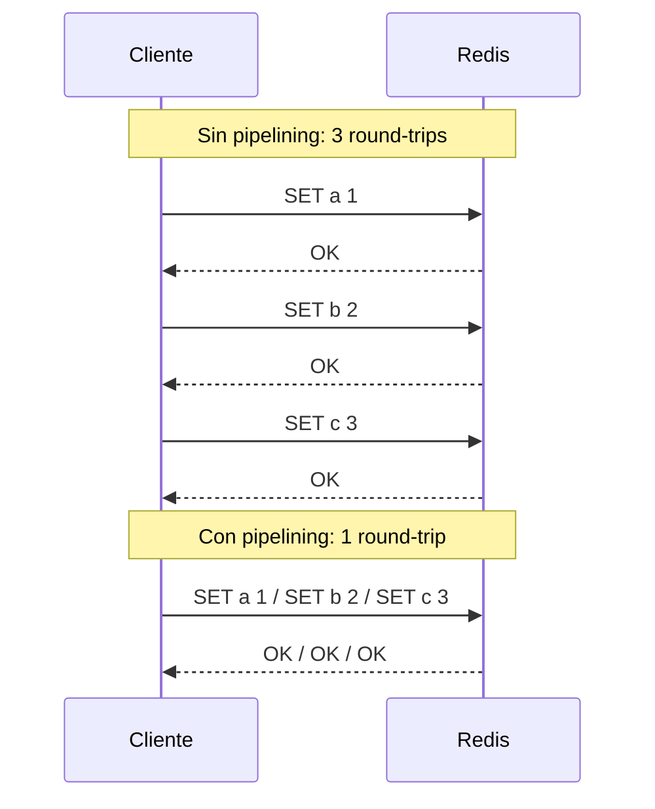

# Pipelining

> [!abstract] En 30 segundos
> - **Qué es:** enviar varios comandos **sin esperar la respuesta de cada uno** y leer todas las respuestas después.
> - **Para qué:** convertir N round-trips en uno (o pocos) y reducir llamadas al sistema: más throughput y menos latencia total.
> - **Recuerda:** pipelining **no es atómico** (otros clientes pueden intercalarse). StackExchange.Redis hace pipelining automáticamente cuando lanzas peticiones concurrentes.

> [!info] Lección 2.12 · Nivel 2 — Estructuras de datos y operaciones avanzadas
> ⬅️ [[Transacciones con MULTI, EXEC y WATCH]] · ➡️ [[Lua scripting en Redis]] · 🗺️ [[01 - Redis - Roadmap#Nivel 2 — Estructuras de datos y operaciones avanzadas|Roadmap]] · 📊 [[03 - Redis - Progreso|Progreso]]
> 🏷️ Core · disponible en todas las ediciones, en Valkey y en los servicios gestionados.

## 📌 Definición

En el modelo petición-respuesta, el cliente envía un comando, espera la respuesta y envía el siguiente. Con **pipelining**, el cliente escribe muchos comandos seguidos en el socket; Redis los procesa en orden y devuelve las respuestas en el mismo orden. El protocolo RESP lo soporta de forma nativa, sin ningún comando especial.

## 🎯 ¿Qué problema resuelve?

Cada round-trip cuesta ~0,1-0,5 ms en la misma zona y mucho más entre regiones, aunque el comando tarde microsegundos en ejecutarse. Cargar 10 000 claves de una en una son 10 000 round-trips; en un pipeline, unos pocos milisegundos de red. Además, el servidor hace muchas menos llamadas `read()`/`write()` al sistema, así que el throughput sube incluso en *loopback*.

## 🧠 Conceptos fundamentales

| Técnica | Atómica | Round-trips | Lógica intermedia |
|---|---|---|---|
| Comandos sueltos | Cada uno | N | En la aplicación |
| Comandos variádicos (`MGET`, `MSET`, `SADD` con varios miembros…) | Sí | 1 | No |
| **Pipelining** | **No** | 1 (o pocos) | No |
| `MULTI`/`EXEC` | Sí (sin intercalado) | 1 si se envía en pipeline | No |
| Lua / Functions | Sí | 1 | Sí, en el servidor |

1. **No es una transacción:** otros clientes pueden ejecutar comandos entre los tuyos.
2. **Los comandos no pueden depender entre sí:** no puedes usar el resultado de uno como argumento del siguiente dentro del mismo pipeline (para eso, Lua).
3. **Memoria de respuestas:** el servidor acumula las respuestas en el buffer de salida hasta que el cliente las lee; pipelines gigantes consumen memoria en ambos lados. Envía por lotes (de 1 000 a 10 000 comandos es un punto de partida razonable; mídelo).
4. **Errores:** cada comando tiene su propia respuesta; un error no detiene los demás.

### Analogía
En lugar de ir al supermercado a por cada producto y volver a casa, llevas **la lista completa** y haces un solo viaje. El cajero cobra los productos en orden, pero otros clientes pueden pasar por otras cajas mientras tanto (no es atómico).
**Dónde se rompe:** no puedes decidir qué comprar según el precio del producto anterior sin volver a casa (no hay lógica intermedia).

## ⚙️ Funcionamiento interno



- Redis lee del socket todos los comandos disponibles, los ejecuta en orden y escribe las respuestas, normalmente con una sola llamada de escritura.
- El tiempo total pasa de `N × (RTT + ejecución)` a aproximadamente `RTT + N × ejecución`.

## 💻 Ejemplos prácticos

```bash
# El efecto en números: -P es el tamaño del pipeline
redis-benchmark -q -n 200000 -t set,get
redis-benchmark -q -n 200000 -t set,get -P 16

# Carga masiva con redis-cli --pipe (entrada en protocolo RESP)
printf '*3\r\n$3\r\nSET\r\n$1\r\na\r\n$1\r\n1\r\n' | redis-cli --pipe
```

Con `-P 16` el throughput se multiplica varias veces respecto a la ejecución sin pipelining.

## 🔧 Implementación en .NET

**Pipelining implícito:** StackExchange.Redis multiplexa todas las peticiones sobre una conexión; si lanzas varias operaciones sin esperar cada una, viajan juntas.

```csharp
using StackExchange.Redis;

IDatabase db = mux.GetDatabase();
string[] ids = Enumerable.Range(1, 1000).Select(i => i.ToString()).ToArray();

// ❌ 1 000 round-trips secuenciales
foreach (string id in ids)
    await db.StringSetAsync($"producto:{id}", "…", TimeSpan.FromMinutes(10));

// ✅ Pipelining implícito: lanzar todas y esperar juntas
await Task.WhenAll(ids.Select(id =>
    db.StringSetAsync($"producto:{id}", "…", TimeSpan.FromMinutes(10))));

// ✅ Pipelining explícito con IBatch: las operaciones se envían juntas, en un bloque
IBatch batch = db.CreateBatch();
List<Task> pending = ids.Select(id =>
    (Task)batch.StringSetAsync($"producto:{id}", "…", TimeSpan.FromMinutes(10))).ToList();
batch.Execute();
await Task.WhenAll(pending);

// ✅ Comando variádico: aún mejor cuando existe
RedisValue[] values = await db.StringGetAsync(
    ids.Select(id => (RedisKey)$"producto:{id}").ToArray());

// Escrituras que no necesitan respuesta (métricas no críticas)
await db.StringIncrementAsync("visitas:home", flags: CommandFlags.FireAndForget);
```

> [!tip] `IBatch` frente a `ITransaction`
> `IBatch` agrupa el envío (pipeline) sin atomicidad; `ITransaction` envuelve los comandos en `MULTI`/`EXEC`. En ambos casos **no esperes las tareas antes de llamar a `Execute`**: se completan cuando el lote se envía.

## 🏗️ Casos de uso en arquitectura

| Caso | Técnica |
|---|---|
| Carga inicial o recálculo masivo | Pipeline por lotes o `redis-cli --pipe` |
| Leer muchas claves en una petición | `MGET` o `HMGET` |
| Escribir métricas y contadores | Pipeline + `FireAndForget` |
| Construir una página con datos de varias estructuras | Lanzar todas las lecturas en paralelo (pipelining implícito) |

### Cuándo NO basta
- Necesitas atomicidad: `MULTI`/`EXEC` o Lua.
- Un comando depende del resultado de otro: Lua.

### Consideraciones de arquitectura

| Dimensión | Qué pensar |
|---|---|
| Latencia | Un pipeline enorme retrasa la primera respuesta y ocupa la conexión compartida |
| Memoria | Buffers de salida del servidor y memoria del cliente |
| Cluster | El cliente reparte los comandos por nodos; cada nodo responde en orden |

## ⚠️ Errores y anti-patterns

| Error | Por qué duele | Cómo evitarlo |
|---|---|---|
| Bucles con `await` en cada comando | N round-trips | `Task.WhenAll`, `IBatch` o variádicos |
| Pipelines de millones de comandos | Memoria y latencia | Lotes de miles |
| Esperar atomicidad del pipeline | Otros clientes se intercalan | `MULTI`/`EXEC` o Lua |
| `FireAndForget` en escrituras críticas | No te enteras de los errores | Esperar el resultado |

## ✅ Buenas prácticas

1. Prefiere comandos variádicos; después, pipelining; después, scripts.
2. Lotes de tamaño moderado y medido.
3. En .NET, lanza en paralelo y espera con `Task.WhenAll`; `IBatch` para bloques explícitos.
4. `FireAndForget` solo para escrituras no críticas.

## 🎤 Preguntas de entrevista

> [!question]- 1. ¿Diferencia entre pipelining y una transacción?
> Pipelining agrupa el envío para ahorrar round-trips, sin atomicidad: otros clientes pueden intercalarse. `MULTI`/`EXEC` garantiza que los comandos se ejecutan seguidos, sin intercalado (y se suele enviar en pipeline).

> [!question]- 2. ¿Por qué el pipelining mejora el throughput incluso en la misma máquina?
> Porque además de ahorrar round-trips reduce las llamadas al sistema: el servidor lee y escribe muchos comandos y respuestas por cada `read()`/`write()`.

> [!question]- 3. ¿Cómo hace pipelining StackExchange.Redis?
> Multiplexando: todas las peticiones de la aplicación comparten una conexión y se escriben en cuanto se emiten, sin esperar las respuestas anteriores. Si lanzas varias tareas sin esperarlas una a una, viajan en pipeline. `IBatch` lo hace explícito.

## 🧪 Ejercicios

### 🟢 Básicos
1. Compara `redis-benchmark` con y sin `-P 16`.
2. Carga 100 000 claves con `--pipe`.

### 🟡 Intermedios
3. Mide en .NET las tres variantes del ejemplo con 10 000 claves contra un Redis en otra máquina o contenedor.

### 🔴 Reto Senior
4. Una página de producto hace 25 llamadas a Redis secuenciales y su p99 es de 40 ms. Propón cómo bajarla por debajo de 5 ms sin cambiar el modelo de datos, y qué cambiarías del modelo para bajarla más.

> [!success]- Soluciones
> **4.** Sin cambiar el modelo: lanzar las 25 lecturas en paralelo (`Task.WhenAll`) para que viajen en un pipeline: un round-trip efectivo. Cambiando el modelo: agrupar en un hash o un documento JSON lo que se lee siempre junto, para hacer 1-3 lecturas; o una caché L1 en memoria para lo más estable.

### ✔️ Checklist de dominio
- [ ] Explico pipelining, variádicos, transacciones y scripts, y cuándo usar cada uno.
- [ ] Aplico pipelining implícito y explícito en .NET.
- [ ] Conozco los límites (memoria, atomicidad, dependencias).

## 📝 Resumen

- Pipelining = varios comandos por round-trip; más throughput, menos latencia total.
- No es atómico ni admite dependencias entre comandos.
- En .NET: concurrencia + multiplexer, `IBatch`, variádicos.
- Lotes moderados para no disparar la memoria.

## 🔗 Referencias

- [Pipelining](https://redis.io/docs/latest/develop/using-commands/pipelining/)
- [StackExchange.Redis: Pipelines and multiplexers](https://stackexchange.github.io/StackExchange.Redis/PipelinesMultiplexers)

## 🔄 Notas relacionadas

- ⬅️ [[Transacciones con MULTI, EXEC y WATCH]] · ➡️ [[Lua scripting en Redis]]
- Relacionadas: [[Latencia y rendimiento en Redis]] · [[StackExchange.Redis]] · [[Benchmarking de Redis]]
