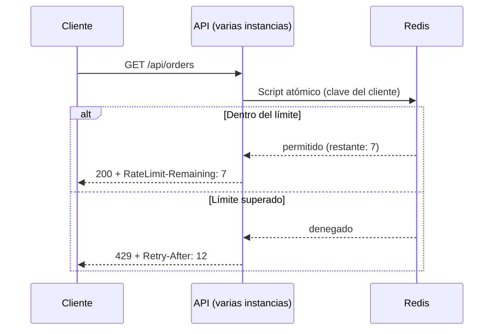

# Rate limiting con Redis

> [!abstract] En 30 segundos
> - **Qué es:** limitar cuántas peticiones puede hacer un cliente en un periodo, con el contador **compartido por todas las instancias** de la aplicación.
> - **Para qué:** proteger APIs de abuso, repartir capacidad, cumplir cuotas de planes.
> - **Recuerda:** el contador y su caducidad deben actualizarse **atómicamente** (Lua, `INCREX` ≥8.8, o un script). El limitador integrado de ASP.NET Core es local a cada proceso.

> [!info] Lección 2.16 · Nivel 2 — Estructuras de datos y operaciones avanzadas
> ⬅️ [[Modelado de datos en Redis]] · ➡️ [[Fundamentos de caching]] · 🗺️ [[01 - Redis - Roadmap#Nivel 2 — Estructuras de datos y operaciones avanzadas|Roadmap]] · 📊 [[03 - Redis - Progreso|Progreso]]
> 🏷️ Core · `INCREX` ≥8.8 (comprueba la versión de tu servicio gestionado) · Valkey: con Lua.
> 🧩 Proyecto asociado: [[Proyecto 02 - Sistema de rate limiting]].

## 📌 Definición

Un **rate limiter** decide, por cada petición, si un cliente (usuario, API key, IP) ha superado su cuota. Si la supera, la API responde `429 Too Many Requests` (idealmente con `Retry-After`). Redis es el sitio natural para el estado porque es rápido, atómico y está compartido por todas las instancias.

## 🎯 ¿Qué problema resuelve?

Con varias instancias detrás de un balanceador, un contador en memoria local deja pasar `N × límite` peticiones. Una base de datos relacional como contador es lenta y crea contención. Redis permite decisiones en menos de un milisegundo con estado centralizado y caducidad automática.

## 🧠 Conceptos fundamentales

| Algoritmo | Idea | Memoria | Precisión | Ráfagas |
|---|---|---|---|---|
| **Ventana fija** | Contador por ventana de tiempo (`INCR` + TTL) | O(1) | Baja: hasta 2× el límite en el cambio de ventana | Sí, en el borde |
| **Ventana deslizante (log)** | Sorted Set con el timestamp de cada petición | O(límite) | Exacta | No |
| **Ventana deslizante (contador)** | Dos ventanas fijas ponderadas | O(1) | Aproximada, buena | Suavizadas |
| **Token bucket** | Cubo que se rellena a tasa constante | O(1) | Exacta con la tasa y capacidad | Permite ráfagas hasta la capacidad |

1. **Atomicidad:** «incrementa y fija TTL», o «limpia, cuenta y añade» deben ejecutarse sin intercalado.
2. **Fuente de tiempo:** usa `redis.call('TIME')` dentro del script para evitar el desfase de relojes entre instancias.
3. **Clave del límite:** usuario, API key, IP, ruta o una combinación; incluye la versión del plan si cambia.
4. **Fail-open o fail-closed:** si Redis cae, ¿dejas pasar el tráfico (disponibilidad) o lo bloqueas (protección)? Es una decisión de negocio.

### Analogía
Un **torniquete con tarjeta** compartido por todas las puertas del estadio: no importa por cuál entres, el contador es el mismo.
**Dónde se rompe:** si cada puerta tuviera su propio torniquete (contador local), tendrías tantos aforos como puertas.

## ⚙️ Funcionamiento interno



- Todo el estado de un cliente vive en una clave (o dos, en el contador deslizante), con TTL: lo que no se usa desaparece.
- Al estar el script en el servidor, el round-trip es único y la decisión es consistente aunque haya 50 instancias concurrentes.

## 💻 Ejemplos prácticos

**Ventana fija (≥8.8, un solo comando):**

```text
127.0.0.1:6379> INCREX rate:user:42:202611031015 BYINT 1 UBOUND 100 EX 60 ENX
1) (integer) 1
2) (integer) 1
```

El segundo elemento (`1`) es el incremento aplicado; `0` significa límite alcanzado.

**Ventana fija (todas las versiones, con Lua):**

```lua
local current = redis.call('INCR', KEYS[1])
if current == 1 then
  redis.call('PEXPIRE', KEYS[1], ARGV[1])
end
return current
```

**Ventana deslizante con Sorted Set:**

```lua
-- KEYS[1] = clave · ARGV[1] = ventana (ms) · ARGV[2] = límite · ARGV[3] = id único de la petición
local t = redis.call('TIME')
local now = t[1] * 1000 + math.floor(t[2] / 1000)
redis.call('ZREMRANGEBYSCORE', KEYS[1], '-inf', now - tonumber(ARGV[1]))
if redis.call('ZCARD', KEYS[1]) < tonumber(ARGV[2]) then
  redis.call('ZADD', KEYS[1], now, ARGV[3])
  redis.call('PEXPIRE', KEYS[1], ARGV[1])
  return 1
end
return 0
```

**Token bucket:**

```lua
-- KEYS[1] = bucket · ARGV: capacidad, tokens por segundo, coste
local capacity = tonumber(ARGV[1])
local rate = tonumber(ARGV[2])
local cost = tonumber(ARGV[3])
local t = redis.call('TIME')
local now = t[1] * 1000 + math.floor(t[2] / 1000)

local data = redis.call('HMGET', KEYS[1], 'tokens', 'ts')
local tokens = tonumber(data[1])
local ts = tonumber(data[2])
if tokens == nil then
  tokens = capacity
  ts = now
end

tokens = math.min(capacity, tokens + math.max(0, now - ts) * rate / 1000)

local allowed = 0
if tokens >= cost then
  tokens = tokens - cost
  allowed = 1
end

redis.call('HSET', KEYS[1], 'tokens', tokens, 'ts', now)
redis.call('PEXPIRE', KEYS[1], math.ceil(capacity / rate * 1000) * 2)
return allowed
```

## 🔧 Implementación en .NET

```csharp
using StackExchange.Redis;

public class RedisRateLimiter(IDatabase db)
{
    // Token bucket: @-parámetros → RedisKey va a KEYS, el resto a ARGV
    private static readonly LuaScript TokenBucket = LuaScript.Prepare("""
        local t = redis.call('TIME')
        local now = t[1] * 1000 + math.floor(t[2] / 1000)
        local data = redis.call('HMGET', @key, 'tokens', 'ts')
        local tokens = tonumber(data[1])
        local ts = tonumber(data[2])
        if tokens == nil then
            tokens = tonumber(@capacity)
            ts = now
        end
        tokens = math.min(tonumber(@capacity), tokens + math.max(0, now - ts) * tonumber(@rate) / 1000)
        local allowed = 0
        if tokens >= tonumber(@cost) then
            tokens = tokens - tonumber(@cost)
            allowed = 1
        end
        redis.call('HSET', @key, 'tokens', tokens, 'ts', now)
        redis.call('PEXPIRE', @key, math.ceil(tonumber(@capacity) / tonumber(@rate) * 1000) * 2)
        return allowed
        """);

    public async Task<bool> TryAcquireAsync(string clientId, int capacity, double ratePerSecond, int cost = 1)
    {
        RedisResult r = await db.ScriptEvaluateAsync(TokenBucket, new
        {
            key = (RedisKey)$"rl:tb:{clientId}",
            capacity,
            rate = ratePerSecond,
            cost
        });
        return (int)r == 1;
    }

    // Ventana fija con INCREX (Redis ≥ 8.8)
    public async Task<bool> TryAcquireFixedWindowAsync(string clientId, int limit, TimeSpan window)
    {
        long bucket = DateTimeOffset.UtcNow.ToUnixTimeSeconds() / (long)window.TotalSeconds;
        RedisResult result = await db.ExecuteAsync("INCREX", $"rl:fw:{clientId}:{bucket}",
            "BYINT", 1, "UBOUND", limit, "EX", (int)window.TotalSeconds, "ENX");
        RedisResult[] parts = (RedisResult[])result!;
        return (long)parts[1] > 0;
    }
}
```

Middleware en ASP.NET Core (el limitador integrado, `Microsoft.AspNetCore.RateLimiting`, mantiene el estado **dentro de cada proceso**: no sirve para un límite global entre instancias):

```csharp
app.Use(async (HttpContext ctx, RequestDelegate next) =>
{
    var limiter = ctx.RequestServices.GetRequiredService<RedisRateLimiter>();
    string client = ctx.User.Identity?.Name ?? ctx.Connection.RemoteIpAddress?.ToString() ?? "anon";

    bool allowed;
    try
    {
        allowed = await limiter.TryAcquireAsync(client, capacity: 20, ratePerSecond: 5);
    }
    catch (RedisException)
    {
        allowed = true;   // fail-open: decisión consciente, documentada y con alerta
    }

    if (!allowed)
    {
        ctx.Response.StatusCode = StatusCodes.Status429TooManyRequests;
        ctx.Response.Headers.RetryAfter = "1";
        return;
    }
    await next(ctx);
});
```

## 🏗️ Casos de uso en arquitectura

| Caso | Algoritmo recomendado |
|---|---|
| Protección básica de una API pública | Ventana fija o token bucket |
| Cuotas por plan (1 000 peticiones/hora) | Ventana deslizante (contador) |
| Protección de login | Ventana deslizante exacta y bloqueo progresivo |
| Tráfico con ráfagas legítimas | Token bucket |
| Límite por coste (peticiones de distinto peso) | Token bucket con coste variable |

### Cuándo NO usar Redis
- Un único proceso o un límite aproximado por instancia es suficiente: `Microsoft.AspNetCore.RateLimiting`.
- Protección contra DDoS volumétrico: debe estar en el borde (CDN, WAF, API Gateway), antes de tu aplicación.

### Consideraciones de arquitectura

| Dimensión | Qué pensar |
|---|---|
| Disponibilidad | Fail-open o fail-closed; timeouts cortos para no añadir latencia |
| Cluster | Una clave por cliente (un slot): se reparte bien; evita límites globales en una sola clave (hot key) |
| Coste | Un comando por petición protegida; para tráfico enorme, combina un límite local grueso y uno global fino |
| Observabilidad | Métricas de permitidas/denegadas por cliente y regla |

## ⚠️ Errores y anti-patterns

| Error | Por qué duele | Cómo evitarlo |
|---|---|---|
| `INCR` y `EXPIRE` en dos pasos | Si el proceso cae entre ambos, la clave queda sin TTL: el cliente queda bloqueado para siempre | Script, `EXPIRE … NX` en transacción o `INCREX … ENX` |
| `GET` + `SET` desde el cliente | Condición de carrera | Atomicidad en servidor |
| Relojes de las instancias distintos | Ventanas inconsistentes | `TIME` de Redis |
| Un solo límite global en una clave | Hot key, cuello de botella | Particionar o aproximar con límites locales |
| Ignorar `Retry-After` | Los clientes reintentan sin control | Devolver el tiempo de espera |
| Fail-closed sin pensar | Redis caído = API caída | Decisión explícita por endpoint |

## ✅ Buenas prácticas

1. Elige el algoritmo según la necesidad, no por moda: ventana fija es la más barata; token bucket, la más flexible.
2. Todo el estado con TTL.
3. Devuelve `429` con `Retry-After` y cabeceras de cuota (por ejemplo, las del borrador IETF `RateLimit-*`).
4. Prueba la concurrencia: 100 tareas contra un límite de 10 deben dejar pasar 10.
5. Mide y alerta sobre los denegados.

## 🎤 Preguntas de entrevista

> [!question]- 1. ¿Qué problema tiene la ventana fija?
> En el cambio de ventana, un cliente puede hacer el límite al final de una y otra vez el límite al principio de la siguiente: hasta el doble en un periodo corto.

> [!question]- 2. ¿Por qué `INCR` + `EXPIRE` no es seguro?
> Son dos comandos: si el proceso falla entre ambos, queda un contador sin expiración. Se resuelve con script Lua, con `INCREX` o con `EXPIRE … NX` dentro de una transacción.

> [!question]- 3. ¿Cuándo prefieres token bucket?
> Cuando quieres permitir ráfagas hasta una capacidad y mantener una tasa media, o cuando las peticiones tienen costes distintos.

> [!question]- 4. ¿Qué haces si Redis no responde?
> Depende del endpoint: fail-open para APIs no críticas (con métricas y alerta) y fail-closed para operaciones sensibles como el login. Con timeouts cortos para no añadir latencia.

## 🧪 Ejercicios

### 🟢 Básicos
1. Implementa la ventana fija con `INCR` y `EXPIRE NX` en `redis-cli` y comprueba que el TTL se fija solo una vez.

### 🟡 Intermedios
2. Implementa el script de ventana deslizante y comprueba con 100 tareas paralelas que el límite de 10 se respeta.
3. Compara memoria: 10 000 clientes con ventana deslizante (log, límite 100) frente a token bucket.

### 🔴 Reto Senior
4. Diseña un limitador para una API con 5 000 req/s en total, límite por cliente de 100/min, 3 instancias de API y Redis Cluster. Define algoritmo, claves, comportamiento ante fallos y métricas.

> [!success]- Soluciones
> **4.** Ventana deslizante con contador (dos claves por cliente y minuto) o token bucket, con la clave `rl:{cliente}` (un slot por cliente, reparto uniforme). Un comando por petición, 5 000/s es fácil para Redis. Fail-open con alerta y timeout de ~20 ms. Métricas: permitidas/denegadas por cliente y regla, latencia del script, errores de Redis.

### ✔️ Checklist de dominio
- [ ] Explico los cuatro algoritmos y sus compromisos.
- [ ] Implemento atomicidad con Lua o `INCREX`.
- [ ] Decido fail-open o fail-closed con criterio.

## 📝 Resumen

- El estado del límite vive en Redis y se actualiza atómicamente.
- Ventana fija (simple), deslizante (precisa), token bucket (ráfagas).
- Atomicidad con Lua o `INCREX`; tiempo con `TIME`.
- Respuesta `429` con `Retry-After` y decisión explícita ante fallos de Redis.

## 🔗 Referencias

- [Rate limiting en Redis](https://redis.io/tutorials/howtos/ratelimiting/)
- [INCREX](https://redis.io/docs/latest/commands/increx/)
- [Rate limiting middleware en ASP.NET Core](https://learn.microsoft.com/aspnet/core/performance/rate-limit)

## 🔄 Notas relacionadas

- ⬅️ [[Modelado de datos en Redis]] · ➡️ [[Fundamentos de caching]]
- Relacionadas: [[Contadores atómicos con INCR y DECR]] · [[Lua scripting en Redis]] · [[Redis Sorted Sets]] · [[Redis con ASP.NET Core]] · [[Proyecto 02 - Sistema de rate limiting]]
