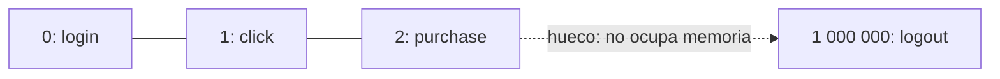

# Redis Arrays

> [!abstract] En 30 segundos
> - **Qué es:** el tipo más reciente de Redis (8.8): una estructura **dispersa** que asocia índices enteros (de 0 a 2⁶⁴−1) con valores string, con acceso directo por índice.
> - **Para qué:** logs indexados por número o tiempo, *ring buffers* de medidas, ventanas deslizantes, datos con índices muy separados.
> - **Recuerda:** a diferencia de una lista, acceder a cualquier índice es O(1) y los huecos no ocupan memoria. Es muy nuevo: verifica el soporte en tu cliente y en tu servicio.

> [!info] Lección 2.10 · Nivel 2 — Estructuras de datos y operaciones avanzadas *(opcional)*
> ⬅️ [[Redis TimeSeries]] · ➡️ [[Transacciones con MULTI, EXEC y WATCH]] · 🗺️ [[01 - Redis - Roadmap#Nivel 2 — Estructuras de datos y operaciones avanzadas|Roadmap]] · 📊 [[03 - Redis - Progreso|Progreso]]
> 🏷️ **≥8.8** (Redis Open Source). No disponible en bases de datos Active-Active. Comprueba si tu servicio gestionado ya lo ofrece.

## 📌 Definición

Un **array** de Redis guarda valores en posiciones numéricas. Puedes escribir en el índice 0 y en el 1 000 000 sin que las posiciones intermedias ocupen memoria.

| Comando | Qué hace |
|---|---|
| `ARSET k índice v1 [v2 …]` | Escribe valores contiguos a partir de un índice |
| `ARGET k índice` | Lee un índice (nil si está vacío) |
| `ARMSET k i1 v1 i2 v2 …` / `ARMGET k i1 i2 …` | Escritura / lectura de índices arbitrarios |
| `ARLEN k` | Longitud lógica: índice máximo + 1 |
| `ARCOUNT k` | Número de elementos no vacíos |
| `ARGETRANGE k ini fin` | Todas las posiciones del rango, con nil en los huecos (máx. 1 000 000 por llamada) |
| `ARSCAN k ini fin` | Solo los elementos existentes, con su índice |
| `ARINSERT k v` / `ARNEXT k` / `ARSEEK k índice` | Inserción secuencial con cursor que avanza solo |
| `ARRING k tamaño v` | Inserta en un *ring buffer* de tamaño fijo (sobrescribe lo más antiguo) |
| `ARLASTITEMS k n [REV]` | Los n últimos insertados |
| `AROP k ini fin SUM/MAX/… / MATCH v` | Agregados sobre un rango |
| `ARGREP k ini fin EXACT/MATCH/GLOB/RE … [AND/OR …] [NOCASE] [WITHVALUES]` | Buscar elementos que cumplen predicados de texto |
| `ARDEL k índice …` / `ARDELRANGE k ini fin` | Borrar por índice o por rango |
| `ARINFO k` | Introspección |

## 🎯 ¿Qué problema resuelve?

- Con una **lista**, leer la posición 500 000 es O(N) y no puedes dejar huecos.
- Con un **hash** con campos numéricos, no hay rangos ni orden.
- Con un **sorted set**, cada elemento paga skiplist y diccionario.
- El array da acceso O(1) por índice, rangos ordenados y huecos gratis: ideal cuando el índice tiene significado (número de secuencia, segundo del día, slot de un buffer circular).

## 🧠 Conceptos fundamentales

1. **Disperso:** `ARLEN` (longitud lógica) puede ser enorme mientras `ARCOUNT` (elementos reales) es pequeño.
2. **Rangos:** `ARGETRANGE` devuelve todas las posiciones (con nil); `ARSCAN`, solo las que existen.
3. **Inserción secuencial:** `ARINSERT` usa un cursor interno que avanza solo; `ARSEEK` lo reposiciona.
4. **Ring buffer:** `ARRING k N v` mantiene los últimos N valores sobrescribiendo los más antiguos; `ARLASTITEMS` los devuelve.
5. **Agregados y búsqueda en el servidor:** `AROP` (suma, máximo, conteo de coincidencias…) y `ARGREP` (búsqueda textual con `EXACT`, `MATCH`, `GLOB` o expresiones regulares) evitan traer los datos a la aplicación.
6. **Complejidad:** la mayoría de comandos por índice son O(1); los de rango (`ARGETRANGE`, `ARSCAN`, `ARDELRANGE`, `AROP`, `ARLASTITEMS`) son O(N).

### Analogía
Un **casillero numerado** de un gimnasio con taquillas del 0 al infinito: puedes abrir directamente la 1 000 000 sin pasar por las demás, y las taquillas que nadie usa no existen físicamente.
**Dónde se rompe:** puedes pedirle al conserje «dime qué hay en las taquillas 100 a 200 que contenga la palabra *error*», algo que ningún casillero real hace.

## ⚙️ Funcionamiento interno

- Usa una codificación de **array troceado** (*sliced array*) que maneja bien tanto patrones densos como dispersos: los grandes huecos entre índices apenas consumen memoria.
- Parámetros de configuración: `array-slice-size`, `array-sparse-kmax`, `array-sparse-kmin`.



## 💻 Ejemplos prácticos

Ejemplos de la documentación oficial:

```text
> ARSET events:1 0 "login" "click" "purchase"
> ARGET events:1 0
> ARGET events:1 999
> ARMSET metrics 0 "10" 5 "20" 100 "30"
> ARMGET metrics 0 5 100 999
> ARSET sparse 0 "a"
> ARSET sparse 1000000 "b"
> ARLEN sparse
> ARCOUNT sparse
> ARINSERT log "event1"
> ARINSERT log "event2"
> ARNEXT log
> ARRING readings 3 "v0"
> ARRING readings 3 "v1"
> ARRING readings 3 "v2"
> ARRING readings 3 "v3"
> ARLASTITEMS readings 3
> ARMSET scores 0 "10" 1 "20" 2 "30"
> AROP scores 0 2 SUM
> AROP scores 0 2 MAX
> ARMSET log 0 "boot: ok" 1 "warn: disk" 2 "ERROR: cpu" 3 "info: ready" 4 "error: net"
> ARGREP log - + MATCH "error" NOCASE
> ARDEL scores 1
```

Qué observar:
- `ARGET events:1 999` devuelve nil: el índice no existe.
- `ARLEN sparse` devuelve 1 000 001 y `ARCOUNT sparse`, 2.
- Tras cuatro `ARRING … 3`, el buffer contiene solo los tres últimos valores.
- `AROP scores 0 2 SUM` suma 10 + 20 + 30 en el servidor.
- `ARGREP … MATCH "error" NOCASE` encuentra «ERROR: cpu» y «error: net»; `-` y `+` son el primer y el último índice.

## 🔧 Implementación en .NET

Comprueba primero si tu versión del cliente ofrece una API tipada; el comando genérico funciona siempre:

```csharp
using StackExchange.Redis;

IDatabase db = mux.GetDatabase();

// Ring buffer de las últimas 1 000 lecturas de un sensor
await db.ExecuteAsync("ARRING", "sensor:7:lecturas", 1000, "21.5");

// Las 10 últimas lecturas
RedisResult last = await db.ExecuteAsync("ARLASTITEMS", "sensor:7:lecturas", 10);
foreach (RedisResult item in (RedisResult[])last!)
    Console.WriteLine(item);

// Evento indexado por segundo del día
int second = (int)DateTime.UtcNow.TimeOfDay.TotalSeconds;
await db.ExecuteAsync("ARSET", $"eventos:{DateTime.UtcNow:yyyyMMdd}", second, "pico de tráfico");
```

## 🏗️ Casos de uso en arquitectura

| Caso | Por qué un array |
|---|---|
| Últimas N medidas de un sensor | `ARRING` + `ARLASTITEMS` |
| Log con número de secuencia | Acceso O(1) por número y rangos |
| Datos por segundo, minuto o slot | El índice es el tiempo; los huecos no cuestan |
| Búsqueda de texto en logs recientes | `ARGREP` en el servidor |

### Cuándo NO usarlo
- Inserciones entre elementos o colas por los extremos: [[Redis Lists]].
- Acceso por nombre de campo: [[Redis Hashes]].
- Log con consumer groups y ACK: [[Redis Streams]].
- Necesitas compatibilidad con servicios gestionados que aún no lo soportan, con Active-Active o con Valkey.

### Consideraciones de arquitectura

| Dimensión | Qué pensar |
|---|---|
| Madurez | Tipo nuevo (8.8): menos ecosistema y soporte en clientes |
| Portabilidad | Solo Redis 8.8+; no en Active-Active |
| Rendimiento | Comandos de rango O(N): acota los rangos |

## ⚠️ Errores y anti-patterns

| Error | Por qué duele | Cómo evitarlo |
|---|---|---|
| Adoptarlo sin comprobar el soporte del servicio gestionado | Comandos desconocidos en producción | Verificar versión y compatibilidad |
| `ARGETRANGE` de rangos enormes | O(N) y respuestas grandes (límite de 1 000 000) | `ARSCAN` o rangos acotados |
| Usarlo como cola | No es su modelo | Listas o Streams |

## ✅ Buenas prácticas

1. Úsalo cuando el índice numérico tenga significado propio.
2. `ARRING` para buffers acotados.
3. Agrega y busca en el servidor con `AROP` y `ARGREP`.
4. Encapsula los comandos para poder cambiar de estructura si tu plataforma no lo soporta.

## 🎤 Preguntas de entrevista

> [!question]- 1. ¿En qué se diferencia un array de Redis de una lista?
> En el array accedes a cualquier índice en O(1) y puedes dejar huecos que no ocupan memoria; en la lista, el acceso por posición es O(N), no hay huecos y su fuerte son las operaciones en los extremos.

> [!question]- 2. ¿Cómo mantendrías las últimas 1 000 lecturas de un sensor?
> En Redis 8.8+, `ARRING sensor:7 1000 valor` y `ARLASTITEMS`. En versiones anteriores, `LPUSH` + `LTRIM 0 999` sobre una lista.

## 🧪 Ejercicios

### 🟢 Básicos
1. Ejecuta los ejemplos y explica la diferencia entre `ARLEN` y `ARCOUNT`.

### 🟡 Intermedios
2. Implementa un ring buffer de 100 medidas con `ARRING` y calcula el máximo con `AROP`.

### 🔴 Reto Senior
3. Compara para «últimas 1 000 medidas por sensor» las opciones lista + `LTRIM`, sorted set por timestamp, stream con `MAXLEN` y array con `ARRING`: memoria, comandos, portabilidad.

> [!success]- Soluciones
> **3.** Lista: portable y simple, sin agregados en servidor. Sorted set: rangos por tiempo, más memoria. Stream: histórico con IDs temporales y consumidores, recorte aproximado. Array: acceso O(1), agregados (`AROP`) y búsqueda (`ARGREP`) en el servidor, pero solo Redis 8.8+.

### ✔️ Checklist de dominio
- [ ] Conozco los comandos principales y su complejidad.
- [ ] Sé cuándo un array mejora a lista, hash o zset.
- [ ] Sé sus limitaciones de versión y distribución.

## 📝 Resumen

- Array = índices enteros dispersos → valores string, acceso O(1).
- `ARRING` para buffers circulares; `AROP`/`ARGREP` para agregar y buscar en el servidor.
- Huecos gratis; `ARLEN` ≠ `ARCOUNT`.
- Redis 8.8+, no en Active-Active: comprueba tu plataforma.

## 🔗 Referencias

- [Redis arrays](https://redis.io/docs/latest/develop/data-types/arrays/)
- [Redis Open Source 8.8 release notes](https://redis.io/docs/latest/operate/oss_and_stack/stack-with-enterprise/release-notes/redisce/redisos-8.8-release-notes/)

## 🔄 Notas relacionadas

- ⬅️ [[Redis TimeSeries]] · ➡️ [[Transacciones con MULTI, EXEC y WATCH]]
- Relacionadas: [[Redis Lists]] · [[Redis Streams]] · [[Redis Sorted Sets]]
