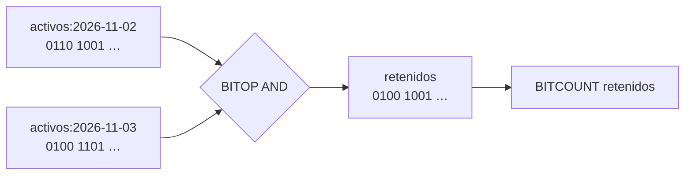

# Redis Bitmaps y Bitfields

> [!abstract] En 30 segundos
> - **Qué es:** operaciones a nivel de bit sobre un string. Un **bitmap** usa cada bit como un sí/no; un **bitfield** empaqueta varios enteros de ancho arbitrario en el mismo string.
> - **Para qué:** flags por usuario, usuarios activos por día, cohortes de retención, contadores empaquetados.
> - **Recuerda:** funciona con IDs **enteros y densos** (1, 2, 3…). 10 millones de usuarios = 10 millones de bits ≈ 1,25 MB por bitmap.

> [!info] Lección 2.2 · Nivel 2 — Estructuras de datos y operaciones avanzadas
> ⬅️ [[Codificaciones internas de los tipos de datos]] · ➡️ [[Redis HyperLogLog]] · 🗺️ [[01 - Redis - Roadmap#Nivel 2 — Estructuras de datos y operaciones avanzadas|Roadmap]] · 📊 [[03 - Redis - Progreso|Progreso]]
> 🏷️ Core · `BITCOUNT`/`BITPOS` con `BIT` ≥7.0 · `BITFIELD_RO` ≥6.2 · operadores `DIFF`, `DIFF1`, `ANDOR`, `ONE` de `BITOP` ≥8.2.

## 📌 Definición

Los bitmaps no son un tipo propio: son **strings** sobre los que se opera bit a bit. El bit en la posición `n` representa el elemento `n` (por ejemplo, el usuario con ID `n`). El offset máximo es 2³² − 1, porque un string tiene como máximo 512 MB.

Los **bitfields** (`BITFIELD`) leen, escriben e incrementan enteros con o sin signo de 1 a 64 bits (63 sin signo) en posiciones arbitrarias del string, con control de desbordamiento.

## 🎯 ¿Qué problema resuelve?

«¿Cuántos usuarios distintos se conectaron hoy?», «¿cuántos de los que se registraron el lunes volvieron el viernes?». Con sets necesitarías un elemento por usuario (decenas de bytes cada uno); con bitmaps, **un bit**. Y las intersecciones y uniones se hacen con `BITOP` en el servidor a velocidad de memoria.

## 🧠 Conceptos fundamentales

| Comando | Qué hace | Complejidad |
|---|---|---|
| `SETBIT k offset 0/1` | Pone un bit; devuelve el valor anterior | O(1) |
| `GETBIT k offset` | Lee un bit | O(1) |
| `BITCOUNT k [ini fin [BYTE/BIT]]` | Cuenta bits a 1 | O(N) |
| `BITPOS k bit [ini [fin [BYTE/BIT]]]` | Primer bit con valor 0 o 1 | O(N) |
| `BITOP op destino k1 k2 …` | Operación entre bitmaps, guarda el resultado | O(N) |
| `BITFIELD k [GET tipo off] [SET tipo off v] [INCRBY tipo off inc] [OVERFLOW WRAP/SAT/FAIL]` | Enteros empaquetados | O(1) por subcomando |
| `BITFIELD_RO k GET …` | Solo lectura (útil en réplicas) | O(1) por subcomando |

**Operadores de `BITOP`:**

| Operador | Resultado: bit a 1 si… | Versión |
|---|---|---|
| `AND` | está en todos | Core |
| `OR` | está en al menos uno | Core |
| `XOR` | difiere (normalmente entre dos) | Core |
| `NOT` | es 0 en el único origen | Core |
| `DIFF X Y1 …` | está en X pero en ninguno de los Y | ≥8.2 |
| `DIFF1 X Y1 …` | está en algún Y pero no en X | ≥8.2 |
| `ANDOR X Y1 …` | está en X y en al menos uno de los Y | ≥8.2 |
| `ONE X1 X2 …` | está exactamente en uno | ≥8.2 |

**Tipos de `BITFIELD`:** `i8`, `u8`, `i16`… hasta `i64` y `u63`. Con `#n` como offset, se cuenta en unidades del tipo (`GET u8 #3` = el cuarto byte).

### Analogía
Un bitmap es un **tablero de luces** con una bombilla por usuario: encendida = estuvo activo hoy. Contar luces encendidas, o comparar dos tableros para ver qué bombillas están encendidas en ambos, es inmediato.
**Dónde se rompe:** si tus usuarios tienen IDs como `9f1c-…` (UUID) no hay forma de asignarles una bombilla sin una tabla de correspondencia con IDs enteros.

## ⚙️ Funcionamiento interno

- Un `SETBIT` en el offset 8 000 000 hace crecer el string hasta ~1 MB (los bytes intermedios se rellenan con ceros). Para IDs muy dispersos, eso desperdicia memoria.
- `BITCOUNT` y `BITOP` recorren el string a velocidad de memoria (Redis 8.2 y 8.4 añadieron optimizaciones SIMD), pero siguen siendo O(N): sobre bitmaps de cientos de MB, mejor en una réplica.
- Strings de distinta longitud en `BITOP` se tratan como si estuvieran rellenos de ceros.



## 💻 Ejemplos prácticos

**Usuarios activos por día y retención:**

```text
127.0.0.1:6379> SETBIT activos:2026-11-02 42 1
(integer) 0
127.0.0.1:6379> SETBIT activos:2026-11-02 7 1
(integer) 0
127.0.0.1:6379> SETBIT activos:2026-11-03 42 1
(integer) 0
127.0.0.1:6379> BITCOUNT activos:2026-11-02
(integer) 2
127.0.0.1:6379> BITOP AND retenidos activos:2026-11-02 activos:2026-11-03
(integer) 6
127.0.0.1:6379> BITCOUNT retenidos
(integer) 1
127.0.0.1:6379> BITOP DIFF perdidos activos:2026-11-02 activos:2026-11-03
(integer) 6
127.0.0.1:6379> BITCOUNT perdidos
(integer) 1                     # el usuario 7 estuvo el día 2 y no el 3
```

**Flags por usuario** (bit 42 = usuario 42 tiene la beta activada):

```text
SETBIT feature:nuevo-checkout 42 1
GETBIT feature:nuevo-checkout 42
```

**Contadores empaquetados con `BITFIELD`** (24 contadores horarios de 16 bits en una sola clave):

```text
127.0.0.1:6379> BITFIELD visitas:producto:42:2026-11-03 INCRBY u16 #14 1
1) (integer) 1
127.0.0.1:6379> BITFIELD visitas:producto:42:2026-11-03 OVERFLOW SAT INCRBY u16 #14 70000
1) (integer) 65535              # saturado en el máximo de u16
127.0.0.1:6379> BITFIELD_RO visitas:producto:42:2026-11-03 GET u16 #14 GET u16 #15
1) (integer) 65535
2) (integer) 0
```

## 🔧 Implementación en .NET

```csharp
using StackExchange.Redis;

IDatabase db = mux.GetDatabase();
string today = $"activos:{DateTime.UtcNow:yyyy-MM-dd}";
string yesterday = $"activos:{DateTime.UtcNow.AddDays(-1):yyyy-MM-dd}";

// Marcar al usuario 42 como activo hoy (el ID debe ser un entero denso)
await db.StringSetBitAsync(today, 42, true);
await db.KeyExpireAsync(today, TimeSpan.FromDays(35), ExpireWhen.HasNoExpiry);

// ¿Estuvo activo?
bool active = await db.StringGetBitAsync(today, 42);

// Activos hoy y retenidos respecto a ayer
long dau = await db.StringBitCountAsync(today);
await db.StringBitOperationAsync(Bitwise.And, "retenidos:tmp", new RedisKey[] { yesterday, today });
long retained = await db.StringBitCountAsync("retenidos:tmp");

// Operadores de 8.2 con el comando genérico
await db.ExecuteAsync("BITOP", "DIFF", "perdidos:tmp", (RedisKey)yesterday, (RedisKey)today);
```

## 🏗️ Casos de uso en arquitectura

| Caso | Diseño |
|---|---|
| DAU/WAU/MAU exactos | Un bitmap por día; `BITOP OR` para semanas/meses |
| Retención por cohortes | `BITOP AND` entre el día de registro y días posteriores |
| Feature flags por usuario | Un bitmap por funcionalidad |
| Asistencia o presencia por franja | Bit por franja horaria dentro de un string por día |
| Contadores pequeños y numerosos | `BITFIELD` con enteros de 8-16 bits |

### Cuándo NO usarlo
- IDs no enteros o muy dispersos (UUID, IDs de 64 bits aleatorios): el bitmap sería enorme o imposible.
- Cuando basta una aproximación de usuarios únicos y los IDs no son densos: [[Redis HyperLogLog]].
- Cuando necesitas saber **quiénes** cumplen una condición compleja de forma frecuente: el [[Redis Query Engine]] o una base analítica.

### Consideraciones de arquitectura

| Dimensión | Qué pensar |
|---|---|
| Memoria | Proporcional al **ID máximo**, no al número de usuarios |
| Rendimiento | `BITOP`/`BITCOUNT` son O(N): sobre bitmaps grandes, en réplicas o en horas valle |
| Cluster | `BITOP` exige que todas las claves estén en el mismo slot |
| Privacidad | Un bitmap por funcionalidad o por día es un dato agregado, pero sigue siendo dato de comportamiento |

## ⚠️ Errores y anti-patterns

| Error | Por qué duele | Cómo evitarlo |
|---|---|---|
| Usar un ID de 64 bits como offset | Offset fuera de rango o string gigante | Mapear a IDs enteros densos |
| `BITOP` sobre años de bitmaps en caliente | Bloqueo O(N) | Precalcular, réplicas, horas valle |
| Bitmaps sin TTL | Crecen sin fin por días | TTL por clave diaria |
| `BITFIELD` sin `OVERFLOW` pensado | Valores que dan la vuelta (`WRAP` por defecto) | `SAT` o `FAIL` según el caso |

## ✅ Buenas prácticas

1. IDs densos (autoincrementales) como offset.
2. Una clave por periodo, con TTL.
3. Operaciones pesadas fuera del camino caliente.
4. `BITFIELD` con el tipo más pequeño suficiente y política de desbordamiento explícita.

## 🎤 Preguntas de entrevista

> [!question]- 1. ¿Cómo calcularías usuarios activos diarios y retención para 50 millones de usuarios?
> Un bitmap por día donde el bit N es el usuario con ID N (~6 MB por día). DAU = `BITCOUNT`. Retención entre dos días = `BITOP AND` y `BITCOUNT`. Semanas o meses con `BITOP OR`. Requiere IDs enteros densos.

> [!question]- 2. ¿Bitmap, set o HyperLogLog para contar usuarios únicos?
> Bitmap si los IDs son enteros densos y necesito exactitud y operaciones entre periodos (memoria fija por ID máximo). Set si necesito exactitud y los IDs son arbitrarios (memoria por elemento). HyperLogLog si basta una aproximación con ~12 KB fijos.

> [!question]- 3. ¿Qué aporta `BITOP DIFF` de Redis 8.2?
> Calcula en una operación «está en X pero en ninguno de los Y», por ejemplo usuarios que estuvieron ayer y no hoy. Antes requería `NOT` + `AND` con claves intermedias.

## 🧪 Ejercicios

### 🟢 Básicos
1. Marca 5 usuarios activos en dos días y calcula DAU y retención.
2. Usa `BITFIELD` para guardar 24 contadores horarios en una clave.

### 🟡 Intermedios
3. Mide `MEMORY USAGE` de un bitmap con el bit 10 000 000 encendido. Explica el resultado.
4. Calcula «usuarios que vinieron 3 días seguidos» con `BITOP AND` de tres bitmaps.

### 🔴 Reto Senior
5. Tus usuarios tienen IDs GUID. Diseña cómo usar bitmaps igualmente para DAU y retención, y valora el coste de la solución.

> [!success]- Soluciones
> **3.** Unos 1,25 MB: el string crece hasta el byte del bit más alto, aunque solo haya un bit encendido.
> **5.** Asignar a cada GUID un entero denso en una tabla de correspondencia (por ejemplo, `INCR seq:user-index` la primera vez que se ve y un hash `user-index` GUID → entero). Coste: una consulta extra (cacheable) por evento y una tabla con todos los usuarios. Si no compensa, HyperLogLog para DAU y bitmaps solo para cohortes concretas.

### ✔️ Checklist de dominio
- [ ] Uso `SETBIT`, `BITCOUNT`, `BITOP` y `BITFIELD`.
- [ ] Calculo memoria a partir del ID máximo.
- [ ] Sé cuándo elegir bitmap, set o HyperLogLog.
- [ ] Conozco los operadores nuevos de 8.2.

## 📝 Resumen

- Bitmaps = strings tratados como arrays de bits; un bit por elemento con ID entero.
- `BITCOUNT` para contar, `BITOP` para combinar (con `DIFF`/`DIFF1`/`ANDOR`/`ONE` desde 8.2).
- `BITFIELD` empaqueta enteros pequeños con control de desbordamiento.
- Memoria proporcional al ID máximo: necesitas IDs densos.
- Operaciones O(N): cuidado con bitmaps enormes.

## 🔗 Referencias

- [Redis bitmaps](https://redis.io/docs/latest/develop/data-types/strings/bitmaps/)
- [Redis bitfields](https://redis.io/docs/latest/develop/data-types/strings/bitfields/)
- [BITOP](https://redis.io/docs/latest/commands/bitop/)

## 🔄 Notas relacionadas

- ⬅️ [[Codificaciones internas de los tipos de datos]] · ➡️ [[Redis HyperLogLog]]
- Relacionadas: [[Redis Sets]] · [[Redis HyperLogLog]] · [[Redis Strings]]
