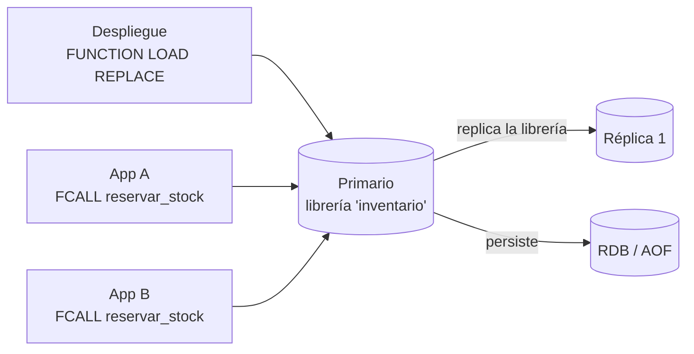

# Redis Functions

> [!abstract] En 30 segundos
> - **Qué es:** la evolución de los scripts: **librerías Lua con nombre** que se cargan en el servidor, se persisten y se replican, y se invocan con `FCALL`.
> - **Para qué:** compartir lógica atómica entre aplicaciones sin reenviar el código en cada petición ni sufrir `NOSCRIPT`.
> - **Recuerda:** se despliegan como parte de la infraestructura (como una migración), no como parte de la petición.

> [!info] Lección 2.14 · Nivel 2 — Estructuras de datos y operaciones avanzadas
> ⬅️ [[Lua scripting en Redis]] · ➡️ [[Modelado de datos en Redis]] · 🗺️ [[01 - Redis - Roadmap#Nivel 2 — Estructuras de datos y operaciones avanzadas|Roadmap]] · 📊 [[03 - Redis - Progreso|Progreso]]
> 🏷️ ≥7.0 · Valkey compatible · comprueba la compatibilidad en tu servicio gestionado antes de depender de ellas.

## 📌 Definición

Una **función** es un callback Lua registrado dentro de una **librería** con `redis.register_function`. La librería se carga con `FUNCTION LOAD`, se guarda en el servidor y se llama con `FCALL nombre numkeys key… arg…`. Cada librería tiene un nombre declarado en su primera línea: `#!lua name=mi_libreria`.

| Comando | Qué hace |
|---|---|
| `FUNCTION LOAD [REPLACE] código` | Carga (o reemplaza) una librería |
| `FCALL f numkeys key… arg…` / `FCALL_RO` | Invoca una función / una función de solo lectura |
| `FUNCTION LIST [WITHCODE]` | Lista librerías |
| `FUNCTION DELETE lib` / `FUNCTION FLUSH` | Elimina |
| `FUNCTION DUMP` / `FUNCTION RESTORE` | Copia de seguridad y restauración |
| `FUNCTION STATS` / `FUNCTION KILL` | Estado y cancelación de la función en ejecución |

## 🎯 ¿Qué problema resuelve?

Los scripts `EVAL` son parte de la aplicación: cada cliente envía su código, la caché es volátil, los scripts no se pueden listar ni versionar en el servidor y no hay forma de que varias aplicaciones compartan una misma implementación. Las Functions son **datos del servidor**: persisten en RDB/AOF, se replican, sobreviven a reinicios y a *failovers*, y se invocan por nombre.

## 🧠 Conceptos fundamentales

1. **Librería:** unidad de carga; puede registrar varias funciones.
2. **Registro:** `redis.register_function('nombre', callback)` o con tabla y flags.
3. **Flags de función:** `no-writes`, `allow-oom`, `allow-stale`, `no-cluster`, `allow-cross-slot-keys`.
4. **Mismas reglas que Lua:** `KEYS`/`ARGV`, atomicidad, bloqueo mientras se ejecuta, límites de tiempo, conversión de tipos.
5. **Ciclo de vida:** se despliegan con `FUNCTION LOAD REPLACE` en un paso de despliegue; se versionan con el nombre (`reservar_v2`) o con el despliegue.

| | `EVAL` | Functions |
|---|---|---|
| Dónde vive el código | En el cliente | En el servidor |
| Persistencia | No (caché) | Sí (RDB/AOF) |
| Replicación | Efectos de escritura | Librería y efectos |
| `NOSCRIPT` | Posible | No existe |
| Invocación | SHA1 o código | Nombre |

### Analogía
Los scripts `EVAL` son **notas adhesivas** que cada cliente lleva en el bolsillo; las Functions son **procedimientos almacenados** colgados en la pared de la cocina con un nombre.
**Dónde se rompe:** si cambias un procedimiento de la pared, todos los cocineros lo notan al instante, también los que usaban la versión vieja.

## ⚙️ Funcionamiento interno



- La librería se compila al cargarla: los errores de sintaxis se detectan en el `FUNCTION LOAD`, no en tiempo de ejecución.
- `FUNCTION DUMP`/`RESTORE` permiten llevar las librerías a otro entorno.

## 💻 Ejemplos prácticos

```lua
#!lua name=inventario

local function reservar(keys, args)
  local stock = tonumber(redis.call('GET', keys[1]) or '0')
  local qty = tonumber(args[1])
  if stock >= qty then
    redis.call('DECRBY', keys[1], qty)
    return 1
  end
  return 0
end

redis.register_function('reservar_stock', reservar)

redis.register_function{
  function_name = 'stock_actual',
  callback = function(keys, args) return redis.call('GET', keys[1]) end,
  flags = { 'no-writes' }
}
```

```bash
# -x lee el último argumento desde la entrada estándar
redis-cli -x FUNCTION LOAD REPLACE < inventario.lua
redis-cli SET stock:sku-1 5
redis-cli FCALL reservar_stock 1 stock:sku-1 2
redis-cli FCALL_RO stock_actual 1 stock:sku-1
redis-cli FUNCTION LIST
```

## 🔧 Implementación en .NET

```csharp
using StackExchange.Redis;

IDatabase db = mux.GetDatabase();

// Despliegue (paso de arranque o migración): carga o reemplaza la librería
string codigo = await File.ReadAllTextAsync("inventario.lua");
await db.ExecuteAsync("FUNCTION", "LOAD", "REPLACE", codigo);

// Uso: invocar por nombre
RedisResult r = await db.ExecuteAsync("FCALL", "reservar_stock", 1, "stock:sku-1", 2);
bool reservado = (int)r == 1;
```

> [!note]
> StackExchange.Redis no necesita una API específica: `ExecuteAsync` envía cualquier comando. Cuando se invoca de forma genérica, el cliente no puede deducir en qué nodo de un Cluster ejecutar `FCALL` a partir de las claves, así que en Cluster comprueba el comportamiento de tu versión o usa un wrapper que enrute por la clave.

## 🏗️ Casos de uso en arquitectura

| Caso | Por qué Functions |
|---|---|
| Varias aplicaciones (o lenguajes) comparten la misma lógica atómica | Una sola implementación en el servidor |
| Entornos con muchos reinicios o failovers | Sin `NOSCRIPT` |
| Gobernanza de cambios | Despliegue controlado de la librería |

### Cuándo NO usarlas
- Lógica que cambia a cada despliegue de la aplicación y quieres versionar junto al código: `EVAL` o `LuaScript` es más simple.
- Servicios gestionados sin soporte.

### Consideraciones de arquitectura

| Dimensión | Qué pensar |
|---|---|
| Despliegue | `FUNCTION LOAD REPLACE` en cada nodo primario (Cluster: en todos los shards) |
| Compatibilidad | Nombre versionado para convivir con la versión anterior durante un despliegue gradual |
| Pruebas | Pruebas de integración contra Redis real |

## ⚠️ Errores y anti-patterns

| Error | Por qué duele | Cómo evitarlo |
|---|---|---|
| Reemplazar una función con otra firma | Las apps antiguas fallan | Versionar el nombre y retirar la antigua después |
| Cargar solo en un shard de Cluster | `FCALL` falla en los demás | Desplegar en todos los primarios |
| Lógica de negocio compleja en la librería | Difícil de probar y depurar | Mantenerla mínima y atómica |
| No controlar el tamaño del trabajo | Bloquea el servidor | Mismas reglas que Lua |

## ✅ Buenas prácticas

1. Librerías pequeñas, con nombre y con flags correctos (`no-writes` en lecturas).
2. Despliegue como paso automatizado e idempotente (`REPLACE`).
3. Versiona nombres de función para despliegues sin interrupción.
4. Guarda el código `.lua` en tu repositorio y pruébalo con Testcontainers.

## 🎤 Preguntas de entrevista

> [!question]- 1. ¿Qué ventaja tienen las Functions sobre `EVAL`?
> Persisten y se replican con los datos, tienen nombre, se pueden listar y compartir entre aplicaciones, y evitan `NOSCRIPT` y el reenvío del código en cada petición.

> [!question]- 2. ¿Cómo desplegarías una nueva versión de una función sin romper la anterior?
> Registrando la nueva con otro nombre (`reservar_v2`), desplegando la aplicación que la usa y retirando la antigua cuando ya nadie la llama.

## 🧪 Ejercicios

### 🟢 Básicos
1. Carga una librería con dos funciones y llámalas con `FCALL`.
2. Prueba `FUNCTION DUMP` y `FUNCTION RESTORE` en otra instancia.

### 🟡 Intermedios
3. Escribe un paso de arranque en .NET que cargue la librería con `REPLACE` y verifique con `FUNCTION LIST`.

### 🔴 Reto Senior
4. Diseña el despliegue de una función con cambio incompatible en un Cluster con 3 shards y 20 instancias de aplicación, sin interrupción.

> [!success]- Soluciones
> **4.** Cargar `funcion_v2` en los 3 primarios (verificar con `FUNCTION LIST`), desplegar progresivamente la aplicación que llama a `v2`, comprobar que no quedan llamadas a `v1` (métricas o `COMMANDSTATS`) y eliminar `v1`. Un fallo se revierte volviendo a la versión anterior de la aplicación, porque `v1` sigue existiendo.

### ✔️ Checklist de dominio
- [ ] Cargo y llamo funciones.
- [ ] Sé cuándo elegir Functions o `EVAL`.
- [ ] Diseño un despliegue versionado.

## 📝 Resumen

- Functions = librerías Lua persistentes, replicadas y con nombre.
- Se despliegan con `FUNCTION LOAD REPLACE` y se llaman con `FCALL`.
- Mismas reglas de atomicidad y de bloqueo que Lua.
- Versiona nombres y despliega en todos los shards.

## 🔗 Referencias

- [Redis Functions](https://redis.io/docs/latest/develop/programmability/functions-intro/)
- [FUNCTION LOAD](https://redis.io/docs/latest/commands/function-load/)

## 🔄 Notas relacionadas

- ⬅️ [[Lua scripting en Redis]] · ➡️ [[Modelado de datos en Redis]]
- Relacionadas: [[Redis Cluster]] · [[Testing con Redis y Testcontainers]]
