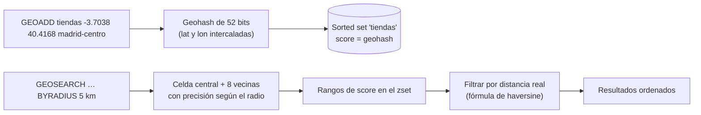

# Redis Geospatial

> [!abstract] En 30 segundos
> - **Qué es:** un índice geográfico construido sobre un sorted set: guardas puntos (longitud, latitud) con un nombre y buscas por radio o por rectángulo.
> - **Para qué:** «tiendas a menos de 5 km», «repartidores cerca del pedido», distancias entre puntos.
> - **Recuerda:** el orden de los argumentos es **longitud, latitud**. `GEOSEARCH` (≥6.2) sustituye a `GEORADIUS`. Los puntos no caducan uno a uno.

> [!info] Lección 2.4 · Nivel 2 — Estructuras de datos y operaciones avanzadas
> ⬅️ [[Redis HyperLogLog]] · ➡️ [[Redis Streams]] · 🗺️ [[01 - Redis - Roadmap#Nivel 2 — Estructuras de datos y operaciones avanzadas|Roadmap]] · 📊 [[03 - Redis - Progreso|Progreso]]
> 🏷️ Core (≥3.2) · `GEOSEARCH`/`GEOSEARCHSTORE` y `GEOADD NX/XX/CH` ≥6.2 · `GEORADIUS*` obsoletos.

## 📌 Definición

| Comando | Qué hace | Complejidad |
|---|---|---|
| `GEOADD k [NX/XX] [CH] lon lat miembro …` | Añade o actualiza posiciones | O(log N) por punto |
| `GEOPOS k m …` | Coordenadas de miembros | O(1) por miembro |
| `GEODIST k m1 m2 [m/km/mi/ft]` | Distancia entre dos miembros | O(1) |
| `GEOHASH k m …` | Geohash estándar de 11 caracteres | O(1) por miembro |
| `GEOSEARCH k FROMMEMBER m / FROMLONLAT lon lat BYRADIUS r unidad / BYBOX ancho alto unidad [ASC/DESC] [COUNT n [ANY]] [WITHCOORD] [WITHDIST] [WITHHASH]` | Búsqueda por radio o caja | O(N + log M) |
| `GEOSEARCHSTORE destino origen … [STOREDIST]` | Igual, guardando el resultado | O(N + log M) |

Límites de coordenadas: longitud de −180 a 180; latitud de −85,05112878 a 85,05112878 (proyección Web Mercator).

## 🎯 ¿Qué problema resuelve?

Buscar puntos cercanos en una base relacional sin extensiones geoespaciales exige calcular distancias a todos los puntos o montar índices complejos. Con Redis, un repartidor actualiza su posición con `GEOADD` cada pocos segundos y la búsqueda «los 10 más cercanos en 3 km» se resuelve en microsegundos sobre millones de puntos.

## 🧠 Conceptos fundamentales

1. **Es un sorted set:** cada punto es un miembro cuyo score es un **geohash de 52 bits** que intercala bits de latitud y longitud. Puedes usar comandos de zset sobre él (`ZREM`, `ZCARD`, `ZRANGE`).
2. **Geohash y cercanía:** puntos cercanos tienden a tener scores cercanos; la búsqueda consulta las celdas vecinas del área y filtra por distancia real.
3. **Modelo esférico:** la distancia se calcula suponiendo una Tierra esférica; la documentación advierte errores de hasta un 0,5 % en casos extremos. Suficiente para «cerca de mí», no para topografía.
4. **`COUNT n ANY`:** devuelve los primeros N que encuentre (más rápido) en lugar de los N más cercanos.
5. **Sin TTL por punto:** un miembro de un zset no caduca solo. Para posiciones que se vuelven obsoletas (repartidores desconectados), necesitas limpieza o particionado temporal.

### Analogía
Un mapa dividido en **casillas numeradas** de forma que las casillas vecinas tienen números parecidos: para buscar alrededor de ti, miras tu casilla y las de alrededor, y luego mides con regla las distancias de lo que encuentres.
**Dónde se rompe:** en los bordes de las casillas, dos puntos muy cercanos pueden tener números muy distintos; Redis lo compensa mirando todas las casillas vecinas.

## ⚙️ Funcionamiento interno



## 💻 Ejemplos prácticos

```text
127.0.0.1:6379> GEOADD tiendas -3.7038 40.4168 sol -3.6883 40.4530 chamartin -3.6800 40.4193 retiro
(integer) 3
127.0.0.1:6379> GEODIST tiendas sol retiro km
"2.0349"
127.0.0.1:6379> GEOSEARCH tiendas FROMLONLAT -3.7000 40.4200 BYRADIUS 3 km ASC WITHDIST
1) 1) "sol"
   2) "0.4799"
2) 1) "retiro"
   2) "1.6959"
127.0.0.1:6379> GEOSEARCH tiendas FROMMEMBER sol BYBOX 10 10 km ASC COUNT 2
1) "sol"
2) "retiro"
```

(Las distancias exactas que veas pueden variar ligeramente en los últimos decimales.)

**Repartidores con posiciones que caducan:** una clave por ventana de tiempo, con TTL.

```text
GEOADD repartidores:202611031015 -3.70 40.42 rider:7
EXPIRE repartidores:202611031015 120
GEOSEARCH repartidores:202611031015 FROMLONLAT -3.70 40.42 BYRADIUS 2 km ASC COUNT 5
```

## 🔧 Implementación en .NET

```csharp
using StackExchange.Redis;

IDatabase db = mux.GetDatabase();

// Alta de tiendas (longitud, latitud, miembro)
await db.GeoAddAsync("tiendas", new GeoEntry[]
{
    new(-3.7038, 40.4168, "sol"),
    new(-3.6883, 40.4530, "chamartin"),
    new(-3.6800, 40.4193, "retiro"),
});

// Las 10 más cercanas a una posición, en un radio de 3 km, con distancia
GeoRadiusResult[] near = await db.GeoSearchAsync(
    "tiendas",
    longitude: -3.7000, latitude: 40.4200,
    shape: new GeoSearchCircle(3, GeoUnit.Kilometers),
    count: 10,
    order: Order.Ascending,
    options: GeoRadiusOptions.WithDistance);

foreach (GeoRadiusResult r in near)
    Console.WriteLine($"{r.Member}: {r.Distance:F2} km");

// Distancia entre dos miembros
double? km = await db.GeoDistanceAsync("tiendas", "sol", "retiro", GeoUnit.Kilometers);
```

## 🏗️ Casos de uso en arquitectura

| Caso | Diseño |
|---|---|
| Tiendas o puntos de interés cercanos | Un índice geo estático por tipo de punto |
| Flotas en movimiento | Índice por ventana de tiempo con TTL, o limpieza de inactivos con un zset de «última señal» |
| Geofencing simple | `GEOSEARCH` desde el punto con el radio de la zona |
| Emparejamiento conductor-pasajero | Búsqueda por radio creciente (1, 3, 5 km) hasta encontrar candidatos |

### Cuándo NO usarlo
- Polígonos, rutas, intersecciones de áreas o consultas espaciales complejas: PostGIS o un motor geoespacial.
- Precisión topográfica o de navegación.
- Combinar geografía con muchos filtros de atributos: el [[Redis Query Engine]] admite campos `GEO` junto a otros filtros.

### Consideraciones de arquitectura

| Dimensión | Qué pensar |
|---|---|
| Frescura | Posiciones viejas devuelven resultados falsos: estrategia de caducidad |
| Escalabilidad | Un índice global es una sola clave en un shard: fragmenta por ciudad o región |
| Escrituras | Muchos `GEOADD` por segundo sobre la misma clave = hot key |
| Precisión | Error de hasta 0,5 % por el modelo esférico |

## ⚠️ Errores y anti-patterns

| Error | Por qué duele | Cómo evitarlo |
|---|---|---|
| Pasar latitud antes que longitud | Puntos en el lugar equivocado o error de rango | Siempre `lon lat` |
| Usar `GEORADIUS` en código nuevo | Obsoleto | `GEOSEARCH` |
| Índice global de todos los repartidores del mundo | Big key y hot key | Fragmentar por zona |
| Esperar que un punto caduque solo | Repartidores «fantasma» | Claves por ventana con TTL o limpieza |

## ✅ Buenas prácticas

1. Fragmenta los índices por ciudad o región.
2. Para datos en movimiento, claves por ventana temporal con TTL.
3. `COUNT` siempre en las búsquedas; `ANY` si no necesitas los más cercanos exactos.
4. Valida rangos de coordenadas en la entrada.

## 🎤 Preguntas de entrevista

> [!question]- 1. ¿Cómo implementa Redis las búsquedas geográficas?
> Sobre un sorted set cuyo score es un geohash de 52 bits. Para buscar por radio calcula las celdas del área (la central y sus vecinas), consulta esos rangos de score y filtra por la distancia real.

> [!question]- 2. Diseña «repartidores cercanos» para una ciudad con 20 000 repartidores que envían su posición cada 5 segundos.
> Un índice geo por ciudad y ventana de tiempo (por ejemplo, cada minuto) con TTL corto, o un índice por ciudad más un zset `ultima-señal` con el timestamp para limpiar inactivos con `ZRANGE … BYSCORE` + `ZREM`. Búsqueda con `GEOSEARCH … BYRADIUS … COUNT n`. 4 000 escrituras/s por ciudad son asumibles; si crece, se fragmenta por zonas.

> [!question]- 3. ¿Qué limitaciones tiene?
> Solo puntos (no polígonos), modelo esférico con error de hasta 0,5 %, latitudes limitadas a ±85,05°, sin TTL por punto y un índice vive en un único shard.

## 🧪 Ejercicios

### 🟢 Básicos
1. Carga 10 puntos de tu ciudad y busca los 3 más cercanos a una dirección.
2. Calcula la distancia entre dos puntos en km y en metros.

### 🟡 Intermedios
3. Implementa en .NET la búsqueda por radio creciente (1, 3, 5 km) hasta encontrar al menos 3 resultados.
4. Implementa la limpieza de repartidores inactivos con un zset de última señal.

### 🔴 Reto Senior
5. Diseña la búsqueda de «restaurantes abiertos ahora, con valoración ≥ 4, a menos de 2 km». ¿Lo harías solo con geo + sets o con el Query Engine? Justifica.

> [!success]- Soluciones
> **4.** En cada señal: `GEOADD` + `ZADD ultima-señal ahora rider`. Un job: `ZRANGE ultima-señal -inf (ahora-60) BYSCORE`, y para cada uno `ZREM` del índice geo y de `ultima-señal` (el índice geo es un zset).
> **5.** Con geo + sets: `GEOSEARCHSTORE` a una clave temporal y luego intersecar con sets de «abiertos» y «valoración ≥ 4» (vía `ZINTERSTORE`, porque el resultado geo es un zset). Funciona, pero mantener los índices de «abierto ahora» y combinar filtros se complica. Con el Query Engine, un índice con campos `GEO`, `NUMERIC` (valoración) y `TAG` (abierto) resuelve todo en una consulta.

### ✔️ Checklist de dominio
- [ ] Uso `GEOADD`, `GEOSEARCH`, `GEODIST` con el orden correcto de coordenadas.
- [ ] Explico el geohash sobre sorted set.
- [ ] Sé gestionar la caducidad de posiciones.
- [ ] Conozco las limitaciones y las alternativas.

## 📝 Resumen

- Índice geo = sorted set con score geohash de 52 bits.
- `GEOSEARCH` por radio o caja, con distancia y orden.
- Longitud antes que latitud; latitud hasta ±85,05°.
- Sin TTL por punto: claves por ventana o limpieza.
- Para geometrías complejas, PostGIS; para geo + filtros, Query Engine.

## 🔗 Referencias

- [Redis geospatial](https://redis.io/docs/latest/develop/data-types/geospatial/)
- [GEOSEARCH](https://redis.io/docs/latest/commands/geosearch/)
- [GEOADD](https://redis.io/docs/latest/commands/geoadd/)

## 🔄 Notas relacionadas

- ⬅️ [[Redis HyperLogLog]] · ➡️ [[Redis Streams]]
- Relacionadas: [[Redis Sorted Sets]] · [[Redis Query Engine]] · [[Diseño de sistemas con Redis]]
